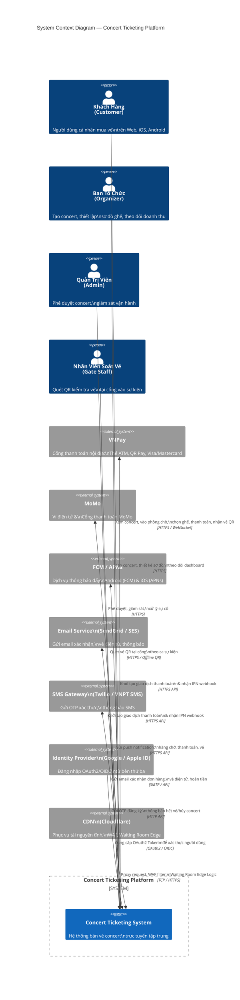
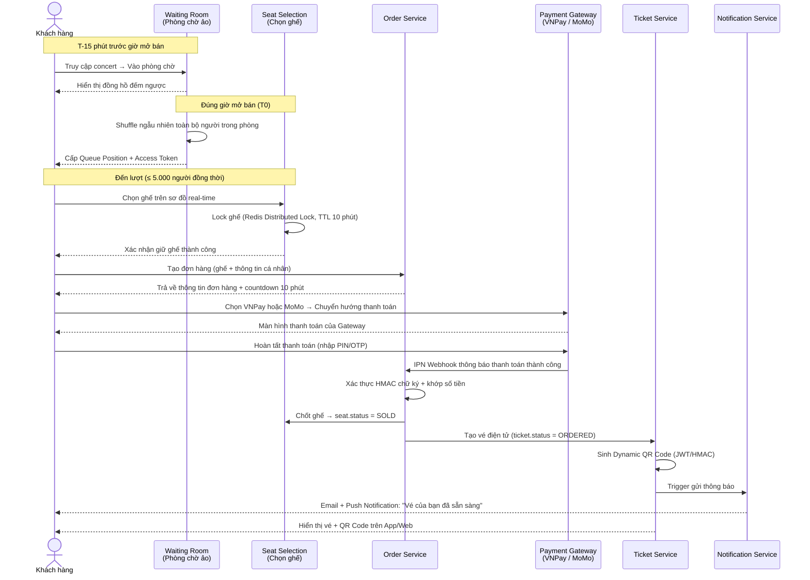
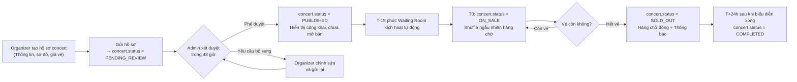
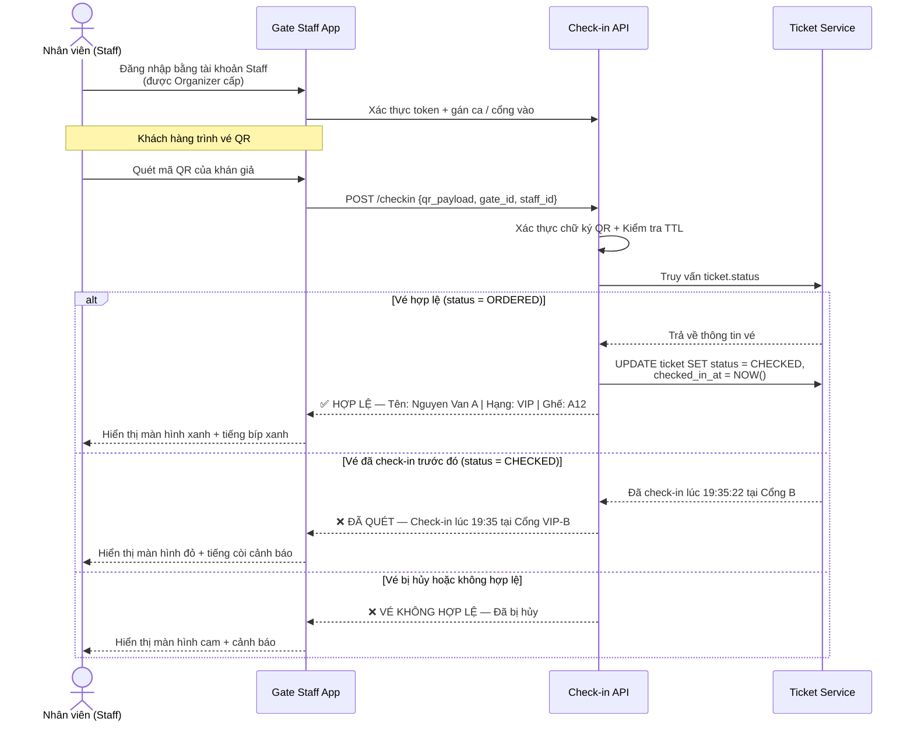
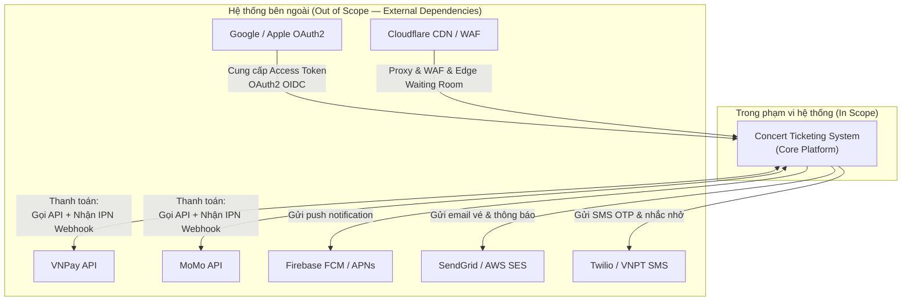

# Bối Cảnh Kinh Doanh & Phạm Vi Hệ Thống (Business Context & System Scope)

## 1. Bối Cảnh Kinh Doanh (Business Context)

### 1.1 Vấn Đề Thị Trường (Market Problem)

Thị trường âm nhạc trực tiếp (Live Entertainment) tại Việt Nam đang bước vào giai đoạn tăng trưởng mạnh sau đại dịch COVID-19. Các sự kiện âm nhạc quy mô lớn — từ concert nghệ sĩ nội địa hàng đầu đến show diễn nghệ sĩ quốc tế — thu hút hàng chục ngàn khán giả tham dự và hàng trăm nghìn người mua vé. Tuy nhiên, hạ tầng bán vé hiện tại đang bộc lộ những vấn đề nghiêm trọng:

| Vấn đề | Biểu hiện thực tế | Hệ quả |
|---|---|---|
| **Quá tải hệ thống tại thời điểm mở bán** | Server sập, trang web không phản hồi trong 5–15 phút đầu khi mở bán | Khách hàng mất vị trí mua vé, trust nền tảng giảm mạnh |
| **Thiếu công bằng trong xếp hàng** | Người biết kỹ thuật dùng bot tự động hoặc F5 liên tục để giành ghế | Bất công với khách hàng thực sự |
| **Trải nghiệm người dùng kém** | Giao diện chậm, không cập nhật sơ đồ ghế thời gian thực | Khách chọn ghế đã bán, bực bội, bỏ giỏ hàng |
| **Vé giả & đầu cơ vé chợ đen** | Mã QR không bảo mật, bị sao chép; một vé nhiều người cùng vào cửa | Thiệt hại doanh thu, kiện cáo pháp lý |
| **Phân mảnh kênh bán vé** | Mỗi concert bán qua các kênh khác nhau (Shopee, MoMo App, trang riêng của BTC) | Không có dữ liệu tập trung, khó quản lý |
| **Thiếu công cụ cho Ban tổ chức** | BTC không có Dashboard real-time, không có công cụ check-in chuyên nghiệp | Lộn xộn tại cổng vào, check-in thủ công chậm chạp |

### 1.2 Lý Do Xây Dựng Hệ Thống (Rationale for Building)

Từ các vấn đề trên, bài toán đặt ra là xây dựng một **nền tảng bán vé concert trực tuyến tập trung, quy mô lớn, công bằng và bảo mật**, với kiến trúc đủ mạnh để phục vụ đồng thời **2 triệu người dùng đăng ký** và chịu được các **đợt traffic đỉnh** (peak load) hàng trăm nghìn request mỗi giây vào thời điểm mở bán.

Hệ thống phải giải quyết được 3 thách thức cốt lõi:
1. **Scalability (Khả năng mở rộng):** Chịu tải đỉnh khi hàng trăm nghìn người đăng nhập cùng lúc.
2. **Fairness (Tính công bằng):** Cơ chế phòng chờ ảo loại bỏ lợi thế của bot và F5 liên tục.
3. **Integrity (Tính toàn vẹn):** Zero double-booking, vé QR mã hóa động chống sao chép.

### 1.3 Mục Tiêu Kinh Doanh Cụ Thể (Business Goals)

| ID | Mục tiêu | Chỉ số đo lường thành công |
|---|---|---|
| BG-01 | Nền tảng bán vé tập trung dành cho thị trường Việt Nam | ≥ 10 concert quy mô lớn (>10,000 vé) mỗi tháng trong năm đầu |
| BG-02 | Đảm bảo công bằng cho khách hàng qua phòng chờ ảo | Tỷ lệ khiếu nại "mua vé không công bằng" < 1% |
| BG-03 | Hệ thống không sập trong đợt mở bán đỉnh | Uptime ≥ 99.95% trong giờ mở bán; P99 latency < 2 giây |
| BG-04 | Zero double-booking | Tỷ lệ lỗi trùng ghế = 0% |
| BG-05 | Vé điện tử bảo mật, chống giả mạo | Tỷ lệ vé giả bị phát hiện qua cổng = 0% |
| BG-06 | Tạo doanh thu nền tảng qua phí dịch vụ | Phí dịch vụ 5–10% trên mỗi vé bán thành công |
| BG-07 | Công cụ vận hành chuyên nghiệp cho Ban tổ chức | BTC tự vận hành được không cần hỗ trợ kỹ thuật trong ngày diễn |

---

## 2. Context Diagram — Ranh Giới Hệ Thống & Các Tác Nhân Bên Ngoài

---

## 3. Mô Tả Tổng Quan Luồng Tương Tác Chính (High-Level Interaction Flows)

### Luồng 1: Khách Hàng → Mua Vé → Nhận Vé QR

### Luồng 2: Ban Tổ Chức → Tạo Concert → Mở Bán

### Luồng 3: Nhân Viên Soát Vé → Check-in tại Cổng

---

## 4. Định Nghĩa Ranh Giới Hệ Thống (System Boundary Definition)

### 4.1 Những gì NẰM TRONG phạm vi hệ thống (In Scope)

| Phạm vi | Mô tả |
|---|---|
| **Phòng chờ ảo & Xếp hàng** | Cơ chế Waiting Room T-15 phút, Shuffle ngẫu nhiên T0, FIFO người đến sau, Giới hạn 5.000 CCU trong khu chọn ghế |
| **Sơ đồ ghế tương tác** | Hiển thị sơ đồ khán phòng thời gian thực, màu sắc phân biệt AVAILABLE/HELD/SOLD/BLOCKED, cập nhật qua WebSocket |
| **Đặt vé & Thanh toán** | Tạo đơn hàng, tích hợp VNPay và MoMo, xử lý IPN webhook, Idempotency Key |
| **Vé điện tử & QR Code** | Phát hành vé tức thì sau thanh toán, Dynamic QR TOTP/JWT, PDF vé gửi email |
| **Check-in cổng vào** | App Staff mobile (iOS/Android), quét QR online/offline, đồng bộ dữ liệu check-in |
| **Quản lý Concert** | Organizer Portal: Tạo concert, thiết kế sơ đồ ghế, giá vé, Dashboard real-time |
| **Phê duyệt & Vận hành** | Admin Dashboard: Phê duyệt concert, giám sát hệ thống, xử lý sự cố |
| **Hoàn tiền & Hủy vé** | Quy trình hủy đơn, hoàn tiền theo chính sách phân bậc, hủy concert hàng loạt |
| **Đánh giá & Nhận xét** | Chức năng review sau concert dành cho khách đã tham dự |
| **Thông báo đa kênh** | Push notification, Email, SMS cho các sự kiện: vé, thanh toán, hủy, nhắc nhở |
| **Báo cáo & Quyết toán** | Báo cáo doanh thu cho Organizer, đối soát giao dịch Admin, giải ngân sau concert |

### 4.2 Những gì KHÔNG NẰM TRONG phạm vi hệ thống (Out of Scope)

| Phạm vi | Lý do loại trừ |
|---|---|
| **Ứng dụng phát trực tiếp (Live Streaming)** | Không phải dịch vụ nền tảng phân phối nội dung — thuộc về Organizer tự cấu hình kênh phát sóng riêng |
| **Quản lý thiết bị vật lý tại sự kiện** | Camera an ninh, âm thanh, ánh sáng — thuộc chuỗi vận hành offline của Organizer |
| **Nền tảng mua bán vé thứ cấp (Secondary Market / Resale)** | Chưa trong phạm vi phiên bản 1; sẽ đánh giá thêm ở roadmap sau |
| **Chức năng bảo hiểm vé (Ticket Insurance)** | Sản phẩm tài chính, cần đối tác bảo hiểm riêng |
| **Quản lý hợp đồng nghệ sĩ** | Quan hệ hợp đồng giữa BTC và nghệ sĩ nằm ngoài phạm vi hệ thống công nghệ |
| **Dịch vụ đặt lịch vận chuyển, lưu trú đi kèm** | Nằm ngoài scope; có thể tích hợp đối tác qua deep link trong tương lai |
| **Hệ thống kế toán - ERP nội bộ của Organizer** | Nền tảng cung cấp báo cáo doanh thu chuẩn hóa; Organizer tự import vào ERP của mình |

### 4.3 Ranh Giới Tích Hợp Hệ Thống Bên Ngoài (External Integration Boundary)

---

## 5. Các Ràng Buộc & Giả Định Quan Trọng (Constraints & Assumptions)

### 5.1 Ràng Buộc Kỹ Thuật

| ID | Ràng buộc | Chi tiết |
|---|---|---|
| TC-01 | Quy mô người dùng | 2 triệu tài khoản đăng ký; đỉnh CCU đồng thời trong giờ mở bán có thể lên đến 500.000 người |
| TC-02 | Giới hạn khu chọn ghế | Tối đa 5.000 CCU trong khu chọn ghế của 1 concert tại 1 thời điểm |
| TC-03 | SLA Uptime | Uptime tối thiểu 99.95% đối với luồng mua vé; 99.9% với các tính năng phụ |
| TC-04 | Độ trễ giữ ghế | API khóa ghế phải hoàn thành trong < 500ms ở P95 dưới tải đỉnh |
| TC-05 | Đa nền tảng | Hỗ trợ đồng thời Web (PWA-ready), iOS App native và Android App native |
| TC-06 | Múi giờ | Toàn bộ dữ liệu lưu trữ UTC; hiển thị UI theo múi giờ ICT (UTC+7) |
| TC-07 | Tiền tệ | Chỉ hỗ trợ VNĐ trong phiên bản 1.0 |

### 5.2 Giả Định Dự Án

| ID | Giả định |
|---|---|
| AS-01 | Organizer đã ký hợp đồng hợp tác với nền tảng trước khi được cấp tài khoản và tạo concert |
| AS-02 | Cổng thanh toán VNPay và MoMo đã hoàn tất thủ tục ký kết và cấp API credentials cho môi trường Production |
| AS-03 | Hệ thống không phải cơ quan cấp vé giấy vật lý; toàn bộ vé là vé điện tử (E-Ticket) kèm mã QR |
| AS-04 | Mạng internet tại địa điểm tổ chức sự kiện được đảm bảo đủ băng thông cho check-in; cơ chế Offline là dự phòng khẩn cấp |
| AS-05 | Khán giả có điện thoại thông minh hiển thị màn hình; tính năng in vé PDF là phương án dự phòng cho người cao tuổi |
| AS-06 | Admin sẽ xử lý phê duyệt concert trong SLA 48 giờ; hệ thống cảnh báo nếu quá hạn |

