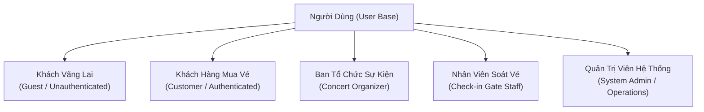

# Ma Trận Phân Quyền Người Dùng (Actor Permissions & RBAC Matrix)

## 1. Giới Thiệu & Mục Đích

Tài liệu này định nghĩa mô hình kiểm soát truy cập dựa trên vai trò (**Role-Based Access Control - RBAC**) cho toàn bộ hệ thống đặt vé concert trực tuyến.

Tài liệu là tiền đề trực tiếp để:
1. **Thiết kế sơ đồ Use Case (Use Case Diagrams)**: Xác định rõ Actor nào liên kết với các Use Case nào.
2. **Thiết kế API Gateway & Authorization Service**: Cung cấp ma trận phân quyền để kiểm tra phân quyền (RBAC Policy Enforcement), thiết lập Scopes/Roles trong JWT Access Token.
3. **Thiết kế UI/UX & Dynamic Navigation**: Ẩn/hiện các chức năng trên giao diện Web, iOS, Android phù hợp với vai trò của người đăng nhập.
4. **Bảo mật hệ thống (Security Architecture)**: Đảm bảo nguyên tắc đặc quyền tối thiểu (Principle of Least Privilege) và phòng chống lỗ hổng leo thang đặc quyền (Privilege Escalation / IDOR).

---

## 2. Định Nghĩa Các Tác Nhân Trong Hệ Thống (Actors Definition)

Hệ thống bao gồm **5 nhóm tác nhân chính**:



| Tác nhân (Actor) | Mã vai trò (Role Code) | Mô tả & Đối tượng người dùng | Kênh truy cập |
|---|---|---|---|
| **Khách vãng lai** | `ROLE_GUEST` | Người dùng chưa đăng nhập tài khoản vào hệ thống. Chỉ có quyền tra cứu thông tin công khai. | Web Browser, Mobile App (Guest mode) |
| **Khách hàng** | `ROLE_CUSTOMER` | Người dùng cá nhân đã đăng ký, xác thực tài khoản (SĐT/Email), có nhu cầu xếp hàng, chọn ghế, mua vé và đánh giá. | Web App, iOS App, Android App |
| **Ban tổ chức** | `ROLE_ORGANIZER` | Doanh nghiệp, đơn vị tổ chức biểu diễn đã ký hợp đồng với nền tảng, tạo sự kiện, thiết lập sơ đồ ghế, giá vé và theo dõi doanh thu. | Web Admin Portal (Dành riêng cho Organizer) |
| **Nhân viên soát vé** | `ROLE_STAFF` | Nhân viên vận hành tại cổng sự kiện, sử dụng thiết bị chuyên dụng hoặc ứng dụng di động để quét mã QR vé của khán giả. | Mobile Staff App (Dedicated handheld scanner / App) |
| **Quản trị viên** | `ROLE_ADMIN` | Đội ngũ vận hành của nền tảng, phê duyệt concert, kiểm duyệt nội dung, xử lý sự cố, đối soát tài chính và quản lý người dùng. | Web Super Admin Dashboard |

---

## 3. Danh Mục Chi Tiết Quyền Theo Từng Actor

### 3.1 Khách Vãng Lai (`ROLE_GUEST`)

- **Bản chất:** Người dùng ẩn danh, không có định danh cá nhân trong hệ thống.
- **Hành động được phép:**
  - Xem trang chủ, danh sách các concert đang công bố (`PUBLISHED`, `ON_SALE`, `SOLD_OUT`, `COMPLETED`).
  - Xem chi tiết thông tin concert: Nghệ sĩ, địa điểm, thời gian, hình ảnh sơ đồ khán phòng tổng thể, bảng giá vé niêm yết.
  - Tìm kiếm, lọc concert theo tên, thể loại nhạc, thành phố, khoảng giá.
  - Xem các đánh giá, nhận xét công khai của khán giả về các concert đã hoàn thành.
  - Thực hiện đăng ký tài khoản mới hoặc đăng nhập (qua SĐT, Email, Google, Apple ID).
- **Hành động KHÔNG được phép:**
  - KHÔNG được vào phòng chờ ảo (`Waiting Room`).
  - KHÔNG được cấp số thứ tự xếp hàng (Queue position).
  - KHÔNG được truy cập vào giao diện chọn ghế chi tiết thời gian thực.
  - KHÔNG được giữ ghế (`HOLD`) hoặc tạo đơn hàng (`ORDER`).
  - KHÔNG được đánh giá hay viết nhận xét.
- **Điều kiện phụ / Chuyển đổi:** Khi nhấn vào nút "Vào phòng chờ" hoặc "Mua vé ngay", hệ thống bắt buộc chuyển hướng sang màn hình Đăng nhập/Đăng ký.

---

### 3.2 Khách Hàng Mua Vé (`ROLE_CUSTOMER`)

- **Bản chất:** Người dùng đã được xác thực danh tính qua JWT Token hợp lệ.
- **Hành động được phép:**
  - Kế thừa toàn bộ quyền tra cứu của `ROLE_GUEST`.
  - Tham gia phòng chờ ảo trước giờ mở bán (`Waiting Room`).
  - Nhận số thứ tự xếp hàng ngẫu nhiên lúc mở bán và xếp hàng FIFO sau mở bán.
  - Truy cập khu vực chọn ghế thời gian thực khi đến lượt (được cấp Queue Access Token).
  - Thực hiện chọn và khóa ghế tạm thời (tối đa 4 ghế, thời hạn 10 phút).
  - Bỏ chọn ghế để giải phóng ghế về `AVAILABLE`.
  - Tạo đơn hàng mua vé và chọn phương thức thanh toán (VNPay / MoMo).
  - Hủy đơn hàng ở trạng thái `PENDING`.
  - Xem lịch sử đơn hàng cá nhân và trạng thái thanh toán.
  - Xem danh sách vé điện tử đã sở hữu kèm mã QR check-in động.
  - Yêu cầu hủy vé và hoàn tiền theo chính sách quy định (trước ngày diễn ra > 3 ngày).
  - Gửi đánh giá (sao từ 1-5 và nhận xét văn bản) cho concert đã tham dự (`ticket.status = CHECKED`).
  - Quản lý thông tin hồ sơ cá nhân, đổi mật khẩu, cập nhật SĐT, địa chỉ email.
- **Hành động KHÔNG được phép:**
  - KHÔNG được giữ quá 4 ghế trong cùng một đơn hàng hoặc vượt hạn mức tài khoản.
  - KHÔNG được chọn ghế đã bị người khác giữ (`HELD`), đã bán (`SOLD`) hoặc bị khóa (`BLOCKED`).
  - KHÔNG được giữ lượt quá 2 phút nếu không có tương tác trong khu chọn ghế.
  - KHÔNG được quét vé của người khác tại cổng soát vé.
  - KHÔNG được tạo concert hoặc can thiệp vào sơ đồ ghế của ban tổ chức.
  - KHÔNG được xem thông tin đơn hàng hay vé của tài khoản khác (chống IDOR).
- **Điều kiện phụ:**
  - Muốn thanh toán phải có số điện thoại đã xác thực OTP.
  - Muốn đánh giá concert phải có vé ở trạng thái `CHECKED` của concert đó.

---

### 3.3 Ban Tổ Chức Sự Kiện (`ROLE_ORGANIZER`)

- **Bản chất:** Đối tác doanh nghiệp/tổ chức có tài khoản Portal riêng, chỉ quản lý dữ liệu thuộc phạm vi tổ chức của mình.
- **Hành động được phép:**
  - Tạo mới hồ sơ Concert (nhập tiêu đề, thể loại, nghệ sĩ, thời gian biểu diễn, địa điểm, thời gian mở bán).
  - Thiết lập sơ đồ chỗ ngồi: Vẽ/chọn template khán phòng, phân chia các hạng vé (VIP, Standard, Standing), gắn mã ghế và định giá vé từng hạng.
  - Khóa ghế kỹ thuật (`BLOCKED`) cho mục đích nội bộ trước thời điểm mở bán.
  - Gửi hồ sơ concert lên Admin để yêu cầu phê duyệt (`PENDING_REVIEW`).
  - Tạo và quản lý tài khoản nhân viên soát vé (`ROLE_STAFF`) thuộc sự kiện của mình.
  - Phân công Staff phụ trách từng cổng soát vé (Gate A, Gate B, Cổng VIP...).
  - Theo dõi Dashboard bán vé thời gian thực: Tỷ lệ lấp đầy ghế, tốc độ bán vé, doanh thu tạm tính, thống kê theo phương thức thanh toán.
  - Theo dõi báo cáo check-in trực tiếp tại hiện trường (số lượng khách đã vào cổng / tổng vé bán).
  - Yêu cầu đóng bán sớm (`CLOSED`) hoặc gửi yêu cầu hủy concert để Admin xem xét theo hợp đồng/chính sách đã phê duyệt.
  - Xem báo cáo đối soát và yêu cầu rút tiền/quyết toán doanh thu sau khi concert hoàn tất.
- **Hành động KHÔNG được phép:**
  - KHÔNG được tự ý xuất bản concert (`PUBLISHED`) mà không qua Admin phê duyệt.
  - KHÔNG được sửa giá vé, vị trí ghế, thời gian hoặc địa điểm sau khi concert đã mở bán (`ON_SALE`) hoặc đã có vé được bán.
  - KHÔNG được xem dữ liệu sự kiện, doanh thu hoặc thông tin khách hàng của Ban tổ chức khác (Data Isolation / Multi-tenancy).
  - KHÔNG được can thiệp vào thuật toán xếp hàng ảo hoặc can thiệp phân bổ ghế trái quy tắc.
- **Điều kiện phụ:**
  - Tài khoản Organizer phải hoàn tất xác minh pháp lý (KYC Doanh nghiệp, GPKD, Hợp đồng biểu diễn).

---

### 3.4 Nhân Viên Soát Vé (`ROLE_STAFF`)

- **Bản chất:** Nhân sự vận hành tại hiện trường sự kiện, thao tác thông qua ứng dụng di động chuyên dụng để xác thực khách vào cửa.
- **Hành động được phép:**
  - Đăng nhập vào ứng dụng di động soát vé (Gate Staff App) bằng tài khoản được Organizer cấp.
  - Xem danh sách ca làm việc và sự kiện được phân công phụ trách.
  - Sử dụng camera hoặc đầu đọc laser để quét mã QR vé điện tử của khách hàng.
  - Xem kết quả xác thực vé thời gian thực: Hợp lệ (Màu xanh), Đã check-in trước đó (Màu đỏ kèm thời gian và cổng đã quét), Vé bị hủy/Không hợp lệ (Màu cam/đen).
  - Xem thông tin chi tiết vé sau khi quét thành công: Họ tên khách, hạng vé, khu vực, số ghế, cổng vào.
  - Khi mất kết nối, dừng xác thực tự động và báo Gate Supervisor; không xác nhận vé offline theo D-023.
  - Xem thống kê số lượng vé đã quét trong ca làm việc cá nhân và tại cổng được phân công.
- **Hành động KHÔNG được phép:**
  - KHÔNG được quét vé của các sự kiện mà mình không được phân công.
  - KHÔNG được quét vé sai phân khu (ví dụ: Staff cổng Thường không thể check-in cho vé cổng VIP nếu hệ thống phân cổng nghiêm ngặt).
  - KHÔNG được chỉnh sửa dữ liệu vé, không được hủy vé, không được hoàn tiền.
  - KHÔNG được xem doanh thu, giá trị tiền vé hay thông tin tài chính của concert.
  - KHÔNG được cấp quyền hoặc tạo thêm tài khoản Staff khác.
- **Điều kiện phụ:**
  - Chỉ được thực hiện check-in trong khung giờ mở cửa đón khách (`gate_open_time` đến `concert_end_time`).

---

### 3.5 Quản Trị Viên Hệ Thống (`ROLE_ADMIN`)

- **Bản chất:** Đội ngũ quản trị tối cao của nền tảng bán vé, chịu trách nhiệm vận hành an toàn, tuân thủ pháp luật và giám sát toàn bộ hoạt động.
- **Hành động được phép:**
  - Phê duyệt (`PUBLISH`) hoặc từ chối (`REJECT`) các concert do Organizer gửi lên trong vòng 48h.
  - Yêu cầu Organizer bổ sung hồ sơ pháp lý giấy phép biểu diễn.
  - Quyền dừng khẩn cấp (Emergency Stop / Circuit Breaker): Đóng bán concert ngay lập tức nếu phát hiện sự cố bảo mật, gian lận hoặc yêu cầu từ cơ quan quản lý nhà nước.
  - Hủy concert (`CANCELLED`) và kích hoạt quy trình hoàn tiền hàng loạt tự động cho 100% khách hàng.
  - Can thiệp xử lý các trường hợp tranh chấp thanh toán, giao dịch thanh toán trễ (`Late Payment Callback`) hoặc lỗi hoàn tiền từ phía ngân hàng.
  - Quản lý danh sách người dùng toàn hệ thống: Khóa tài khoản có hành vi gian lận (dùng bot, spam request, đầu cơ vé lậu).
  - Cấu hình thông số vận hành theo baseline đã duyệt: dung lượng phòng chờ, giới hạn CCU, seat hold cố định 600 giây và queue admission timeout 120 giây; không cho phép thay đổi TTL nghiệp vụ giữ ghế.
  - Xem báo cáo doanh thu, số dư chờ quyết toán theo sổ nội bộ, phí nền tảng theo hợp đồng và đối soát VNPay/MoMo; không coi số liệu nội bộ là xác nhận số dư tài khoản ngân hàng/escrow.
  - Finance/Admin phê duyệt hồ sơ quyết toán và ghi nhận payout sau khi có bằng chứng chuyển tiền; hệ thống không tự động chuyển khoản theo D-034.
  - Quản lý và kiểm duyệt các đánh giá/nhận xét vi phạm thuần phong mỹ tục hoặc spam quảng cáo.
  - Xem toàn bộ Audit Log của hệ thống (lịch sử truy cập, thay đổi dữ liệu, thao tác quản trị).
- **Hành động KHÔNG được phép (Nguyên tắc bảo vệ dữ liệu):**
  - KHÔNG được can thiệp thủ công sửa đổi số dư tài khoản ngân hàng của khách hay doanh nghiệp.
  - KHÔNG được can thiệp vào quá trình shuffle ngẫu nhiên của phòng chờ ảo nhằm thiên vị bất kỳ người dùng nào.
  - KHÔNG được tự ý chiếm đoạt hoặc chuyển nhượng vé đã thuộc quyền sở hữu của khách hàng nếu không có căn cứ pháp lý hoặc vi phạm điều khoản dịch vụ rõ ràng.

---

## 4. Bảng Ma Trận Phân Quyền Chi Tiết Theo Từng Module Nghiệp Vụ

**Ký hiệu quy ước:**
- `C` (Create): Tạo mới dữ liệu.
- `R` (Read): Xem, tra cứu thông tin.
- `U` (Update): Chỉnh sửa, cập nhật dữ liệu.
- `D` (Delete): Xóa hoặc hủy dữ liệu.
- `E` (Execute): Kích hoạt quy trình / Thao tác nghiệp vụ đặc thù (Check-in, Duyệt, Shuffle...).
- `[-]`: Không có quyền truy cập.
- `*`: Có điều kiện ràng buộc đặc biệt (Scope / Ownership).

| Phân hệ / Nghiệp vụ | Khách vãng lai (`GUEST`) | Khách hàng (`CUSTOMER`) | Ban tổ chức (`ORGANIZER`) | Nhân viên soát vé (`STAFF`) | Quản trị viên (`ADMIN`) | Điều kiện ràng buộc chi tiết |
|---|:---:|:---:|:---:|:---:|:---:|---|
| **1. Xác thực & Tài khoản** | | | | | | |
| Đăng ký, Đăng nhập | C, R | R, U* | R, U* | R, U* | R, U | *Chỉ cập nhật tài khoản của chính mình |
| Khóa / Mở khóa tài khoản | [-] | [-] | [-] | [-] | U | Admin quản lý tài khoản người dùng toàn hệ thống |
| **2. Tra cứu Concert** | | | | | | |
| Xem danh sách concert công khai | R | R | R | R | R | Chỉ xem concert đã `PUBLISHED`, `ON_SALE`, `COMPLETED` |
| Tìm kiếm, lọc concert | R | R | R | R | R | Tìm kiếm theo nghệ sĩ, địa điểm, thể loại nhạc |
| Xem chi tiết & giá vé niêm yết | R | R | R | R | R | Công khai thông tin tổ chức và sơ đồ tổng quan |
| **3. Phòng chờ ảo & Hàng chờ** | | | | | | |
| Vào phòng chờ ảo (`Waiting Room`) | [-] | E* | [-] | [-] | R (Monitor) | *Cần đăng nhập; trước giờ mở bán 15 phút |
| Nhận số thứ tự hàng chờ (Queue Token) | [-] | R, E* | [-] | [-] | R (Monitor) | *Mỗi user duy nhất 1 số thứ tự / concert |
| Giám sát hàng chờ thời gian thực | [-] | R* | R* | [-] | R | *User xem số vị trí cá nhân; Org/Admin xem tổng CCU |
| **4. Sơ đồ ghế & Khóa giữ ghế** | | | | | | |
| Xem sơ đồ ghế thời gian thực | [-] | R* | R* | [-] | R | *Chỉ user có Queue Token hợp lệ mới được xem |
| Chọn và khóa ghế (`HOLD`) | [-] | C, U* | [-] | [-] | [-] | *Tối đa 4 ghế, thời hạn 10 phút |
| Bỏ chọn ghế giải phóng về `AVAILABLE` | [-] | U* | [-] | [-] | [-] | *Chỉ giải phóng ghế đang do mình giữ |
| Khóa ghế kỹ thuật (`BLOCKED`) | [-] | [-] | U* | [-] | U | *Chỉ thực hiện trước khi concert mở bán |
| **5. Đơn hàng (Orders)** | | | | | | |
| Tạo đơn hàng (`order.status = PENDING`) | [-] | C* | [-] | [-] | [-] | *Chỉ tạo được khi đang giữ ghế hợp lệ |
| Hủy đơn hàng đang chờ thanh toán | [-] | U* | [-] | [-] | U* | *Customer tự hủy; Admin hủy khi có sự cố |
| Xem chi tiết đơn hàng cá nhân | [-] | R* | [-] | [-] | R | *Chống IDOR; chỉ xem đơn của chính mình |
| Xem danh sách đơn hàng toàn concert | [-] | [-] | R* | [-] | R | *Organizer chỉ xem đơn của concert mình sở hữu |
| **6. Thanh toán & Cổng thanh toán** | | | | | | |
| Khởi tạo thanh toán VNPay / MoMo | [-] | E* | [-] | [-] | [-] | *Đơn hàng phải còn hiệu lực trong 10 phút |
| Nhận và xử lý IPN / Webhook | [-] | [-] | [-] | [-] | E (System) | Hệ thống tự động xử lý chữ ký số bảo mật |
| Xem lịch sử giao dịch thanh toán | [-] | R* | R* | [-] | R | *Customer xem giao dịch cá nhân; Org xem tổng thu |
| Đối soát giao dịch thanh toán (Reconcile) | [-] | [-] | [-] | [-] | E, R | Admin đối soát định kỳ với nhà cung cấp cổng |
| **7. Vé điện tử & QR Code** | | | | | | |
| Nhận vé điện tử sau thanh toán | [-] | R* | [-] | [-] | R | *Vé tự sinh ở trạng thái `ORDERED` |
| Hiển thị Dynamic QR Code check-in | [-] | R* | [-] | [-] | [-] | *Làm mới mã mỗi 30 giây (token có hiệu lực tối đa 60 giây) trên App cá nhân |
| Tải vé file PDF / Nhận vé qua Email | [-] | R* | [-] | [-] | [-] | *Vé định dạng tĩnh có chữ ký bảo mật |
| **8. Vận hành Cổng Soát Vé (Check-in)** | | | | | | |
| Quét mã QR xác thực vé tại cổng | [-] | [-] | [-] | E* | E | *Staff chỉ quét concert và cổng được phân công |
| Check-in khi scanner mất kết nối | [-] | [-] | [-] | [-] | [-] | Không có check-in offline; fail-closed và báo Gate Supervisor theo D-023 |
| Xem báo cáo tỷ lệ check-in hiện trường | [-] | [-] | R* | R* | R | *Staff xem cổng mình; Org xem toàn bộ sự kiện |
| **9. Hủy vé & Hoàn tiền (Refunds)** | | | | | | |
| Gửi yêu cầu hoàn tiền cá nhân | [-] | C, E* | [-] | [-] | [-] | *Tỷ lệ và điều kiện theo ngày lịch địa phương BR-RFD-001; chặn nếu có vé CHECKED theo BR-RFD-006 |
| Hoàn tiền hàng loạt khi hủy concert | [-] | [-] | [-] | [-] | E* | *Admin kích hoạt tự động hoàn tiền 100% |
| **10. Quản lý Concert & Ban tổ chức** | | | | | | |
| Tạo hồ sơ concert mới | [-] | [-] | C* | [-] | C | *Tạo ở trạng thái `PENDING_REVIEW` |
| Thiết kế sơ đồ ghế & Định giá vé | [-] | [-] | C, U* | [-] | U | *Chỉ sửa trước khi concert mở bán |
| Phê duyệt / Từ chối concert | [-] | [-] | [-] | [-] | E, U | Admin cam kết SLA phê duyệt trong 48 giờ |
| Dừng bán khẩn cấp / Hủy concert | [-] | [-] | U* | [-] | E, U | *Organizer gửi yêu cầu; Admin quyết định theo hợp đồng và chính sách khẩn cấp đã phê duyệt |
| Phân công tài khoản Staff cho cổng | [-] | [-] | C, U, D* | [-] | U | *Organizer quản lý Staff thuộc sự kiện của mình |
| **11. Đánh giá & Nhận xét (Reviews)** | | | | | | |
| Xem đánh giá công khai | R | R | R | R | R | Mọi người đều có quyền xem đánh giá |
| Đăng đánh giá & chấm điểm sao | [-] | C* | [-] | [-] | [-] | *Chỉ dành cho vé đã check-in (`CHECKED`) |
| Sửa / Xóa đánh giá cá nhân | [-] | U, D* | [-] | [-] | [-] | *Trong vòng 30 ngày kể từ khi đăng |
| Xóa đánh giá vi phạm / Kiểm duyệt | [-] | [-] | [-] | [-] | D, U | Admin kiểm duyệt từ ngữ độc hại hoặc spam |
| **12. Báo cáo & Quyết toán tài chính** | | | | | | |
| Xem báo cáo doanh thu & lấp đầy | [-] | [-] | R* | [-] | R | *Org chỉ xem sự kiện của mình; Admin xem toàn sàn |
| Yêu cầu quyết toán doanh thu (Payout) | [-] | [-] | C* | [-] | [-] | *Sau COMPLETED, đối soát đầy đủ và đủ điều kiện theo hợp đồng đã ký |
| Phê duyệt/ghi nhận payout | [-] | [-] | [-] | [-] | E, U | Chỉ sau đối soát; lưu người duyệt, tham chiếu và bằng chứng chuyển tiền; điều khoản theo D-034 |

---

## 5. Cấu Trúc Token & Cơ Chế Kiểm Soát Phân Quyền (Token Architecture & Auth Guards)

### 5.1 Cấu trúc JWT Payload đại diện vai trò (Sample Claims)

Khi người dùng đăng nhập thành công, Authentication Service cấp một JWT Access Token (TTL ngắn: 15-30 phút) và Refresh Token (TTL dài: 7-30 ngày). Payload chứa định danh và quyền hạn:

```json
{
  "sub": "usr_9b1deb4d-3b7d-4bad-9bdd-2b0d7b3dcb6d",
  "name": "Nguyen Van A",
  "phone": "+84901234567",
  "roles": ["ROLE_CUSTOMER"],
  "permissions": [
    "concert:read",
    "queue:join",
    "seat:hold",
    "order:create",
    "ticket:read",
    "review:create"
  ],
  "iss": "https://auth.concert-ticketing.vn",
  "iat": 1774350000,
  "exp": 1774351800
}
```

Đối với tài khoản `ROLE_ORGANIZER` và `ROLE_STAFF`, token có thêm phạm vi tài nguyên (`scopes` / `assigned_tenants`):

```json
{
  "sub": "stf_88319203-aa12-4c22-990a-1123456789ab",
  "roles": ["ROLE_STAFF"],
  "assigned_concert_id": "cnc_2026_mytam_mytour",
  "assigned_gates": ["GATE_A_VIP", "GATE_A_STD"],
  "permissions": [
    "ticket:scan",
    "ticket:verify",
    "checkin:read_stats"
  ],
  "exp": 1774360000
}
```

### 5.2 Cơ chế bảo vệ chống lỗ hổng bảo mật phổ biến

1. **Phòng chống IDOR (Insecure Direct Object References):**
   - Mọi API truy xuất tài nguyên riêng tư như `/api/v1/orders/{order_id}` hoặc `/api/v1/tickets/{ticket_id}` bắt buộc phải kiểm tra quyền sở hữu tại tầng Data Access:
   ```sql
   SELECT * FROM orders WHERE id = :order_id AND customer_id = :current_user_id;
   ```
   - Nếu không khớp, trả về ngay mã phản hồi `403 Forbidden` hoặc `404 Not Found` (để tránh rò rỉ sự tồn tại của ID).

2. **Kiểm tra Token phòng chờ độc lập (Queue Admission Guard):**
   - API chọn ghế `/api/v1/concerts/{id}/seats/hold` không chỉ kiểm tra Bearer JWT của Customer mà còn bắt buộc kiểm tra `X-Queue-Token` trong Header HTTP.
   - Queue Access Token có TTL 120 giây tính từ heartbeat hợp lệ gần nhất; app foreground gửi heartbeat mỗi 30 giây. Token chỉ gia hạn khi heartbeat hoặc thao tác UI được xác thực; WebSocket đơn thuần không gia hạn. Thu hồi token không giải phóng seat hold 600 giây theo D-002/D-015.

3. **Chống giả mạo vai trò (Privilege Escalation):**
   - API phân quyền người dùng không chấp nhận gán vai trò (`roles`) từ tham số request của client.
   - Chỉ tài khoản có `ROLE_ADMIN` mới có thể gọi endpoint cập nhật vai trò nội bộ qua mạng VPC nội bộ được bảo vệ bởi VPN/mTLS.

