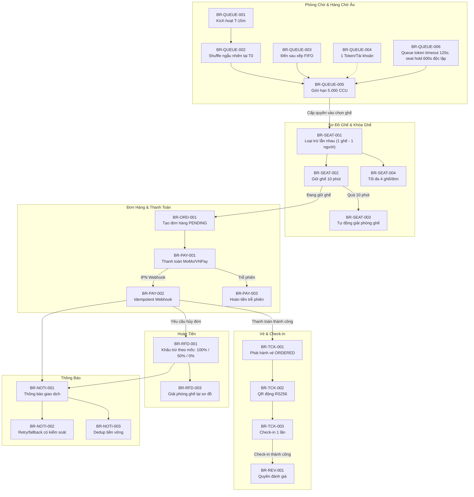

# Danh Mục Quy Tắc Nghiệp Vụ (Business Rules Catalog)

## 1. Giới Thiệu & Mục Đích

Tài liệu này tập hợp và mã hóa toàn bộ các Quy tắc Nghiệp vụ (**Business Rules - BR**) chi phối hệ thống bán vé concert trực tuyến quy mô lớn (2 triệu người dùng).

Tài liệu phục vụ làm căn cứ chuẩn xác để:
1. **Thiết kế System Architecture & Service Logic**: Xác định các logic rẽ nhánh, kiểm tra điều kiện (preconditions), và xử lý bất biến (invariants).
2. **Thiết kế Database & Constraint**: Định nghĩa validation logic ở tầng DB và application (Foreign Keys, Unique Indexes, Check Constraints, Distributed Locks).
3. **Thiết kế State Machine & Workflow**: Thiết lập guard condition cho các bước chuyển trạng thái của Concert, Ghế, Đơn hàng, Vé, Giao dịch thanh toán.
4. **Xây dựng Test Case & Acceptance Criteria (AC)**: Làm cơ sở kiểm thử cho QA/QC và nghiệm thu nghiệp vụ.

---

## 2. Bảng Tóm Tắt Mã Quy Tắc Theo Phân Hệ (Domain Index)

| Nhóm mã | Phân hệ (Domain) | Số lượng quy tắc |
|---|---|---|
| `BR-QUEUE` | Phòng chờ ảo & Xếp hàng (Virtual Waiting Room & Queue) | 8 quy tắc (`BR-QUEUE-001` → `008`) |
| `BR-SEAT` | Sơ đồ ghế & Khóa ghế (Seat Map & Seat Holding) | 8 quy tắc (`BR-SEAT-001` → `008`) |
| `BR-ORD` | Đơn hàng & Giới hạn giao dịch (Orders & Limits) | 8 quy tắc (`BR-ORD-001` → `008`) |
| `BR-PAY` | Thanh toán & Cổng thanh toán (Payment & Gateways) | 8 quy tắc (`BR-PAY-001` → `008`) |
| `BR-TCK` | Vé điện tử & Check-in (E-Ticket & QR Access) | 8 quy tắc (`BR-TCK-001` → `008`) |
| `BR-RFD` | Hủy đơn & Hoàn tiền (Refunds & Cancellations) | 7 quy tắc (`BR-RFD-001` → `007`) |
| `BR-CON` | Quản lý Concert & Ban tổ chức (Organizer & Events) | 8 quy tắc (`BR-CON-001` → `008`) |
| `BR-REV` | Đánh giá & Nhận xét (Reviews & Rating) | 4 quy tắc (`BR-REV-001` → `004`) |
| `BR-NOTI` | Thông báo & tùy chọn nhận tin (Notifications) | 3 quy tắc (`BR-NOTI-001` → `003`) |

---

## 3. Chi Tiết Danh Mục Quy Tắc Nghiệp Vụ

### 3.1 Phân hệ Phòng chờ ảo & Xếp hàng (Virtual Waiting Room & Queue)

#### BR-QUEUE-001: Kích hoạt phòng chờ trước giờ mở bán
- **Tên quy tắc:** Kích hoạt phòng chờ tự động (Waiting Room Activation).
- **Mô tả:** Hệ thống tự động mở Phòng chờ ảo (Waiting Room) chính xác 15 phút trước thời điểm mở bán chính thức (`concert.sale_start_time - 15 minutes`). Khách hàng truy cập concert trong khoảng thời gian này sẽ được giữ tại giao diện phòng chờ, hiển thị đồng hồ đếm ngược và không thể truy cập trực tiếp vào khu vực chọn ghế.
- **Điều kiện kích hoạt:** `current_time >= (concert.sale_start_time - 15m)` VÀ `current_time < concert.sale_start_time`.
- **Ngoại lệ:** Concert có quy mô dưới 500 ghế hoặc loại hình bán vé không áp dụng phòng chờ (do Admin cấu hình đặc biệt).
- **Tác động thiết kế:** CDN/Edge proxy chặn trực tiếp request vào API chọn ghế, chuyển hướng sang hệ thống Waiting Room phân tán (Cloudflare Waiting Room hoặc Redis FIFO Queue).

#### BR-QUEUE-002: Xáo trộn ngẫu nhiên thứ tự lúc mở bán (Random Shuffle)
- **Tên quy tắc:** Phân vị trí ngẫu nhiên cho người đến sớm (Equal Opportunity Shuffle).
- **Mô tả:** Đúng thời điểm `concert.sale_start_time`, toàn bộ người dùng đang có mặt trong phòng chờ ảo sẽ được gán số thứ tự mua vé ngẫu nhiên (sử dụng thuật toán Fisher-Yates shuffle công bằng, không phụ thuộc vào việc ai bấm vào phòng chờ ở phút thứ 15 hay phút thứ 1).
- **Ngoại lệ:** Không có. Tất cả user trong phòng chờ tại thời điểm T0 đều có xác suất nhận số thứ tự như nhau.
- **Tác động thiết kế:** Tránh tình trạng người dùng dùng tool/bot spam kết nối sớm giành chỗ; giảm áp lực race condition tại thời điểm mở bán.

#### BR-QUEUE-003: Xếp hàng đến sau theo thứ tự FIFO (Late Arrivals FIFO)
- **Tên quy tắc:** Người dùng đến sau thời điểm mở bán xếp cuối hàng.
- **Mô tả:** Bất kỳ khách hàng nào truy cập hệ thống sau thời điểm `concert.sale_start_time` sẽ được tự động xếp vào cuối hàng chờ hiện tại theo thứ tự thời gian thực (First In First Out - FIFO).
- **Điều kiện kích hoạt:** `current_time > concert.sale_start_time` VÀ hàng chờ vẫn đang mở VÀ vé chưa hết (`concert.status = ON_SALE`).
- **Ngoại lệ:** Nếu hàng chờ đã rỗng và số lượng người trong khu chọn ghế dưới ngưỡng 5.000, người đến sau được vào thẳng khu vực chọn ghế (`BR-QUEUE-005`).

#### BR-QUEUE-004: Đơn nhất vị trí xếp hàng trên mỗi tài khoản (Single Position Per Account)
- **Tên quy tắc:** Mỗi tài khoản duy nhất một vị trí xếp hàng cho mỗi concert.
- **Mô tả:** Mỗi User ID chỉ được cấp đúng một số thứ tự xếp hàng (Queue Ticket / Queue Position) duy nhất cho một concert cụ thể, bất kể người dùng mở nhiều tab trên trình duyệt, mở nhiều thiết bị (web, mobile app iOS, Android) cùng lúc.
- **Xử lý vi phạm:** Thiết bị/tab kết nối sau cùng tài khoản sẽ đồng bộ chung một số thứ tự duy nhất (dựa trên `user_id` + `concert_id`). Mọi hành vi dùng bot clone tài khoản hoặc tạo nhiều kết nối song song trên 1 tài khoản không mang lại lợi thế.
- **Tác động thiết kế:** Khóa phiên phân tán (Distributed Session Lock) lưu trên Redis theo key `queue:user:{concert_id}:{user_id}`.

#### BR-QUEUE-005: Giới hạn dung lượng đồng thời tại khu chọn ghế (Concurrency Limit)
- **Tên quy tắc:** Tối đa 5.000 người dùng đồng thời trong khu chọn ghế (Max 5,000 CCU).
- **Mô tả:** Khu vực chọn ghế (Seat Selection Area) chỉ cho phép tối đa 5.000 người dùng hoạt động đồng thời tại một thời điểm (`current_active_users <= 5,000`). Khi có người hoàn tất thanh toán, hủy bỏ, hoặc hết hạn phiên rời khỏi khu vực, hệ thống mới cấp quyền (Queue Admission Token) cho số thứ tự kế tiếp vào thay thế.
- **Tác động thiết kế:** Token Bucket hoặc Leaky Bucket thuật toán; duy trì đếm số active token trên Redis với TTL.

#### BR-QUEUE-006: Thu hồi phiên chọn ghế khi không hoạt động quá 2 phút (Inactivity Timeout)
- **Tên quy tắc:** Thu hồi quyền vào khu chọn ghế sau 120 giây không hoạt động.
- **Mô tả:** Hoạt động hợp lệ là thao tác UI hoặc heartbeat đã xác thực; ứng dụng ở foreground gửi heartbeat mỗi 30 giây. Kết nối WebSocket đơn thuần không được tính là hoạt động. Sau 120 giây từ hoạt động hợp lệ cuối, hệ thống thu hồi Queue Access Token và quyền chọn ghế, cảnh báo từ giây 90. Quy tắc này không hủy và không rút ngắn seat hold đã tạo: hold tiếp tục đến hết 600 giây, do người dùng hủy, hoặc luồng order hợp lệ kết thúc (D-002, D-015).

#### BR-QUEUE-007: Đóng hàng chờ và thông báo khi hết vé
- **Tên quy tắc:** Dừng cấp lượt mới khi concert hết vé và thông báo trạng thái nhất quán.
- **Mô tả:** Khi không còn ghế bán được, concert chuyển SOLD_OUT, waiting room ngừng cấp Queue Access Token mới và phát cập nhật realtime trong ứng dụng cho người đang chờ. Push notification là kênh bổ sung khi người dùng đã cho phép; email/SMS không phải kênh bắt buộc. Message dùng event ID idempotent; trạng thái hộp thư IN_APP là nguồn hiển thị bền vững (D-020).

#### BR-QUEUE-008: Mã hóa và chống giả mạo Queue Token (Queue Security)
- **Tên quy tắc:** Token vào phòng chọn ghế phải được ký số và xác thực một lần.
- **Mô tả:** Token cấp cho người dùng khi đến lượt vào khu chọn ghế (`Access Token`) là JWT được ký bằng HMAC-SHA256, gồm `user_id`, `concert_id`, `queue_number`, `issued_at` và `expires_at`. API chọn ghế xác minh chữ ký, concert, thời hạn và quyền sử dụng token; payload JWT chỉ được ký, không được coi là dữ liệu đã mã hóa và khóa HMAC không được đưa xuống client.

---

### 3.2 Phân hệ Sơ đồ ghế & Khóa ghế (Seat Map & Seat Holding)

#### BR-SEAT-001: Tính nguyên tử và loại trừ tương hỗ khi giữ ghế (Mutual Exclusive Hold)
- **Tên quy tắc:** Một ghế chỉ được giữ bởi duy nhất một khách hàng tại một thời điểm.
- **Mô tả:** Mỗi ghế vật lý trên sơ đồ chỉ có thể được một người dùng giữ (`seat.status = HELD`) tại một thời điểm. Tuyệt đối không xảy ra tình trạng 2 khách hàng cùng giữ một ghế (Zero Double-Booking).
- **Xử lý vi phạm:** Nếu 2 yêu cầu giữ cùng một ghế gửi đến đồng thời (sai biệt mili-giây), hệ thống chỉ chấp nhận yêu cầu đầu tiên đến (dựa trên Redis Distributed Lock / Redlock / Database Optimistic Locking); yêu cầu thứ hai lập tức nhận mã lỗi `SEAT_ALREADY_HELD` hoặc `SEAT_CONFLICT`.
- **Tác động thiết kế:** Áp dụng distributed locking có thời hạn trên Redis hoặc sử dụng atomic conditional update: `UPDATE seats SET status='HELD', hold_user_id=? WHERE id=? AND status='AVAILABLE'`.

#### BR-SEAT-002: Thời hạn giữ ghế tối đa 10 phút (10-Minute Hold TTL)
- **Tên quy tắc:** Khóa ghế tạm thời có thời hạn 10 phút (Seat Hold Time-To-Live).
- **Mô tả:** Khi khách hàng chọn ghế thành công, hệ thống khóa giữ ghế đó trong thời gian chính xác 10 phút (600 giây). Đồng hồ đếm ngược được kích hoạt đồng bộ giữa client và server.
- **Điều kiện kết thúc giữ ghế:**
  1. Khách hàng hoàn tất thanh toán thành công → Ghế chuyển sang `SOLD`.
  2. Khách hàng chủ động nhấn "Bỏ chọn ghế" → Ghế lập tức hoàn về `AVAILABLE`.
  3. Quá 10 phút không hoàn tất thanh toán → Hết hạn tự động, ghế hoàn về `AVAILABLE` (`BR-SEAT-003`).

#### BR-SEAT-003: Tự động giải phóng ghế khi hết hạn (Auto-Release on Expiration)
- **Tên quy tắc:** Tự động trả ghế về trạng thái AVAILABLE khi hết hạn 10 phút.
- **Mô tả:** Khi hết thời gian 600 giây mà đơn hàng chưa được thanh toán, hệ thống lập tức hủy phiên giữ ghế (`seat.status = AVAILABLE`, xóa `hold_user_id`), đơn hàng liên kết chuyển sang `OUT_TIME`. Ghế được công khai trên sơ đồ để các khách hàng khác tiếp tục chọn.
- **Tác động thiết kế:** Cơ chế tự động giải phóng qua Redis Key Expiration (Keyspace notification) kết hợp tác vụ Delayed Job / Scheduler kiểm tra định kỳ mỗi 5 giây.

#### BR-SEAT-004: Giới hạn số lượng ghế chọn tối đa trên mỗi giao dịch (Seat Selection Limit)
- **Tên quy tắc:** Tối đa 4 ghế trên mỗi đơn hàng (Max 4 Seats Per Order).
- **Mô tả:** Trong một lần mua vé (một phiên giao dịch), một tài khoản chỉ được phép chọn và giữ tối đa 4 ghế cho cùng một concert.
- **Xử lý vi phạm:** Giao diện vô hiệu hóa thao tác chọn ghế thứ 5; API trả về mã lỗi `SEAT_LIMIT_EXCEEDED` nếu client cố tình gửi payload quá 4 ghế.
- **Ngoại lệ:** Ban tổ chức có thể cấu hình giới hạn riêng cho từng concert (ví dụ: tối đa 2 vé cho concert siêu hot, hoặc 6 vé cho concert thông thường), nhưng mặc định toàn hệ thống là 4 vé.

#### BR-SEAT-005: Quy tắc liền kề khi chọn ghế có số (Contiguous Seating Recommendation)
- **Tên quy tắc:** Cảnh báo để lại ghế trống đơn lẻ (Orphan Seat Prevention - Soft Rule).
- **Mô tả:** Khi người dùng chọn ghế trong khu vực có số ghế cố định, hệ thống khuyến nghị và hiển thị cảnh báo nếu thao tác chọn ghế để lại đúng 1 ghế trống duy nhất giữa các ghế đã chọn và lối đi hoặc vách ngăn (ghế đơn lẻ khó bán).
- **Tính chất:** Cảnh báo mềm (Soft validation) để tối ưu doanh thu cho ban tổ chức.

#### BR-SEAT-006: Khóa ghế đặc biệt bởi Ban tổ chức hoặc Admin (Seat Blocking)
- **Tên quy tắc:** Khóa ghế kỹ thuật và ghế khách mời (Blocked Seats).
- **Mô tả:** Ban tổ chức và Admin có quyền chuyển trạng thái ghế sang `BLOCKED` trước khi concert mở bán để dành riêng cho khách mời (VIP), nhà tài trợ, hoặc vị trí lắp đặt máy móc âm thanh/ánh sáng bị che khuất tầm nhìn. Ghế ở trạng thái `BLOCKED` không hiển thị cho khách hàng chọn.
- **Điều kiện:** Chỉ được thực hiện khi ghế đang ở trạng thái `AVAILABLE` và trước thời điểm concert chuyển sang `ON_SALE`.

#### BR-SEAT-007: Cập nhật sơ đồ ghế thời gian thực (Real-time Seat Map Synchronization)
- **Tên quy tắc:** Đồng bộ trạng thái ghế qua WebSocket/SSE.
- **Mô tả:** Mọi thay đổi trạng thái của ghế (`AVAILABLE` ↔ `HELD` → `SOLD`) phải được broadcast đến tất cả 5.000 người dùng đang xem sơ đồ ghế của concert đó trong vòng dưới 1 giây (độ trễ < 1000ms).

#### BR-SEAT-008: Bất biến toàn vẹn số lượng ghế (Seat Quantity Invariant)
- **Tên quy tắc:** Tổng số ghế phải luôn bằng dung lượng phòng hòa nhạc.
- **Mô tả:** Tại mọi thời điểm: `Total Seats = COUNT(AVAILABLE) + COUNT(HELD) + COUNT(SOLD) + COUNT(BLOCKED)`. Số lượng này phải luôn khớp với sức chứa thiết kế của sơ đồ khán phòng (`venue.capacity`), không được thất thoát hay tự sinh thêm bất kỳ ghế nào.

---

### 3.3 Phân hệ Đơn hàng & Giới hạn giao dịch (Orders & Limits)

#### BR-ORD-001: Điều kiện khởi tạo đơn hàng (Order Creation Precondition)
- **Tên quy tắc:** Đơn hàng chỉ được tạo khi ghế đã được giữ hợp lệ.
- **Mô tả:** Đơn hàng chỉ có thể được tạo (`order.status = PENDING`) khi toàn bộ ghế trong danh sách chọn của khách hàng đang ở trạng thái `HELD` và được gán chính xác cho `user_id` của khách hàng đó.
- **Tác động thiết kế:** Transaction atomic: Tạo bản ghi Order và Order Items, gắn kết với Hold Session ID.

#### BR-ORD-002: Thời gian hết hạn của đơn hàng bằng thời gian giữ ghế còn lại
- **Tên quy tắc:** Order expiration đồng bộ với Seat hold timeout.
- **Mô tả:** Thời hạn hiệu lực của đơn hàng `PENDING` được tính bằng thời gian còn lại của phiên giữ ghế (tối đa 10 phút kể từ lúc giữ ghế đầu tiên). Khi hết thời gian này, nếu đơn chưa thanh toán, trạng thái tự động chuyển thành `OUT_TIME`.

#### BR-ORD-003: Giới hạn tổng số vé hiệu lực trên mỗi tài khoản/concert (Account Purchase Limit)
- **Tên quy tắc:** Một tài khoản có tối đa 4 vé hiệu lực hoặc đang được giữ cho một concert.
- **Mô tả:** Giới hạn được kiểm tra nguyên tử theo cặp user_id + concert_id, gồm vé trong order PAID chưa bị hủy và ghế đang HELD/PENDING. Cho phép tạo nhiều order tuần tự, nhưng chỉ có một hold group/checkout hoặc payment attempt có kết quả UNKNOWN đang hoạt động tại một thời điểm cho cùng cặp user-concert. Order đã hủy/hoàn tiền hoàn tất không tính vào quota; giới hạn 4 vé/hold group vẫn áp dụng (D-001, D-018).

#### BR-ORD-004: Tính bất biến của đơn hàng sau khi tạo (Order Immutability)
- **Tên quy tắc:** Không cho phép sửa đổi thông tin ghế hoặc giá sau khi tạo đơn.
- **Mô tả:** Khi đơn hàng đã ở trạng thái `PENDING`, khách hàng không được phép thêm, bớt ghế hoặc thay đổi loại vé trong đơn hàng. Muốn đổi ghế, khách hàng bắt buộc phải nhấn "Hủy đơn" để giải phóng ghế cũ về `AVAILABLE` và thực hiện chọn lại ghế mới (nếu còn trong lượt).

#### BR-ORD-005: Đóng băng đơn giá tại thời điểm tạo đơn (Price Snapshot)
- **Tên quy tắc:** Lưu trữ giá vé cố định tại thời điểm tạo đơn.
- **Mô tả:** Giá vé từng ghế phải được lưu thành snapshot bất biến trong `order_items`. Phí dịch vụ và thuế (nếu áp dụng) phải được lưu thành số tiền nguyên VND snapshot trên orders; discount_amount luôn bằng 0 trong baseline vì voucher nằm ngoài phạm vi theo D-031. Mọi tổng tiền được tính từ snapshot, không lấy giá hiện hành để sửa đơn đã tạo.

#### BR-ORD-006: Mã đơn hàng duy nhất và chuẩn định dạng (Order Code Format)
- **Tên quy tắc:** Mã đơn hàng toàn hệ thống là duy nhất.
- **Mô tả:** Mỗi đơn hàng được cấp một mã hiển thị duy nhất (ví dụ: `ORD-YYYYMMDD-XXXXXX`), có tính ngẫu nhiên, khó đoán nhưng dễ đọc, phục vụ tra cứu trên cổng thanh toán và giao tiếp chăm sóc khách hàng.

#### BR-ORD-007: Khách hàng chủ động hủy đơn chờ thanh toán (Customer Cancellation of Pending Order)
- **Tên quy tắc:** Hủy đơn PENDING tức thì giải phóng ghế.
- **Mô tả:** Khách hàng có quyền chủ động bấm "Hủy đơn hàng" khi đơn đang ở trạng thái `PENDING`. Khi đó, đơn hàng lập tức chuyển sang trạng thái `CANCELLED`, và toàn bộ ghế liên kết lập tức được giải phóng về trạng thái `AVAILABLE`.

#### BR-ORD-008: Chặn tạo đơn trùng lặp (Idempotent Order Creation)
- **Tên quy tắc:** Chống tạo đơn hàng kép do click nhiều lần.
- **Mô tả:** Yêu cầu tạo đơn hàng từ client phải đính kèm một `Idempotency-Key` (UUIDv4 sinh từ client). Trong thời hạn lưu idempotency tối thiểu 24 giờ, hệ thống chỉ tạo 1 đơn hàng cho cùng key và trả lại cùng kết quả cho các request lặp. Khóa được lưu bền vững cùng đơn hàng; TTL Redis không phải cơ chế duy nhất bảo đảm chống tạo trùng.

---

### 3.4 Phân hệ Thanh toán & Cổng thanh toán (Payment & Gateways)

#### BR-PAY-001: Cổng thanh toán hợp lệ và quy đổi tiền tệ (Supported Gateways & Currency)
- **Tên quy tắc:** Hỗ trợ cổng thanh toán tích hợp chính thức và đơn vị tiền tệ VNĐ.
- **Mô tả:** Hệ thống hỗ trợ tích hợp chính thức 2 cổng thanh toán: **VNPay** (Thẻ ATM nội địa, QR-Pay, Thẻ quốc tế Visa/Master) và **MoMo** (Ví điện tử MoMo, Thẻ liên kết). Toàn bộ giao dịch trên lãnh thổ Việt Nam được thanh toán bằng đơn vị Việt Nam Đồng (VNĐ), làm tròn đến hàng đơn vị nguyên.

#### BR-PAY-002: Tính lũy thừa và xử lý Webhook IPN an toàn (Idempotent Webhook Processing)
- **Tên quy tắc:** Xử lý IPN/Webhook từ cổng thanh toán phải là Idempotent tuyệt đối.
- **Mô tả:** Cổng thanh toán có thể gửi lại Webhook/IPN nhiều lần cho cùng một giao dịch. Hệ thống phải kiểm tra `payment_transaction_id` và mã tham chiếu cổng thanh toán (`gateway_transaction_no`):
  1. Nếu giao dịch đã ở trạng thái `SUCCESS`, hệ thống chỉ ghi log, trả mã phản hồi `200 OK` (hoặc format cổng yêu cầu) và không thực hiện xử lý lại việc phát hành vé.
  2. Bắt buộc kiểm tra chữ ký số (Checksum/HMAC SHA512) của nhà cung cấp thanh toán trước khi chấp nhận dữ liệu Webhook.

#### BR-PAY-003: Xử lý thanh toán thành công sau khi ghế đã hết hạn giữ (Late Payment Callback)
- **Tên quy tắc:** Không hồi sinh hold hết hạn và không ghi đè ghế khác.
- **Mô tả:** Nếu đối soát xác nhận provider đã thu tiền nhưng hold_expires_at <= now() hoặc order không thể claim nguyên tử toàn bộ ghế:
  1. Không tạo order mới, không hồi sinh hold, không chiếm ghế đã được giữ/bán cho khách khác; payment transaction chuyển SUCCESS_UNFULFILLED.
  2. Tạo một logical refund 100% số tiền thực thu, bao gồm khoản đã thu, với idempotency key duy nhất; không phát hành ticket.
  3. Refund chỉ gửi khi provider status được xác minh; timeout/retry theo BR-RFD-005 và D-032, không retry mù.
  4. Giữ audit đầy đủ và thông báo REFUND_PENDING/UNKNOWN cho tới khi có kết quả provider; chỉ thông báo hoàn tất sau xác nhận.

#### BR-PAY-004: Thời hạn chuyển hướng thanh toán (Gateway Redirection Timeout)
- **Tên quy tắc:** Giới hạn thời gian mở cổng thanh toán.
- **Mô tả:** URL thanh toán do VNPay/MoMo sinh ra chỉ có hiệu lực tối đa bằng thời gian giữ đơn còn lại (dưới 10 phút). Nếu khách hàng không thực hiện thanh toán trước khi phiên hết hạn, cổng thanh toán sẽ từ chối giao dịch.

#### BR-PAY-005: Ghi vết đầy đủ mọi giao dịch thanh toán (Payment Audit Log)
- **Tên quy tắc:** Không được xóa hay ghi đè lịch sử giao dịch thanh toán.
- **Mô tả:** Mọi tương tác thanh toán đều phải sinh bản ghi trong bảng `payment_transactions` bao gồm: Raw Request, Raw Response từ cổng thanh toán, IP người dùng, mã lỗi nhà mạng, timestamp chính xác đến mili-giây.

#### BR-PAY-006: Khớp đúng số tiền thanh toán (Amount Verification Guard)
- **Tên quy tắc:** Số tiền thanh toán thành công phải khớp 100% với giá trị đơn hàng.
- **Mô tả:** Khi nhận Webhook IPN, hệ thống bắt buộc so khớp trường số tiền thanh toán (`amount`) từ cổng trả về với trường `final_amount` lưu trong cơ sở dữ liệu (số tiền thực sự gửi tới cổng thanh toán). Nếu phát hiện sai lệch dù chỉ 1 đồng, hệ thống lập tức từ chối cập nhật trạng thái đơn, đánh dấu cờ gian lận (`SUSPICIOUS_PAYMENT_FRAUD`) và gửi cảnh báo khẩn cho đội ngũ an ninh.

#### BR-PAY-007: Cơ chế Reconcile đối soát định kỳ (Daily Payment Reconciliation)
- **Tên quy tắc:** Đối soát tự động hàng ngày giữa hệ thống và cổng thanh toán.
- **Mô tả:** Vào 02:00 sáng mỗi ngày, hệ thống tự động tải file đối soát giao dịch (Reconciliation file) từ cổng VNPay và MoMo để so khớp dữ liệu đơn hàng và giao dịch thực tế, phát hiện chênh lệch tiền thu và phát lệnh hoàn tiền cho các giao dịch treo chưa xử lý.

#### BR-PAY-008: Cấm thanh toán bổ sung (No Partial Payments)
- **Tên quy tắc:** Không hỗ trợ thanh toán một phần.
- **Mô tả:** Một đơn hàng chỉ được thanh toán trọn gói 100% giá trị trong một lần thanh toán duy nhất qua một phương thức thanh toán đã chọn. Không hỗ trợ chia nhỏ tiền sang nhiều ví hoặc thanh toán trước một phần đặt cọc.

---

### 3.5 Phân hệ Vé điện tử & Check-in (E-Ticket & QR Access)

#### BR-TCK-001: Tự động phát hành vé điện tử tức thì (Immediate Ticket Issuance)
- **Tên quy tắc:** Phát hành vé ngay sau khi đơn hàng thanh toán thành công.
- **Mô tả:** Ngay khi đơn hàng nhận trạng thái `PAID`, hệ thống tự động sinh các bản ghi vé tương ứng trong bảng `tickets` với trạng thái ban đầu là `ORDERED`. Mỗi ghế tương ứng với một vé điện tử độc lập.
- **Thời gian xử lý:** Toàn bộ vé và mã QR phải được tạo và sẵn sàng hiển thị trên App/Web của người dùng trong vòng dưới 3 giây sau khi thanh toán thành công.

#### BR-TCK-002: QR Code động có chữ ký số và thời hạn ngắn (Dynamic QR Security)
- **Tên quy tắc:** Mã QR check-in có chữ ký số, hạn chế giả mạo và giảm rủi ro chia sẻ ảnh chụp màn hình.
- **Mô tả:** QR động hiển thị trên ứng dụng là JWT/JWS ký số bằng RS256, chứa định danh vé, concert, ghế, thời điểm phát hành (`iat`), thời điểm hết hạn (`exp = iat + 60 giây`) và nonce. Ứng dụng làm mới token mỗi 30 giây; token cũ vẫn hợp lệ đến `exp` và chỉ bị từ chối khi `exp <= now()` hoặc vé không còn ở trạng thái hợp lệ. Khóa riêng ký token được bảo vệ và luân chuyển an toàn; ứng dụng/thiết bị xác thực bằng khóa công khai.
- **Ngoại lệ:** Đối với phiên bản in vé PDF hoặc vé gửi qua email cho người dùng không có smartphone, áp dụng mã QR tĩnh có chữ ký số mã hóa bảo mật cao kết hợp kiểm tra giấy tờ tùy thân (CCCD) tại cửa.

#### BR-TCK-003: Quy tắc một lần check-in duy nhất (Single Check-in Enforcement)
- **Tên quy tắc:** Mỗi vé chỉ được quét qua cổng đúng một lần (Zero Duplicate Entry).
- **Mô tả:** Khi nhân viên soát vé quét mã QR tại cổng vào:
  1. Nếu vé ở trạng thái `ORDERED`: Hệ thống chuyển trạng thái sang `CHECKED`, ghi nhận thời gian `checked_in_at` và ID nhân viên soát vé, âm báo chấp thuận (tiếng bíp xanh).
  2. Nếu vé đã ở trạng thái `CHECKED`: Hệ thống lập tức từ chối, phát âm báo cảnh báo (tiếng còi đỏ), hiển thị trên màn hình máy quét: "Vé đã được check-in vào lúc [HH:mm:ss] bởi cổng [Cổng X]".
  3. Nếu vé ở trạng thái `CANCELLED`: Báo lỗi "Vé không hợp lệ / Đã bị hủy".

#### BR-TCK-004: Quyền soát vé theo phân quyền sự kiện (Staff Gate Assignment)
- **Tên quy tắc:** Nhân viên soát vé chỉ được quét vé thuộc sự kiện được phân công.
- **Mô tả:** Tài khoản Staff chỉ có quyền quét và xác thực vé của đúng concert và đúng cổng/khu vực (Zone/Gate) mà ban tổ chức đã gán quyền. Quét vé của concert khác hoặc sai phân khu VIP/Standard sẽ bị từ chối với thông báo "Sai cổng vào".

#### BR-TCK-005: Không hỗ trợ check-in offline trong baseline
- **Tên quy tắc:** Check-in yêu cầu xác thực online để bảo đảm một vé chỉ được sử dụng một lần.
- **Mô tả:** Scanner phải kết nối Check-in Service để xác minh chữ ký, concert, thời gian, gate và trạng thái ticket; cập nhật ORDERED → CHECKED bằng thao tác atomic. Khi mất mạng/không xác minh được, ứng dụng fail-closed, không nhận vé từ local cache và báo Gate Supervisor để xử lý sự cố tại địa điểm. Offline synchronization và local ticket cache nằm ngoài baseline (D-023).

#### BR-TCK-006: Định danh chủ sở hữu vé và chuyển nhượng (Ticket Ownership & Transfer)
- **Tên quy tắc:** Vé gắn liền với thông tin cá nhân của người mua vé.
- **Mô tả:** Mỗi vé điện tử hiển thị rõ họ tên, số điện thoại hoặc 4 số cuối CCCD của người mua vé để đối chiếu danh tính khi ban tổ chức yêu cầu kiểm tra ngẫu nhiên tại cổng vào.
- **Quy tắc chuyển nhượng:** Nếu tính năng sang tên/chuyển nhượng vé được bật cho concert, việc chuyển nhượng phải thực hiện chính thức qua hệ thống với mức phí và thời hạn do Ban tổ chức quy định, không hỗ trợ mua bán chuyển nhượng ngoài luồng.

#### BR-TCK-007: Cấm check-in trước thời gian mở cửa (Gate Open Time Guard)
- **Tên quy tắc:** Không cho phép check-in trước giờ mở cửa đón khách.
- **Mô tả:** Cổng soát vé chỉ chấp nhận vé hợp lệ kể từ thời điểm `concert.gate_open_time` (thường là 2-3 giờ trước giờ biểu diễn). Mọi thao tác quét vé trước thời điểm này sẽ nhận thông báo: "Chưa đến giờ mở cửa đón khách".

#### BR-TCK-008: Khóa check-in sau khi concert kết thúc (Post-Concert Gate Closure)
- **Tên quy tắc:** Tự động vô hiệu hóa check-in sau khi kết thúc buổi diễn.
- **Mô tả:** Khi concert chuyển trạng thái sang `COMPLETED`, toàn bộ các vé chưa check-in (`ORDERED`) sẽ được đánh dấu cờ "Không tham dự" (`EXPIRED_UNATTENDED`), không còn giá trị sử dụng để vào cửa.

---

### 3.6 Phân hệ Hủy đơn & Hoàn tiền (Refunds & Cancellations)

#### BR-RFD-001: Chính sách hoàn tiền theo ngày lịch địa phương
- **Tên quy tắc:** Tỷ lệ hoàn tiền tự nguyện dựa trên số ngày lịch còn lại tới ngày diễn.
- **Mô tả:** Dùng days_before = event_local_date - request_local_date, chuyển đổi theo timezone địa điểm (mặc định Asia/Ho_Chi_Minh):
  1. days_before >= 7: hoàn 100% tổng giá vé đủ điều kiện.
  2. 3 <= days_before <= 6: hoàn 50% tổng giá vé đủ điều kiện; tính trên tổng order một lần và làm tròn half-up tới 1 VND.
  3. 0 <= days_before <= 2: không đủ điều kiện hoàn tự nguyện.
- **Loại trừ:** Phí dịch vụ và thuế không hoàn theo yêu cầu tự nguyện; hủy concert do Organizer/Admin theo BR-RFD-004 hoàn 100% order.final_amount.
- **Ngoại lệ:** Concert đã hủy áp dụng BR-RFD-004; order có ticket CHECKED vẫn bị chặn đối với yêu cầu hủy tự nguyện theo BR-RFD-006.

#### BR-RFD-002: Nguyên tắc hoàn tiền toàn bộ đơn hàng (Full Order Cancellation Only)
- **Tên quy tắc:** Chỉ cho phép hoàn tiền theo toàn bộ đơn hàng, không hoàn tiền lẻ từng ghế.
- **Mô tả:** Khi khách hàng yêu cầu hủy đơn hàng, hệ thống thực hiện hủy toàn bộ các vé trong đơn hàng đó. Không hỗ trợ hủy 1 ghế và giữ lại 3 ghế trong đơn 4 vé nhằm đảm bảo tính toàn vẹn của giao dịch thanh toán gốc.

#### BR-RFD-003: Vô hiệu hóa vé và giải phóng ghế khi hủy tự nguyện
- **Tên quy tắc:** Khi khách xác nhận yêu cầu hủy đủ điều kiện, vé bị vô hiệu hóa ngay và không thể check-in.
- **Mô tả:** Trong cùng transaction với chuyển order sang REFUND_PENDING, ticket chuyển CANCELLED, QR bị vô hiệu hóa, và ghế có thể chuyển SOLD → AVAILABLE chỉ khi concert vẫn ON_SALE. Nếu refund sau đó thất bại, order chuyển REFUND_FAILED, ticket vẫn vô hiệu và chuyển vào hàng đợi xử lý thủ công; không tự đưa order về PAID. Quy tắc này không áp dụng cho concert bị hủy, nơi ghế không được mở bán lại.

#### BR-RFD-004: Hoàn tiền khi Concert bị hủy
- **Tên quy tắc:** Tự động hoàn 100% tổng số tiền đã thu cho mọi order PAID khi concert bị hủy trước COMPLETED.
- **Mô tả:** Tất cả ticket của concert bị hủy đều mất hiệu lực và order PAID chuyển REFUND_PENDING, kể cả ticket CHECKED. Hoàn trả order.final_amount đầy đủ (gồm phí dịch vụ/thuế đã thu) về nguồn thanh toán gốc; ticket chuyển CANCELLED, check-in log được giữ nguyên. Ghế của concert bị hủy vẫn không khả dụng và không được đưa lại vào bán. Concert COMPLETED không thể chuyển sang CANCELLED; mọi xử lý sau hoàn thành là quy trình khiếu nại ngoài luồng batch. Notification chỉ xác nhận đã hoàn khi provider xác nhận COMPLETED (D-017).

#### BR-RFD-005: Thời gian xử lý hoàn tiền do nhà cung cấp quyết định
- **Tên quy tắc:** Không cam kết SLA tiền về từ phía hệ thống bán vé.
- **Mô tả:** Sau khi provider xác nhận hoàn tiền, thời gian tiền xuất hiện trên ví/tài khoản phụ thuộc provider, ngân hàng phát hành và phương thức thanh toán. Có thể hiển thị hướng dẫn hoặc ước tính nếu provider công bố, nhưng phải ghi rõ không phải cam kết của nền tảng. Hệ thống lưu trạng thái provider và chỉ thông báo hoàn tất khi có xác nhận COMPLETED.

#### BR-RFD-006: Chặn hủy tự nguyện cho order có ticket đã check-in
- **Tên quy tắc:** Không nhận yêu cầu refund thông thường của khách hàng cho order có ticket CHECKED.
- **Mô tả:** Nếu có ít nhất một ticket CHECKED, từ chối yêu cầu tự nguyện theo BR-RFD-001 và giữ nguyên ticket/seat/order. Quy tắc này không áp dụng cho concert bị hủy trước COMPLETED; trường hợp đó luôn theo BR-RFD-004 và hoàn mọi order PAID, kể cả đã check-in.

#### BR-RFD-007: Đối soát và trừ tiền doanh thu của Organizer khi hoàn tiền (Organizer Balance Adjustment)
- **Tên quy tắc:** Số tiền hoàn được khấu trừ vào công nợ quyết toán của Organizer.
- **Mô tả:** Mọi khoản tiền hoàn cho khách hàng sẽ được hệ thống tự động ghi nhận giảm trừ tương ứng vào doanh thu chờ quyết toán của Ban tổ chức concert đó.

---

### 3.7 Phân hệ Quản lý Concert & Ban tổ chức (Organizer & Events)

#### BR-CON-001: Quy trình phê duyệt Concert bắt buộc bởi Admin (Mandatory Admin Approval)
- **Tên quy tắc:** Concert phải được Admin phê duyệt mới được công bố.
- **Mô tả:** Ban tổ chức (Organizer) khi tạo concert mới, concert sẽ có trạng thái `PENDING_REVIEW`. Concert chỉ được chuyển sang trạng thái `PUBLISHED` khi có phê duyệt chính thức từ tài khoản có quyền Admin.
- **Cam kết dịch vụ (SLA):** Admin cam kết xử lý phê duyệt hoặc phản hồi yêu cầu chỉnh sửa trong vòng tối đa 48 giờ kể từ khi nhận hồ sơ.

#### BR-CON-002: Quyền sửa concert theo trạng thái (Concert Data Change Control)
- **Tên quy tắc:** Kiểm soát nội dung và thông tin thương mại theo vòng đời concert.
- **Mô tả:**
  1. Trước ON_SALE, Organizer được sửa mô tả, media và nội dung không ảnh hưởng hợp đồng vé; thay đổi được audit.
  2. Đổi event_date/time, venue, seat map, ticket zone hoặc giá sau PUBLISHED phải gửi Admin duyệt lại; chỉ có hiệu lực sau phê duyệt và phải thông báo khách hàng bị ảnh hưởng nếu đã có giao dịch.
  3. Từ ON_SALE trở đi, khóa trực tiếp các trường lịch, venue, seat map, zone và giá. Thay đổi khẩn cấp dùng luồng amendment/cancellation có Admin audit; không sửa snapshot order đã tạo (D-021).

#### BR-CON-003: Điều kiện mở bán concert (Sale Start Precondition)
- **Tên quy tắc:** Concert chỉ mở bán khi đã được công bố và đến đúng giờ cấu hình.
- **Mô tả:** Trạng thái concert chỉ được tự động chuyển từ `PUBLISHED` sang `ON_SALE` khi:
  1. `current_time >= concert.sale_start_time`.
  2. Sơ đồ ghế đã được thiết lập đầy đủ giá cho 100% vị trí ghế.
  3. Hợp đồng kinh doanh và tỷ lệ hoa hồng nền tảng giữa Admin và Organizer đã được xác nhận.

#### BR-CON-004: Tự động đóng bán khi hết vé (Auto Sold-Out Transition)
- **Tên quy tắc:** Tự động chuyển sang SOLD_OUT khi toàn bộ ghế đã bán hết.
- **Mô tả:** Ngay khi ghế khả dụng cuối cùng chuyển sang trạng thái `SOLD`, hệ thống tự động cập nhật trạng thái concert sang `SOLD_OUT`.

#### BR-CON-005: Phí hoa hồng nền tảng và quyết toán (Platform Commission & Payout)
- **Tên quy tắc:** Nền tảng tự động trích hoa hồng trước khi quyết toán cho Organizer.
- **Mô tả:** Tỷ lệ/phương pháp tính phí, phí cố định, chi phí refund, thời điểm đủ điều kiện và thời gian chờ payout phải lấy từ hợp đồng đã ký và được lưu thành snapshot phiên bản trong hồ sơ quyết toán; không mặc định tỷ lệ, thời hạn khiếu nại hay tài khoản escrow. Chỉ lập quyết toán sau khi concert COMPLETED, payment/refund đã đối soát và không còn trạng thái UNKNOWN hoặc hold chưa xử lý. Admin có thẩm quyền phê duyệt; bằng chứng và mã tham chiếu payout được lưu audit. Trước khi ký hợp đồng và Legal/Finance phê duyệt, không được mở payout production (D-034).

#### BR-CON-006: Điều kiện Organizer chủ động hủy concert (Organizer Cancellation Guard)
- **Tên quy tắc:** Ràng buộc pháp lý và bồi thường khi Organizer yêu cầu hủy concert.
- **Mô tả:** Organizer gửi yêu cầu hủy để Admin xem xét; không tự động từ chối theo mốc 72 giờ. Nghĩa vụ thông báo, chi phí cổng hoàn tiền và trách nhiệm tài chính được quyết định theo hợp đồng đã ký và chính sách khẩn cấp được Legal/Finance phê duyệt. Khi yêu cầu được duyệt, mọi order PAID được xử lý theo BR-RFD-004 (D-017/D-034).

#### BR-CON-007: Giới hạn số lượng concert đang chạy của Organizer mới (Organizer Event Quota)
- **Tên quy tắc:** Giới hạn tổ chức sự kiện cho đối tác mới.
- **Mô tả:** Ban tổ chức mới tham gia nền tảng (chưa xác minh doanh nghiệp mức cao) chỉ được tạo tối đa 2 concert cùng lúc cho đến khi hoàn tất xác minh KYC doanh nghiệp và có lịch sử tổ chức thành công ít nhất 1 sự kiện.

#### BR-CON-008: Chuyển trạng thái hoàn thành sự kiện (Auto Completion of Concert)
- **Tên quy tắc:** Tự động hoàn thành sau 24 giờ kể từ giờ kết thúc concert.
- **Mô tả:** Sau 24 giờ kể từ thời điểm kết thúc buổi biểu diễn (`concert.end_time + 24 hours`), nếu không có khiếu nại hoặc sự cố nghiêm trọng, hệ thống tự động chuyển trạng thái concert từ `ON_SALE` / `SOLD_OUT` / `CLOSED` sang `COMPLETED`.

---

### 3.8 Phân hệ Đánh giá & Nhận xét (Reviews & Rating)

#### BR-REV-001: Chỉ khách hàng đã mua vé và tham gia mới được đánh giá (Verified Attendee Only)
- **Tên quy tắc:** Đánh giá đã xác thực (Verified Reviewer Requirement).
- **Mô tả:** Chỉ những tài khoản đã mua vé thành công và vé đã được quét check-in hợp lệ (`ticket.status = CHECKED`) mới có quyền gửi đánh giá (số sao 1-5 và nhận xét) cho concert đó. Khách hàng mua vé nhưng không tham gia hoặc khách hàng không mua vé không có quyền đánh giá.

#### BR-REV-002: Giới hạn một đánh giá duy nhất cho mỗi tài khoản trên mỗi concert (Single Review Per User)
- **Tên quy tắc:** Mỗi người dùng chỉ đánh giá 1 lần cho 1 concert.
- **Mô tả:** Một tài khoản chỉ được đăng đúng một bản đánh giá duy nhất cho một concert đã tham dự. Người dùng có quyền chỉnh sửa hoặc xóa đánh giá của mình trong vòng 30 ngày kể từ ngày đăng.

#### BR-REV-003: Thời hạn mở nhận đánh giá (Review Window)
- **Tên quy tắc:** Mở nhận đánh giá sau khi concert diễn ra và đóng sau 30 ngày.
- **Mô tả:** Hệ thống chỉ mở chức năng đánh giá sau khi concert chuyển sang trạng thái `COMPLETED`. Cổng nhận đánh giá sẽ tự động đóng sau 30 ngày kể từ ngày hoàn thành concert.

#### BR-REV-004: Kiểm duyệt tự động từ ngữ vi phạm (Automated Content Moderation)
- **Tên quy tắc:** Lọc nội dung thô tục và spam.
- **Mô tả:** Mọi nội dung nhận xét bằng văn bản phải đi qua bộ lọc kiểm duyệt tự động (chặn từ ngữ thô tục, xúc phạm, spam link quảng cáo). Nếu phát hiện vi phạm, hệ thống từ chối đăng và yêu cầu người dùng chỉnh sửa nội dung văn minh.

---

### 3.9 Phân hệ Thông báo & Tùy chọn nhận tin (Notifications)

#### BR-NOTI-001: Thông báo giao dịch và bảo mật bắt buộc
- **Tên quy tắc:** Không cho tắt thông báo in-app về giao dịch, bảo mật và thay đổi sự kiện ảnh hưởng trực tiếp đến vé.
- **Mô tả:** Sự kiện OTP, thanh toán/đơn hàng, phát hành hoặc vô hiệu hóa vé, hủy/đổi lịch concert và hoàn tiền phải tạo thông báo in-app. Kênh email/push/SMS theo ma trận sự kiện, địa chỉ đã xác minh và consent áp dụng. User preference không được tắt thông báo in-app bắt buộc. Chỉ xác nhận đã đưa vào hàng đợi khi outbox/broker chấp nhận; không tuyên bố chắc chắn provider đã giao.

#### BR-NOTI-002: Retry và kênh dự phòng có kiểm soát
- **Tên quy tắc:** Xử lý lỗi gửi theo ma trận kênh và chính sách retry có giới hạn.
- **Mô tả:** Lỗi gửi được ghi nhận và retry có giới hạn qua RabbitMQ; dùng cùng định danh thông báo. Chỉ chuyển kênh khi sự kiện cho phép, kênh dự phòng đã xác minh/được consent và provider có thể xử lý. Không suy diễn trạng thái provider chấp nhận là người nhận đã đọc; lỗi cuối cùng phải vào DLQ hoặc hàng đợi vận hành.

#### BR-NOTI-003: Chống tạo thông báo trùng
- **Tên quy tắc:** Một thông báo logic chỉ được tạo một lần cho mỗi sự kiện, người nhận, kênh và mục đích.
- **Mô tả:** Dùng deduplication key ổn định, có unique constraint trong SQL Server cho mỗi thông báo. RabbitMQ redelivery, consumer retry hoặc callback lặp không tạo bản ghi/thao tác gửi logic thứ hai. Redis chỉ là lớp tăng tốc tùy chọn; tính duy nhất bền vững do SQL Server bảo đảm.

---

## 4. Ma Trận Ràng Buộc & Quan Hệ Phụ Thuộc (Rule Dependency Matrix)

Sơ đồ thể hiện sự phụ thuộc và kích hoạt giữa các phân hệ quy tắc nghiệp vụ:

---

## 5. Kết Luận & Hướng Dẫn Áp Dụng

Mọi lập trình viên backend, frontend, chuyên viên thiết kế dữ liệu và kỹ sư kiểm thử phải đối chiếu trực tiếp với mã quy tắc (Rule ID) tương ứng trong tài liệu này:
- **API Error Responses**: Bắt buộc trả mã lỗi có liên kết trực tiếp với Business Rule (Ví dụ: `{"error": "BUSINESS_RULE_VIOLATION", "code": "BR-SEAT-004", "message": "Bạn chỉ được chọn tối đa 4 ghế"}`).
- **Database Triggers & Check Constraints**: Áp dụng cho các bất biến bắt buộc như `BR-SEAT-008`, `BR-ORD-003`.
- **Automated Integration Tests**: Mỗi Business Rule phải có tối thiểu 01 Test Suite tương ứng bao gồm cả Happy Path và Edge Case / Exception Path.

