# SM01 — State Machine: Concert (Trạng Thái Sự Kiện Concert)

## 1. Mục Đích

Tài liệu mô tả toàn bộ vòng đời trạng thái của một **Concert** từ khi được tạo bởi Ban tổ chức đến khi hoàn thành hoặc bị hủy. State machine này là căn cứ để:
- Thiết kế cột `status` trong bảng `concerts` (Database Design).
- Xác định điều kiện guard cho từng chuyển trạng thái (Backend Service Logic).
- Vẽ Concert Lifecycle Diagram trong System Design.
- Viết acceptance test kiểm tra chuyển trạng thái hợp lệ và bất hợp lệ.

---

## 2. Danh Mục Trạng Thái (State Inventory)

| Mã trạng thái | Tên hiển thị | Mô tả | Trạng thái bền (Stable)? |
|---|---|---|:---:|
| `DRAFT` | Bản nháp | Concert đang được Organizer soạn thảo, chưa gửi duyệt | ✅ |
| `PENDING_REVIEW` | Chờ Admin duyệt | Organizer đã gửi hồ sơ; Admin đang xem xét (SLA 48h) | ✅ |
| `PUBLISHED` | Đã công bố | Admin phê duyệt; hiển thị công khai nhưng chưa đến giờ bán | ✅ |
| `ON_SALE` | Đang mở bán | Đã đến `sale_start_time`; hàng chờ và khu chọn ghế hoạt động | ✅ |
| `SOLD_OUT` | Hết vé | Toàn bộ ghế `SOLD`; hàng chờ đóng, không nhận thêm lượt | ✅ |
| `CLOSED` | Đã đóng bán | Organizer hoặc Admin đóng bán chủ động trước khi hết vé | ✅ |
| `PENDING_CANCELLATION` | Chờ duyệt hủy | Organizer gửi yêu cầu hủy; lưu trạng thái trước đó để khôi phục nếu Admin từ chối | ✅ |
| `COMPLETED` | Đã hoàn thành | Sự kiện đã diễn ra; mở cổng đánh giá (T+24h sau khi kết thúc) | ✅ (Terminal) |
| `CANCELLED` | Đã hủy | Hủy trước COMPLETED; refund 100% order.final_amount cho mọi order PAID kể cả vé CHECKED; ticket vô hiệu, check-in logs bất biến, ghế không bán lại (D-017) | ✅ (Terminal) |

---

## 3. Sơ Đồ Trạng Thái (State Diagram — Mermaid)

```mermaid
stateDiagram-v2
    [*] --> DRAFT : Organizer tạo concert mới

    DRAFT --> PENDING_REVIEW : Organizer gửi hồ sơ để phê duyệt
    PENDING_REVIEW --> DRAFT : Admin yêu cầu bổ sung / chỉnh sửa
    PENDING_REVIEW --> PUBLISHED : Admin phê duyệt (trong 48h SLA)

    PUBLISHED --> ON_SALE : current_time >= sale_start_time\nVÀ sơ đồ ghế đã đầy đủ giá
    PUBLISHED --> CANCELLED : Admin hủy (lý do pháp lý / BTC vi phạm)

    ON_SALE --> SOLD_OUT : COUNT(AVAILABLE) + COUNT(HELD) = 0\n(Toàn bộ ghế đã SOLD)
    ON_SALE --> CLOSED : Organizer đóng bán sớm\nHOẶC Admin đóng khẩn cấp
    ON_SALE --> CANCELLED : Admin hủy (sự cố bất khả kháng)

    SOLD_OUT --> ON_SALE : Có ghế SOLD → AVAILABLE\n(Đơn OUT_TIME giải phóng ghế)\nVÀ cấu hình cho phép mở lại
    SOLD_OUT --> COMPLETED : T+24h sau concert.end_time\nVÀ không có sự cố nghiêm trọng
    SOLD_OUT --> CANCELLED : Admin hủy (thiên tai / lý do bất khả kháng)

    CLOSED --> COMPLETED : T+24h sau concert.end_time
    CLOSED --> ON_SALE : Admin mở bán lại (nếu còn ghế)
    CLOSED --> CANCELLED : Admin hủy hoàn toàn

    PUBLISHED --> PENDING_CANCELLATION : Organizer yêu cầu hủy
    ON_SALE --> PENDING_CANCELLATION : Organizer yêu cầu hủy
    SOLD_OUT --> PENDING_CANCELLATION : Organizer yêu cầu hủy
    CLOSED --> PENDING_CANCELLATION : Organizer yêu cầu hủy
    PENDING_CANCELLATION --> CANCELLED : Admin phê duyệt yêu cầu
    PENDING_CANCELLATION --> PUBLISHED : Admin từ chối; khôi phục status_before_cancellation (nếu trạng thái trước đó là PUBLISHED)
    PENDING_CANCELLATION --> ON_SALE : Admin từ chối; khôi phục status_before_cancellation (nếu trạng thái trước đó là ON_SALE)
    PENDING_CANCELLATION --> SOLD_OUT : Admin từ chối; khôi phục status_before_cancellation (nếu trạng thái trước đó là SOLD_OUT)
    PENDING_CANCELLATION --> CLOSED : Admin từ chối; khôi phục status_before_cancellation (nếu trạng thái trước đó là CLOSED)

    COMPLETED --> [*] : Trạng thái cuối; không được hủy sau khi hoàn tất
    CANCELLED --> [*]
```



---

## 4. Bảng Chuyển Trạng Thái Chi Tiết (State Transition Table)

| # | Trạng thái hiện tại | Sự kiện kích hoạt (Event / Trigger) | Guard Condition (Điều kiện) | Trạng thái kế tiếp | Actor thực hiện | BR liên quan |
|---|---|---|---|---|---|---|
| T-01 | `DRAFT` | Organizer nhấn "Gửi phê duyệt" | Sơ đồ ghế đã thiết lập ≥ 1 hạng vé có giá; Thông tin concert đầy đủ (tên, địa điểm, ngày giờ) | `PENDING_REVIEW` | Organizer | BR-CON-001 |
| T-02 | `PENDING_REVIEW` | Admin nhấn "Phê duyệt" | Hồ sơ pháp lý hợp lệ (GPKD, hợp đồng biểu diễn); Admin đã xác nhận nội dung | `PUBLISHED` | Admin | BR-CON-001 |
| T-03 | `PENDING_REVIEW` | Admin nhấn "Yêu cầu chỉnh sửa" | Admin cần thêm thông tin hoặc phát hiện vi phạm nhỏ | `DRAFT` | Admin | BR-CON-001 |
| T-04 | `PUBLISHED` | Scheduler tự động kiểm tra giờ | `current_time >= concert.sale_start_time` VÀ `venue_map.is_fully_priced = true` | `ON_SALE` | System (Scheduler) | BR-CON-003 |
| T-05 | `ON_SALE` | Ghế cuối cùng được bán | `COUNT(seats WHERE status IN ['AVAILABLE','HELD']) = 0` | `SOLD_OUT` | System (Event-driven) | BR-CON-004, BR-QUEUE-007 |
| T-06 | `ON_SALE` | Organizer đóng bán chủ động | Organizer xác nhận đóng cửa bán trước; hệ thống ghi nhận lý do | `CLOSED` | Organizer | BR-CON-002 |
| T-07 | `ON_SALE` | Admin dừng bán khẩn cấp | Admin xác nhận quyết định (Circuit Breaker) | `CLOSED` | Admin | — |
| T-08 | `SOLD_OUT` | Đơn hàng OUT_TIME giải phóng ghế | `COUNT(seats WHERE status='AVAILABLE') > 0` VÀ cấu hình `allow_reopen_queue = true` | `ON_SALE` | System (Auto) | BR-SEAT-003 |
| T-09 | `SOLD_OUT` | Scheduler T+24h sau concert.end_time | `current_time >= (concert.end_time + 24h)` VÀ không có cờ `incident_flag` | `COMPLETED` | System (Scheduler) | BR-CON-008 |
| T-10 | `CLOSED` | Scheduler T+24h sau concert.end_time | `current_time >= (concert.end_time + 24h)` | `COMPLETED` | System (Scheduler) | BR-CON-008 |
| T-11 | `CLOSED` | Admin mở bán lại | Admin xác nhận mở lại; còn ghế `AVAILABLE` | `ON_SALE` | Admin | — |
| T-12 | `PUBLISHED` / `ON_SALE` / `SOLD_OUT` / `CLOSED` | Admin hủy concert | Admin xác nhận kèm lý do pháp lý; kích hoạt hoàn tiền hàng loạt | `CANCELLED` | Admin | BR-RFD-004 |
| T-13 | `PUBLISHED` / `ON_SALE` / `SOLD_OUT` / `CLOSED` | Organizer gửi yêu cầu hủy | Lưu `status_before_cancellation`, `cancellation_requested_at`; điều kiện thời gian theo BR-CON-006 | `PENDING_CANCELLATION` | Organizer | BR-CON-006 |
| T-14 | `PENDING_CANCELLATION` | Admin duyệt hoặc từ chối | Phê duyệt → kích hoạt quy trình hủy; từ chối → khôi phục `status_before_cancellation`; audit cả hai nhánh | `CANCELLED` hoặc trạng thái trước đó | Admin | BR-RFD-004 |

---

## 5. Mô Tả Chi Tiết Các Trạng Thái Đặc Biệt

### 5.1 Trạng thái `CANCELLED` — Kích hoạt Hoàn Tiền Hàng Loạt

Khi concert chuyển sang `CANCELLED`, hệ thống **tự động** kích hoạt chuỗi hành động sau (Saga Pattern):

```
1. Phát sự kiện domain: ConcertCancelledEvent {concert_id, cancelled_by, reason, timestamp}
2. Order Service lắng nghe → Tìm toàn bộ Order có status = PAID liên kết với concert_id
3. Với mỗi Order PAID:
   a. Với mọi order PAID, tạo refund record riêng; order chuyển PAID → REFUND_PENDING.
   b. Mọi order PAID, kể cả có vé CHECKED, nhận refund 100% order.final_amount theo D-017; ticket vô hiệu, check-in log bất biến, ghế không mở bán lại.
   c. Refund Service gửi yêu cầu tới VNPay/MoMo theo idempotency key; kết quả được ghi trong `refunds`.
   d. Khi provider xác nhận hoàn tất → order.status = REFUNDED; nếu UNKNOWN thì tiếp tục reconciliation theo D-032.
   e. Tất cả ticket trong order → ticket.status = CANCELLED ngay khi hủy concert; QR vô hiệu hóa và check-in log giữ nguyên.
   f. Ghế đã bán vẫn giữ trạng thái SOLD/không khả dụng; các ghế khác của concert CANCELLED không được bán. Không chuyển ghế về AVAILABLE.
4. Notification Service tạo thông báo IN_APP bắt buộc và enqueue email/push nếu kênh đủ điều kiện; lưu trạng thái provider khi có receipt, không cam kết provider giao tới 100% người nhận.
```

### 5.2 Trạng thái `COMPLETED` — Mở Cổng Đánh Giá

```
1. concert.status = COMPLETED
2. Review Service → Mở cổng đánh giá (review_window_open = true)
3. Thời hạn nhận đánh giá: 30 ngày kể từ concert.end_time
4. Sau 30 ngày: review_window_open = false (đóng cổng tự động)
5. Organizer Dashboard: Hiển thị báo cáo tổng kết sự kiện đầy đủ
6. Admin: Phê duyệt quyết toán và giải ngân tiền cho Organizer
```

---

## 6. Quy Tắc Bất Biến (State Machine Invariants)

| Invariant | Mô tả |
|---|---|
| **INV-CON-01** | Một concert chỉ có thể ở đúng một trạng thái tại một thời điểm. |
| **INV-CON-02** | Trạng thái `COMPLETED` và `CANCELLED` là trạng thái cuối (Terminal States) — không thể chuyển tiếp sang bất kỳ trạng thái nào khác. |
| **INV-CON-03** | Không thể chuyển từ `COMPLETED` hoặc `CANCELLED` quay ngược lại bất kỳ trạng thái nào. |
| **INV-CON-04** | Chỉ concert ở trạng thái `ON_SALE` mới cho phép thao tác khóa ghế (HOLD) và tạo đơn hàng. |
| **INV-CON-05** | Thông tin trọng yếu (sơ đồ ghế, giá, địa điểm, giờ biểu diễn) bị đóng băng (Immutable) kể từ khi chuyển sang `ON_SALE`. |

