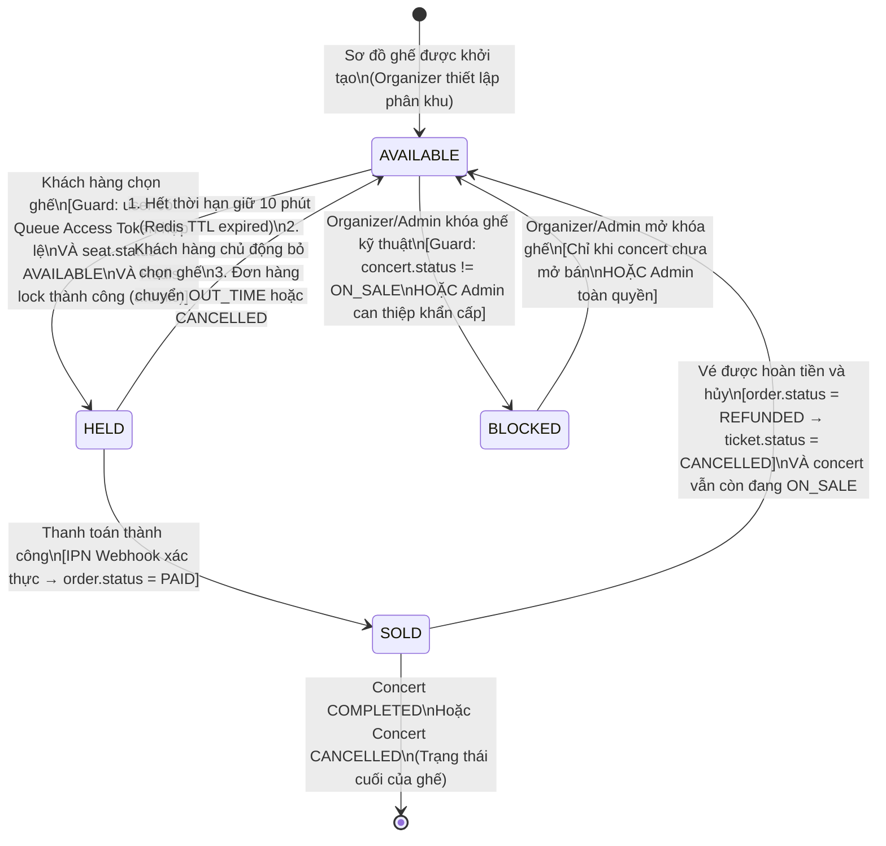
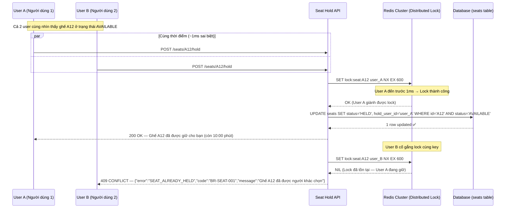
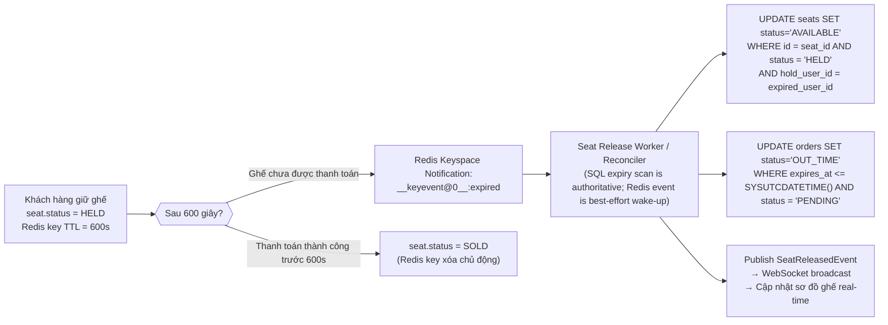

# SM02 — State Machine: Seat (Trạng Thái Ghế Ngồi)

## 1. Mục Đích

Tài liệu mô tả toàn bộ vòng đời trạng thái của một **Ghế ngồi (Seat)** trong sơ đồ khán phòng. State machine này là căn cứ để:
- Thiết kế cột `status` trong bảng `seats` (Database Design — cần Index cho query tốc độ cao).
- Thiết kế cơ chế **atomic Redis lock theo owner token kết hợp conditional update trên SQL Server** chống double-booking.
- Xác định các sự kiện domain (`SeatHeld`, `SeatReleased`, `SeatSold`) để broadcast WebSocket cập nhật sơ đồ ghế real-time.
- Xác định các guard condition cho API `/seats/hold` và `/seats/release`.

---

## 2. Danh Mục Trạng Thái (State Inventory)

| Mã trạng thái | Tên hiển thị | Màu sắc sơ đồ | Mô tả |
|---|---|---|---|
| `AVAILABLE` | Trống / Có thể chọn | 🟢 Xanh lá | Ghế chưa được ai chọn, hiển thị cho khách hàng tương tác |
| `HELD` | Đang được giữ | 🟡 Vàng | Có khách đang giữ; khóa tối đa 10 phút; chỉ 1 người tại 1 thời điểm |
| `SOLD` | Đã bán | 🔴 Đỏ | Đơn hàng đã thanh toán thành công; ghế thuộc về khách hàng |
| `BLOCKED` | Bị khóa (kỹ thuật) | ⬛ Xám đậm | Khóa bởi Organizer/Admin (ghế VIP dành riêng, hỏng hóc, che khuất tầm nhìn) |

---

## 3. Sơ Đồ Trạng Thái (State Diagram — Mermaid)



---

## 4. Bảng Chuyển Trạng Thái Chi Tiết (State Transition Table)

| # | Trạng thái hiện tại | Event / Trigger | Guard Condition | Trạng thái kế tiếp | Actor | BR liên quan |
|---|---|---|---|---|---|---|
| T-01 | `AVAILABLE` | Khách hàng gọi API chọn ghế `POST /seats/{id}/hold` | (1) `seat.status = AVAILABLE`; (2) User có `X-Queue-Token` hợp lệ còn hiệu lực; (3) Redis `SET NX EX 600` (atomic lock) thành công; (4) Số ghế đang hold của user < giới hạn concert (mặc định 4) | `HELD` | Customer | BR-SEAT-001, BR-SEAT-004, BR-QUEUE-008 |
| T-02 | `HELD` | Đến hạn hold sau 600 giây | `SYSUTCDATETIME() >= seat.hold_expires_at`; scheduler/reconciler kiểm tra SQL Server. Redis keyspace notification chỉ là tín hiệu đánh thức, không phải nguồn đảm bảo | `AVAILABLE` | System (Auto-release) | BR-SEAT-002, BR-SEAT-003 |
| T-03 | `HELD` | Khách hàng gọi API bỏ chọn ghế `DELETE /seats/{id}/hold` | `seat.hold_user_id = current_user_id` (chỉ người đang giữ mới được bỏ) | `AVAILABLE` | Customer | BR-SEAT-002 |
| T-04 | `HELD` | Đơn hàng liên kết chuyển sang `OUT_TIME` | Worker xử lý khi `SYSUTCDATETIME() >= order.expires_at` và order còn `PENDING` → giải phóng đúng hold group | `AVAILABLE` | System (Auto-release) | BR-SEAT-003, BR-ORD-002 |
| T-05 | `HELD` | Đơn hàng liên kết bị `CANCELLED` bởi khách hàng | `order.status = CANCELLED` được cập nhật; Service phát `OrderCancelledEvent` | `AVAILABLE` | System (Event-driven) | BR-ORD-007 |
| T-06 | `HELD` | IPN Webhook thanh toán thành công | `payment_transaction.status = SUCCESS`; số tiền khớp `order.final_amount` (BR-PAY-006); chữ ký hợp lệ; order và mọi seat hold vẫn còn hiệu lực tại thời điểm commit | `SOLD` | System (Webhook handler) | BR-PAY-002, BR-PAY-006 |
| T-07 | `SOLD` | Yêu cầu hoàn tiền được chấp thuận | Yêu cầu hủy đã được chấp nhận cục bộ, `order.status = REFUND_PENDING`; vé bị vô hiệu hóa; `concert.status = ON_SALE` → ghế được mở lại. Refund thất bại không tự phục hồi vé/ghế | `AVAILABLE` | System (Refund Service) | BR-RFD-003 |
| T-08 | `AVAILABLE` | Organizer/Admin khóa ghế kỹ thuật | `concert.status NOT IN ['ON_SALE']` HOẶC Admin override; `seat.status = AVAILABLE` | `BLOCKED` | Organizer / Admin | BR-SEAT-006 |
| T-09 | `BLOCKED` | Organizer/Admin mở khóa ghế | `concert.status NOT IN ['ON_SALE','SOLD_OUT']` HOẶC Admin; ghế không bị link với đơn hàng nào | `AVAILABLE` | Organizer / Admin | BR-SEAT-006 |

---

## 5. Race Condition & Xử Lý Đồng Thời (Concurrent Hold Race Condition)

### 5.1 Tình huống: 2 Người Dùng Cùng Chọn 1 Ghế



### 5.2 Chiến Lược Locking Kép (Defense in Depth)

Hệ thống áp dụng **2 lớp bảo vệ** để đảm bảo Zero Double-Booking:

1. **Tầng Redis — Distributed Lock (Tầng 1 — Tốc độ cao):**
   ```
   SET lock:seat:{seat_id} {user_id} NX EX 600
   ```
   - `NX`: Chỉ set nếu key chưa tồn tại (atomic operation).
   - `EX 600`: Tự hết hạn sau 600 giây.
   - Đây là tầng check đầu tiên, phản hồi < 5ms.

2. **Tầng Database — Optimistic Lock/Conditional Update (Tầng 2 — Độ bền):**
   ```sql
   UPDATE seats
   SET status = 'HELD',
       hold_user_id = :user_id,
       hold_started_at = SYSUTCDATETIME(),
       hold_expires_at = DATEADD(SECOND, 600, SYSUTCDATETIME()),
       version = version + 1
   WHERE id = :seat_id
     AND status = 'AVAILABLE'
     AND version = :current_version;
   ```
   - Nếu `affected_rows = 0` → có race condition vượt qua Redis → rollback và trả lỗi `SEAT_CONFLICT`.

---

## 6. Cơ Chế Tự Động Giải Phóng Ghế (Auto-Release Architecture)



---

## 7. Broadcast Cập Nhật Sơ Đồ Ghế Real-time (WebSocket Events)

Mỗi khi ghế thay đổi trạng thái, hệ thống phát sự kiện WebSocket đến toàn bộ người dùng đang xem sơ đồ ghế của concert đó (tối đa 5.000 CCU):

| Sự kiện | Payload | Trigger |
|---|---|---|
| `seat.held` | `{seat_id, new_status:"HELD", concert_id}` | T-01: Ghế bị giữ thành công |
| `seat.released` | `{seat_id, new_status:"AVAILABLE", concert_id}` | T-02, T-03, T-04, T-05: Ghế được giải phóng |
| `seat.sold` | `{seat_id, new_status:"SOLD", concert_id}` | T-06: Thanh toán thành công |
| `seat.blocked` | `{seat_id, new_status:"BLOCKED", concert_id}` | T-08: Admin/Org khóa ghế |

---

## 8. Quy Tắc Bất Biến (Seat State Invariants)

| Invariant | Mô tả |
|---|---|
| **INV-SEAT-01** | Một ghế chỉ được ở đúng một trạng thái tại một thời điểm. |
| **INV-SEAT-02** | Tổng số ghế theo concert là hằng số bất biến: `COUNT(AVAILABLE) + COUNT(HELD) + COUNT(SOLD) + COUNT(BLOCKED) = số ghế đã cấu hình cho concert` (BR-SEAT-008). |
| **INV-SEAT-03** | Ghế ở trạng thái `HELD` luôn phải có đúng một `hold_user_id` và một `hold_started_at` hợp lệ. |
| **INV-SEAT-04** | Ghế ở trạng thái `SOLD` luôn phải liên kết với đúng một `ticket_id` hợp lệ. |
| **INV-SEAT-05** | Không thể chuyển thẳng từ `AVAILABLE` sang `SOLD` mà không qua trạng thái `HELD` (đảm bảo luồng tạo đơn hàng). |
| **INV-SEAT-06** | Chuyển `HELD → AVAILABLE` chỉ do chủ hold, worker hệ thống sau khi đối chiếu owner/expiry, hoặc Admin có quyền override và audit log; thao tác release cũ không được xóa lock của owner mới. |

