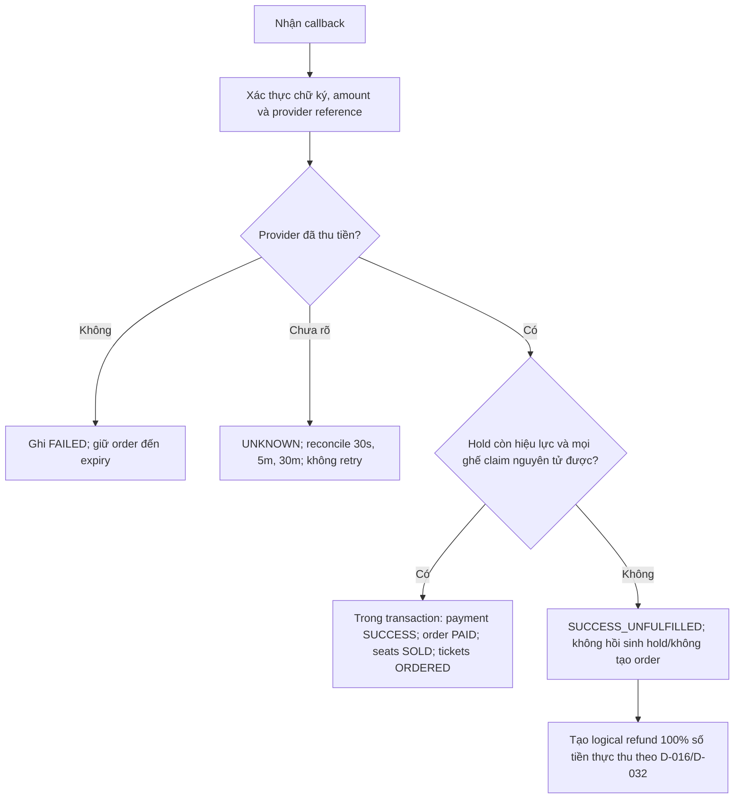

# SM03 — State Machine: Order (Trạng Thái Đơn Hàng)

## 1. Mục Đích

Tài liệu mô tả toàn bộ vòng đời trạng thái của một **Đơn Hàng (Order)** từ khi được tạo đến khi kết thúc vòng đời (hoàn tất, hết hạn, hủy, hoàn tiền). State machine này là căn cứ để:
- Thiết kế cột `status` trong bảng `orders`.
- Thiết kế Order Service API và transition logic.
- Xác định điều kiện kích hoạt hoàn tiền và giải phóng ghế.
- Xử lý edge case: thanh toán callback trễ (Late Payment Race Condition).
- Viết Integration Test cho luồng đặt vé end-to-end.

---

## 2. Danh Mục Trạng Thái (State Inventory)

| Mã trạng thái | Tên hiển thị | Mô tả |
|---|---|---|
| `PENDING` | Chờ thanh toán | Đơn vừa tạo; ghế đang giữ (`HELD`); đếm ngược 10 phút |
| `PAID` | Đã thanh toán | IPN Webhook thành công, đúng số tiền, chữ ký hợp lệ; vé đã được phát hành |
| `OUT_TIME` | Hết hạn thanh toán | 10 phút không hoàn tất thanh toán; ghế tự động trả về `AVAILABLE` |
| `CANCELLED` | Đã hủy | Khách hủy đơn khi còn `PENDING`; hold được giải phóng |
| `REFUND_PENDING` | Đang xử lý hoàn tiền | Refund request đã được chấp nhận; vé bị vô hiệu hóa; chờ kết quả provider |
| `REFUNDED` | Đã hoàn tiền | Refund record xác nhận hoàn tất; vé `CANCELLED` |
| `REFUND_FAILED` | Hoàn tiền lỗi cần xử lý | Provider từ chối/hết retry; cần retry hoặc vận hành xử lý thủ công; không khôi phục vé/ghế hay order về `PAID` |

---

## 3. Sơ Đồ Trạng Thái (State Diagram — Mermaid)

```mermaid
stateDiagram-v2
    [*] --> PENDING : Tạo order từ hold group còn hạn

    PENDING --> PAID : Payment callback hợp lệ\n[số tiền = order.final_amount; order và toàn bộ hold còn hiệu lực]
    PENDING --> OUT_TIME : Đến orders.expires_at\n[hold group đã hết hạn; ghế được release]
    PENDING --> CANCELLED : Khách chủ động hủy\n[ghế được release]

    PAID --> REFUND_PENDING : Yêu cầu hoàn tiền được chấp nhận\n[đủ điều kiện theo BR-RFD; không có vé CHECKED]
    PAID --> REFUND_PENDING : Concert hủy trước COMPLETED\n[100% final_amount cho mọi vé, kể cả CHECKED; D-017]
    REFUND_PENDING --> REFUNDED : Refund provider xác nhận thành công
    REFUND_PENDING --> REFUND_FAILED : Refund bị từ chối/hết retry
    REFUND_FAILED --> REFUND_PENDING : Retry hoặc xử lý thủ công được duyệt

    OUT_TIME --> [*]
    CANCELLED --> [*]
    REFUNDED --> [*]
    PAID --> [*] : Concert kết thúc và hết thời hạn khiếu nại
```

---

## 4. Bảng Chuyển Trạng Thái Chi Tiết

| # | Trạng thái hiện tại | Event / Trigger | Guard Condition | Trạng thái kế tiếp | Actor | BR liên quan |
|---|---|---|---|---|---|---|
| T-01 | _(Không tồn tại)_ | Khách gọi `POST /orders` | Toàn bộ `seat_ids` trong payload đang ở `HELD` và `hold_user_id = current_user_id`; Tổng vé trong đơn ≤ giới hạn concert; Idempotency-Key chưa xử lý | `PENDING` | Customer | BR-ORD-001, BR-ORD-003, BR-ORD-008 |
| T-02 | `PENDING` | Nhận payment callback hợp lệ | Chữ ký hợp lệ; `amount_paid = order.final_amount`; `order_id` khớp; order còn `PENDING` và thời điểm xử lý nằm trong hold expiry | `PAID` | System (Webhook) | BR-PAY-002, BR-PAY-006 |
| T-03 | `PENDING` | Worker xử lý hết hạn | `SYSUTCDATETIME() >= order.expires_at` VÀ `order.status = PENDING`; `order.expires_at` kế thừa hạn hold group, không phải `created_at + 600s` | `OUT_TIME` | System (Scheduler/Reconciler) | BR-ORD-002, BR-SEAT-003 |
| T-04 | `PENDING` | Khách gọi `DELETE /orders/{id}` | `order.customer_id = current_user_id`; `order.status = PENDING` | `CANCELLED` | Customer | BR-ORD-007 |
| T-05 | PAID | Khách gửi yêu cầu refund | order.status = PAID; tính số ngày lịch tại múi giờ địa điểm theo BR-RFD-001; không có ticket CHECKED theo BR-RFD-006 | REFUND_PENDING hoặc bị từ chối nếu mức refund là 0% | Customer | BR-RFD-001, BR-RFD-002, BR-RFD-006 |
| T-06 | PAID | Concert bị hủy trước COMPLETED | ConcertCancelledEvent; mọi ticket, kể cả CHECKED, bị vô hiệu hóa; refund 100% order.final_amount; không mở lại ghế | REFUND_PENDING | System (Event-driven) | BR-RFD-004, D-017 |
| T-07 | `REFUND_PENDING` | Provider xác nhận refund thành công | Số tiền khớp với `refunds.refund_amount`; callback hợp lệ và idempotent | `REFUNDED` | System (Webhook) | BR-RFD-005 |
| T-08 | `REFUND_PENDING` | Provider từ chối/hết retry | Ghi `refunds.status = FAILED`; tạo tác vụ retry/manual; vé đã hủy và ghế đã giải phóng không tự phục hồi | `REFUND_FAILED` | System / Admin | BR-RFD-005 |
| T-09 | REFUND_FAILED | Retry hoặc xử lý thủ công | Chỉ sau provider failure xác định; tối đa 3 lần; timeout/UNKNOWN phải reconcile theo D-032; giữ logical idempotency key | REFUND_PENDING | System / Admin | BR-RFD-005, D-019, D-032 |

---

## 5. Xử Lý Trường Hợp Đặc Biệt: Late Payment Callback

Nếu payment được provider xác nhận thành công sau khi hold hết hạn hoặc order đã OUT_TIME/CANCELLED:
1. Không hồi sinh hold, không claim lại ghế dù ghế hiện đang trống, không tạo order mới.
2. Ghi payment transaction SUCCESS_UNFULFILLED; order giữ OUT_TIME/CANCELLED và không phát hành ticket.
3. Sau reconciliation xác nhận tiền đã thu, tạo một refund 100% số tiền thực thu. Timeout/retry theo D-032; không gửi refund lần thứ hai khi trạng thái UNKNOWN.



## 6. Cơ Chế Idempotency Key (Chống Tạo Đơn Trùng)

```mermaid
sequenceDiagram
    participant C as Client
    participant API as Order API
    participant DB as Database

    C->>API: POST /orders\nHeaders: Idempotency-Key: uuid-xyz\nBody: {seat_ids: [...]}

    API->>DB: SELECT id, order_code, status, expires_at, final_amount FROM orders\nWHERE idempotency_key = 'uuid-xyz' (retention ≥ 24h); dựng lại response từ order

    alt Key chưa tồn tại
        DB-->>API: NULL (chưa xử lý)
        API->>DB: INSERT order (idempotency_key UNIQUE) + order_items\n(atomic SQL Server transaction)
        DB-->>API: Order tạo thành công
        API-->>C: 201 Created {order_id: "ORD-20261024-XXXXX"}
    else Key đã tồn tại (request trùng lặp)
        DB-->>API: {order_id: "ORD-20261024-XXXXX", status: "PENDING"}
        API-->>C: 200 OK {order_id: "ORD-20261024-XXXXX"} (Cùng kết quả)
    end
```

---

## 7. Định Dạng Mã Đơn Hàng (Order Code Format)

```
ORD-{YYYYMMDD}-{XXXXXX}

Ví dụ: ORD-20261024-A3F9K2

Trong đó:
- YYYYMMDD: Ngày tạo đơn (UTC+7)
- XXXXXX: 6 ký tự alphanumeric ngẫu nhiên (Base36 encoding từ UUID)
```

Yêu cầu:
- Duy nhất toàn hệ thống (Global Unique).
- Không đoán được thứ tự (Không phải sequential integer).
- Có thể đọc và đọc qua điện thoại/chat hỗ trợ.

---

## 8. Quy Tắc Bất Biến (Order State Invariants)

| Invariant | Mô tả |
|---|---|
| **INV-ORD-01** | Một đơn hàng chỉ ở đúng một trạng thái tại một thời điểm. |
| **INV-ORD-02** | `OUT_TIME`, `CANCELLED`, `REFUNDED` là terminal; `PAID` có thể sang `REFUND_PENDING`; `REFUND_FAILED` chỉ retry/manual theo audit, không rollback thành `PAID`. |
| **INV-ORD-03** | Không thể tạo đơn hàng khi đang có đơn hàng `PENDING` đang dùng cùng `seat_id`. |
| **INV-ORD-04** | Mọi snapshot tiền bất biến sau khi tạo: `final_amount = total_amount - discount_amount + service_fee_amount + tax_amount`; callback thanh toán phải khớp `final_amount`. |
| **INV-ORD-05** | Một đơn hàng `PAID` không được hủy nếu có bất kỳ vé nào trong đơn đã ở trạng thái `CHECKED`. |
| **INV-ORD-06** | `order.expires_at` bằng hạn cố định của hold group (600 giây từ lần giữ đầu tiên); tạo order không khởi động lại hoặc gia hạn đồng hồ. |

