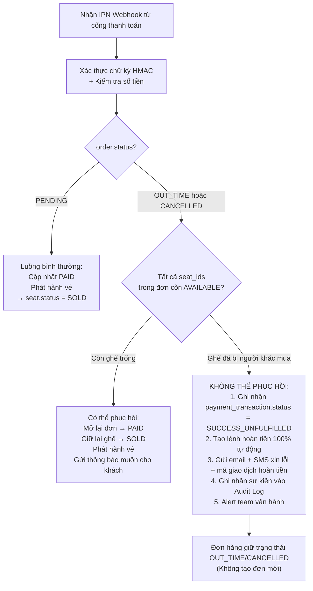
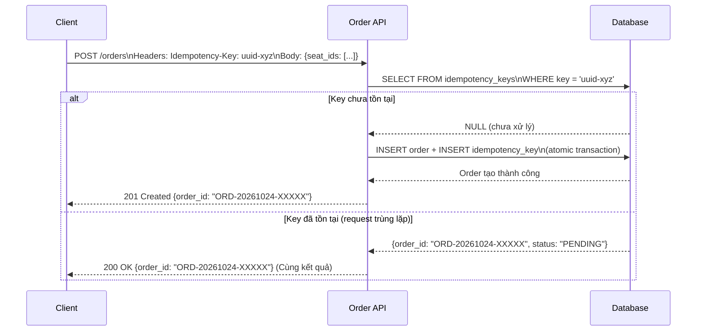

# SM03 — State Machine: Order (Trạng Thái Đơn Hàng)

## 1. Mục Đích

Tài liệu mô tả toàn bộ vòng đời trạng thái của một **Đơn Hàng (Order)** từ khi được tạo đến khi kết thúc vòng đời (hoàn tất, hết hạn, hủy, hoàn tiền). State machine này là căn cứ để:
- Thiết kế cột `status` trong bảng `orders`.
- Thiết kế Order Service API và transition logic.
- Xác định điều kiện kích hoạt hoàn tiền và giải phóng ghế.
- Xử lý edge case: thanh toán callback trễ (Late Payment Race Condition).
- Viết Integration Test cho luồng đặt vé end-to-end.

---

## 2. Danh Mục Trạng Thái (State Inventory)

| Mã trạng thái | Tên hiển thị | Mô tả |
|---|---|---|
| `PENDING` | Chờ thanh toán | Đơn vừa tạo; ghế đang giữ (`HELD`); đếm ngược 10 phút |
| `PAID` | Đã thanh toán | IPN Webhook thành công, đúng số tiền, chữ ký hợp lệ; vé đã được phát hành |
| `OUT_TIME` | Hết hạn thanh toán | 10 phút không hoàn tất thanh toán; ghế tự động trả về `AVAILABLE` |
| `CANCELLED` | Đã hủy | Khách hủy chủ động (khi PENDING) hoặc concert bị hủy (khi PAID) |
| `REFUND_PENDING` | Đang xử lý hoàn tiền | Yêu cầu hoàn tiền đã gửi tới cổng thanh toán, chờ xác nhận |
| `REFUNDED` | Đã hoàn tiền | Tiền đã hoàn về tài khoản/ví khách hàng; vé `CANCELLED` |

---

## 3. Sơ Đồ Trạng Thái (State Diagram — Mermaid)

```mermaid
stateDiagram-v2
    [*] --> PENDING : Khách hàng tạo đơn hàng\n[ghế đang HELD; countdown 10 phút]

    PENDING --> PAID : IPN Webhook thành công\n[Chữ ký HMAC hợp lệ\nVÀ amount khớp order.total_amount]

    PENDING --> OUT_TIME : Hết hạn 10 phút\n[Timer expired; ghế → AVAILABLE]

    PENDING --> CANCELLED : Khách hàng hủy đơn chủ động\n[Chỉ được hủy khi PENDING\nghế → AVAILABLE ngay lập tức]

    PAID --> REFUND_PENDING : Khách hàng gửi yêu cầu hoàn tiền\n[Guard: trước concert > 3 ngày\nVÀ không có vé nào đã CHECKED]

    PAID --> CANCELLED : Concert bị hủy (Admin kích hoạt)\n[Hệ thống tự động; kích hoạt hoàn tiền 100%]

    REFUND_PENDING --> REFUNDED : Cổng thanh toán xác nhận hoàn tiền thành công\n[IPN Refund Webhook hợp lệ]

    REFUND_PENDING --> PAID : Hoàn tiền thất bại tại cổng\n[Retry hoặc xử lý thủ công bởi Admin]

    OUT_TIME --> [*]
    CANCELLED --> [*]
    REFUNDED --> [*]
    PAID --> [*] : Concert COMPLETED + Hết thời hạn khiếu nại
```



---

## 4. Bảng Chuyển Trạng Thái Chi Tiết

| # | Trạng thái hiện tại | Event / Trigger | Guard Condition | Trạng thái kế tiếp | Actor | BR liên quan |
|---|---|---|---|---|---|---|
| T-01 | _(Không tồn tại)_ | Khách gọi `POST /orders` | Toàn bộ `seat_ids` trong payload đang ở `HELD` và `hold_user_id = current_user_id`; Tổng vé trong đơn ≤ giới hạn concert; Idempotency-Key chưa xử lý | `PENDING` | Customer | BR-ORD-001, BR-ORD-003, BR-ORD-008 |
| T-02 | `PENDING` | Nhận IPN Webhook từ VNPay/MoMo | Chữ ký HMAC SHA512 hợp lệ; `amount_paid = order.total_amount`; `order_id` khớp; đơn vẫn còn `PENDING` (chống idempotent) | `PAID` | System (Webhook) | BR-PAY-002, BR-PAY-006 |
| T-03 | `PENDING` | Timer 10 phút hết hạn | `current_time > order.expires_at` VÀ `order.status = PENDING` | `OUT_TIME` | System (Scheduler) | BR-ORD-002, BR-SEAT-003 |
| T-04 | `PENDING` | Khách gọi `DELETE /orders/{id}` | `order.customer_id = current_user_id`; `order.status = PENDING` | `CANCELLED` | Customer | BR-ORD-007 |
| T-05 | `PAID` | Khách gửi `POST /orders/{id}/refund` | `order.status = PAID`; `(concert.event_date - now()) > 72h`; Không có ticket nào có `status = CHECKED` trong đơn hàng này | `REFUND_PENDING` | Customer | BR-RFD-001, BR-RFD-002, BR-RFD-006 |
| T-06 | `PAID` | Concert bị Admin hủy | `ConcertCancelledEvent` nhận bởi Order Service; `order.status = PAID` | `CANCELLED` | System (Event-driven) | BR-RFD-004 |
| T-07 | `CANCELLED` (từ PAID) | Hệ thống tự động kích hoạt hoàn tiền | Concert cancelled → `CancelledOrder` triggers refund flow (100%) | `REFUND_PENDING` | System (Auto) | BR-RFD-004 |
| T-08 | `REFUND_PENDING` | Nhận IPN Refund Webhook thành công | Cổng thanh toán xác nhận hoàn tiền; `refund_amount = order.total_amount` (hoặc % theo chính sách) | `REFUNDED` | System (Webhook) | BR-RFD-005 |
| T-09 | `REFUND_PENDING` | Hoàn tiền thất bại tại cổng | Cổng trả lỗi (timeout, lỗi ngân hàng); đặt vào Dead Letter Queue để retry hoặc Admin xử lý thủ công | `PAID` (rollback) | System / Admin | BR-RFD-005 |

---

## 5. Xử Lý Trường Hợp Đặc Biệt: Late Payment Callback (Thanh Toán Callback Trễ)

Đây là edge case nghiêm trọng nhất cần thiết kế cẩn thận:

### Tình huống:
1. Khách hàng hoàn tất thanh toán tại cổng VNPay/MoMo trước 10 phút.
2. Do lỗi mạng, IPN Webhook **gửi đến server SAU** khi đơn đã chuyển `OUT_TIME`.
3. Trong khoảng thời gian đó, ghế đã được người khác mua thành công.

### Phương án xử lý (BR-PAY-003):



---

## 6. Cơ Chế Idempotency Key (Chống Tạo Đơn Trùng)



---

## 7. Định Dạng Mã Đơn Hàng (Order Code Format)

```
ORD-{YYYYMMDD}-{XXXXXX}

Ví dụ: ORD-20261024-A3F9K2

Trong đó:
- YYYYMMDD: Ngày tạo đơn (UTC+7)
- XXXXXX: 6 ký tự alphanumeric ngẫu nhiên (Base36 encoding từ UUID)
```

Yêu cầu:
- Duy nhất toàn hệ thống (Global Unique).
- Không đoán được thứ tự (Không phải sequential integer).
- Có thể đọc và đọc qua điện thoại/chat hỗ trợ.

---

## 8. Quy Tắc Bất Biến (Order State Invariants)

| Invariant | Mô tả |
|---|---|
| **INV-ORD-01** | Một đơn hàng chỉ ở đúng một trạng thái tại một thời điểm. |
| **INV-ORD-02** | `PAID`, `OUT_TIME`, `CANCELLED`, `REFUNDED` đều là trạng thái cuối (Terminal) sau khi đạt được — ngoại trừ `CANCELLED → REFUND_PENDING` khi concert bị hủy. |
| **INV-ORD-03** | Không thể tạo đơn hàng khi đang có đơn hàng `PENDING` đang dùng cùng `seat_id`. |
| **INV-ORD-04** | Số tiền `total_amount` được đóng băng tại thời điểm tạo đơn; không thể thay đổi sau đó. |
| **INV-ORD-05** | Một đơn hàng `PAID` không được hủy nếu có bất kỳ vé nào trong đơn đã ở trạng thái `CHECKED`. |
| **INV-ORD-06** | `order.expires_at = order.created_at + 600 seconds` (cố định, không thể gia hạn). |
