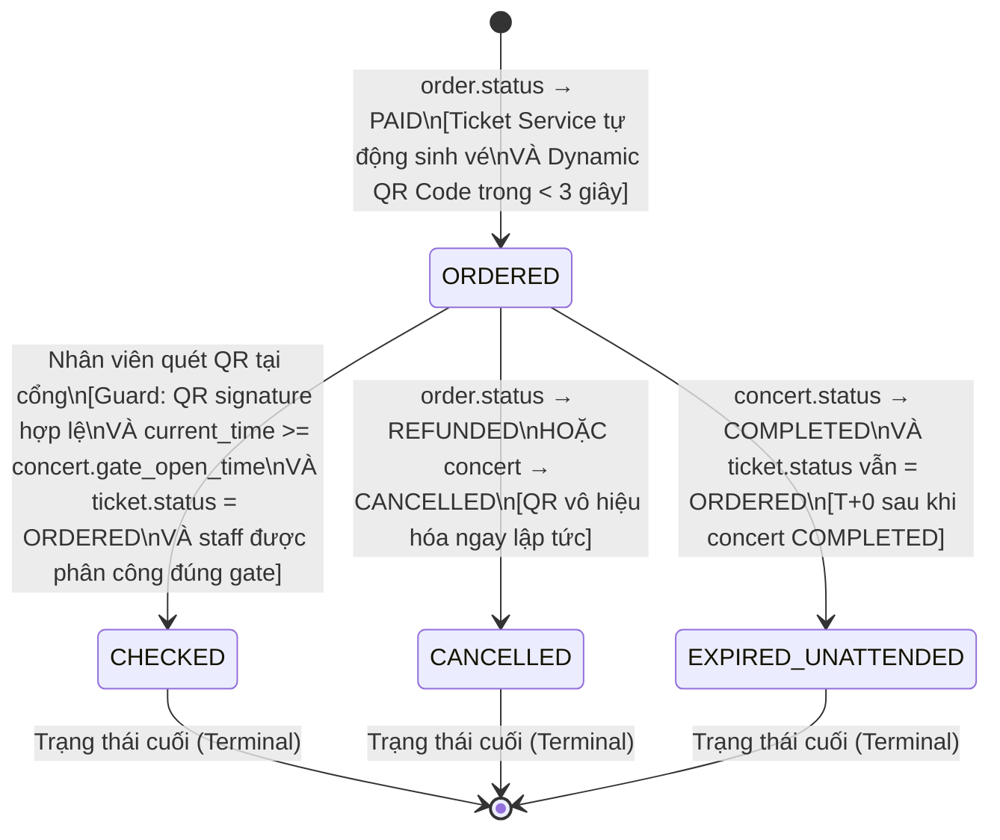

# SM04 — State Machine: Ticket (Trạng Thái Vé Điện Tử)

> **Phạm vi:** check-in online là baseline. Khi không thể xác thực trên server, check-in fail-closed theo D-023; không có luồng OFFLINE_SYNC.

## 1. Mục Đích

Tài liệu mô tả toàn bộ vòng đời trạng thái của một **Vé Điện Tử (E-Ticket)** từ khi được phát hành sau thanh toán đến khi được sử dụng hoặc hủy. State machine này là căn cứ để:
- Thiết kế cột `status` trong bảng `tickets`.
- Thiết kế Check-in API và xử lý quét QR tại cổng sự kiện.
- Định nghĩa cấu trúc Dynamic QR Code (JWT payload, rotation logic).
- Từ chối check-in khi mất kết nối; không chấp nhận cache cục bộ làm nguồn xác thực.
- Viết Test Case kiểm tra phòng chống vé giả / quét trùng.

---

## 2. Danh Mục Trạng Thái (State Inventory)

| Mã trạng thái | Tên hiển thị | Mô tả |
|---|---|---|
| `ORDERED` | Đã phát hành | Vé được tạo sau khi thanh toán thành công; mã QR hoạt động; chủ vé có thể xem và trình QR |
| `CHECKED` | Đã check-in | Mã QR đã được quét thành công tại cổng sự kiện; vé đã sử dụng; không thể check-in lại |
| `CANCELLED` | Đã hủy | Vé bị hủy do đơn hàng được hoàn tiền hoặc concert bị hủy; mã QR vô hiệu hóa ngay lập tức |
| `EXPIRED_UNATTENDED` | Hết hạn - Không tham dự | Concert đã hoàn thành nhưng vé không được quét (Chủ vé vắng mặt) |

---

## 3. Sơ Đồ Trạng Thái (State Diagram — Mermaid)



---

## 4. Bảng Chuyển Trạng Thái Chi Tiết

| # | Trạng thái hiện tại | Event / Trigger | Guard Condition | Trạng thái kế tiếp | Actor | BR liên quan |
|---|---|---|---|---|---|---|
| T-01 | _(Không tồn tại)_ | `order.status` chuyển sang `PAID` | IPN Webhook xác thực thành công; Order Service phát `OrderPaidEvent`; Ticket Service lắng nghe | `ORDERED` | System (Auto) | BR-TCK-001 |
| T-02 | `ORDERED` | Nhân viên quét mã QR qua Staff App | (1) Chữ ký JWT RS256 hợp lệ, xác minh bằng public key; (2) `concert.gate_open_time <= now() <= concert.end_time + buffer`; (3) `ticket.status = ORDERED`; (4) Staff token có quyền tại gate được phân công | `CHECKED` | Staff | BR-TCK-003, BR-TCK-004, BR-TCK-007 |
| T-03 | `ORDERED` | `order.status` chuyển sang `REFUNDED` | Refund Service hoàn tất; `OrderRefundedEvent` phát tới Ticket Service | `CANCELLED` | System (Event-driven) | BR-RFD-003 |
| T-04 | `ORDERED` | `concert.status` chuyển sang `CANCELLED` | `ConcertCancelledEvent`; Ticket Service cập nhật hàng loạt toàn bộ vé của concert | `CANCELLED` | System (Event-driven) | BR-RFD-004 |
| T-05 | `ORDERED` | `concert.status` chuyển sang `COMPLETED` | `ConcertCompletedEvent`; Ticket Service quét tất cả vé `ORDERED` còn lại của concert | `EXPIRED_UNATTENDED` | System (Batch job) | BR-TCK-008 |

---

## 5. Cấu Trúc Mã QR Động (Dynamic QR Code Architecture)

### 5.1 Luồng sinh và làm mới QR Code

```mermaid
sequenceDiagram
    participant APP as Mobile App (Customer)
    participant TK_API as Ticket API
    participant QR_SVC as QR Code Service

    APP->>TK_API: GET /tickets/{ticket_id}/qr-token
    TK_API->>TK_API: Kiểm tra ticket.status = ORDERED
    TK_API->>QR_SVC: Sinh JWT payload cho QR Code

    QR_SVC->>QR_SVC: Build JWT Payload:\n{ticket_id, concert_id, seat_id, iat,\nexp: iat+60, nonce}; không chứa PII
    QR_SVC->>QR_SVC: Ký bằng RS256 Private Key\n(Lưu trữ an toàn, rotate định kỳ)
    QR_SVC-->>TK_API: jwt_token (string)

    TK_API-->>APP: {qr_token: "eyJhbGci...", expires_in: 60}
    APP->>APP: Render QR Code từ jwt_token\nHiển thị đồng hồ đếm ngược 60s

    Note over APP: Sau 30 giây (token có hiệu lực tối đa 60 giây)
    APP->>TK_API: Tự động gọi lại GET /tickets/{id}/qr-token
    TK_API-->>APP: QR Token mới (rotation)
```

### 5.2 Cấu trúc JWT Payload của QR Token

```json
{
  "ticket_id": "tkt_9b1deb4d-3b7d-4bad-9bdd-2b0d7b3dcb6d",
  "concert_id": "cnc_mytam_2026_hanoi",
  "seat_id": "seat_A_VIP_012",
  "iat": 1774350000,
  "exp": 1774350060,
  "nonce": "f2a81c09"
}
```

Header:
```json
{
  "alg": "RS256",
  "kid": "qr-signing-key-v3"
}
```

### 5.3 Quy trình xác thực QR tại cổng (Staff App)

```mermaid
flowchart TD
    A["Nhân viên quét QR\n→ Lấy JWT string từ mã QR"] --> B["Verify JWT signature\nbằng RSA Public Key\n(key được cài sẵn trong app)"]
    B --> C{Chữ ký hợp lệ?}
    C -->|Không hợp lệ| ERR1["❌ VÉ GIẢ MẠO\nBáo cáo an ninh ngay"]
    C -->|Hợp lệ| D{JWT còn hạn?\n(exp > now())}
    D -->|Hết hạn > 60s| ERR2["⚠️ QR ĐÃ HẾT HẠN\nYêu cầu khách làm mới\n(mở app để tự động refresh)"]
    D -->|Còn hạn| E["Gọi API xác thực online\nPOST /checkin\n{ticket_id, gate_id, staff_id}"]
    E --> F{ticket.status?}
    F -->|ORDERED| G["✅ HỢP LỆ\nCập nhật CHECKED\nHiển thị màn xanh"]
    F -->|CHECKED| H["❌ ĐÃ CHECK-IN LÚC {time}\nTẠI CỔNG {gate}\nHiển thị màn đỏ + cảnh báo"]
    F -->|CANCELLED| I["❌ VÉ ĐÃ BỊ HỦY\nHiển thị màn cam"]
```

---

## 6. Mất kết nối và thao tác hỗ trợ

Khi scanner không thể xác thực online, không được chuyển ticket sang CHECKED, không hiển thị thành công và không chấp nhận dữ liệu cache/JWT đơn lẻ. Staff chuyển sự cố cho Gate Supervisor theo quy trình vận hành địa điểm. Nếu phải dùng manual override, thao tác cần xác thực online, quyền phù hợp, lý do bắt buộc và audit log; không được tạo một cơ chế offline sync.

Khi mạng phục hồi, staff thực hiện scan lại. Scan ID/idempotency key bảo đảm retry không tạo check-in thành công trùng. Mọi check-in thành công vẫn phải cập nhật ticket và checkin_logs trong transaction nhất quán.
## 7. Quy Tắc Bất Biến (Ticket State Invariants)

| Invariant | Mô tả |
|---|---|
| **INV-TCK-01** | Mỗi vé chỉ được check-in tối đa 1 lần (Zero Duplicate Entry). Bất kỳ cố gắng check-in vé đã `CHECKED` đều bị từ chối và ghi log cảnh báo. |
| **INV-TCK-02** | Mỗi vé điện tử liên kết 1-1 với đúng 1 ghế cụ thể và 1 đơn hàng. |
| **INV-TCK-03** | Khi vé `CANCELLED`, mã QR phải bị vô hiệu hóa tức thì — server từ chối toàn bộ token JWT của vé này ngay cả khi JWT chưa hết hạn `exp`. |
| **INV-TCK-04** | Không thể phục hồi vé từ trạng thái `CANCELLED` hoặc `CHECKED` sang `ORDERED`. |
| **INV-TCK-05** | Một `order.status = PAID` luôn có số lượng vé `ORDERED` bằng đúng số ghế trong đơn hàng (1 ghế = 1 vé). |

