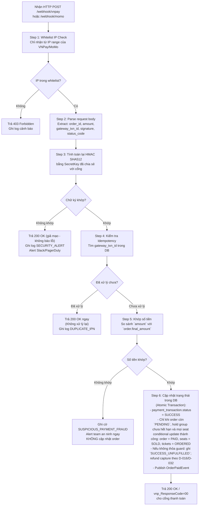
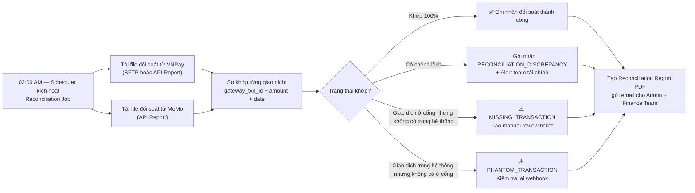

# SM05 — State Machine: Payment Transaction & Refund (Trạng Thái Giao Dịch Thanh Toán & Hoàn Tiền)

## 1. Mục Đích

Tài liệu mô tả toàn bộ vòng đời trạng thái của một **Giao Dịch Thanh Toán (Payment Transaction)** — bao gồm cả luồng thanh toán mua vé và luồng hoàn tiền ngược lại. State machine này là căn cứ để:
- Thiết kế bảng `payment_transactions` cho thanh toán và bảng `refunds` riêng cho hoàn tiền; mỗi luồng có trạng thái/audit độc lập.
- Thiết kế Payment Service và Webhook Handler an toàn.
- Xử lý đặc biệt: IPN trùng lặp, callback trễ, hoàn tiền thất bại, đối soát tài chính.
- Thiết kế hệ thống cảnh báo gian lận thanh toán (Fraud Detection).

---

## 2. Danh Mục Trạng Thái (State Inventory)

### 2.1 Thanh Toán Mua Vé (Payment Flow)

| Mã trạng thái | Tên hiển thị | Mô tả |
|---|---|---|
| `INITIATED` | Khởi tạo | Yêu cầu thanh toán vừa được tạo, chờ cổng xử lý (người dùng chưa hoàn thành giao dịch) |
| `PROCESSING` | Đang xử lý | Người dùng đang nhập thông tin thanh toán tại cổng VNPay / MoMo |
| `SUCCESS` | Thành công | Cổng thanh toán xác nhận giao dịch hoàn tất; tiền đã được trừ |
| `FAILED` | Thất bại xác định | Provider xác nhận thất bại; không dùng cho timeout chưa rõ kết quả |
| `UNKNOWN` | Chưa rõ kết quả | Không nhận được phản hồi đủ để biết provider đã thu tiền hay chưa; cần đối soát trước retry |
| `SUCCESS_UNFULFILLED` | Đã thu tiền nhưng chưa fulfillment | Provider đã capture nhưng hold hết hạn hoặc không thể claim ghế; không cấp vé, không tạo order mới, refund 100% capture sau xác minh theo D-016/D-032 |

### 2.2 Hoàn Tiền (Refund Flow)

| Mã trạng thái | Tên hiển thị | Mô tả |
|---|---|---|
| `PENDING` | Chờ gửi/khởi tạo | Refund request đã được ghi trong `refunds`; chưa có kết quả cuối từ provider |
| `PROCESSING` | Đang xử lý | Provider đã nhận yêu cầu hoàn tiền |
| `COMPLETED` | Đã hoàn tiền | Provider xác nhận hoàn tiền thành công |
| `FAILED` | Hoàn tiền thất bại | Provider từ chối/hết retry; cần retry hoặc xử lý thủ công |
| `REJECTED` | Bị từ chối | Refund request không đạt chính sách/điều kiện trước khi gửi provider |

---

## 3. Sơ Đồ Trạng Thái (State Diagram — Mermaid)

### 3.1 Luồng Thanh Toán Mua Vé

```mermaid
stateDiagram-v2
    [*] --> INITIATED : Hệ thống tạo Payment Request\nvà gọi API cổng thanh toán\n[order.status = PENDING]

    INITIATED --> PROCESSING : Người dùng mở màn hình\nthanh toán của cổng

    PROCESSING --> SUCCESS : Người dùng hoàn tất thanh toán\n[Cổng gửi IPN Webhook SUCCESS]

    PROCESSING --> FAILED : Provider xác nhận OTP/ngân hàng từ chối
    INITIATED --> UNKNOWN : Timeout 30 giây, chưa rõ provider đã thu tiền hay chưa
    PROCESSING --> UNKNOWN : Mất callback/response và chưa thể xác minh kết quả
    UNKNOWN --> SUCCESS : Reconciliation xác nhận đã thu tiền\n[order/hold còn hiệu lực và claim ghế thành công]
    UNKNOWN --> SUCCESS_UNFULFILLED : Reconciliation xác nhận đã thu tiền\n[hold hết hạn/không claim đủ ghế; D-016]
    UNKNOWN --> FAILED : Reconciliation xác nhận không thu tiền

    SUCCESS --> SUCCESS_UNFULFILLED : Callback thành công đến sau hold expiry\nVÀ order đã OUT_TIME hoặc ghế không thể claim nguyên tử\n[Không thể phục hồi ghế]

    SUCCESS --> [*] : Trạng thái cuối (giao dịch thanh toán thành công)\norder → PAID, ticket → ORDERED

    SUCCESS_UNFULFILLED --> [*] : Payment state được chốt; tạo logical refunds 100% số tiền thực thu sau capture xác nhận theo D-016/D-032

    UNKNOWN --> [*] : Giữ trạng thái chờ reconciliation; không khởi tạo lần thu tiền khác khi kết quả chưa rõ
    FAILED --> [*] : Provider xác nhận thất bại; order giữ PENDING đến khi OUT_TIME
```

### 3.2 Luồng Hoàn Tiền

```mermaid
stateDiagram-v2
    [*] --> PENDING : Tạo refunds record sau khi chính sách được kiểm tra

    PENDING --> PROCESSING : Provider chấp nhận yêu cầu
    PROCESSING --> COMPLETED : Refund callback hợp lệ xác nhận thành công
    PROCESSING --> UNKNOWN : Timeout chưa xác định kết quả\nUNKNOWN --> FAILED : Reconciliation xác nhận provider không thu tiền\nPROCESSING --> FAILED : Provider xác nhận thất bại
    FAILED --> PENDING : Retry/manual action được duyệt; giữ lịch sử từng lần thử
    PENDING --> REJECTED : Yêu cầu không đủ điều kiện trước khi gửi provider

    COMPLETED --> [*] : Hoàn tất
    REJECTED --> [*] : Kết thúc không gửi tiền
    FAILED --> [*] : Khi chuyển manual queue; order vẫn REFUND_FAILED
```



---

## 4. Bảng Chuyển Trạng Thái Chi Tiết

### 4.1 Luồng Thanh Toán

| # | Trạng thái hiện tại | Event / Trigger | Guard Condition | Trạng thái kế tiếp | BR liên quan |
|---|---|---|---|---|---|
| T-01 | _(Không tồn tại)_ | Order Service tạo Payment Transaction | `order.status = PENDING`; Idempotency-Key chưa xử lý | `INITIATED` | BR-PAY-004 |
| T-02 | `INITIATED` | Người dùng được chuyển hướng đến cổng | VNPay/MoMo confirm redirect | `PROCESSING` | — |
| T-03 | PROCESSING | Nhận callback hợp lệ | Chữ ký/amount/reference hợp lệ; nếu hold còn hiệu lực và claim tất cả ghế nguyên tử thành công thì PAID; nếu hết hạn thì SUCCESS_UNFULFILLED | SUCCESS hoặc SUCCESS_UNFULFILLED | BR-PAY-002, BR-PAY-003 |
| T-04 | `PROCESSING` | Provider từ chối giao dịch | IPN/callback có mã thất bại đã xác thực; không dùng timeout đơn thuần làm bằng chứng thất bại | `FAILED` | — |
| T-04a | PROCESSING | Không nhận callback | Timeout sau 30 giây, kết quả thu tiền chưa rõ; status UNKNOWN; reconcile ở 30s/5m/30m; không tạo attempt khác | UNKNOWN | D-033 |
| T-05 | INITIATED | Timeout kết nối tới cổng | Sau 30 giây chưa có kết quả; UNKNOWN, đối soát trước retry; quá 30 phút chuyển support queue | UNKNOWN | D-033 |
| T-06 | UNKNOWN | Reconciliation nhận kết quả provider | Không thu tiền/thất bại xác định → FAILED; thu tiền + hold hợp lệ + claim thành công → SUCCESS; thu tiền nhưng không thể fulfill → SUCCESS_UNFULFILLED; lưu provider reference | FAILED/SUCCESS/SUCCESS_UNFULFILLED | D-016, D-033 |
| T-07 | SUCCESS | Callback thành công đến sau hold expiry hoặc order OUT_TIME | Không claim ghế, không tạo order mới; ghi SUCCESS_UNFULFILLED | SUCCESS_UNFULFILLED | BR-PAY-003, D-016 |
| T-R-01 | SUCCESS_UNFULFILLED | Capture đã xác minh | Tạo một logical refund 100% số tiền thực thu; idempotency key duy nhất; timeout theo D-032 | Refund PENDING/UNKNOWN | BR-PAY-003, D-016 |

### 4.2 Luồng Hoàn Tiền

| # | Trạng thái hiện tại | Event / Trigger | Guard Condition | Trạng thái kế tiếp | BR liên quan |
|---|---|---|---|---|---|
| T-R-01 | SUCCESS_UNFULFILLED | Capture đã xác minh | Tạo một logical refund 100% số tiền thực thu; idempotency key duy nhất; timeout theo D-032 | Refund PENDING/UNKNOWN | BR-PAY-003, D-016 |
| T-R-02 | `PENDING` | Provider nhận yêu cầu | Provider reference được ghi; request có idempotency key | `PROCESSING` | — |
| T-R-03 | `PROCESSING` | Refund callback thành công | Chữ ký hợp lệ; amount khớp `refunds.refund_amount`; callback idempotent | `COMPLETED` | BR-RFD-005 |
| T-R-04 | PROCESSING | Provider timeout/không có kết quả | Chưa biết hoàn tiền đã thực hiện hay chưa; chuyển UNKNOWN, reconcile 30s/5m/30m; không retry mù | UNKNOWN | D-032 |
| T-R-05 | FAILED | Provider xác nhận thất bại | Retry tối đa 3 lần sau backoff 1/5/30 phút; logical idempotency key không đổi; không vượt refundable amount | PENDING | D-019, D-032 |
| T-R-06 | `FAILED` | Hết retry hoặc cần xử lý người vận hành | Đưa vào Manual Refund Queue; order giữ `REFUND_FAILED` cho tới khi được xử lý | _(Manual Queue)_ | — |

---

## 5. Xử Lý IPN Webhook An Toàn (Secure Webhook Processing)



---

## 6. Nguồn Đặc Tả Schema

Bảng `payment_transactions` chỉ lưu các giao dịch thu tiền với trạng thái `INITIATED`, `PROCESSING`, `SUCCESS`, `FAILED`, `UNKNOWN` hoặc `SUCCESS_UNFULFILLED`. Lệnh hoàn tiền và trạng thái provider của nó được lưu riêng trong bảng `refunds`; không gộp trạng thái `REFUND_*` vào payment transaction. ERD SQL Server là nguồn đặc tả cột/constraint duy nhất: [ERD & Database Schema Design](<../../06_System_Design_And_Tools_(Architecture_And_Tools)/03_ERD_And_Database_Schema_Design.md>). DDL chạy được phải nằm trong migration của dự án theo SQL Server 2025 Enterprise baseline D-026; DBA/Finance sign-off license và sizing trước go-live.

## 7. Đối Soát Tài Chính Định Kỳ (Daily Reconciliation Process)



---

## 8. Quy Tắc Bất Biến (Payment Transaction Invariants)

| Invariant | Mô tả |
|---|---|
| **INV-PAY-01** | Không xóa payment attempt; trạng thái hiện tại được cập nhật theo state machine và mọi thay đổi/provider callback được audit. Không lưu secret, PAN hoặc dữ liệu xác thực nhạy cảm trong raw payload. |
| **INV-PAY-02** | Một `gateway_txn_id` chỉ được xử lý thành công một lần duy nhất trong hệ thống (Idempotency guarantee). |
| **INV-PAY-03** | Số tiền lưu dạng fixed-point (không dùng float); validation theo đơn vị VNĐ và định dạng provider; payment amount phải bằng snapshot `orders.final_amount`. |
| **INV-PAY-04** | Giao dịch `SUCCESS` của một `order_id` không được phép xuất hiện 2 lần (một đơn chỉ thanh toán thành công 1 lần). |
| **INV-PAY-05** | Tổng `refunds.refund_amount` đã hoàn/đang xử lý cho một order không vượt quá mức được phép hoàn theo policy; số tiền payment gốc tham chiếu payment transaction SUCCESS tương ứng. |

