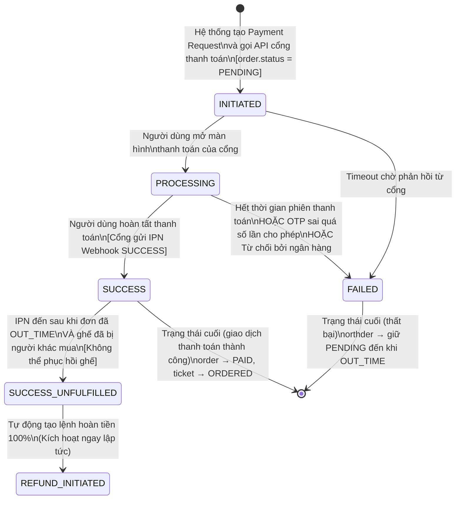
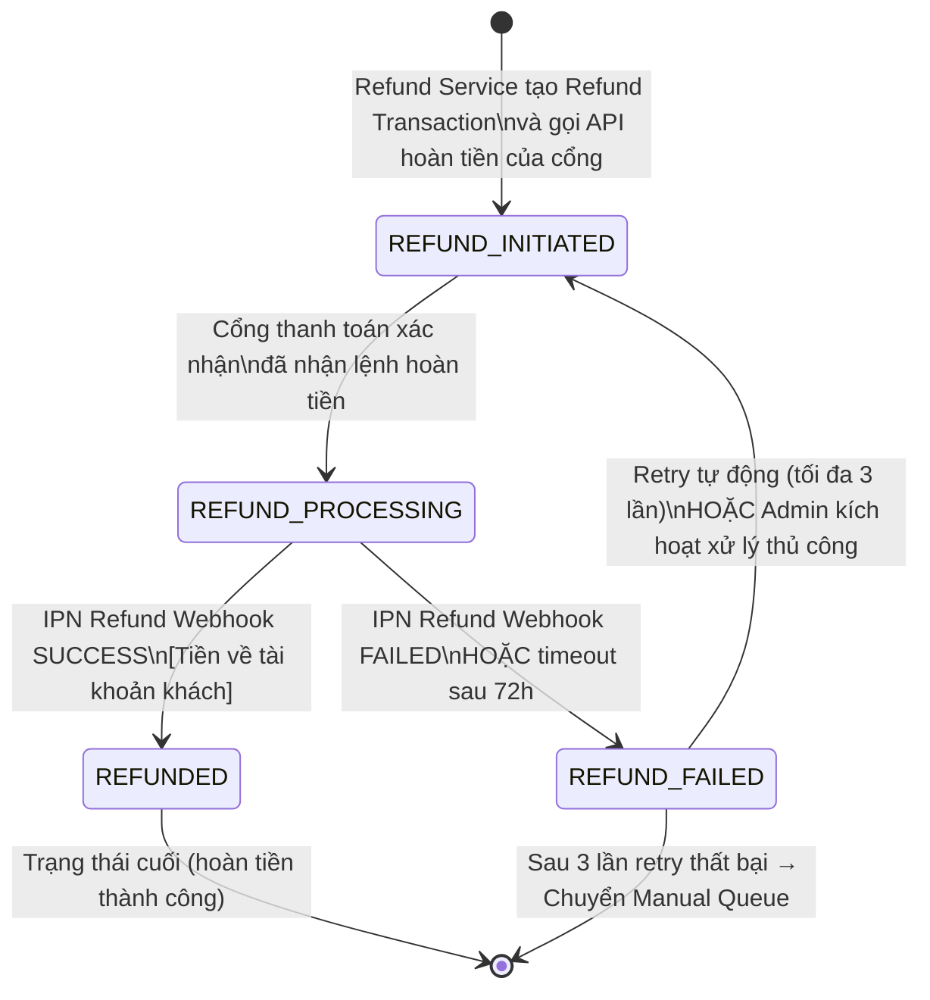
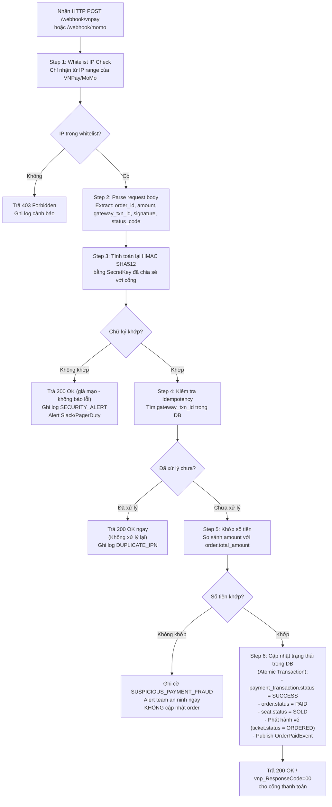
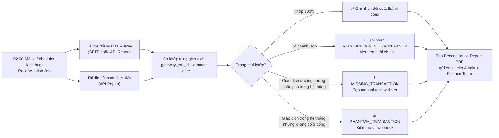

# SM05 — State Machine: Payment Transaction & Refund (Trạng Thái Giao Dịch Thanh Toán & Hoàn Tiền)

## 1. Mục Đích

Tài liệu mô tả toàn bộ vòng đời trạng thái của một **Giao Dịch Thanh Toán (Payment Transaction)** — bao gồm cả luồng thanh toán mua vé và luồng hoàn tiền ngược lại. State machine này là căn cứ để:
- Thiết kế bảng `payment_transactions` với các cột trạng thái và audit log đầy đủ.
- Thiết kế Payment Service và Webhook Handler an toàn.
- Xử lý đặc biệt: IPN trùng lặp, callback trễ, hoàn tiền thất bại, đối soát tài chính.
- Thiết kế hệ thống cảnh báo gian lận thanh toán (Fraud Detection).

---

## 2. Danh Mục Trạng Thái (State Inventory)

### 2.1 Thanh Toán Mua Vé (Payment Flow)

| Mã trạng thái | Tên hiển thị | Mô tả |
|---|---|---|
| `INITIATED` | Khởi tạo | Yêu cầu thanh toán vừa được tạo, chờ cổng xử lý (người dùng chưa hoàn thành giao dịch) |
| `PROCESSING` | Đang xử lý | Người dùng đang nhập thông tin thanh toán tại cổng VNPay / MoMo |
| `SUCCESS` | Thành công | Cổng thanh toán xác nhận giao dịch hoàn tất; tiền đã được trừ |
| `FAILED` | Thất bại | Giao dịch thất bại (OTP sai, không đủ số dư, lỗi ngân hàng, hết phiên) |
| `SUCCESS_UNFULFILLED` | Thành công nhưng không thể thực hiện | Tiền bị trừ nhưng ghế đã hết hạn giữ và bị người khác mua mất; phải hoàn tiền 100% |

### 2.2 Hoàn Tiền (Refund Flow)

| Mã trạng thái | Tên hiển thị | Mô tả |
|---|---|---|
| `REFUND_INITIATED` | Khởi tạo hoàn tiền | Lệnh hoàn tiền vừa được tạo và gửi đến cổng thanh toán |
| `REFUND_PROCESSING` | Đang xử lý hoàn tiền | Cổng thanh toán đã nhận và đang xử lý hoàn tiền về ngân hàng/ví |
| `REFUNDED` | Đã hoàn tiền | Tiền đã về tài khoản khách hàng thành công |
| `REFUND_FAILED` | Hoàn tiền thất bại | Cổng từ chối hoặc lỗi ngân hàng khi hoàn; cần xử lý thủ công |

---

## 3. Sơ Đồ Trạng Thái (State Diagram — Mermaid)

### 3.1 Luồng Thanh Toán Mua Vé



### 3.2 Luồng Hoàn Tiền



---

## 4. Bảng Chuyển Trạng Thái Chi Tiết

### 4.1 Luồng Thanh Toán

| # | Trạng thái hiện tại | Event / Trigger | Guard Condition | Trạng thái kế tiếp | BR liên quan |
|---|---|---|---|---|---|
| T-01 | _(Không tồn tại)_ | Order Service tạo Payment Transaction | `order.status = PENDING`; Idempotency-Key chưa xử lý | `INITIATED` | BR-PAY-004 |
| T-02 | `INITIATED` | Người dùng được chuyển hướng đến cổng | VNPay/MoMo confirm redirect | `PROCESSING` | — |
| T-03 | `PROCESSING` | Nhận IPN Webhook `vnp_ResponseCode=00` hoặc MoMo `resultCode=0` | Chữ ký HMAC hợp lệ; `amount` khớp; `order_id` tồn tại và đang `PENDING` | `SUCCESS` | BR-PAY-002, BR-PAY-006 |
| T-04 | `PROCESSING` | Người dùng hủy hoặc timeout tại cổng | IPN với code thất bại hoặc không nhận IPN sau 15 phút | `FAILED` | — |
| T-05 | `INITIATED` | Timeout kết nối tới cổng | Không nhận phản hồi sau 30 giây | `FAILED` | — |
| T-06 | `SUCCESS` | IPN đến muộn sau khi đơn `OUT_TIME` | `order.status = OUT_TIME` VÀ ít nhất 1 ghế không còn `AVAILABLE` | `SUCCESS_UNFULFILLED` | BR-PAY-003 |
| T-07 | `SUCCESS_UNFULFILLED` | Refund Service kích hoạt tự động | Ngay sau khi trạng thái `SUCCESS_UNFULFILLED` được set | `REFUND_INITIATED` | BR-PAY-003 |

### 4.2 Luồng Hoàn Tiền

| # | Trạng thái hiện tại | Event / Trigger | Guard Condition | Trạng thái kế tiếp | BR liên quan |
|---|---|---|---|---|---|
| T-08 | _(Không tồn tại)_ | Refund Service gọi API hoàn tiền của cổng | Lệnh từ: (a) Khách hủy đơn PAID hợp lệ; (b) Concert hủy; (c) SUCCESS_UNFULFILLED | `REFUND_INITIATED` | BR-RFD-001, BR-RFD-004 |
| T-09 | `REFUND_INITIATED` | Cổng xác nhận nhận lệnh hoàn tiền | HTTP 200 từ cổng thanh toán | `REFUND_PROCESSING` | — |
| T-10 | `REFUND_PROCESSING` | IPN Refund Webhook SUCCESS | Chữ ký hợp lệ; `refund_amount` khớp; giao dịch gốc tồn tại | `REFUNDED` | BR-RFD-005 |
| T-11 | `REFUND_PROCESSING` | IPN Refund FAILED hoặc timeout 72h | Cổng trả mã lỗi hoặc không phản hồi trong 72h | `REFUND_FAILED` | BR-RFD-005 |
| T-12 | `REFUND_FAILED` | Retry tự động (tối đa 3 lần, mỗi lần cách nhau 24h) | `retry_count < 3` | `REFUND_INITIATED` | — |
| T-13 | `REFUND_FAILED` | Admin xử lý thủ công sau 3 lần retry | `retry_count >= 3` → Đẩy vào Manual Refund Queue; Admin thao tác trên Dashboard | _(Manual Queue)_ | — |

---

## 5. Xử Lý IPN Webhook An Toàn (Secure Webhook Processing)



---

## 6. Cấu Trúc Bảng `payment_transactions` (Database Schema Reference)

```sql
CREATE TABLE payment_transactions (
    id              UUID PRIMARY KEY DEFAULT gen_random_uuid(),
    order_id        UUID NOT NULL REFERENCES orders(id),
    transaction_type ENUM('PAYMENT', 'REFUND') NOT NULL,
    gateway         ENUM('VNPAY', 'MOMO') NOT NULL,
    status          ENUM('INITIATED','PROCESSING','SUCCESS','FAILED',
                         'SUCCESS_UNFULFILLED',
                         'REFUND_INITIATED','REFUND_PROCESSING',
                         'REFUNDED','REFUND_FAILED') NOT NULL,
    amount          BIGINT NOT NULL,              -- Số tiền VNĐ (không dùng DECIMAL)
    gateway_txn_id  VARCHAR(100) UNIQUE,          -- Mã giao dịch phía cổng thanh toán
    idempotency_key VARCHAR(100) UNIQUE,          -- Chống xử lý webhook trùng
    raw_request     JSONB,                        -- Raw payload gửi tới cổng
    raw_response    JSONB,                        -- Raw IPN Webhook nhận về
    ip_address      INET,                         -- IP người dùng thực hiện giao dịch
    retry_count     SMALLINT DEFAULT 0,           -- Số lần retry hoàn tiền
    created_at      TIMESTAMPTZ NOT NULL DEFAULT NOW(),
    updated_at      TIMESTAMPTZ NOT NULL DEFAULT NOW()
);

-- Index cho tìm kiếm nhanh
CREATE INDEX idx_payment_txn_order_id ON payment_transactions(order_id);
CREATE INDEX idx_payment_txn_gateway_txn_id ON payment_transactions(gateway_txn_id);
CREATE INDEX idx_payment_txn_status ON payment_transactions(status);
```

---

## 7. Đối Soát Tài Chính Định Kỳ (Daily Reconciliation Process)



---

## 8. Quy Tắc Bất Biến (Payment Transaction Invariants)

| Invariant | Mô tả |
|---|---|
| **INV-PAY-01** | Bản ghi trong bảng `payment_transactions` là **Append-only** — không được xóa hoặc UPDATE đè lên lịch sử cũ. Mọi thay đổi trạng thái phải tạo bản ghi mới hoặc cập nhật cột `status` với audit trail. |
| **INV-PAY-02** | Một `gateway_txn_id` chỉ được xử lý thành công một lần duy nhất trong hệ thống (Idempotency guarantee). |
| **INV-PAY-03** | `amount` lưu trong bảng là số nguyên dương (VNĐ, không dùng float). Mọi so sánh phải chính xác tuyệt đối — sai lệch 1 đồng là sự cố bảo mật nghiêm trọng. |
| **INV-PAY-04** | Giao dịch `SUCCESS` của một `order_id` không được phép xuất hiện 2 lần (một đơn chỉ thanh toán thành công 1 lần). |
| **INV-PAY-05** | Tổng `amount` của tất cả `REFUND` giao dịch cho một `order_id` không được vượt quá `amount` của giao dịch `PAYMENT SUCCESS` tương ứng. |
