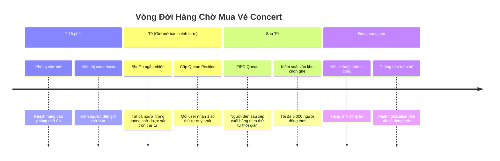
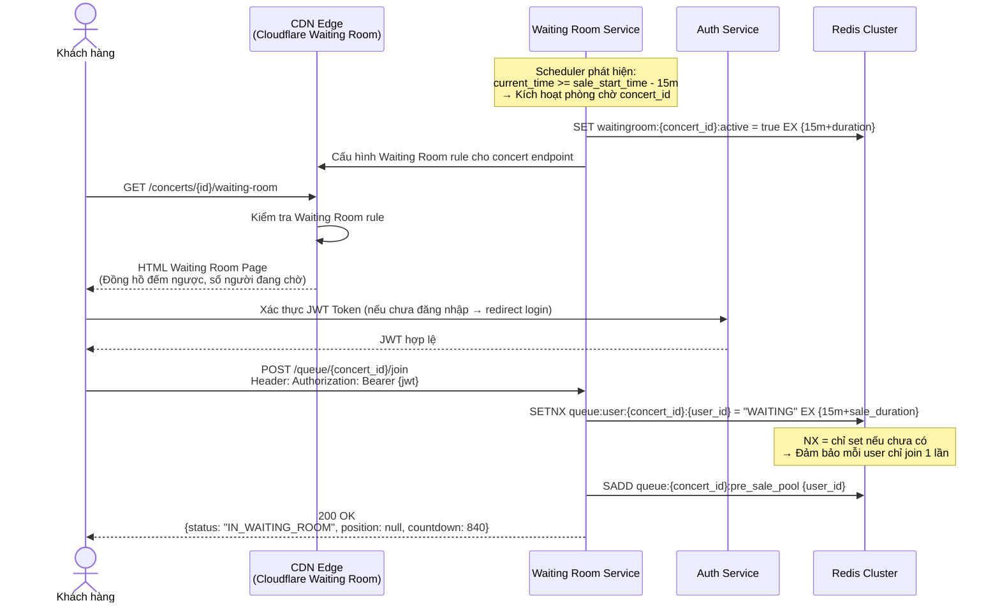
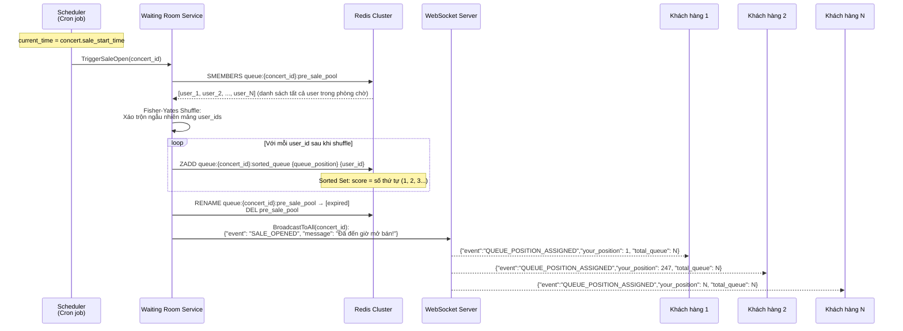
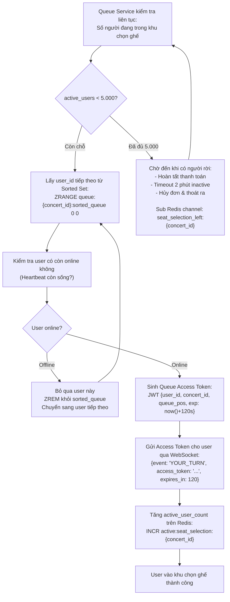
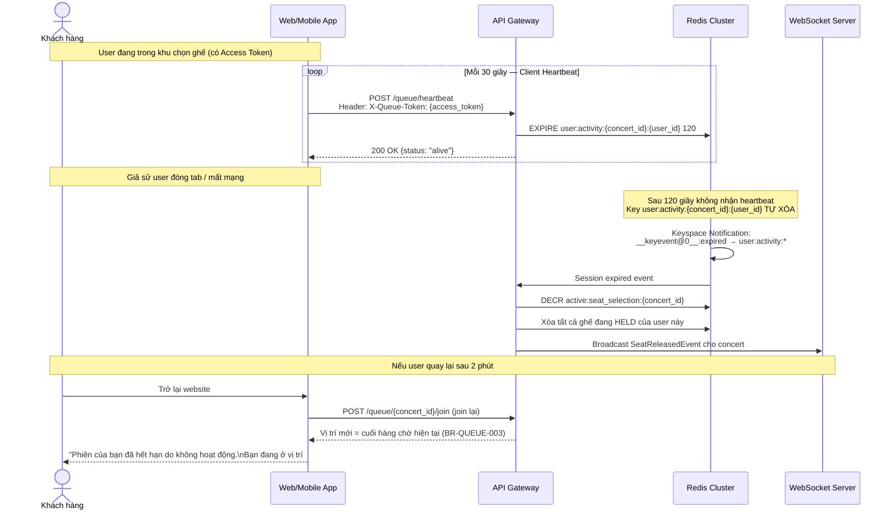

# BF01 — Business Flow: Phòng Chờ Ảo & Hàng Chờ Ảo (Waiting Room & Virtual Queue)

## 1. Mục Đích

Tài liệu mô tả chi tiết luồng nghiệp vụ của cơ chế **Phòng Chờ Ảo (Virtual Waiting Room)** và **Hàng Chờ Ảo (Virtual Queue)** — trái tim của hệ thống đảm bảo công bằng và chống quá tải khi mở bán vé concert.

Luồng này là căn cứ trực tiếp để:
- Vẽ **Sequence Diagram** chi tiết cho Queue Service và Seat Selection Service.
- Thiết kế kiến trúc Redis Queue + WebSocket Server + CDN Edge.
- Xác định các API Endpoints cần thiết cho luồng phòng chờ.

---

## 2. Tổng Quan Pha (Phase Overview)

Luồng Phòng Chờ gồm **4 pha** liên tiếp:

---

## 3. Luồng Chi Tiết Theo Từng Pha

### Pha 1: T-15 Phút — Mở Phòng Chờ

### Pha 2: T0 — Shuffle Ngẫu Nhiên & Phân Phát Số Thứ Tự

### Pha 3: Kiểm Soát Vào Khu Chọn Ghế (Admission Control — Max 5.000 CCU)

### Pha 4: Timeout Không Hoạt Động & Thu Hồi Quyền (Inactivity Revocation)

---

## 4. Bảo Vệ Chống Gian Lận & Bot (Anti-Fraud & Bot Protection)

### 4.1 Các hình thức gian lận và biện pháp đối phó

| Loại gian lận | Biểu hiện | Biện pháp đối phó |
|---|---|---|
| **F5 Spam / Click bot** | Gửi hàng nghìn request GET `/concerts/{id}` | CDN Rate Limiting (Cloudflare) + `429 Too Many Requests` |
| **Multi-tab farming** | Mở 10 tab để giữ nhiều vị trí | SETNX Redis: Mỗi `user_id` chỉ có 1 entry trong queue |
| **Multi-device** | Dùng điện thoại + laptop cùng lúc | Cùng `user_id` → cùng queue position, không được cộng thêm |
| **Account farming (nhiều nick)** | Tạo nhiều tài khoản ảo | Yêu cầu xác thực SĐT (OTP); 1 SĐT = 1 tài khoản; reCAPTCHA v3 khi đăng ký |
| **Queue Token theft** | Đánh cắp `X-Queue-Token` của người khác | Token binding `user_id + IP + device_fingerprint`; TTL ngắn 120s |
| **Automated checkout bot** | Bot tự động chọn ghế và điền form | Fingerprinting JS challenge (không CAPTCHA blocking để UX tốt) |

---

## 5. API Endpoints Liên Quan (Queue Service API Reference)

| Method | Endpoint | Auth | Mô tả |
|---|---|---|---|
| `POST` | `/api/v1/queue/{concert_id}/join` | Bearer JWT | Tham gia hàng chờ / phòng chờ |
| `GET` | `/api/v1/queue/{concert_id}/status` | Bearer JWT | Xem số thứ tự và vị trí hiện tại |
| `POST` | `/api/v1/queue/heartbeat` | Bearer JWT + X-Queue-Token | Gửi heartbeat duy trì phiên chọn ghế |
| `DELETE` | `/api/v1/queue/{concert_id}/leave` | Bearer JWT | Rời khỏi hàng chờ (tự nguyện) |
| `WS` | `wss://api.concert.vn/ws/queue/{concert_id}` | JWT query param | Kênh WebSocket nhận sự kiện real-time |

### WebSocket Events (Server → Client)

| Event | Payload | Ý nghĩa |
|---|---|---|
| `WAITING_ROOM_OPEN` | `{countdown: 900, total_waiting: N}` | Phòng chờ vừa mở |
| `QUEUE_POSITION_ASSIGNED` | `{your_position: N, total_queue: M}` | Số thứ tự được cấp sau shuffle |
| `YOUR_TURN` | `{access_token: "...", expires_in: 120}` | Đến lượt vào khu chọn ghế |
| `POSITION_UPDATED` | `{your_position: N}` | Vị trí cập nhật (người trước rời đi) |
| `SALE_SOLD_OUT` | `{message: "Đã hết vé"}` | Hết vé, hàng chờ đóng |
| `SESSION_EXPIRED` | `{reason: "INACTIVITY_TIMEOUT"}` | Phiên hết hạn do không hoạt động |

