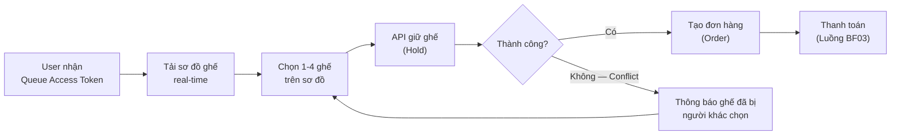
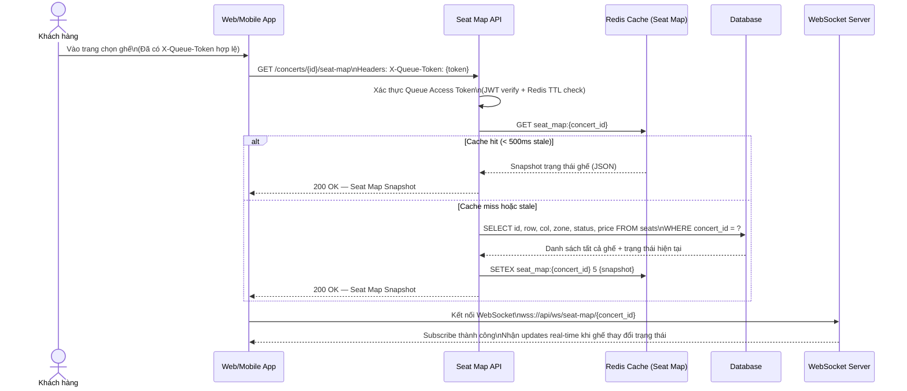
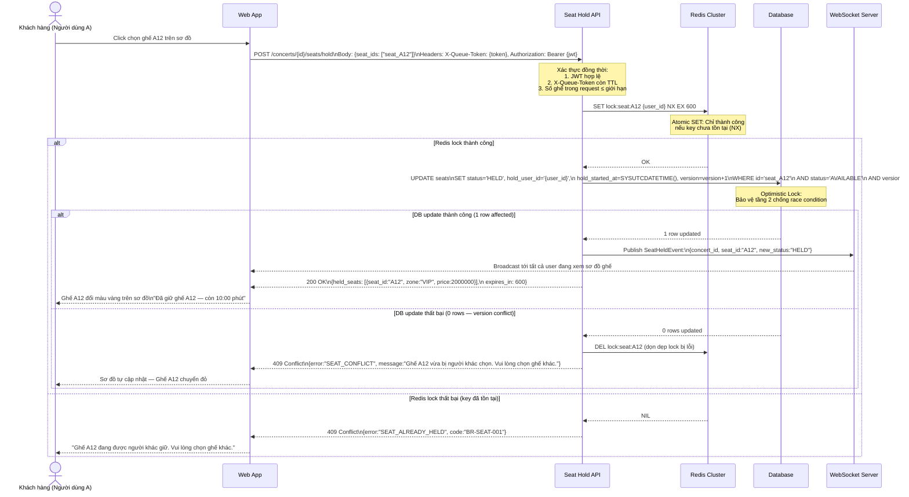
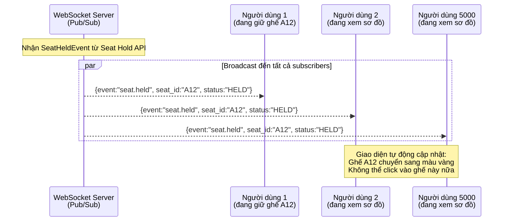
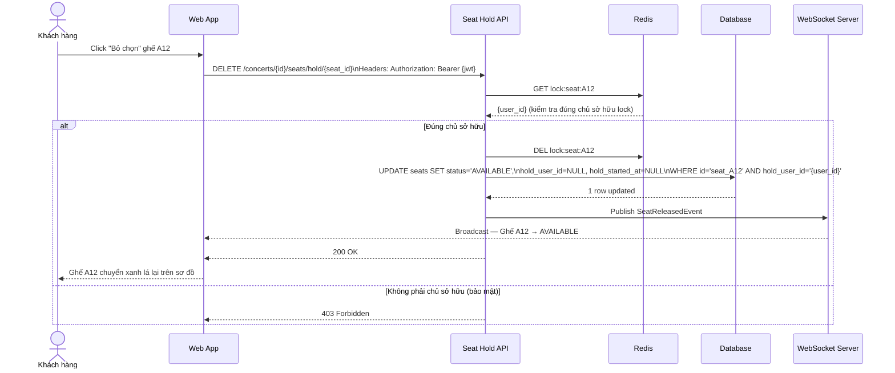
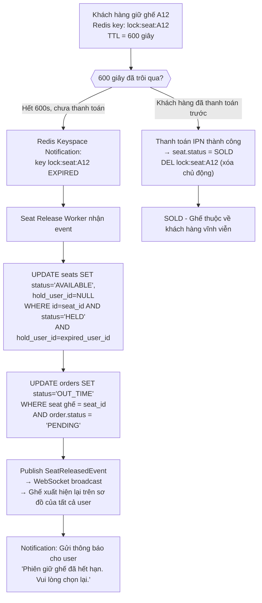

# BF02 — Business Flow: Chọn Ghế & Ngăn Chặn Double-Booking (Seat Selection & Double-Booking Prevention)

## 1. Mục Đích

Tài liệu mô tả chi tiết luồng nghiệp vụ **Chọn Ghế** trên sơ đồ khán phòng tương tác thời gian thực, bao gồm cơ chế **ngăn chặn đặt trùng ghế (Zero Double-Booking)** dưới áp lực tải cao đồng thời.

---

## 2. Tổng Quan Luồng (Flow Overview)



---

## 3. Chi Tiết Từng Bước

### Bước 1: Tải Sơ Đồ Ghế Thời Gian Thực



### Bước 2: Chọn Ghế và Khóa Ghế (Atomic Hold)



### Bước 3: Cập Nhật Sơ Đồ Real-time Cho Tất Cả Người Dùng



### Bước 4: Bỏ Chọn Ghế (Release Hold)



---

## 4. Xử Lý Tự Động Hết Hạn Giữ Ghế (Auto-Release on Timeout)



---

## 5. Giới Hạn Số Ghế Tối Đa Trên Mỗi Đơn Hàng (Per-Order Seat Limit Guard)

```mermaid
flowchart LR
    A["API nhận request giữ ghế\n{seat_ids: [A12, A13, A14, A15, A16]}"] --> B["Đếm số ghế trong request:\nCOUNT = 5"]
    B --> C{count <= concert.max_seats_per_order\n(mặc định 4)?}
    C -->|Có ≤ 4| D["Tiếp tục xử lý giữ ghế"]
    C -->|Không > 4| E["Trả lỗi ngay lập tức:\n400 Bad Request\n{error:'SEAT_LIMIT_EXCEEDED',\ncode:'BR-SEAT-004',\nmessage:'Bạn chỉ được chọn tối đa 4 ghế'}"]

    D --> F["Kiểm tra tổng vé đang sở hữu:\nSELECT COUNT(*) FROM tickets t\nJOIN orders o ON t.order_id = o.id\nWHERE o.customer_id = user_id\nAND o.concert_id = concert_id\nAND o.status IN ('PAID','PENDING')"]
    F --> G{total_owned + new_request <= max_per_account?}
    G -->|Vượt giới hạn| H["400 Bad Request\n{error:'ACCOUNT_SEAT_LIMIT_EXCEEDED',\ncode:'BR-ORD-003'}"]
    G -->|Trong giới hạn| I["Tiến hành lock từng ghế một\n(theo thứ tự seat_id để tránh deadlock)"]
```

---

## 6. Phòng Chống Double-Booking — Tóm Tắt Defense Layers

| Layer | Cơ chế | Độ trễ | Hiệu quả |
|---|---|---|---|
| **Layer 1 — CDN** | Rate limiting per IP/user | < 1ms | Chặn bot, F5 spam trước khi vào API |
| **Layer 2 — API Auth** | Queue Access Token validation (Redis TTL) | < 5ms | Chỉ user có lượt mới được gọi Seat Hold API |
| **Layer 3 — Redis Distributed Lock** | `SET NX EX` — Atomic; chỉ 1 user giành lock | < 5ms | Ngăn đồng thời ở tầng cache; phản hồi nhanh |
| **Layer 4 — Database Optimistic Lock** | `WHERE status='AVAILABLE' AND version=N` | < 20ms | Đảm bảo tính nhất quán dữ liệu dù Redis fail |
| **Layer 5 — Audit Log** | Ghi nhận tất cả attempt HOLD, thành công và thất bại | Async | Phục vụ điều tra tranh chấp và bảo mật |

