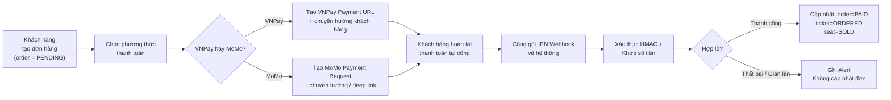
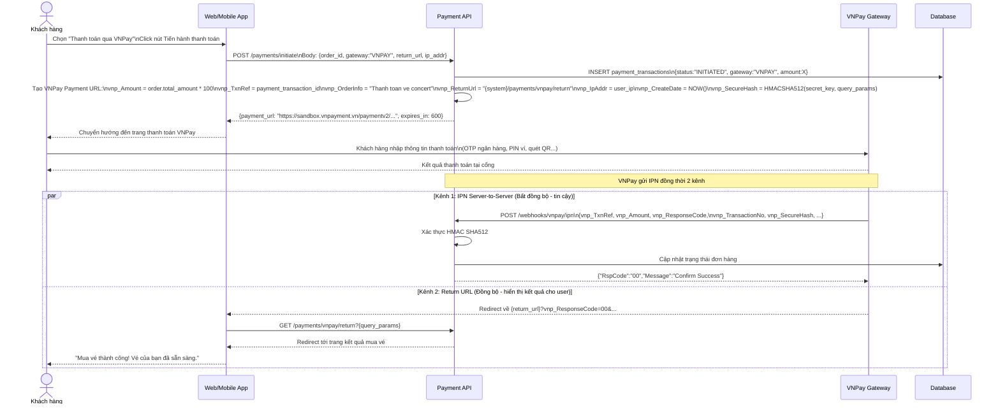
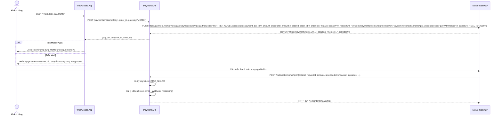
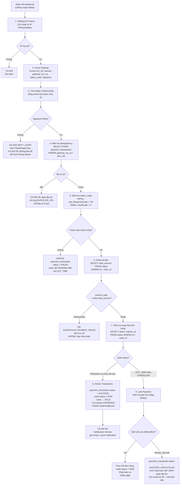

# BF03 — Business Flow: Luồng Thanh Toán VNPay & MoMo (Payment Flow)

## 1. Mục Đích

Tài liệu mô tả chi tiết luồng tích hợp thanh toán qua hai cổng **VNPay** và **MoMo**, bao gồm khởi tạo giao dịch, xử lý IPN Webhook an toàn, và tất cả các trường hợp ngoại lệ.

---

## 2. Tổng Quan Luồng Thanh Toán

---

## 3. Luồng Chi Tiết VNPay

---

## 4. Luồng Chi Tiết MoMo

---

## 5. Xử Lý IPN Webhook An Toàn (Idempotent Webhook Handler)

---

## 6. Các Trường Hợp Thanh Toán Thất Bại & Xử Lý

| Mã lỗi VNPay | Mã lỗi MoMo | Nguyên nhân | Xử Lý Hệ Thống | Thông Báo Người Dùng |
|---|---|---|---|---|
| `07` | `1006` | Thẻ/Tài khoản bị khóa | Ghi `FAILED`; đơn giữ `PENDING` | "Thẻ của bạn bị khóa. Vui lòng liên hệ ngân hàng." |
| `09` | `1005` | Thẻ chưa đăng ký Internet Banking | Ghi `FAILED` | "Vui lòng đăng ký dịch vụ thanh toán online với ngân hàng." |
| `10` | `1002` | Xác thực OTP quá số lần cho phép | Ghi `FAILED`; khóa tạm thời retry | "Nhập OTP sai quá nhiều lần. Vui lòng thử lại sau 15 phút." |
| `11` | `1003` | Hết hạn chờ thanh toán | Ghi `FAILED` → Scheduler xử lý `OUT_TIME` | "Phiên thanh toán đã hết hạn. Vui lòng đặt vé lại." |
| `12` | `1001` | Thẻ/Tài khoản không đủ số dư | Ghi `FAILED` | "Tài khoản không đủ số dư. Vui lòng nạp tiền hoặc dùng phương thức khác." |
| `24` | `1007` | Khách hàng hủy giao dịch | Ghi `FAILED` | "Bạn đã hủy giao dịch. Đơn hàng vẫn còn hiệu lực trong {X} phút." |
| `99` | `9000` | Lỗi không xác định từ ngân hàng | Ghi `FAILED`; Alert team | "Đã xảy ra lỗi kỹ thuật. Vui lòng thử lại hoặc liên hệ hỗ trợ." |

---

## 7. API Endpoints Thanh Toán

| Method | Endpoint | Mô tả |
|---|---|---|
| `POST` | `/api/v1/payments/initiate` | Khởi tạo giao dịch, chọn gateway |
| `GET` | `/api/v1/payments/vnpay/return` | Nhận return URL từ VNPay (hiển thị kết quả) |
| `GET` | `/api/v1/payments/momo/return` | Nhận return URL từ MoMo |
| `POST` | `/api/v1/webhooks/vnpay/ipn` | Nhận IPN từ VNPay (server-to-server) |
| `POST` | `/api/v1/webhooks/momo/ipn` | Nhận IPN từ MoMo (server-to-server) |
| `GET` | `/api/v1/payments/{txn_id}/status` | Kiểm tra trạng thái giao dịch (polling fallback) |
