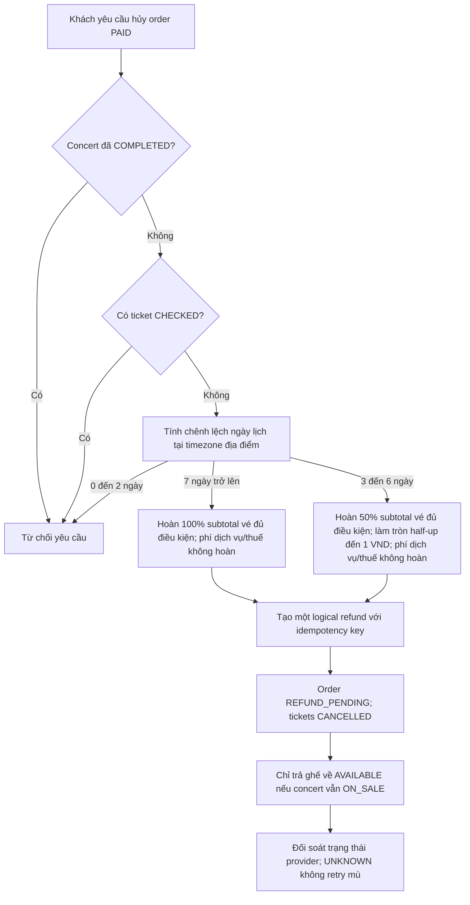

# BF04 — Hủy đơn và chính sách hoàn tiền

## 1. Phạm vi và nguồn quy tắc

Luồng này phân biệt ba trường hợp: khách tự nguyện hủy đơn đã thanh toán, BTC/Admin hủy concert, và payment capture được xác nhận sau khi hết hạn giữ ghế. Mỗi lệnh hoàn tiền được lưu riêng trong refunds; trạng thái đơn và vé không thay thế kết quả đối soát của cổng thanh toán. Các quy tắc có thẩm quyền: BR-RFD-001–BR-RFD-007, D-016–D-019, D-024, D-032 và D-033.

## 2. Khách tự nguyện hủy đơn đã thanh toán



Ngày yêu cầu và ngày concert được chuyển sang ngày lịch theo timezone của venue. Mốc 7 ngày và 3 ngày tính theo chênh lệch ngày địa phương, không theo số giờ trôi qua. Tỷ lệ được áp dụng một lần cho tổng giá vé eligible của đơn; tiền VND là số nguyên, làm tròn half-up một lần. Phí dịch vụ và thuế không hoàn cho khách tự hủy theo BR-RFD-001; event cancellation hoàn toàn bộ order.final_amount theo BR-RFD-004. Hai trường hợp được phân biệt trong API, ledger và thông báo.

## 3. Xử lý yêu cầu hoàn tiền

```mermaid
sequenceDiagram
 actor C as Customer
 participant API as Order API
 participant DB as SQL Server
 participant OUT as Transactional Outbox
 participant W as Refund Worker
 participant PG as VNPay or MoMo
 C->>API: Gửi yêu cầu hủy có Idempotency-Key
 API->>DB: Kiểm tra owner, PAID, chưa CHECKED, concert chưa COMPLETED
 API->>DB: Tính refund; ghi order REFUND_PENDING, ticket CANCELLED, refund PENDING
 API->>OUT: Ghi event trong cùng transaction
 API-->>C: Trả trạng thái đã tiếp nhận
 W->>OUT: Đọc event chưa phát
 W->>PG: Gửi refund với logical idempotency key
 PG-->>W: Kết quả hoặc timeout
 alt Provider xác nhận hoàn thành
  W->>DB: refund COMPLETED; order REFUNDED
 else Provider xác nhận thất bại xác định
  W->>DB: refund FAILED; xếp retry tối đa 3 lần theo 1/5/30 phút
 else Timeout hoặc kết quả chưa rõ
  W->>DB: refund UNKNOWN; reconcile tại 30 giây, 5 phút, 30 phút
  Note over W,PG: Không gửi lệnh refund mới khi trạng thái còn UNKNOWN
 end
```

Tạo yêu cầu phải idempotent: gửi lại cùng khóa trả trạng thái hiện tại và không tạo lệnh refund thứ hai. Provider timeout chuyển refund sang UNKNOWN; đối soát trước khi retry. Chỉ retry sau khi provider xác nhận lần gửi trước thất bại xác định, tối đa 3 lần với backoff 1, 5, 30 phút. Nếu vẫn UNKNOWN sau 30 phút hoặc hết retry, chuyển hàng đợi Finance/Support thủ công; giữ nguyên lịch sử và không tự đưa order về PAID.

## 4. BTC/Admin hủy concert

Áp dụng khi concert được hủy trước COMPLETED. Mọi order PAID được xử lý, kể cả order có ticket CHECKED: hoàn 100% order.final_amount; tất cả ticket chuyển CANCELLED để QR không còn hiệu lực; checkin_logs được giữ bất biến; không giải phóng ghế để bán lại cho concert đã hủy. Order chuyển REFUND_PENDING cho đến khi provider xác nhận hoàn tất; UNKNOWN tuân theo D-032. Concert COMPLETED không thể chuyển CANCELLED.

```mermaid
sequenceDiagram
 participant A as Admin
 participant C as Concert Service
 participant DB as SQL Server
 participant O as Outbox
 participant W as Refund Worker
 participant PG as Payment Provider
 participant N as Notification Worker
 A->>C: Xác nhận hủy concert trước COMPLETED, kèm lý do
 C->>DB: Transaction: concert CANCELLED; ghi audit; tạo event outbox
 C-->>A: Hủy được ghi nhận và xử lý bất đồng bộ
 W->>O: Đọc ConcertCancelled
 loop Mỗi order PAID, bao gồm ticket CHECKED
  W->>DB: order REFUND_PENDING; tickets CANCELLED; giữ checkin logs; không mở lại ghế
  W->>PG: Refund 100% order.final_amount với idempotency key
  PG-->>W: Trạng thái provider
  W->>DB: Ghi PENDING, COMPLETED, FAILED hoặc UNKNOWN
 end
 N->>N: Gửi thông báo IN_APP; push/email theo tùy chọn và consent
```

Batch phải resume an toàn sau crash: mỗi order có logical refund idempotency key duy nhất, cursor/checkpoint theo concert và audit được lưu bền vững. Không coi event broker là nguồn trạng thái chính; event được phát từ transactional outbox.

## 5. Thanh toán thành công sau khi hold hết hạn

Nếu đối soát hoặc callback xác nhận provider đã capture tiền sau khi hold 600 giây hết hạn, không tạo order mới, không hồi sinh hold và không claim lại ghế. Ghi payment SUCCESS_UNFULFILLED. Sau khi xác minh capture, tạo đúng một refund 100% số tiền thực thu; xử lý timeout/retry theo cùng quy tắc UNKNOWN tại D-032.

## 6. Bảng chính sách

| Trường hợp | Kết quả | Ghế/vé | Đối soát |
|---|---|---|---|
| Khách hủy, còn ít nhất 7 ngày địa phương, chưa check-in | Hoàn 100% subtotal vé đủ điều kiện; phí dịch vụ/thuế không hoàn | Ticket CANCELLED; ghế mở lại chỉ khi concert còn ON_SALE | UNKNOWN không retry mù |
| Khách hủy, còn 3–6 ngày địa phương, chưa check-in | Hoàn 50% subtotal vé đủ điều kiện | Như trên | Làm tròn VND một lần |
| Khách hủy, còn 0–2 ngày hoặc có ticket CHECKED | Không chấp nhận voluntary refund | Không đổi trạng thái | Trả lỗi có mã ổn định |
| Concert hủy trước COMPLETED | Hoàn 100% order.final_amount cho mọi order PAID, kể cả CHECKED | Tất cả vé CANCELLED; log giữ nguyên; ghế không bán lại | Một logical refund mỗi order |
| Payment capture sau hold expiry | Hoàn 100% capture sau xác minh | Không hồi sinh hold, không cấp vé | SUCCESS_UNFULFILLED rồi refund |

Thời gian tiền về tài khoản phụ thuộc provider và ngân hàng; hệ thống chỉ thông báo trạng thái đã gửi/được provider xác nhận, không cam kết SLA bên thứ ba chưa được ký kết.