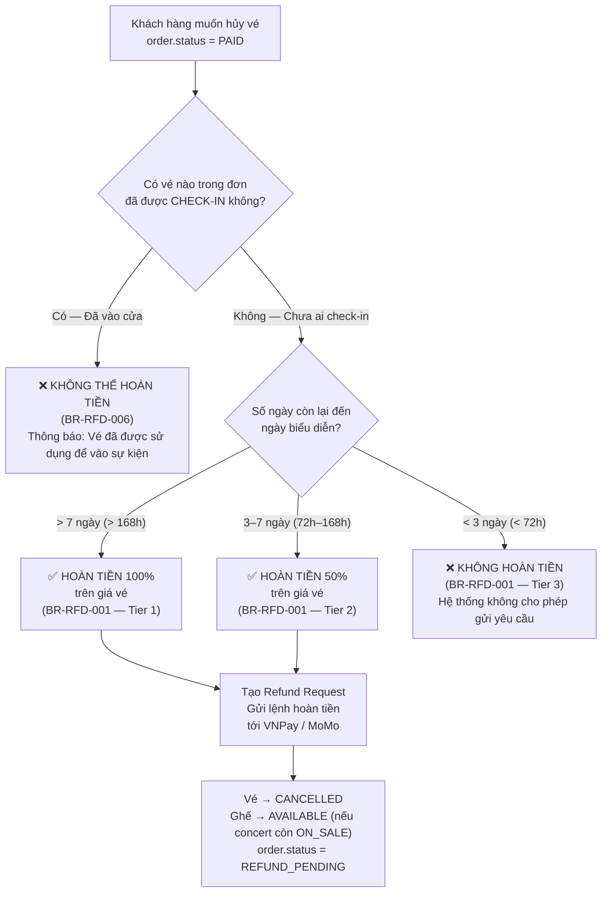
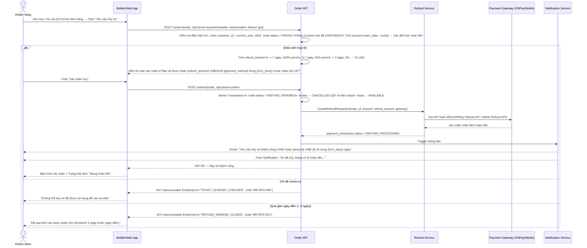
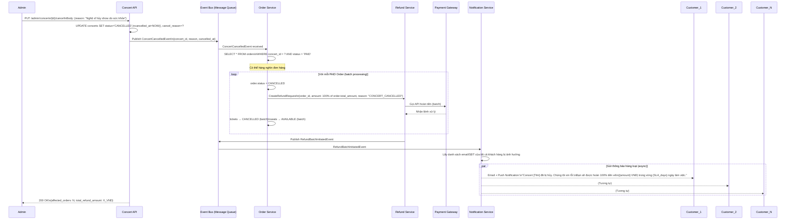
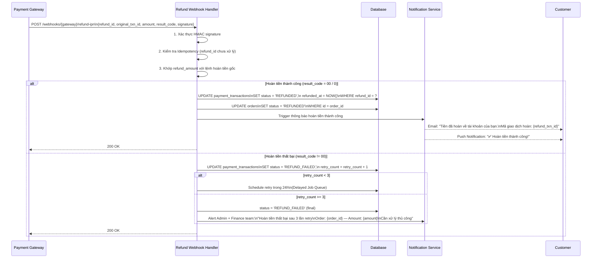

# BF04 — Business Flow: Hủy Đơn & Chính Sách Hoàn Tiền (Order Cancellation & Refund Policy)

## 1. Mục Đích

Tài liệu mô tả chi tiết luồng nghiệp vụ **Hủy Đơn Hàng** và **Hoàn Tiền** — bao gồm hoàn tiền tự nguyện của khách hàng và hoàn tiền hàng loạt khi concert bị hủy.

---

## 2. Cây Quyết Định Hoàn Tiền (Refund Decision Tree)

---

## 3. Luồng Hủy Đơn Tự Nguyện Của Khách Hàng

---

## 4. Luồng Hoàn Tiền Hàng Loạt Khi Concert Bị Hủy

---

## 5. Luồng Cổng Thanh Toán Xác Nhận Hoàn Tiền (Refund IPN Processing)

---

## 6. Thời Gian Hoàn Tiền Theo Phương Thức Thanh Toán (Refund SLA)

| Phương thức thanh toán gốc | Thời gian hoàn tiền | Ghi chú |
|---|---|---|
| Ví MoMo | 1 – 2 ngày làm việc | Hoàn về ví điện tử MoMo |
| Thẻ ATM nội địa (VNPay) | 3 – 5 ngày làm việc | Hoàn về tài khoản ngân hàng |
| Thẻ Visa / Mastercard (VNPay) | 7 – 15 ngày làm việc | Theo kỳ sao kê của ngân hàng phát hành |
| Thẻ tín dụng nội địa | 5 – 7 ngày làm việc | Tùy ngân hàng phát hành |

> **Lưu ý:** Thời gian tính từ khi hệ thống gửi lệnh hoàn tiền đến cổng thanh toán, không tính thời gian chờ duyệt yêu cầu.

---

## 7. Bảng Tóm Tắt Chính Sách Hoàn Tiền (Refund Policy Summary)

| Trường hợp | Điều kiện | Tỷ lệ hoàn | Ai kích hoạt | Thời hạn xử lý |
|---|---|---|---|---|
| **Hủy tự nguyện — Sớm** | Trước concert > 7 ngày | 100% giá vé | Khách hàng | 1–15 ngày (tùy phương thức) |
| **Hủy tự nguyện — Trung hạn** | Trước concert 3–7 ngày | 50% giá vé | Khách hàng | 1–15 ngày |
| **Hủy tự nguyện — Muộn** | Trước concert < 3 ngày | 0% — Không hoàn | Không cho phép | — |
| **Concert bị hủy bởi Admin** | Bất kỳ thời điểm nào | 100% giá vé | Hệ thống (Auto) | 1–15 ngày |
| **Late Payment Callback** | Tiền trừ nhưng ghế đã mất | 100% số tiền đã trừ | Hệ thống (Auto) | 1–15 ngày |
| **Vé đã check-in** | Bất kỳ lý do nào | 0% — Không hoàn | Không cho phép | — |

