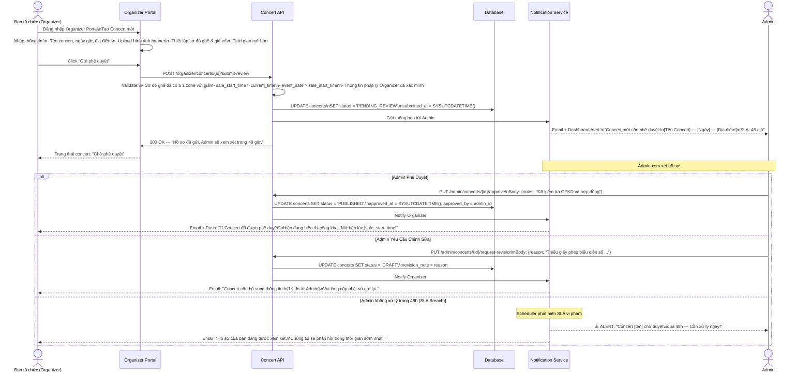
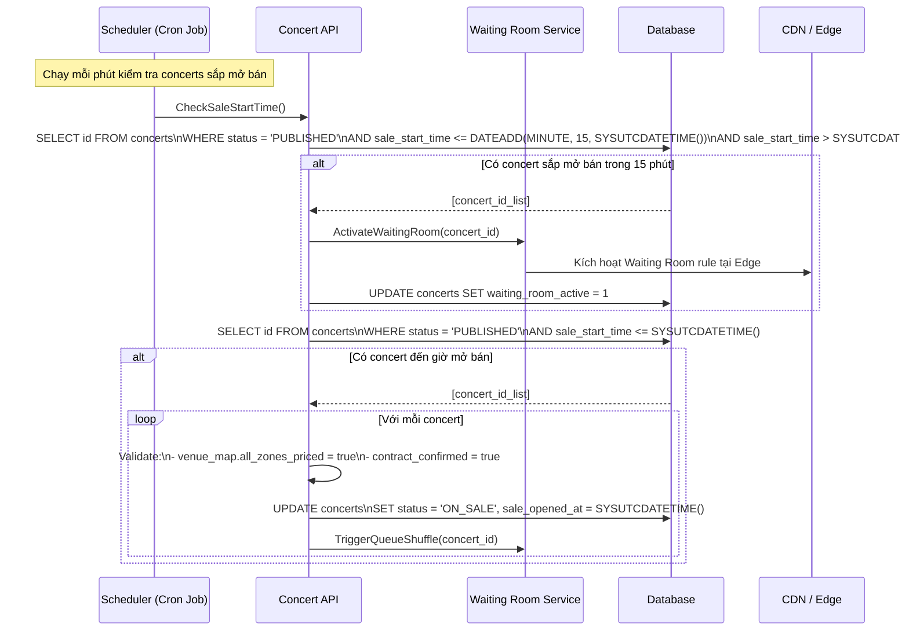
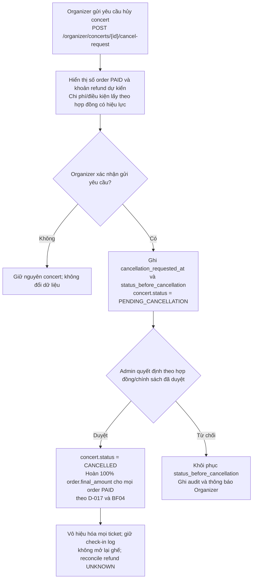
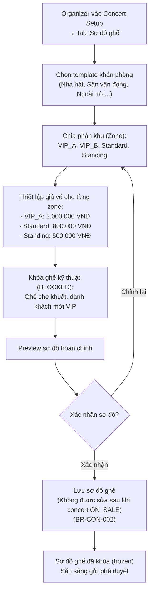

# BF05 — Business Flow: Phê Duyệt & Hủy Concert (Concert Approval & Cancellation Flow)

## 1. Mục Đích

Tài liệu mô tả luồng nghiệp vụ từ khi Ban tổ chức tạo concert, trải qua quy trình phê duyệt của Admin, cho đến các kịch bản hủy concert từ phía Organizer và Admin.

---

## 2. Luồng Tạo & Phê Duyệt Concert



---

## 3. Luồng Tự Động Mở Bán (Auto ON_SALE Transition)



---

## 4. Luồng Organizer Yêu Cầu Hủy Concert



---

## 5. Luồng Admin Hủy Khẩn Cấp Concert (Emergency Cancellation)

```mermaid
sequenceDiagram
    actor ADMIN as Admin
    participant ADMIN_DASH as Admin Dashboard
    participant CON_API as Concert API
    participant ORDER_SVC as Order Service
    participant EVENT_BUS as Event Bus
    participant NT as Notification Service

    ADMIN->>ADMIN_DASH: Tìm concert → Click "Hủy khẩn cấp"

    ADMIN_DASH-->>ADMIN: Màn xác nhận:\n"THAO TÁC KHÔNG THỂ HOÀN TÁC!\nToàn bộ {N} đơn hàng sẽ được hoàn tiền 100%.\nNhập lý do hủy bắt buộc:"

    ADMIN->>ADMIN_DASH: Nhập lý do + Confirm 2FA

    ADMIN_DASH->>CON_API: POST /admin/concerts/{id}/emergency-cancel\nBody: {reason: "...", admin_2fa_token: "..."}

    CON_API->>CON_API: Xác thực Admin 2FA token\nGhi Audit Log đầy đủ

    CON_API->>CON_API: UPDATE concerts\nSET status='CANCELLED',\ncancelled_by=admin_id,\ncancel_reason=reason,\ncancelled_at=SYSUTCDATETIME()

    CON_API->>EVENT_BUS: Publish ConcertCancelledEvent (Priority HIGH)

    par Hành động song song
        EVENT_BUS->>ORDER_SVC: Process batch refunds\n(Tất cả PAID orders → REFUND_PENDING)
        EVENT_BUS->>NT: Gửi thông báo khẩn đến tất cả khách hàng bị ảnh hưởng
    end

    ORDER_SVC->>ORDER_SVC: Batch update:\n- N eligible orders → REFUND_PENDING (không có trạng thái CANCELLED trung gian); mọi order PAID, kể cả vé CHECKED, được refund 100% theo D-017; log check-in giữ nguyên và không mở lại ghế\n- Tickets → CANCELLED kể cả CHECKED (QR vô hiệu); check-in logs bất biến\n- Không đưa ghế của concert CANCELLED về AVAILABLE

    NT->>NT: Gửi email + SMS + Push đến tất cả khách hàng\n(Sử dụng queue để không làm quá tải email server)

    CON_API-->>ADMIN_DASH: 200 OK\n{cancelled_orders: N, total_refund: X VND}
    ADMIN_DASH-->>ADMIN: "Concert đã hủy. {N} đơn hàng đang được xử lý hoàn tiền."
```

---

## 6. Quy Trình Thiết Lập Sơ Đồ Ghế Của Organizer



