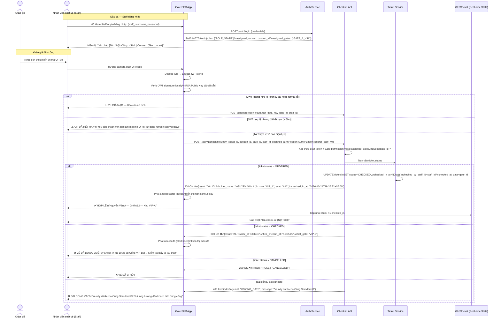
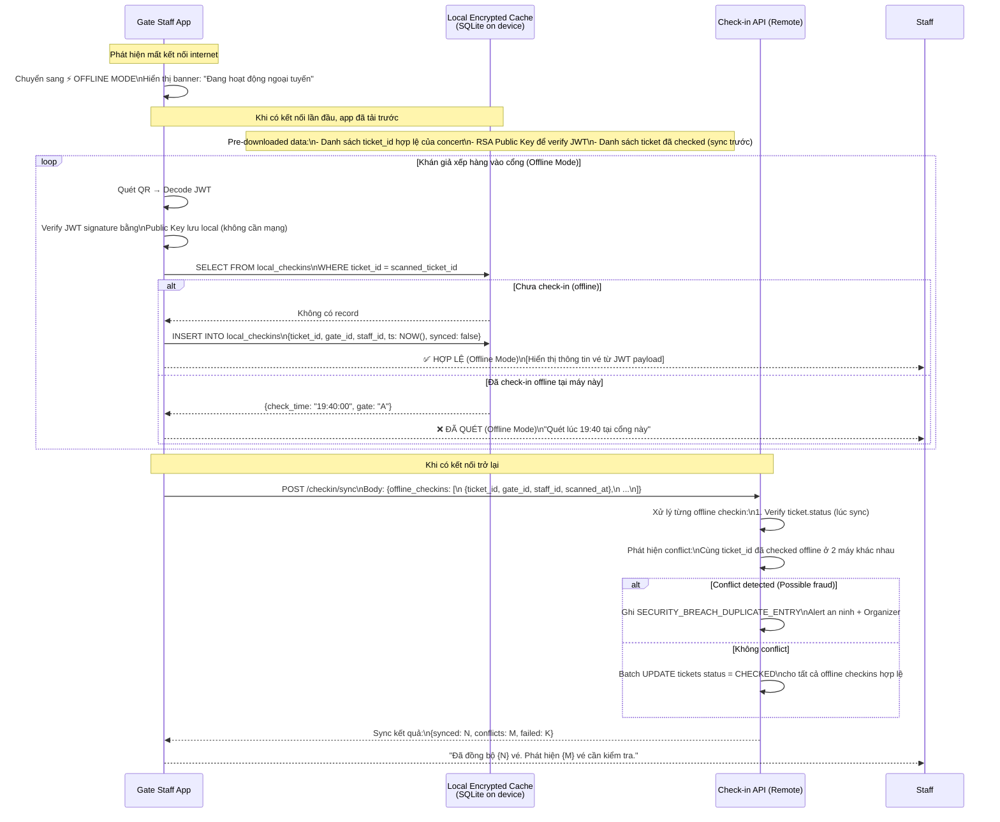
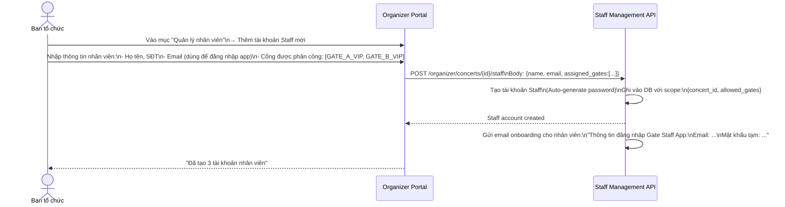
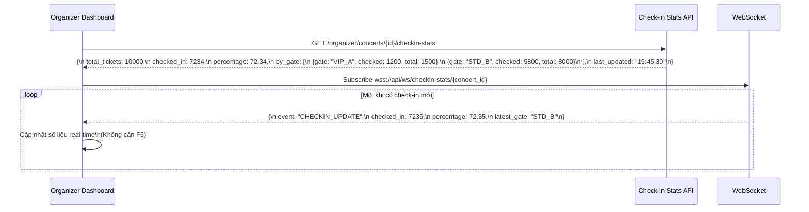

# BF06 — Business Flow: Quét QR & Check-in Tại Cổng Sự Kiện (QR Scanning & Gate Check-in)

## 1. Mục Đích

Tài liệu mô tả chi tiết luồng nghiệp vụ **Soát Vé Tại Cổng Sự Kiện** — bao gồm check-in online, chế độ offline dự phòng, phân quyền cổng theo phân khu và xử lý vé giả mạo.

---

## 2. Luồng Check-in Online (Kết Nối Mạng Bình Thường)

---

## 3. Luồng Check-in Offline (Mất Kết Nối Mạng Tại Cổng)

---

## 4. Phân Quyền Cổng Soát Vé (Gate Permission Management)

---

## 5. Dashboard Check-in Real-time Cho Organizer

---

## 6. Xử Lý Các Tình Huống Đặc Biệt Tại Cổng

| Tình huống | Hiển thị trên App | Hành động nhân viên | BR liên quan |
|---|---|---|---|
| Vé hợp lệ lần đầu | ✅ Xanh: "HỢP LỆ — [Tên khách] — [Ghế] — [Zone]" | Cho phép vào | BR-TCK-003 |
| Vé đã quét trước đó | ❌ Đỏ: "ĐÃ QUÉT lúc [HH:mm] tại Cổng [X]" | Yêu cầu CCCD; Giữ lại người; Báo Tổ trưởng | BR-TCK-003 |
| Vé đã bị hủy | ❌ Cam: "VÉ ĐÃ BỊ HỦY — Lý do: [hoàn tiền/concert hủy]" | Không cho vào | BR-RFD-003 |
| Sai cổng vào | ⚠️ Vàng: "SAI CỔNG — Vé dành cho Cổng [X]" | Hướng dẫn khách đến đúng cổng | BR-TCK-004 |
| QR hết hạn 60s | ⚠️ Cam: "QR HẾT HẠN — Yêu cầu khách làm mới" | Yêu cầu khách mở app refresh | BR-TCK-002 |
| QR giả mạo (chữ ký sai) | 🔴 Đỏ đậm: "VÉ GIẢ MẠO — CẢNH BÁO AN NINH" | Giữ người lại; Gọi an ninh ngay; Không tự xử lý | BR-TCK-002 |
| Chưa đến giờ mở cửa | ⚠️ Xám: "CHƯA ĐẾN GIỜ MỞ CỬA — [HH:mm]" | Yêu cầu khách đợi | BR-TCK-007 |
| Mất mạng tại cổng | ⚡ Offline Mode kích hoạt tự động | Tiếp tục soát vé; Đồng bộ sau | BR-TCK-005 |
