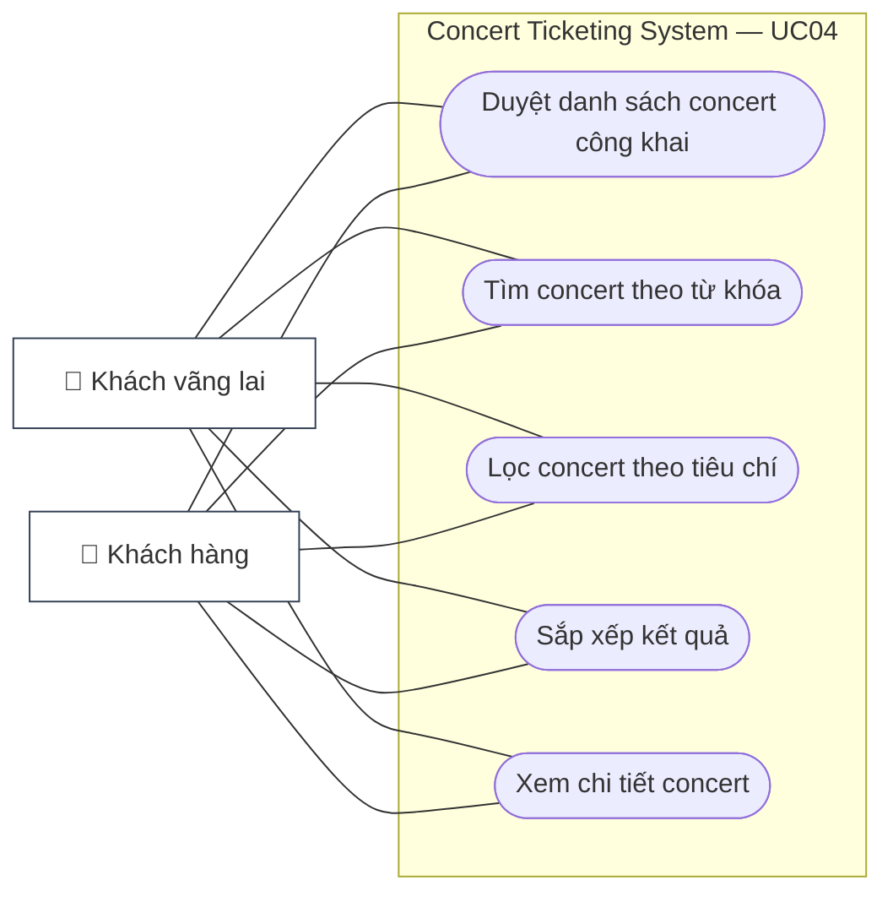

# UC04 — Tìm Kiếm & Lọc Concert (Browse, Search & Filter Concerts)

## 1. Thông Tin Chung

| Trường | Nội dung |
|---|---|
| **Use Case ID** | UC04 |
| **Tên Use Case** | Tìm Kiếm & Lọc Concert |
| **Module** | 02 — Concert & Ticket Purchase Module |
| **Actor chính** | Khách vãng lai (Guest), Khách hàng (Customer) |
| **Mức độ ưu tiên** | 🔴 Critical |
| **Precondition** | Hệ thống có ít nhất 1 concert ở trạng thái `PUBLISHED`, `ON_SALE`, hoặc `COMPLETED` |
| **BR liên quan** | BR-CON-001 (chỉ hiển thị concert đã duyệt) |

---

## 2. Tóm Tắt

Use case này cho phép bất kỳ người dùng (đã đăng nhập hoặc chưa) duyệt, tìm kiếm và lọc danh sách concert công khai theo nhiều tiêu chí khác nhau.

---

<!-- BEGIN MERMAID USE-CASE UC04 -->
### Sơ đồ Use Case (Mermaid)

<!-- END MERMAID USE-CASE UC04 -->

## 3. Điều Kiện Tiên Quyết (Preconditions)

- Không yêu cầu đăng nhập.
- Concert phải ở trạng thái `PUBLISHED`, `ON_SALE`, `SOLD_OUT`, hoặc `COMPLETED` mới được hiển thị.
- Concert `DRAFT`, `PENDING_REVIEW`, `CANCELLED` không hiển thị công khai.

---

## 4. Điều Kiện Kết Thúc (Postconditions)

- Người dùng xem được danh sách concert phù hợp với tiêu chí tìm kiếm/lọc.
- Người dùng có thể tiến hành xem chi tiết concert (dẫn đến UC05).

---

## 5. Luồng Chính (Main Flow)

| Bước | Actor | Hành động | Phản hồi hệ thống |
|---|---|---|---|
| 1 | Guest/Customer | Truy cập trang chủ hoặc trang "Khám phá concert" | Hiển thị danh sách concert nổi bật, concert sắp diễn, phân loại theo thể loại nhạc |
| 2 | Guest/Customer | Nhập từ khóa vào ô tìm kiếm (tên concert, nghệ sĩ, địa điểm) | Gợi ý tìm kiếm xuất hiện real-time sau khi gõ ≥ 2 ký tự (autocomplete) |
| 3 | Guest/Customer | Chọn bộ lọc bổ sung (nếu muốn) | Hiển thị panel lọc |
| 4 | Guest/Customer | Áp dụng bộ lọc và/hoặc nhấn tìm kiếm | Hiển thị danh sách kết quả phù hợp, sắp xếp theo mặc định (ngày diễn gần nhất) |
| 5 | Guest/Customer | Cuộn để xem thêm (infinite scroll hoặc phân trang) | Tải thêm kết quả |
| 6 | Guest/Customer | Click vào một concert trong danh sách | Chuyển đến trang chi tiết concert (UC05) |

---

## 6. Tiêu Chí Tìm Kiếm & Lọc Được Hỗ Trợ

| Tiêu chí | Loại | Ví dụ giá trị |
|---|---|---|
| **Từ khóa** | Text search | Tên concert, tên nghệ sĩ, tên địa điểm |
| **Thể loại nhạc** | Multi-select | Pop, Rock, EDM, R&B, Classical, Hip-hop, Indie |
| **Thành phố / Địa điểm** | Dropdown | Hà Nội, TP.HCM, Đà Nẵng |
| **Khoảng ngày diễn** | Date Range Picker | Từ ngày — Đến ngày |
| **Khoảng giá vé** | Range Slider (VNĐ) | 0 — 10.000.000 VNĐ |
| **Trạng thái bán vé** | Checkbox | Đang mở bán, Hết vé, Sắp mở bán |
| **Sắp xếp theo** | Dropdown | Ngày diễn gần nhất, Giá thấp → cao, Đánh giá cao nhất, Mới nhất |

---

## 7. Luồng Ngoại Lệ (Exception Flows)

| ID | Điều kiện | Xử lý |
|---|---|---|
| EX-01 | Không có concert nào khớp với từ khóa/bộ lọc | Hiển thị "Không tìm thấy kết quả phù hợp" + gợi ý mở rộng tiêu chí |
| EX-02 | Người dùng nhập từ khóa có ký tự đặc biệt (XSS/SQLi attempt) | Sanitize input; trả về kết quả rỗng; không báo lỗi kỹ thuật |
| EX-03 | API search bị timeout (> 3 giây) | Hiển thị skeleton loading; retry tự động 1 lần; nếu vẫn lỗi → hiển thị "Tạm thời không tải được danh sách" |

---

## 8. User Stories & Acceptance Criteria

### US-04-01: Xem Danh Sách Concert Trang Chủ

> **As a** khách vãng lai,  
> **I want to** thấy danh sách concert nổi bật khi vào trang chủ,  
> **So that** khám phá nhanh các sự kiện đang diễn ra mà không cần tìm kiếm.

| AC | Mô tả | Loại |
|---|---|---|
| AC-04-01-01 | Trang chủ hiển thị tối thiểu 8 concert nổi bật, có hình ảnh banner, tên nghệ sĩ, ngày diễn, thành phố, giá vé từ | Functional |
| AC-04-01-02 | Trang chủ tải nội dung chính (LCP) trong < 2.5 giây trên kết nối 4G | Performance |
| AC-04-01-03 | Có section riêng "Sắp mở bán" để khách hàng biết và chuẩn bị trước | Functional |
| AC-04-01-04 | Hình ảnh concert được phục vụ qua CDN dạng WebP; tự động lazy load | Performance |

---

### US-04-02: Tìm Kiếm Concert Theo Từ Khóa

> **As a** khách hàng,  
> **I want to** tìm kiếm concert bằng tên nghệ sĩ hoặc tên sự kiện,  
> **So that** nhanh chóng tìm thấy concert tôi muốn mua vé.

| AC | Mô tả | Loại |
|---|---|---|
| AC-04-02-01 | Autocomplete gợi ý xuất hiện sau khi gõ ≥ 2 ký tự, tối đa 8 gợi ý, latency < 300ms | Performance |
| AC-04-02-02 | Tìm kiếm không phân biệt hoa thường, có dấu/không dấu tiếng Việt (ví dụ: "my tam" tìm ra "Mỹ Tâm") | Functional |
| AC-04-02-03 | Kết quả tìm kiếm trả về trong < 500ms | Performance |
| AC-04-02-04 | Từ khóa tìm kiếm được highlight trong kết quả trả về | Functional |
| AC-04-02-05 | Lịch sử 5 tìm kiếm gần nhất được lưu local và gợi ý khi người dùng focus vào ô search | Functional |

---

### US-04-03: Lọc Concert Theo Nhiều Tiêu Chí

> **As a** khách hàng,  
> **I want to** lọc concert theo thành phố, thể loại nhạc và khoảng giá vé,  
> **So that** chỉ thấy những concert phù hợp với tôi.

| AC | Mô tả | Loại |
|---|---|---|
| AC-04-03-01 | Có thể áp dụng nhiều bộ lọc cùng lúc; kết quả được cập nhật tức thì khi thay đổi lọc (không cần nhấn "Tìm") | Functional |
| AC-04-03-02 | Hiển thị số lượng kết quả tìm được sau mỗi lần lọc (ví dụ: "Tìm thấy 12 concert") | Functional |
| AC-04-03-03 | Có nút "Xóa bộ lọc" để reset về trạng thái ban đầu chỉ với 1 click | Functional |
| AC-04-03-04 | Bộ lọc đang áp dụng hiển thị dưới dạng "tag" có thể xóa từng cái | Functional |
| AC-04-03-05 | URL cập nhật theo bộ lọc (query params) để người dùng có thể lưu/chia sẻ link tìm kiếm | Functional |

---

## 9. Danh Sách Use Case Con & Quan Hệ Actor

| Use Case Con | Actor Chính | Actor Phụ | Ghi Chú |
|---|---|---|---|
| UC04.1 — Xem trang chủ & danh sách concert | Guest, Customer | — | Không cần đăng nhập |
| UC04.2 — Tìm kiếm theo từ khóa | Guest, Customer | Search Engine (Elasticsearch) | Autocomplete, full-text search |
| UC04.3 — Lọc theo tiêu chí | Guest, Customer | — | Combine filter; URL params |
| UC04.4 — Sắp xếp kết quả | Guest, Customer | — | Client-side sort hoặc server-side |
| UC04.5 — Xem chi tiết concert | Guest, Customer | — | Dẫn đến UC05 |

