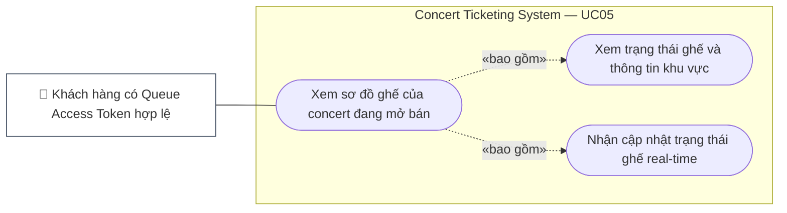

# UC05 — Xem Sơ Đồ Ghế (View Seat Map)

## 1. Thông Tin Chung

| Trường | Nội dung |
|---|---|
| **Use Case ID** | UC05 |
| **Tên Use Case** | Xem Sơ Đồ Ghế Real-time |
| **Module** | 02 — Concert & Ticket Purchase Module |
| **Actor chính** | Khách hàng (Customer) — đã có Queue Access Token hợp lệ |
| **Mức độ ưu tiên** | 🔴 Critical |
| **Precondition** | Customer đã đăng nhập; concert đang ở trạng thái `ON_SALE`; customer đã có số thứ tự hàng chờ và đã được cấp Queue Access Token (đến lượt vào khu chọn ghế) |
| **BR liên quan** | BR-QUEUE-005 (max 5.000 CCU), BR-SEAT-007 (real-time sync < 1s), BR-SEAT-008 (bất biến số ghế) |

---

## 2. Tóm Tắt

Use case này cho phép khách hàng đã đến lượt trong hàng chờ xem sơ đồ chỗ ngồi tương tác của concert với trạng thái ghế được cập nhật real-time qua WebSocket. Đây là bước cầu nối giữa hàng chờ và hành động chọn ghế (UC06).

---

<!-- BEGIN MERMAID USE-CASE UC05 -->
### Sơ đồ Use Case (Mermaid)

<!-- END MERMAID USE-CASE UC05 -->

## 3. Điều Kiện Tiên Quyết (Preconditions)

- Customer đã đăng nhập và có JWT hợp lệ.
- Customer đã nhận `Queue Access Token` (X-Queue-Token) — chứng nhận đã đến lượt vào khu chọn ghế.
- `X-Queue-Token` còn trong thời hạn hiệu lực (TTL 120 giây từ heartbeat/UI action xác thực cuối; heartbeat mỗi 30 giây khi trang foreground; WebSocket đơn thuần không gia hạn theo D-015).
- Số lượng người trong khu chọn ghế hiện tại < 5.000.
- `concert.status = ON_SALE`.

---

## 4. Điều Kiện Kết Thúc (Postconditions)

**Thành công:**
- Sơ đồ ghế hiển thị đầy đủ với màu sắc phân biệt: `AVAILABLE` (xanh), `HELD` (vàng), `SOLD` (đỏ), `BLOCKED` (xám).
- Kết nối WebSocket được thiết lập để nhận cập nhật trạng thái ghế real-time.
- Customer có thể tiến hành chọn ghế (UC06).

**Thất bại:**
- `X-Queue-Token` hết hạn → Hiển thị thông báo "Phiên của bạn đã hết hạn" và chuyển về hàng chờ.
- Concert hết vé (`SOLD_OUT`) → Hiển thị thông báo và không cho chọn ghế.

---

## 5. Luồng Chính (Main Flow)

| Bước | Actor | Hành động | Phản hồi hệ thống |
|---|---|---|---|
| 1 | Customer | Được thông báo "Đến lượt của bạn!" qua WebSocket sau khi chờ đủ thời gian | Hiển thị nút "Vào chọn ghế ngay" với đồng hồ đếm ngược 120 giây |
| 2 | Customer | Nhấn "Vào chọn ghế ngay" | Tải trang Seat Map; API kiểm tra Queue Access Token |
| 3 | System | Lấy snapshot sơ đồ ghế từ cache Redis (stale ≤ 5 giây) | Hiển thị sơ đồ ghế với toàn bộ vị trí và màu sắc trạng thái |
| 4 | System | Thiết lập kết nối WebSocket | WebSocket kết nối thành công; customer bắt đầu nhận cập nhật real-time |
| 5 | Customer | Xem sơ đồ: phóng to/thu nhỏ, di chuyển bản đồ (pan/zoom) | Sơ đồ phản hồi mượt mà |
| 6 | Customer | Hover chuột vào một ghế | Tooltip hiển thị: Mã ghế, Khu vực (Zone), Giá vé, Trạng thái hiện tại |
| 7 | Customer | Thấy ghế vừa bị người khác giữ → màu vàng | WebSocket broadcast cập nhật trạng thái ghế tức thì (< 1 giây) |
| 8 | Customer | Chọn ghế muốn mua | Chuyển sang UC06 — Chọn & Giữ Ghế |

---

## 6. Thông Tin Hiển Thị Trên Sơ Đồ Ghế

| Yếu tố hiển thị | Mô tả |
|---|---|
| **Phân khu (Zone)** | Hiển thị tên khu vực (VIP_A, Standard_B, Standing...) với màu nền phân biệt |
| **Mã ghế** | Ví dụ: A-12, B-05; hiển thị khi zoom đủ lớn |
| **Màu trạng thái** | Xanh lá = AVAILABLE; Vàng = HELD (đang có người giữ); Đỏ = SOLD; Xám đậm = BLOCKED |
| **Giá vé theo zone** | Hiển thị legend giá vé từng khu ở góc màn hình |
| **Tổng ghế trống** | Hiển thị số ghế còn trống theo từng zone (ví dụ: "VIP_A: 23 ghế trống") |
| **Sân khấu / Hướng nhìn** | Hiển thị vị trí sân khấu để user ước lượng tầm nhìn |

---

## 7. Luồng Ngoại Lệ (Exception Flows)

| ID | Điều kiện | Xử lý |
|---|---|---|
| EX-01 | `X-Queue-Token` không hợp lệ hoặc đã hết hạn | Trả `401 Unauthorized`; redirect về trang hàng chờ; thông báo "Phiên chọn ghế đã hết hạn. Bạn cần xếp hàng lại." |
| EX-02 | Tất cả ghế đã SOLD (hết vé) khi customer vừa vào trang | Hiển thị "Rất tiếc! Vé đã bán hết trong lúc bạn chờ." |
| EX-03 | WebSocket bị ngắt kết nối (mất mạng) | Hiển thị banner cảnh báo "Đang mất kết nối – Sơ đồ có thể không còn chính xác"; retry tự động mỗi 5 giây |
| EX-04 | API trả snapshot sơ đồ ghế quá thời gian 3 giây | Hiển thị skeleton loading; retry 1 lần; nếu vẫn lỗi hiển thị nút "Thử lại" |
| EX-05 | Customer không tương tác trong 120 giây liên tục | Hệ thống hiển thị cảnh báo "Bạn sắp mất lượt" ở giây 90; đến giây 120 → thu hồi Queue Token và quyền tiếp tục chọn ghế. Seat hold đã tạo vẫn theo TTL 10 phút đã chốt tại D-002; chỉ được giải phóng khi hết TTL, người dùng hủy, hoặc luồng đơn hàng hợp lệ kết thúc hold |

---

## 8. User Stories & Acceptance Criteria

### US-05-01: Xem Sơ Đồ Ghế Real-time

> **As a** khách hàng đã đến lượt trong hàng chờ,  
> **I want to** xem sơ đồ ghế ngồi của concert với trạng thái cập nhật liên tục,  
> **So that** tôi chọn được ghế ưa thích trước khi người khác chọn.

| AC | Mô tả | Loại |
|---|---|---|
| AC-05-01-01 | Sơ đồ ghế phải hiển thị đầy đủ và chính xác trong < 2 giây kể từ khi trang tải | Performance |
| AC-05-01-02 | Khi ghế thay đổi trạng thái (bất kỳ user nào khác giữ/thanh toán), sơ đồ cập nhật < 1 giây qua WebSocket | Performance |
| AC-05-01-03 | Phân biệt rõ ràng 4 trạng thái ghế bằng màu sắc khác nhau; có legend giải thích màu sắc luôn hiển thị | Functional |
| AC-05-01-04 | Sơ đồ hỗ trợ pan (kéo để di chuyển) và zoom (cuộn chuột / pinch trên mobile) | UX |
| AC-05-01-05 | Trên màn hình mobile (≤ 768px), sơ đồ tự động thu nhỏ để hiển thị toàn bộ khán phòng; có thể zoom in để chọn ghế | UX |
| AC-05-01-06 | Số lượng ghế còn trống theo từng zone được hiển thị và cập nhật real-time | Functional |

---

### US-05-02: Xem Chi Tiết Thông Tin Ghế

> **As a** khách hàng,  
> **I want to** xem giá vé và thông tin chi tiết của từng ghế khi hover/tap vào,  
> **So that** quyết định chọn ghế phù hợp với ngân sách và vị trí ưa thích.

| AC | Mô tả | Loại |
|---|---|---|
| AC-05-02-01 | Tooltip/popup hiển thị khi hover (desktop) hoặc tap (mobile): Mã ghế, Zone, Giá vé, Trạng thái | Functional |
| AC-05-02-02 | Với ghế `HELD`: Tooltip hiển thị "Đang có người giữ" (không lộ thông tin user đang giữ) | Functional (Privacy) |
| AC-05-02-03 | Với ghế `BLOCKED`: Tooltip hiển thị "Ghế này không khả dụng" | Functional |
| AC-05-02-04 | Khi click vào ghế `AVAILABLE`, trực tiếp kích hoạt hành động giữ ghế (UC06); không cần thêm bước xác nhận trung gian | UX |

---

## 9. Danh Sách Use Case Con & Quan Hệ Actor

| Use Case Con | Actor Chính | Actor Phụ | Ghi Chú |
|---|---|---|---|
| UC05.1 — Tải và hiển thị sơ đồ ghế | Customer | Redis Cache, WebSocket Server | Snapshot từ cache; WebSocket cho real-time |
| UC05.2 — Nhận cập nhật trạng thái ghế real-time | Customer | WebSocket Server | Broadcast từ tất cả sự kiện giữ ghế/bán ghế |
| UC05.3 — Xem thông tin chi tiết ghế | Customer | — | Hover/tap tooltip |
| UC05.4 — Phóng to/thu nhỏ sơ đồ | Customer | — | Client-side pan & zoom |

