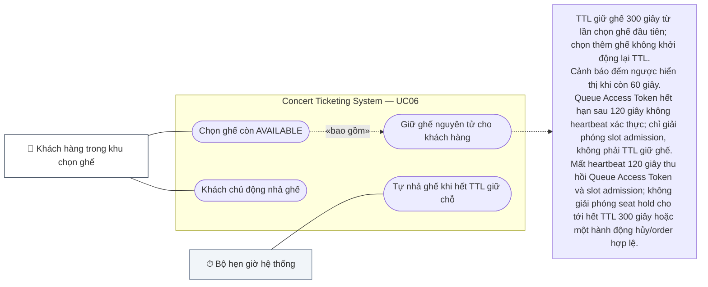

# UC06 — Chọn & Giữ Ghế (Select & Hold Seats)

## 1. Thông Tin Chung

| Trường | Nội dung |
|---|---|
| **Use Case ID** | UC06 |
| **Tên Use Case** | Chọn & Giữ Ghế |
| **Module** | 02 — Concert & Ticket Purchase Module |
| **Actor chính** | Khách hàng (Customer) |
| **Mức độ ưu tiên** | 🔴 Critical |
| **Precondition** | Customer đang xem sơ đồ ghế (UC05); có `X-Queue-Token` hợp lệ; `concert.status = ON_SALE` |
| **BR liên quan** | BR-SEAT-001 (loại trừ tương hỗ), BR-SEAT-002 (TTL 5 phút), BR-SEAT-004 (max 4 ghế/đơn), BR-ORD-003 (giới hạn tài khoản), BR-QUEUE-006 (timeout 2 phút inactive), BR-SEAT-005 (thông tin người sử dụng vé) |

---

## 2. Tóm Tắt

Use case này xử lý hành động chọn ghế trên sơ đồ và khóa giữ ghế tạm thời (Seat Hold) trong **5 phút**. Đây là bước quan trọng nhất cần đảm bảo **Zero Double-Booking** — chỉ đúng một khách hàng được giữ một ghế tại một thời điểm. Ngoài ra, use case còn thu thập **thông tin người sử dụng vé (Attendee Information)** khi khách hàng mua vé cho nhiều người.

---

<!-- BEGIN MERMAID USE-CASE UC06 -->
### Sơ đồ Use Case (Mermaid)

<!-- END MERMAID USE-CASE UC06 -->

## 3. Điều Kiện Tiên Quyết (Preconditions)

- Customer đang trong khu chọn ghế với `X-Queue-Token` hợp lệ.
- Ghế muốn chọn đang ở trạng thái `AVAILABLE`.
- Số ghế trong request ≤ giới hạn của concert (mặc định 4 ghế).
- Tổng vé đang sở hữu (PAID + PENDING) của tài khoản này cho concert chưa đạt giới hạn.

---

## 4. Điều Kiện Kết Thúc (Postconditions)

**Thành công:**
- Ghế chuyển sang trạng thái `HELD` với `hold_user_id` = current customer.
- Đồng hồ đếm ngược **5 phút** bắt đầu đồng bộ trên cả client và server.
- WebSocket broadcast cập nhật ghế → vàng trên sơ đồ của tất cả user.

**Thất bại:**
- Ghế vẫn ở `AVAILABLE` (nếu ai khác đã giữ trước).
- Hiển thị thông báo lỗi rõ ràng; user có thể chọn ghế khác.

---

## 5. Luồng Chính (Main Flow) — Chọn Ghế Thành Công

| Bước | Actor | Hành động | Phản hồi hệ thống |
|---|---|---|---|
| 1 | Customer | Click vào ghế màu xanh (AVAILABLE) trên sơ đồ | UI đánh dấu ghế là "đang được chọn" (màu xanh dương nhạt tạm thời) |
| 2 | System | Gửi request API giữ ghế: `POST /concerts/{id}/seats/hold` với `seat_ids` và `X-Queue-Token` | — |
| 3 | System | Thực hiện Redis Distributed Lock (`SET NX EX 300`) — Tầng bảo vệ 1 | — |
| 4 | System | Thực hiện DB Conditional Update — Tầng bảo vệ 2 | — |
| 5 | System | Cả 2 tầng thành công | Ghế chuyển `HELD`; WebSocket broadcast; giảm active slot của khu chọn ghế |
| 6 | System | Hiển thị kết quả cho customer | Panel "Ghế đã chọn" xuất hiện với danh sách ghế đang giữ, đồng hồ đếm ngược **05:00**, tổng tiền tạm tính |
| 7 | Customer | Chọn thêm ghế khác (nếu muốn, tổng ≤ 4) | Lặp lại từ bước 1; đồng hồ đếm ngược giữ nguyên theo mốc ghế đầu tiên |
| 8 | Customer | Nhấn "Tiến hành đặt vé" | Nếu mua 2–4 vé → chuyển sang UC06.6 — Nhập thông tin người sử dụng vé; nếu mua 1 vé → thông tin mặc định là người mua, có thể chỉnh sửa, rồi chuyển sang UC07 |

---

## 6. Luồng Thay Thế (Alternative Flows)

### AF-01: Ghế Bị Người Khác Chọn Trước (Race Condition)

| Bước | Mô tả |
|---|---|
| 1 | Customer click ghế → UI hiển thị "đang xử lý" |
| 2 | Server kiểm tra Redis Lock → đã tồn tại (user khác đã giữ) |
| 3 | API trả `409 Conflict: SEAT_ALREADY_HELD` |
| 4 | UI xóa trạng thái "đang xử lý"; ghế tự động chuyển màu vàng trên sơ đồ (WebSocket đã cập nhật) |
| 5 | Toast thông báo: "Ghế {A12} vừa bị người khác chọn. Vui lòng chọn ghế khác." |

### AF-02: Bỏ Chọn Một Ghế Đã Giữ

| Bước | Mô tả |
|---|---|
| 1 | Customer nhấn nút "✕" bên cạnh ghế trong panel "Ghế đã chọn" |
| 2 | API `DELETE /concerts/{id}/seats/hold/{seat_id}` |
| 3 | Xác nhận `hold_user_id` khớp với customer đang yêu cầu |
| 4 | Giải phóng Redis Lock; cập nhật DB `seat.status = AVAILABLE` |
| 5 | WebSocket broadcast: ghế → xanh lá; Panel cập nhật tổng tiền |

### AF-03: Bỏ Chọn Tất Cả Ghế & Thoát Khu Chọn Ghế

| Bước | Mô tả |
|---|---|
| 1 | Customer nhấn "Hủy tất cả" hoặc đóng tab/trình duyệt |
| 2 | Nếu đóng tab, heartbeat dừng; sau 120 giây hệ thống thu hồi Queue Access Token và slot admission. Mọi ghế HELD vẫn thuộc customer đến hết TTL **300 giây**, trừ khi customer hủy chủ động hoặc order flow hợp lệ kết thúc hold |
| 3 | Nếu nhấn "Hủy tất cả": API giải phóng tất cả ghế đang giữ của customer ngay lập tức |
| 4 | Queue Access Token bị thu hồi; slot trong khu chọn ghế được giải phóng cho người tiếp theo |

---

## 7. Luồng Ngoại Lệ (Exception Flows)

| ID | Điều kiện | Xử lý |
|---|---|---|
| EX-01 | Chọn > 4 ghế trong 1 đơn | API trả `400: SEAT_LIMIT_EXCEEDED`; UI vô hiệu hóa click ghế thứ 5 trở đi với tooltip giải thích |
| EX-02 | Tổng vé đang sở hữu đạt giới hạn tài khoản | API trả `400: ACCOUNT_SEAT_LIMIT_EXCEEDED`; hiển thị "Bạn đã sở hữu X vé cho concert này" |
| EX-03 | `X-Queue-Token` hết hạn giữa chừng khi đang chọn ghế | Hệ thống thông báo "Phiên hết hạn"; giải phóng tất cả ghế đang giữ; redirect về hàng chờ với vị trí cuối |
| EX-04 | Kết nối WebSocket bị ngắt khi đang giữ ghế | Banner cảnh báo; ghế vẫn được giữ trên server (Redis TTL chạy độc lập); heartbeat retry kết nối |
| EX-05 | Concert hết vé ngay sau khi customer giữ được 1 ghế | Cho phép customer tiếp tục với ghế đang giữ; thông báo "Concert đã hết vé nhưng bạn vẫn đang giữ ghế của mình" |
| EX-06 | Thông tin người sử dụng vé không hợp lệ hoặc thiếu (khi mua 2–4 vé) | Hệ thống chặn tiến hành thanh toán; hiển thị thông báo lỗi từng trường; yêu cầu nhập đủ trước khi tiếp tục |

---

## 8. User Stories & Acceptance Criteria

### US-06-01: Chọn Và Giữ Ghế Thành Công

> **As a** khách hàng đang trong khu chọn ghế,  
> **I want to** click chọn ghế và hệ thống tự động giữ trong **5 phút**,  
> **So that** tôi có đủ thời gian thanh toán mà không lo bị người khác lấy mất.

| AC | Mô tả | Loại |
|---|---|---|
| AC-06-01-01 | Thao tác chọn ghế (click → API → cập nhật UI) hoàn tất trong < 500ms ở P95 dưới tải đỉnh | Performance |
| AC-06-01-02 | Đồng hồ đếm ngược **5 phút (300 giây)** hiển thị chính xác và đồng bộ giữa client-server; không bị reset khi chọn thêm ghế | Functional |
| AC-06-01-03 | Không thể xảy ra double-booking: 2 user cùng click cùng 1 ghế → chỉ 1 người thành công, người kia nhận lỗi ngay lập tức | Functional (Critical) |
| AC-06-01-04 | WebSocket cập nhật màu ghế trên sơ đồ của TẤT CẢ người dùng đang xem trong < 1 giây | Performance |
| AC-06-01-05 | Panel "Ghế đã chọn" hiển thị: Mã ghế, Zone, Giá từng ghế, Tổng tiền, Đồng hồ đếm ngược | Functional |
| AC-06-01-06 | Khi còn **60 giây**, hệ thống hiển thị cảnh báo nổi bật "Còn 1 phút để hoàn tất đặt vé!" trên cả UI và timer | Functional |

---

### US-06-02: Giải Phóng Ghế Khi Hết Hạn

> **As a** system,  
> **I want to** tự động giải phóng ghế sau **5 phút** nếu chưa được thanh toán,  
> **So that** ghế quay về sơ đồ cho khách hàng khác và không bị "treo" vĩnh viễn.

| AC | Mô tả | Loại |
|---|---|---|
| AC-06-02-01 | Đúng sau **300 giây** kể từ khi hold thành công, ghế tự động chuyển về `AVAILABLE` mà không cần can thiệp thủ công | Functional |
| AC-06-02-02 | Auto-release chạy trong vòng ≤ 5 giây sau thời điểm hết hạn (Redis keyspace notification hoặc scheduler job) | Performance |
| AC-06-02-03 | Sau khi ghế được giải phóng, WebSocket broadcast ngay lập tức cập nhật sơ đồ | Functional |
| AC-06-02-04 | Đơn hàng liên kết chuyển sang `OUT_TIME`; khách hàng nhận push notification "Phiên giữ ghế đã hết hạn" | Functional |

---

### US-06-03: Giới Hạn Số Ghế Trên Mỗi Đơn

> **As a** system,  
> **I want to** giới hạn mỗi đơn hàng tối đa 4 ghế,  
> **So that** phân phối vé công bằng và ngăn đầu cơ vé.

| AC | Mô tả | Loại |
|---|---|---|
| AC-06-03-01 | Giao diện vô hiệu hóa (disable + tooltip giải thích) nút chọn ghế thứ 5 trở đi khi đã có 4 ghế trong panel | Functional |
| AC-06-03-02 | API luôn validate ở backend bất kể giao diện có disable hay không — không thể bypass bằng cách gửi trực tiếp API | Security |
| AC-06-03-03 | Giới hạn áp dụng tích lũy: 2 ghế từ đơn PENDING cũ + 2 ghế mới = đủ giới hạn | Functional |

---

### US-06-04: Nhập Thông Tin Người Sử Dụng Vé

> **As a** khách hàng mua vé cho nhiều người,  
> **I want to** nhập thông tin từng người sẽ sử dụng vé,  
> **So that** mỗi vé ghi đúng tên người sử dụng thực tế và ban tổ chức có thể kiểm soát được danh sách tham dự.

| AC | Mô tả | Loại |
|---|---|---|
| AC-06-04-01 | Nếu mua **1 vé**: thông tin người sử dụng mặc định là thông tin người mua (Họ tên, SĐT từ tài khoản), cho phép chỉnh sửa trước khi xác nhận | Functional |
| AC-06-04-02 | Nếu mua **2–4 vé**: hệ thống hiển thị form nhập thông tin riêng biệt cho từng ghế/vé; không cho phép tiến hành thanh toán nếu chưa nhập đủ | Functional |
| AC-06-04-03 | Mỗi vé bắt buộc nhập: **Họ tên đầy đủ** (tối đa 100 ký tự), **Số điện thoại** (10–11 số, định dạng Việt Nam) | Functional |
| AC-06-04-04 | Trường **CCCD/CMND** là tùy chọn (optional), 9–12 chữ số; nếu nhập thì phải hợp lệ | Functional |
| AC-06-04-05 | Thông tin người sử dụng vé được lưu vào DB và in trên vé điện tử; mỗi vé hiển thị tên người sử dụng, không phải tên người mua | Functional |
| AC-06-04-06 | Khách hàng có thể sao chép thông tin từ người dùng vé này sang người dùng vé khác bằng nút "Dùng thông tin giống người X" để tiết kiệm thời gian | Functional |
| AC-06-04-07 | Toàn bộ luồng nhập thông tin (từ khi hiển thị form → submit) phải hoàn tất trước khi TTL giữ ghế hết hạn; đồng hồ đếm ngược vẫn chạy trong màn hình này | Functional |

---

## 9. Danh Sách Use Case Con & Quan Hệ Actor

| Use Case Con | Actor Chính | Actor Phụ | Ghi Chú |
|---|---|---|---|
| UC06.1 — Chọn ghế (Hold) | Customer | Redis (Distributed Lock), Database | Atomic locking, 2 lớp bảo vệ |
| UC06.2 — Bỏ chọn ghế (Release) | Customer | Redis, WebSocket Server | Chỉ chính chủ mới được release |
| UC06.3 — Auto-release khi hết TTL | System (Auto) | Redis Keyspace Notification | Tự động không cần user action; TTL = **300 giây** |
| UC06.4 — Thu hồi queue admission khi mất heartbeat | System (Auto) | Redis TTL | Sau 120s thu hồi Queue Access Token/slot admission; seat hold tiếp tục đến TTL **300s** |
| UC06.5 — Tiến hành đặt vé | Customer | — | Trigger UC06.6 (nếu ≥ 2 vé) hoặc UC07 trực tiếp (nếu 1 vé) |
| UC06.6 — Nhập thông tin người sử dụng vé (Attendee Info Collection) | Customer | Database | Bắt buộc khi mua 2–4 vé; tùy chọn chỉnh sửa khi mua 1 vé; dữ liệu được in trên vé điện tử |

---

## 10. Business Rules Liên Quan

| BR ID | Nội dung | Ghi Chú |
|---|---|---|
| **BR-SEAT-001** | Mỗi ghế chỉ được giữ bởi duy nhất 1 user tại 1 thời điểm (loại trừ tương hỗ) | Áp dụng Redis NX Lock + DB conditional update |
| **BR-SEAT-002** | TTL giữ ghế là **5 phút (300 giây)** kể từ lần chọn ghế đầu tiên; chọn thêm ghế không reset TTL; cảnh báo đếm ngược hiển thị khi còn **60 giây** | Trước đây: 10 phút (600 giây) → Cập nhật: 5 phút (300 giây) |
| **BR-SEAT-004** | Mỗi đơn hàng tối đa **4 ghế** (cộng dồn tất cả đơn PENDING của tài khoản cho cùng 1 concert) | Chống đầu cơ vé |
| **BR-SEAT-005** | **Thông tin người sử dụng vé (Attendee Information):** (1) Mua 1 vé: thông tin mặc định = thông tin người mua, có thể chỉnh sửa. (2) Mua 2–4 vé: bắt buộc nhập Họ tên + SĐT riêng biệt cho từng ghế; CCCD/CMND là tùy chọn. (3) Mỗi vé in tên người sử dụng thực tế, không phải tên người mua | Mới thêm |
| **BR-ORD-003** | Giới hạn tổng vé theo tài khoản trên mỗi concert (xem cấu hình riêng) | — |
| **BR-QUEUE-006** | Mất heartbeat ≥ 120 giây → thu hồi Queue Access Token và slot admission; seat hold không bị ảnh hưởng cho tới hết TTL 300 giây | — |

