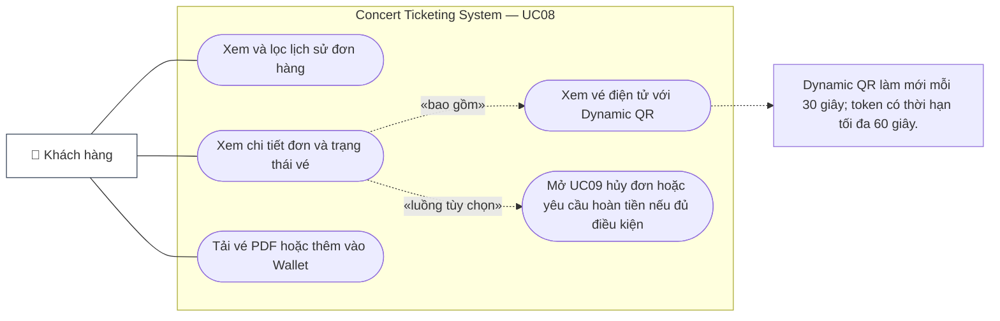

# UC08 — Xem Lịch Sử Đơn Hàng Cá Nhân (View Personal Order History)

## 1. Thông Tin Chung

| Trường | Nội dung |
|---|---|
| **Use Case ID** | UC08 |
| **Tên Use Case** | Xem Lịch Sử Đơn Hàng & Vé Cá Nhân |
| **Module** | 03 — Orders, Refunds & Reviews Module |
| **Actor chính** | Khách hàng (Customer) |
| **Mức độ ưu tiên** | 🟡 High |
| **Precondition** | Customer đã đăng nhập |
| **BR liên quan** | BR-ORD-006 (định dạng mã đơn), Chống IDOR |

---

## 2. Tóm Tắt

Use case này cho phép khách hàng xem toàn bộ lịch sử đơn hàng, trạng thái từng đơn, xem và tải vé điện tử kèm mã QR, và truy cập nhanh vào chức năng hủy/hoàn tiền.

---

<!-- BEGIN MERMAID USE-CASE UC08 -->
### Sơ đồ Use Case (Mermaid)

<!-- END MERMAID USE-CASE UC08 -->

## 3. Luồng Chính (Main Flow)

| Bước | Actor | Hành động | Phản hồi hệ thống |
|---|---|---|---|
| 1 | Customer | Vào "Vé của tôi" / "Đơn hàng của tôi" từ menu cá nhân | Hiển thị danh sách đơn hàng (mới nhất trước), phân trang 10 đơn/trang |
| 2 | Customer | Xem danh sách tổng quan | Mỗi đơn hiển thị: Mã đơn, Tên concert, Ngày mua, Trạng thái, Tổng tiền |
| 3 | Customer | Lọc theo trạng thái: Tất cả / Đã thanh toán / Đang hoàn tiền / Đã hủy | Danh sách lọc cập nhật tức thì |
| 4 | Customer | Click vào một đơn hàng cụ thể | Hiển thị chi tiết đơn: Thông tin concert, từng ghế & giá, trạng thái từng vé, lịch sử thanh toán |
| 5 | Customer | Click "Xem vé" cho một vé cụ thể | Hiển thị vé điện tử với Dynamic QR Code |
| 6 | Customer | Tải vé PDF / Thêm vào Apple/Google Wallet | Tải file PDF hoặc mở app Wallet tương ứng |

---

## 4. Thông Tin Hiển Thị Theo Từng Mức

### 4.1 Danh Sách Đơn Hàng (List View)

| Thông tin | Mô tả |
|---|---|
| Mã đơn hàng | Ví dụ: `ORD-20261024-A3F9K2` |
| Tên concert + nghệ sĩ | Tóm tắt |
| Ngày mua | Ngày giờ (múi giờ UTC+7) |
| Số lượng vé | Ví dụ: "2 vé" |
| Tổng tiền đã thanh toán | VNĐ |
| Trạng thái đơn | Badge màu: PAID (xanh), PENDING (vàng), OUT_TIME (xám), REFUND_PENDING (cam), REFUND_FAILED (đỏ đậm), REFUNDED (xanh nhạt), CANCELLED (đỏ) |

### 4.2 Chi Tiết Đơn Hàng (Detail View)

| Thông tin | Mô tả |
|---|---|
| Thông tin sự kiện | Tên, ngày giờ, địa điểm, hình ảnh |
| Danh sách ghế | Từng ghế: Mã ghế, Zone, Giá; Trạng thái vé tương ứng |
| Bảng tài chính | Giá gốc, phí dịch vụ, VAT, tổng cộng |
| Phương thức thanh toán | VNPay / MoMo; mã giao dịch cổng |
| Lịch sử giao dịch | Thời gian thanh toán, trạng thái giao dịch |
| Nút hành động | "Xem vé QR" / "Hủy đơn" (nếu hợp lệ) / "Yêu cầu hoàn tiền" (nếu hợp lệ) |

---

## 5. User Stories & Acceptance Criteria

### US-08-01: Xem Danh Sách Đơn Hàng

> **As a** khách hàng,  
> **I want to** xem tất cả đơn hàng đã đặt theo thứ tự mới nhất,  
> **So that** theo dõi trạng thái mua vé và truy cập vé nhanh chóng.

| AC | Mô tả | Loại |
|---|---|---|
| AC-08-01-01 | Chỉ hiển thị đơn hàng thuộc đúng `customer_id` đang đăng nhập — tuyệt đối không lộ đơn của người khác (IDOR protection) | Security (Critical) |
| AC-08-01-02 | Trang tải danh sách 10 đơn hàng đầu tiên trong < 1 giây | Performance |
| AC-08-01-03 | Trạng thái đơn hàng hiển thị real-time; nếu đơn đang `REFUND_PENDING` vừa chuyển sang `REFUNDED` → tự cập nhật không cần F5 | Functional |
| AC-08-01-04 | Có thể lọc đơn theo trạng thái và tìm theo mã đơn hàng | Functional |

---

### US-08-02: Xem Vé Điện Tử & Mã QR

> **As a** khách hàng đã mua vé,  
> **I want to** xem và tải vé điện tử kèm mã QR check-in,  
> **So that** chuẩn bị sẵn để vào cửa sự kiện.

| AC | Mô tả | Loại |
|---|---|---|
| AC-08-02-01 | Mã QR là JWT/JWS ký RS256 — làm mới mỗi 30 giây, token có hiệu lực tối đa 60 giây; mỗi token có `nonce` và chữ ký mới | Security |
| AC-08-02-02 | Vé `ORDERED` hiển thị đầy đủ thông tin: Tên chủ vé, Concert, Ngày giờ, Địa điểm, Zone, Ghế số, Mã QR | Functional |
| AC-08-02-03 | Vé `CANCELLED` hiển thị dấu "ĐÃ HỦY" rõ ràng, mã QR không hiển thị hoặc bị xóa | Functional |
| AC-08-02-04 | Có thể tải vé dạng PDF (ảnh tĩnh + QR static có chữ ký); kích thước file PDF ≤ 500KB | Functional |
| AC-08-02-05 | Trên iOS: có thể thêm vé vào Apple Wallet; trên Android: thêm vào Google Wallet | Functional (Nice to have) |

---

## 6. Danh Sách Use Case Con & Quan Hệ Actor

| Use Case Con | Actor Chính | Actor Phụ | Ghi Chú |
|---|---|---|---|
| UC08.1 — Xem danh sách đơn hàng | Customer | — | IDOR protection bắt buộc |
| UC08.2 — Lọc và tìm kiếm đơn hàng | Customer | — | Lọc theo status, mã đơn |
| UC08.3 — Xem chi tiết đơn hàng | Customer | — | Xem từng ghế + lịch sử thanh toán |
| UC08.4 — Xem vé điện tử & QR | Customer | QR Service | Dynamic QR rotate every 30s; token validity at most 60s |
| UC08.5 — Tải vé PDF | Customer | PDF Generator Service | Static QR với chữ ký RSA |
| UC08.6 — Hủy đơn (nếu hợp lệ) | Customer | — | Dẫn đến UC09 |

