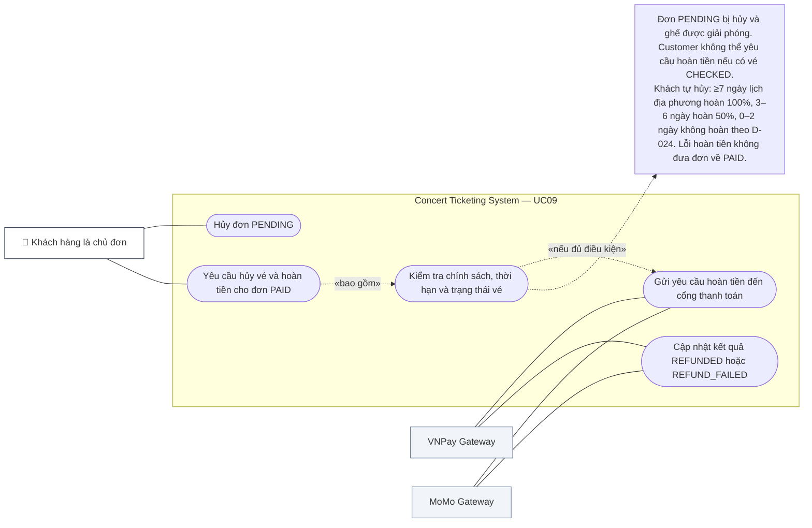

# UC09 — Hủy Đơn Hàng & Yêu Cầu Hoàn Tiền (Order Cancellation & Refund Request)

## 1. Thông Tin Chung

| Trường | Nội dung |
|---|---|
| **Use Case ID** | UC09 |
| **Tên Use Case** | Hủy Đơn Hàng & Yêu Cầu Hoàn Tiền |
| **Module** | 03 — Orders, Refunds & Reviews Module |
| **Actor chính** | Khách hàng (Customer) |
| **Actor phụ** | VNPay / MoMo Gateway (hoàn tiền), Notification Service |
| **Mức độ ưu tiên** | 🔴 Critical |
| **Precondition** | Customer đã đăng nhập; có đơn hàng `PAID` hoặc `PENDING` |
| **BR liên quan** | BR-RFD-001 đến BR-RFD-007; BR-ORD-007 |

---

## 2. Tóm Tắt

Use case này mô tả hai kịch bản hủy đơn hàng: (1) hủy đơn đang chờ thanh toán (`PENDING`) — không cần hoàn tiền; và (2) yêu cầu hủy vé và hoàn tiền cho đơn đã thanh toán (`PAID`) — áp dụng chính sách hoàn tiền phân bậc theo mốc thời gian.

---

<!-- BEGIN MERMAID USE-CASE UC09 -->
### Sơ đồ Use Case (Mermaid)

<!-- END MERMAID USE-CASE UC09 -->

## 3. Điều Kiện Tiên Quyết (Preconditions)

- Customer đã đăng nhập và là chủ sở hữu của đơn hàng muốn hủy.
- Với hủy đơn PENDING: `order.status = PENDING` và `order.expires_at > now()`.
- Với yêu cầu tự nguyện: order.status = PAID; concert chưa COMPLETED; không có vé nào trong đơn CHECKED; số ngày lịch theo timezone venue từ 3 trở lên.

---

## 4. Điều Kiện Kết Thúc (Postconditions)

**Thành công — Hủy PENDING:**
- `order.status = CANCELLED`; tất cả ghế giải phóng về `AVAILABLE` tức thì.

**Thành công — Hoàn tiền:**
- `order.status = REFUND_PENDING`; tất cả vé → `CANCELLED` (QR vô hiệu hóa); ghế → `AVAILABLE` (nếu concert còn ON_SALE).

**Thất bại:**
- Đơn hàng giữ nguyên trạng thái; thông báo lý do rõ ràng.

---

## 5. Luồng Chính A — Hủy Đơn Chờ Thanh Toán (PENDING)

| Bước | Actor | Hành động | Phản hồi hệ thống |
|---|---|---|---|
| 1 | Customer | Xem chi tiết đơn PENDING → Click "Hủy đơn hàng" | Hiển thị popup xác nhận: "Hủy đơn sẽ giải phóng ghế về sơ đồ. Xác nhận?" |
| 2 | Customer | Xác nhận | Hệ thống hủy đơn ngay lập tức |
| 3 | System | Cập nhật nguyên tử: `order → CANCELLED`; tất cả `HELD seats → AVAILABLE` | — |
| 4 | System | WebSocket broadcast: ghế chuyển xanh lá trên sơ đồ | Customer thấy thông báo "Đơn hàng đã được hủy thành công." |

---

## 6. Luồng Chính B — Yêu Cầu Hủy Vé & Hoàn Tiền (PAID)

| Bước | Actor | Hành động | Phản hồi hệ thống |
|---|---|---|---|
| 1 | Customer | Xem chi tiết đơn PAID → Click "Yêu cầu hủy vé / hoàn tiền" | Hệ thống tính chênh lệch ngày lịch tại timezone địa điểm theo D-024 |
| 2 | System | Kiểm tra điều kiện hợp lệ (có vé nào CHECKED? Còn đủ ngày để hoàn?) | Hiển thị màn thông báo tỷ lệ hoàn tiền áp dụng |
| 3 | System | Hiển thị thông tin hoàn tiền | "Bạn sẽ được hoàn **X VNĐ** (Y%) về {phương thức} trong {Z ngày làm việc}. Thao tác không thể hoàn tác." |
| 4 | Customer | Xác nhận yêu cầu | Hệ thống cập nhật và gửi lệnh hoàn tiền |
| 5 | System | Cập nhật nguyên tử | `order → REFUND_PENDING`; tất cả `tickets → CANCELLED`; ghế → `AVAILABLE` (nếu concert ON_SALE) |
| 6 | System | Gửi lệnh hoàn tiền đến cổng thanh toán | Hệ thống ghi yêu cầu và trạng thái provider; timeout thành UNKNOWN, reconcile theo D-032 |
| 7 | System | Gửi thông báo | Thông báo in-app: yêu cầu hoàn đã được ghi nhận; push/email chỉ gửi khi bật và có consent, không cam kết thời điểm tiền về. |

---

## 7. Luồng Ngoại Lệ (Exception Flows)

| ID | Điều kiện | Xử lý |
|---|---|---|
| EX-01 | Có vé trong đơn đã `CHECKED` | `422 Unprocessable: TICKET_ALREADY_CHECKED`. "Không thể hủy vé đã được sử dụng để vào sự kiện." |
| EX-02 | Gửi yêu cầu hoàn tiền khi còn < 3 ngày đến ngày diễn | `422: REFUND_WINDOW_CLOSED`. "Đã quá thời hạn hủy vé. Chính sách không cho phép hoàn tiền trong vòng 3 ngày trước sự kiện." |
| EX-03 | Gọi API hủy không phải chủ sở hữu đơn hàng | `403 Forbidden`. Ghi log bảo mật (IDOR attempt). |
| EX-04 | Provider timeout hoặc không rõ kết quả hoàn | Đặt refund UNKNOWN; reconcile 30 giây, 5 phút, 30 phút; không retry mù. Chỉ retry khi thất bại xác định, tối đa 3 lần theo backoff 1/5/30 phút; sau 30 phút UNKNOWN chuyển manual queue (D-032) |
| EX-05 | Customer gửi yêu cầu hoàn tiền 2 lần cho cùng 1 đơn | Idempotency: Hệ thống phát hiện đơn đã `REFUND_PENDING` → trả kết quả hiện tại, không tạo thêm lệnh hoàn tiền |

---

## 8. Bảng Chính Sách Hoàn Tiền Hiển Thị Cho Người Dùng

| Thời điểm gửi yêu cầu | Tỷ lệ hoàn | Số tiền hoàn (ví dụ: đơn 2.000.000đ) |
|---|---|---|
| Chênh lệch ngày địa phương ≥ 7; không có vé CHECKED | **100%** subtotal vé eligible | Tính từ snapshot order, VND nguyên |
| Chênh lệch ngày địa phương 3–6; không có vé CHECKED | **50%** subtotal vé eligible, làm tròn half-up một lần | Tính từ snapshot order, VND nguyên |
| Chênh lệch ngày địa phương 0–2 hoặc có ticket CHECKED | **0%** — Từ chối yêu cầu tự nguyện | Không tạo refund |

> **Lưu ý:** Phí dịch vụ nền tảng và phí giao dịch cổng thanh toán không được hoàn lại trong mọi trường hợp.

---

## 9. User Stories & Acceptance Criteria

### US-09-01: Hủy Đơn Hàng Chờ Thanh Toán

> **As a** khách hàng đang có đơn PENDING,  
> **I want to** hủy đơn hàng chưa thanh toán,  
> **So that** giải phóng ghế và không bị tính tiền.

| AC | Mô tả | Loại |
|---|---|---|
| AC-09-01-01 | Sau khi xác nhận hủy: `order.status = CANCELLED` và ghế → `AVAILABLE` trong vòng < 2 giây | Performance |
| AC-09-01-02 | Không tính bất kỳ khoản phí nào khi hủy đơn `PENDING` | Functional |
| AC-09-01-03 | Nút "Hủy đơn" chỉ hiển thị khi `order.status = PENDING` và vẫn còn trong thời hạn | Functional |

---

### US-09-02: Yêu Cầu Hoàn Tiền Cho Vé Đã Mua

> **As a** khách hàng đã mua vé nhưng không thể tham dự,  
> **I want to** yêu cầu hủy vé và hoàn tiền theo chính sách,  
> **So that** thu hồi lại một phần hoặc toàn bộ chi phí.

| AC | Mô tả | Loại |
|---|---|---|
| AC-09-02-01 | Hệ thống hiển thị chính xác số tiền đủ điều kiện hoàn trước khi customer xác nhận; nếu hiển thị thời gian xử lý thì ghi rõ đây là ước tính của provider, không phải cam kết của hệ thống | Functional |
| AC-09-02-02 | Sau khi customer xác nhận: vé chuyển `CANCELLED`; mã QR bị vô hiệu hóa ngay lập tức (< 1 giây) | Security (Critical) |
| AC-09-02-03 | Nếu concert còn `ON_SALE`, ghế được trả về `AVAILABLE` và xuất hiện lại trên sơ đồ để người khác mua | Functional |
| AC-09-02-04 | Khi cổng thanh toán xác nhận hoàn tiền: `order.status → REFUNDED`; customer nhận thông báo với mã giao dịch hoàn tiền | Functional |
| AC-09-02-05 | Toàn bộ đơn hàng phải được hủy cùng lúc — không hỗ trợ hủy lẻ từng vé | Functional |

---

## 10. Danh Sách Use Case Con & Quan Hệ Actor

| Use Case Con | Actor Chính | Actor Phụ | Ghi Chú |
|---|---|---|---|
| UC09.1 — Hủy đơn PENDING | Customer | — | Giải phóng ghế tức thì |
| UC09.2 — Yêu cầu hoàn tiền đơn PAID | Customer | Refund Service | Kiểm tra điều kiện trước khi cho phép |
| UC09.3 — Gửi lệnh hoàn tiền tới cổng | System | VNPay / MoMo API | Async; có retry |
| UC09.4 — Nhận xác nhận hoàn tiền (IPN) | System | VNPay / MoMo | Cập nhật order → REFUNDED |
| UC09.5 — Thông báo kết quả hoàn tiền | System | Email, Push Service | Gửi mã giao dịch hoàn |

