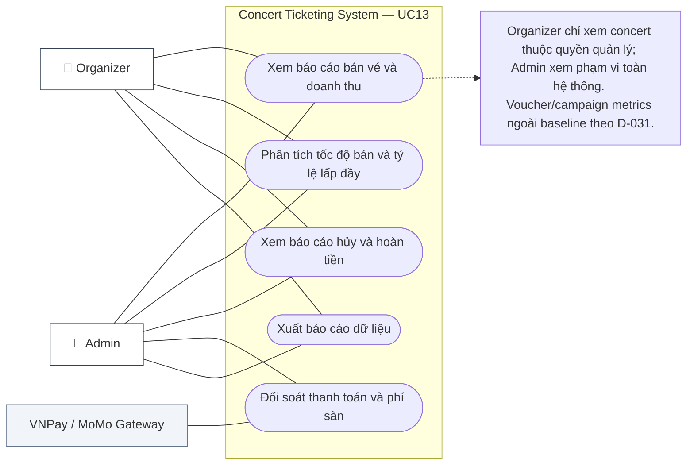
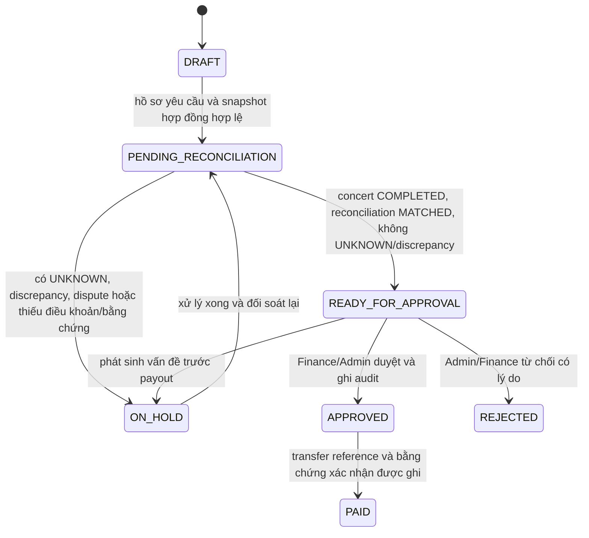

# UC13 — Báo Cáo Doanh Thu & Vé Bán (Revenue & Ticket Sales Reports)

> **Phạm vi:** báo cáo doanh thu và vé bán thuộc baseline. Voucher/campaign metrics ngoài baseline theo D-031.

## 1. Thông Tin Chung

| Trường | Nội dung |
|---|---|
| **Use Case ID** | UC13 |
| **Tên Use Case** | Báo Cáo Doanh Thu & Vé Bán (Revenue & Ticket Sales Reports) |
| **Module** | 04 — Organizer & Concert Administration Module |
| **Actor chính** | Organizer (Ban tổ chức), Admin (Quản trị viên sàn) |
| **Actor phụ** | Financial Service, Export Service, Cổng thanh toán (VNPay, MoMo) |
| **Mức độ ưu tiên** | 🔴 High |
| **Precondition** | Actor đã đăng nhập thành công với quyền tương ứng (`ROLE_ORGANIZER` hoặc `ROLE_ADMIN`); concert đã có phát sinh giao dịch hoặc đang mở bán |
| **Postcondition** | Báo cáo phân tích được kết xuất hiển thị trực quan hoặc tải xuống tệp tin dữ liệu có bảo mật |
| **BR liên quan** | BR-PAY-005, BR-RFD-007, BR-CON-005, BR-ORD-003, BR-ORD-004 |

---

## 2. Tóm Tắt

Use case này mô tả nghiệp vụ trích xuất, tổng hợp và phân tích dữ liệu bán vé, doanh thu, dòng tiền hoàn trả, tỷ lệ lấp đầy ghế (occupancy rate) và phí dịch vụ nền tảng.
- **Organizer:** Được xem dữ liệu chuyên sâu của các concert thuộc quyền quản lý của mình (doanh thu từng hạng vé, tốc độ bán vé theo thời gian, tỷ lệ hủy/hoàn vé, dòng tiền ròng thực nhận sau khi trừ phí sàn).
- **Admin:** Được xem bức tranh toàn cảnh của hệ thống (Gross Merchandise Value - GMV, tổng doanh thu phí sàn, đối soát liên ngân hàng/ví điện tử, cảnh báo rủi ro thanh toán).

---

<!-- BEGIN MERMAID USE-CASE UC13 -->
### Sơ đồ Use Case (Mermaid)

<!-- END MERMAID USE-CASE UC13 -->

## 3. Luồng Chính A — Organizer Xem Báo Cáo Doanh Thu Real-Time

| Bước | Actor | Hành động | Phản hồi hệ thống |
|---|---|---|---|
| 1 | Organizer | Đăng nhập Organizer Portal → Vào menu "Báo cáo & Thống kê" (Analytics & Reports) | Hiển thị màn hình danh sách concert do mình sở hữu kèm chỉ số tóm tắt (Tổng vé bán, Tổng doanh thu) |
| 2 | Organizer | Chọn concert cụ thể cần xem báo cáo | Hệ thống truy vấn dữ liệu aggregated từ Database/Read Replica |
| 3 | System | Tính toán và tổng hợp dữ liệu | Hiển thị Dashboard báo cáo gồm 4 nhóm chỉ số: 1. **Thẻ tóm tắt:** Tổng doanh thu (Gross), Doanh thu ròng (Net), Vé đã bán / Tổng vé, Tỷ lệ lấp đầy (Fill rate %) 2. **Bảng phân tích theo Zone/Hạng vé:** Số vé bán, số ghế giữ (HELD), số ghế trống (AVAILABLE), doanh thu theo Zone 3. **Biểu đồ tốc độ bán vé:** Số lượng vé bán theo từng giờ (Velocity sales chart) 4. **Thống kê phương thức thanh toán:** Tỷ lệ % thanh toán qua VNPay, MoMo |
| 4 | Organizer | Chọn bộ lọc: "Tất cả thời gian", "Hôm nay", "7 ngày qua", hoặc "Tùy chỉnh khoảng ngày" | Dashboard cập nhật lại số liệu tương ứng trong vòng < 1 giây |

---

## 4. Luồng Chính B — Admin Xem Báo Cáo Toàn Sàn & Đối Soát Doanh Thu

| Bước | Actor | Hành động | Phản hồi hệ thống |
|---|---|---|---|
| 1 | Admin | Đăng nhập Admin Portal → Chọn "Báo cáo tài chính toàn hệ thống" | Hiển thị tổng quan tài chính toàn sàn theo chu kỳ (Ngày/Tuần/Tháng/Năm) |
| 2 | Admin | Xem các chỉ số vĩ mô | Hiển thị GMV vé, tổng tiền thanh toán đã capture, refund đã xác nhận, phí nền tảng theo snapshot hợp đồng và số dư chờ quyết toán theo sổ nội bộ; không xác nhận custody/escrow hoặc số dư ngân hàng |
| 3 | Admin | Chọn tab "Đối soát cổng thanh toán" (Reconciliation) | Hệ thống so khớp dữ liệu nội bộ đơn hàng `PAID` với file đối soát đối tác (VNPay/MoMo Settlement Data) |
| 4 | Admin | Xem bảng đối soát tự động | Phân loại các giao dịch: Khớp 100%, Sai lệch số tiền, Giao dịch thừa/thiếu (Discrepancy) |

---

## 5. Luồng Thay Thế (Alternative Flows)

### AF-01: Xuất Tệp Báo Cáo Định Dạng Excel/CSV
| Bước | Mô tả |
|---|---|
| 1 | Organizer hoặc Admin nhấn nút "Xuất báo cáo" (Export Report). |
| 2 | Hệ thống mở modal tùy chọn: Định dạng (Excel `.xlsx` / CSV UTF-8 / PDF), Phạm vi dữ liệu (Tóm tắt doanh thu, Chi tiết từng đơn hàng, Danh sách vé & thông tin người mua, Lịch sử hoàn tiền). |
| 3 | Actor chọn cấu hình xuất và nhấn "Tải xuống". |
| 4 | **Trường hợp tập dữ liệu < 5.000 dòng:** Hệ thống tạo file trực tiếp trên RAM và trả về luồng tải xuống trình duyệt ngay lập tức (< 3 giây). |
| 5 | **Trường hợp tập dữ liệu ≥ 5.000 dòng:** Hệ thống tạo Job xử lý nền (Async Worker Task), hiển thị thông báo: *"Báo cáo đang được xử lý ngầm, hệ thống sẽ gửi đường dẫn tải về email của bạn khi hoàn tất"*. |

## 6. Luồng Ngoại Lệ (Exception Flows)

| ID | Điều kiện | Xử lý | Mã lỗi / Cảnh báo |
|---|---|---|---|
| EX-01 | Organizer cố tình truyền ID concert của đơn vị khác trên URL hoặc Request API để xem báo cáo | Hệ thống chặn bằng cơ chế kiểm tra quyền sở hữu (RBAC & Tenancy Isolation check); Ghi nhận vi phạm bảo mật | `403 Forbidden` (`ACCESS_DENIED_ORGANIZATION_MISMATCH`) |
| EX-02 | File đối soát thanh toán xuất hiện giao dịch lệch tiền (Discrepancy) giữa sàn và Cổng thanh toán | Hệ thống đánh dấu cờ cảnh báo đỏ (`RECONCILIATION_MISMATCH`); Gửi alert ngay cho phòng Tài chính & Kế toán | Cảnh báo High-Priority trên Dashboard kế toán |
| EX-03 | Quá tải truy vấn báo cáo trong giờ cao điểm mở bán vé | Hệ thống chuyển hướng truy vấn đọc sang Read Replica hoặc Cache Redis thống kê (cập nhật 60 giây/lần) để không ảnh hưởng DB giao dịch chính | Thông báo UI: *"Dữ liệu cập nhật cách đây 1 phút"* |
| EX-04 | Xuất báo cáo dung lượng lớn thất bại do lỗi bộ nhớ hoặc đứt kết nối | Hệ thống bắt lỗi, gửi thông báo lỗi cho người dùng kèm nút "Thử lại", lưu log trace cho bộ phận kỹ thuật | `500 Export Failed` kèm Retry token |

---

## 7. Cấu Trúc Bảng Dữ Liệu Báo Cáo Chi Tiết

### Bảng 1: Báo Cáo Doanh Thu Theo Hạng Vé / Khu Vực (Zone Breakdown)

| Cột dữ liệu | Kiểu dữ liệu | Diễn giải nghiệp vụ |
|---|---|---|
| `zone_name` | String | Tên khu vực (VD: VIP 1, GA Khán đài A, Standing CAT 1) |
| `ticket_price` | Currency (VND) | Đơn giá niêm yết của hạng vé |
| `total_capacity` | Integer | Tổng số ghế/chỗ phát hành ban đầu của Zone |
| `sold_count` | Integer | Số vé đã thanh toán thành công (`PAID`) |
| `held_count` | Integer | Số ghế đang được giữ chờ thanh toán (`HELD`) |
| `available_count` | Integer | Số ghế còn trống có thể bán (`AVAILABLE`) |
| `occupancy_rate` | Percentage (%) | Tỷ lệ lấp đầy: `(sold_count / total_capacity) * 100%` |
| `gross_revenue` | Currency (VND) | Tổng doanh thu gộp: `sold_count * ticket_price` |
| discount_amount | Currency (VND) | Bằng 0 trong baseline theo D-031 |
| `net_revenue` | Currency (VND) | Doanh thu thực tế sau chiết khấu |

### Bảng 2: Báo Cáo Quyết Toán Tài Chính (Settlement Summary)

| Chỉ số tài chính | Công thức tính | Ý nghĩa nghiệp vụ |
|---|---|---|
| **GMV vé (Ticket GMV)** | Tổng giá niêm yết của order_items thuộc order PAID; discount_amount bằng 0 theo D-031 | Giá trị vé bán; không đồng nhất với tổng tiền đã capture gồm phí/thuế |
| **Tổng tiền đã capture** | Tổng amount của payment_transactions có status SUCCESS đã xác nhận | Tổng tiền thu từ khách theo dữ liệu provider; đối chiếu riêng với GMV vé |
| **Tổng refund đã xác nhận** | Tổng refunds có status COMPLETED; UNKNOWN/discrepancy hiển thị riêng | Tiền provider xác nhận đã trả lại khách |
| **Tiền đã thu ròng (Net Captured)** | Tổng payment capture đã xác nhận - tổng refund COMPLETED | Tiền thu thực tế còn lại; chưa phải payable Organizer |
| **Phí dịch vụ sàn (Platform Fee)** | Tính theo tỷ lệ/công thức/phí cố định trong snapshot điều khoản hợp đồng gắn với kỳ quyết toán | Chỉ áp dụng điều khoản có hiệu lực; không dùng tỷ lệ mẫu hoặc mặc định |
| **Payable Organizer** | Tổng settlement entries theo snapshot hợp đồng và adjustment đã duyệt | Không suy ra chỉ từ GMV; cách phân bổ phí/thuế/refund phụ thuộc hợp đồng |

GMV vé tính theo giá niêm yết của order_items; tiền đã capture lấy từ payment provider; Net Captured = capture đã xác nhận − refund COMPLETED. Payable Organizer được tính từ eligible_sales_amount, refund allocation, phí và adjustment theo snapshot hợp đồng, nên không thể suy trực tiếp từ GMV.
---

## 8. User Stories & Acceptance Criteria

### US-13-01: Báo Cáo Real-Time Cho Organizer
> **As an** Organizer,  
> **I want to** theo dõi doanh số bán vé và tỷ lệ lấp đầy ghế theo thời gian thực (real-time),  
> **So that** đánh giá được hiệu quả chiến dịch truyền thông và có phương án điều chỉnh giá/tiếp thị kịp thời.

| Mã AC | Tiêu chí nghiệm thu (Acceptance Criteria) | Phân loại |
|---|---|---|
| AC-13-01-01 | Số lượng vé bán và doanh thu của concert phải cập nhật với độ trễ không quá 60 giây so với giao dịch thực tế trên cổng thanh toán | Performance |
| AC-13-01-02 | Tỷ lệ lấp đầy ghế (Fill rate) được hiển thị chi tiết theo từng Zone và tổng quan toàn bộ concert | Functional |
| AC-13-01-03 | Biểu đồ vận tốc bán vé (Sales velocity) cho phép chọn xem theo các mốc: 15 phút, 1 giờ, 1 ngày | Functional |
| AC-13-01-04 | Organizer chỉ nhìn thấy dữ liệu concert thuộc tổ chức của mình; không thể truy cập concert của bên khác | Security |

---

### US-13-02: Báo Cáo Đối Soát Tài Chính Cho Admin Sàn
> **As an** Admin / Kế toán viên sàn vé,  
> **I want to** đối soát số liệu bán vé nội bộ với báo cáo giao dịch từ VNPay và MoMo,  
> **So that** phát hiện chênh lệch dòng tiền và đảm bảo tính chính xác trước khi thanh toán cho BTC.

| Mã AC | Tiêu chí nghiệm thu (Acceptance Criteria) | Phân loại |
|---|---|---|
| AC-13-02-01 | Hệ thống cung cấp chức năng nhập file đối soát (CSV/Excel) từ cổng thanh toán hoặc tự động lấy qua API đối soát hằng ngày lúc 02:00 sáng | Functional |
| AC-13-02-02 | Tự động so khớp theo `transaction_id`, `order_id`, số tiền và trạng thái giao dịch | Functional |
| AC-13-02-03 | Bất kỳ trường hợp lệch trạng thái (VD: Cổng báo thành công nhưng sàn chưa ghi nhận `PAID`) phải được gắn cờ `DISCREPANCY` và xuất danh sách riêng | Functional |
| AC-13-02-04 | Lưu vết lịch sử đối soát và người thực hiện phê duyệt quyết toán vào Audit Log | Security |
| AC-13-02-05 | Phí nền tảng và payable khớp snapshot điều khoản hợp đồng gắn với settlement; không dùng mức phí mặc định | Financial / Functional |
| AC-13-02-06 | Chặn READY_FOR_APPROVAL/APPROVED/PAID nếu concert chưa COMPLETED, reconciliation chưa MATCHED, còn payment/refund UNKNOWN hoặc discrepancy chưa xử lý | Control |
| AC-13-02-07 | Admin/Finance phê duyệt có audit log, người duyệt và thời điểm; chỉ ghi PAID khi có payout reference và bằng chứng chuyển tiền | Security / Audit |

---

### US-13-03: Xuất Dữ Liệu Báo Cáo Nền (Async Export)
> **As an** Organizer hoặc Admin,  
> **I want to** xuất toàn bộ lịch sử bán vé chi tiết ra tệp Excel bảo mật,  
> **So that** phục vụ công tác kế toán nội bộ và lưu trữ sổ sách.

| Mã AC | Tiêu chí nghiệm thu (Acceptance Criteria) | Phân loại |
|---|---|---|
| AC-13-03-01 | Với file xuất dưới 5.000 dòng: Thời gian tạo file và trả về tải xuống không vượt quá 3 giây | Performance |
| AC-13-03-02 | Với báo cáo lớn: Chạy ngầm qua Worker Queue, gửi email thông báo kèm link tải có thời hạn (presigned URL có hiệu lực trong 24 giờ) | Functional |
| AC-13-03-03 | Các thông tin nhạy cảm của khách hàng trong file xuất (Số điện thoại, email) được hỗ trợ tùy chọn mặt nạ hóa (Masking: VD `090****123`) theo chuẩn bảo mật dữ liệu | Security |

---

## 9. Danh Sách Use Case Con & Quan Hệ Phân Quyền

| Mã Use Case Con | Tên Use Case Con | Actor Chính | Actor Phụ | Mục Đích Sử Dụng |
|---|---|---|---|---|
| **UC13.1** | Xem Dashboard Doanh Thu Real-Time | Organizer, Admin | Caching Layer | Giám sát tiến độ mở bán |
| **UC13.2** | Xem Phân Tích Doanh Thu Theo Hạng Vé / Zone | Organizer, Admin | — | Đánh giá sức hút từng khu vực ghế |
| **UC13.3** | Xem Báo Cáo Lịch Sử Hoàn Tiền & Hủy Vé | Organizer, Admin | Refund Service | Quản trị rủi ro & tỷ lệ hoàn vé |
| **UC13.4** | Báo Cáo Đối Soát Cổng Thanh Toán (Reconciliation) | Admin | VNPay, MoMo API | Kiểm tra chênh lệch số dư ngân hàng |
| **UC13.5** | Xuất Báo Cáo Ra Excel/CSV (Sync & Async Export) | Organizer, Admin | Message Queue, S3 Storage | Tải dữ liệu ngoại tuyến kế toán |
| **UC13.6 (ngoài baseline)** | Lịch gửi báo cáo định kỳ qua email (đề xuất tương lai) | Organizer, Admin | Notification Worker | Không có schedule persistence hoặc UAT trong release hiện tại |

## 10. Vòng đời settlement

### Điều kiện lập và ghi nhận quyết toán

1. Concert phải ở trạng thái COMPLETED; mọi payment/refund liên quan phải được đối soát, không còn UNKNOWN hoặc discrepancy chưa xử lý.
2. Tỷ lệ phí, căn cứ tính, thời gian chờ, chi phí refund và điều kiện payout lấy từ snapshot hợp đồng có hiệu lực; không dùng tỷ lệ hoặc số ngày minh họa.
3. Organizer gửi yêu cầu; Finance/Admin kiểm tra, phê duyệt và ghi audit. Baseline chỉ lưu hồ sơ quyết toán, phê duyệt và bằng chứng/tham chiếu payout; không giả định tích hợp chuyển khoản tự động hay giữ tiền trong escrow (D-034).
4. Nếu có bất đồng, chargeback, refund UNKNOWN hoặc thiếu bằng chứng thì settlement chuyển ON_HOLD; không ghi PAID trước khi có xác nhận chuyển tiền.

