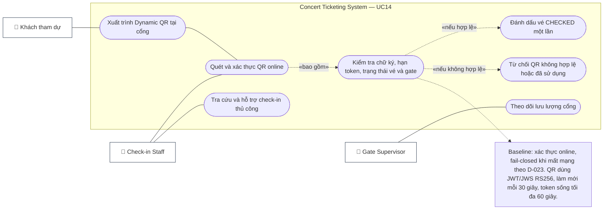

# UC14 — Quét QR Code Check-In Tại Cổng (QR Code Check-In)

> **Phạm vi:** check-in online là baseline; khi không thể kết nối để xác thực, scanner fail-closed theo D-023; không có offline check-in.

## 1. Thông Tin Chung

| Trường | Nội dung |
|---|---|
| **Use Case ID** | UC14 |
| **Tên Use Case** | Quét QR Code Check-In Tại Cổng (QR Code Check-In) |
| **Module** | 05 — Check-In & Notifications Module |
| **Actor chính** | Check-in Staff (Nhân viên soát vé tại cổng) |
| **Actor phụ** | Khách tham dự (Attendee), Gate Supervisor, Check-in Service; không dùng local cache làm nguồn xác thực |
| **Mức độ ưu tiên** | 🔴 Critical |
| **Precondition** | Nhân viên soát vé đã đăng nhập thiết bị chuyên dụng hoặc ứng dụng Check-in App với quyền `ROLE_STAFF`; thiết bị được gán Gate/Zone; thời điểm hiện tại nằm trong khung check-in cấu hình của concert (từ `gate_open_time` đến `end_time + buffer`) |
| **Postcondition** | Vé hợp lệ được chuyển sang trạng thái `CHECKED`, ghi nhận thời gian và cổng vào; vé không hợp lệ bị từ chối kèm lý do rõ ràng |
| **BR liên quan** | BR-TCK-002 (Dynamic QR), BR-TCK-003 (Single Check-in và từ chối vé đã hủy), BR-TCK-004 (phân quyền Gate/Zone), BR-TCK-005 (fail-closed khi mất mạng), BR-TCK-007 (khung giờ mở cổng) |

---

## 2. Tóm Tắt

Use case này mô tả check-in online bằng QR tại cổng, mục tiêu phản hồi ≤500 ms, chống quét vé trùng và xác thực trạng thái trên server. Khi không thể kết nối để xác thực, scanner fail-closed theo D-023.

---

<!-- BEGIN MERMAID USE-CASE UC14 -->
### Sơ đồ Use Case (Mermaid)


<!-- END MERMAID USE-CASE UC14 -->

## 3. Luồng Chính A — Quét QR Code Online Thành Công (Standard Gate Check-In)

| Bước | Actor | Hành động | Phản hồi hệ thống |
|---|---|---|---|
| 1 | Khách hàng | Mở ứng dụng di động hoặc Web app trên điện thoại, đưa màn hình hiển thị Dynamic QR Code lại gần camera quét của nhân viên | Mã QR được làm mới mỗi 30 giây; mỗi token có hiệu lực tối đa 60 giây |
| 2 | Check-in Staff | Hướng thiết bị quét (Handheld Scanner hoặc điện thoại Staff) vào mã QR | Ống kính bắt mã QR và đọc chuỗi JWT compact JWS |
| 3 | System | Đọc payload JWT, xác thực chữ ký RS256 bằng public key và gửi request xác thực tới Check-in Service | Hệ thống kiểm tra trong Redis Cache và DB: 1. Mã hợp lệ; 2. Đúng concert & Zone; 3. Trạng thái hiện tại là `ORDERED` |
| 4 | System | Cập nhật nguyên tử trạng thái vé: `ticket.status = CHECKED`, lưu `checked_in_at = SYSUTCDATETIME()`, `checked_in_by = staff_id`, `gate_id = G01` | Thực thi thành công trong vòng $\le 300\text{ ms}$ |
| 5 | Staff Device | Thiết bị nhận tín hiệu thành công | Màn hình nhấp nháy **Xanh Lá Cây**, phát âm thanh "Bíp" ngân cao thành công, rung nhẹ máy, hiển thị: *"HỢP LỆ — MỜI VÀO: [Tên khách] - Khu vực [VIP 1] - Hàng [A] - Số [12]"* |
| 6 | Check-in Staff | Báo khách hàng bước qua cổng an ninh | Khách tiến vào khán đài |

---

## 4. Luồng Thay Thế (Alternative Flows)

### AF-01: Mất kết nối tới dịch vụ xác thực — từ chối đóng cửa fail-closed

| Bước | Hành vi bắt buộc |
|---|---|
| 1 | Scanner không nhận được phản hồi xác thực online hoặc mất kết nối tới Check-in Service. |
| 2 | Ứng dụng hiển thị lỗi kết nối; không báo vé hợp lệ, không ghi ticket CHECKED và không chấp nhận QR chỉ từ cache hoặc nội dung JWT. |
| 3 | Nhân viên hướng khách tới Gate Supervisor/quầy hỗ trợ theo quy trình vận hành của địa điểm; quy trình này không được bypass kiểm tra trạng thái vé trên server. |
| 4 | Khi mạng phục hồi, staff quét lại. Mỗi yêu cầu scan dùng idempotency/scan ID để retry không tạo check-in trùng. |### AF-02: Check-In Thủ Công Tại Quầy Hỗ Trợ (Manual Helpdesk Lookup)
| Bước | Mô tả |
|---|---|
| 1 | Khách hàng gặp sự cố: Điện thoại hết pin, vỡ màn hình không hiển thị được mã QR, hoặc không nhận được email vé. |
| 2 | Khách hàng đến quầy Trợ giúp (Troubleshooting / Helpdesk Desk) xuất trình Căn cước công dân (CCCD) và tin nhắn/email thanh toán. |
| 3 | Nhân viên Helpdesk tìm kiếm theo Số điện thoại hoặc Mã đơn hàng (`order_code`) trên giao diện Tra cứu Quản trị. |
| 4 | Hệ thống hiển thị danh sách vé của khách; Nhân viên đối chiếu họ tên CCCD với thông tin tài khoản. |
| 5 | Nhân viên nhấn nút "Xác nhận Check-in Thủ Công" (Manual Override), ghi chú lý do ("Khách hết pin - Đối chiếu CCCD số 00123..."). |
| 6 | Vé được chuyển sang `CHECKED` và hệ thống in giấy chứng nhận qua cổng nhanh (Fast-pass wristband). |

### AF-03: Check-In Theo Nhóm (Group Fast Check-In)
| Bước | Mô tả |
|---|---|
| 1 | Người mua vé đại diện cho nhóm 4 người cùng tới cổng một lúc. |
| 2 | Nhân viên quét mã vé đầu tiên; hệ thống hiển thị tùy chọn: *"Đơn hàng có 4 vé cùng Zone — Bạn có muốn Check-in toàn bộ nhóm?"*. |
| 3 | Nhân viên kiểm tra số người thực tế có mặt và nhấn "Xác nhận vào cả 4 người". |
| 4 | Toàn bộ 4 vé được chuyển sang trạng thái `CHECKED` cùng lúc. |

---

## 5. Luồng Ngoại Lệ (Exception Flows)

| ID | Điều kiện ngoại lệ | Phản hồi thiết bị & Xử lý | Mã lỗi / Cảnh báo |
|---|---|---|---|
| EX-01 | **Vé đã được check-in trước đó (Duplicate Scan / Đã sử dụng)** | Màn hình nhấp nháy **ĐỎ RỰC**, phát còi cảnh báo lớn "Tít tít tít", rung mạnh thiết bị. Hiển thị thông báo: *"CẢNH BÁO: VÉ ĐÃ ĐƯỢC CHECK-IN LÚC 18:25 TẠI CỔNG B-02 BỞI NHÂN VIÊN #12"*. Nhân viên giữ người cầm vé và bàn giao giám sát an ninh | `TICKET_ALREADY_USED` |
| EX-02 | **Vé đã bị hủy hoặc hoàn tiền (Cancelled / Refunded Ticket)** | Màn hình hiển thị màu ĐỎ: *"VÉ KHÔNG HỢP LỆ — Vé đã bị hủy/hoàn tiền theo yêu cầu ngày DD/MM"*. Từ chối vào cổng | `TICKET_CANCELLED_OR_REFUNDED` |
| EX-03 | **Sai cổng hoặc sai khu vực (Wrong Gate / Wrong Zone)** | Màn hình hiển thị màu VÀNG CAM kèm âm báo cảnh báo: *"SAI CỔNG — Vé thuộc Khu vực [STAND C - CỔNG 4]. Vui lòng hướng dẫn khách sang Cổng 4"*. Vé chưa bị đổi trạng thái | `WRONG_GATE_OR_ZONE` |
| EX-04 | **Mã QR đã hết hạn (JWT Token Expired)** | Khách hàng chụp ảnh màn hình từ trước và mã cũ đã quá hạn (hoặc đồng hồ lệch quá 60 giây). Thiết bị báo: *"MÃ QR ĐÃ HẾT HẠN — Vui lòng mở trực tiếp ứng dụng để lấy mã mới"* | `QR_TOKEN_EXPIRED` |
| EX-05 | **Mã QR giả mạo / Không hợp lệ (Invalid Signature)** | Chữ ký điện tử trong payload không khớp với khóa công khai của hệ thống. Báo động: *"MÃ VÉ KHÔNG TỒN TẠI HOẶC BỊ LÀM GIẢ"* | `INVALID_SIGNATURE` |

---

## 6. Cấu Trúc Dữ Liệu Payload Của Mã QR & Bản Ghi Check-In

### 1. Payload Mã QR Động (Dynamic QR Token Structure)
Mã QR hiển thị trên ứng dụng người dùng chứa JWS/JWT được ký số, không phải dữ liệu được mã hóa; các claim nhạy cảm không được đưa vào payload:
```json
{
  "ticket_id": "tkt_9f8d7c6b-4e3a",
  "concert_id": "con_2026_blackpink",
  "seat_id": "seat_vip_a_012",
  "iat": 1729774800,
  "exp": 1729774860,
  "nonce": "a8f3b2c1"
}
```
- `ticket_id`, `concert_id`, `seat_id`: Định danh vé, concert và ghế; không chứa họ tên hoặc số điện thoại.
- `exp` (Expiration Time): `iat + 60` giây; ứng dụng làm mới token mỗi 30 giây, token cũ không bị vô hiệu sớm chỉ do rotation
- `nonce`: Chuỗi ngẫu nhiên chống replay attack
- Chữ ký RS256 nằm trong segment thứ ba của JWS; header chứa `alg = RS256` và `kid`, không đưa chữ ký vào payload JSON.

### 2. Bản Ghi Nhật Ký Soát Vé (Check-in Audit Record)

| Thuộc tính | Kiểu dữ liệu | Ý nghĩa |
|---|---|---|
| `checkin_id` | UUID | Khóa chính của bản ghi soát vé |
| `ticket_id` | UUID | Khóa ngoại tham chiếu tới bảng `tickets` |
| `concert_id` | UUID | Định danh sự kiện |
| `gate_id` | String | Cổng diễn ra check-in (VD: GATE_A_VIP) |
| `staff_id` | UUID | Mã nhân viên thực hiện quét |
| `device_id` | String | Mã phần cứng thiết bị quét |
| `checkin_time` | Timestamp | Thời điểm chính xác (mili-giây) |
| checkin_mode | Enum | ONLINE hoặc MANUAL_OVERRIDE; không có OFFLINE_SYNC theo D-023 |
| `result` | Enum | `SUCCESS`, `DUPLICATE_FAILED`, `WRONG_GATE`, `INVALID` |

---

## 7. User Stories & Acceptance Criteria

### US-14-01: Quét Mã Xác Thực Tốc Độ Cao Tại Cổng
> **As a** Check-in Staff,  
> **I want to** quét mã QR của khách hàng và nhận phản hồi tức thì trong vòng nửa giây,  
> **So that** quá trình soát vé diễn ra nhanh chóng, tránh ùn tắc trước cửa vào sân vận động.

| Mã AC | Tiêu chí nghiệm thu (Acceptance Criteria) | Phân loại |
|---|---|---|
| AC-14-01-01 | Thời gian từ lúc camera bắt nét mã QR đến khi màn hình hiển thị kết quả Xanh/Đỏ không vượt quá $500\text{ ms}$ trong điều kiện kết nối mạng thông thường | Performance |
| AC-14-01-02 | Giao diện hiển thị rõ ràng với phông chữ lớn, màu sắc tương phản cao (Xanh lá = Vào; Đỏ = Cảnh báo vi phạm; Vàng = Sai cổng) | Usability |
| AC-14-01-03 | Khi quét vé thành công, phát tín hiệu âm thanh và rung để nhân viên không cần nhìn chằm chằm màn hình liên tục | Usability |
| AC-14-01-04 | Vé đã quét lập tức chuyển trạng thái trên Redis và DB sang `CHECKED`; mọi nỗ lực quét lại lần hai tại bất kỳ cổng nào đều báo `ALREADY_USED` ngay lập tức | Security |

---

### US-14-02: Từ chối check-in khi không xác thực được online
> **As a** Gate Supervisor,  
> **I want to** scanner không chấp nhận vé nếu không thể hỏi trạng thái mới nhất từ server,<br>
> **So that** vé không bị dùng trùng tại nhiều cổng hoặc sau khi bị hủy.

| Mã AC | Tiêu chí nghiệm thu (Acceptance Criteria) | Phân loại |
|---|---|---|
| AC-14-02-01 | Mất kết nối/timeout phải hiện trạng thái không xác định hoặc lỗi mạng; không hiện tín hiệu xanh, không đổi ticket sang CHECKED. | Security |
| AC-14-02-02 | Cache hoặc chữ ký JWT hợp lệ không đủ để xác nhận check-in khi không truy vấn được trạng thái vé online. | Security |
| AC-14-02-03 | Khi mạng phục hồi, scan retry cùng scan ID không tạo thêm log thành công hoặc chuyển trạng thái lần hai. | Reliability |
| AC-14-02-04 | UI hướng dẫn nhân viên chuyển sự cố cho Gate Supervisor; mọi manual override phải thực hiện online, có quyền hạn và audit reason. | Operational |
### US-14-03: Thống Kê Tiến Độ Check-In Thời Gian Thực Cho Ban Tổ Chức
> **As an** Organizer / Gate Supervisor,  
> **I want to** xem số lượng khán giả đã vào sân theo từng cổng và từng zone theo thời gian thực,  
> **So that** điều phối nhân sự an ninh và giãn dòng khán giả hợp lý.

| Mã AC | Tiêu chí nghiệm thu (Acceptance Criteria) | Phân loại |
|---|---|---|
| AC-14-03-01 | Dashboard hiển thị thanh tiến độ: Số vé đã quét / Tổng vé phát hành (Tổng quan và theo từng Cổng) | Functional |
| AC-14-03-02 | Tốc độ check-in được tính theo số lượt vào mỗi phút (Check-in Velocity: Attendees / Min) | Functional |
| AC-14-03-03 | Cảnh báo khi có cổng vượt quá ngưỡng tải hoặc phát hiện tỷ lệ vé lỗi / vé giả bất thường tại một vị trí cổng | Security |

---

## 8. Danh Sách Use Case Con & Phân Quyền

| Mã Use Case Con | Tên Use Case Con | Actor Chính | Actor Phụ | Mục Đích Sử Dụng |
|---|---|---|---|---|
| **UC14.1** | Đăng Nhập & Gán Cổng Soát Vé (Assign Gate) | Check-in Staff | Gate Supervisor | Thiết lập cổng và Zone phụ trách cho ca trực |
| **UC14.2** | Quét Mã QR Xác Thực Vé Tốc Độ Cao | Check-in Staff | Check-in Service, Redis | Soát vé luồng bình thường |
| **UC14.3** | Từ chối check-in khi xác thực online không khả dụng | Check-in Staff | Check-in Service | Fail-closed, không chấp nhận cache cục bộ |
| **UC14.4** | Check-In Thủ Công Tại Bàn Trợ Giúp (Helpdesk Override) | Gate Supervisor, Staff | Customer Service DB | Hỗ trợ vé vỡ màn hình, hết pin, đối chiếu CCCD |

| **UC14.6** | Giám Sát Lưu Lượng Ra Vào Theo Cổng Real-Time | Gate Supervisor, Organizer | Analytics Service | Giám sát an ninh và điều tiết khán giả |
