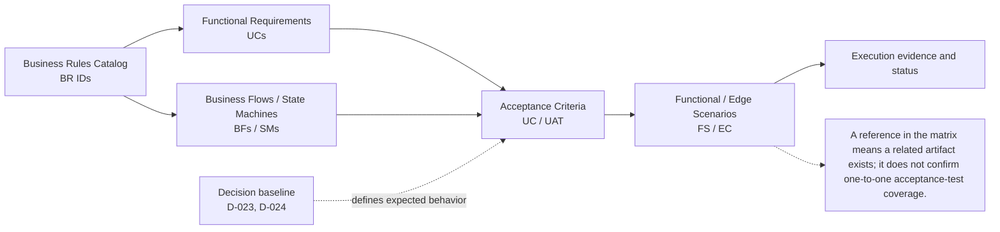

# 06 — Ma trận truy vết yêu cầu (Requirements Traceability Matrix)

## Mục đích và quy ước

Ma trận nối các mã quy tắc thực sự có trong Business Rules Catalog với use case, luồng/state machine và tài liệu xác nhận. Mã BR phải khớp nguyên văn catalog; tham chiếu scenario là nhóm cần đối chiếu, không khẳng định mọi rule đã có test tự động riêng.

**Trạng thái:** Mỗi BR được nối với use case, luồng/state và tiêu chí/scenario theo miền. “Execution evidence pending” có nghĩa là chưa có kết quả chạy trong tài liệu; trạng thái này không khẳng định tính năng đã triển khai hay UAT đã hoàn tất.

<!-- BEGIN MERMAID DIAGRAM RTM-TRACEABILITY -->
### Sơ đồ truy vết BR đến bằng chứng kiểm thử

<!-- END MERMAID DIAGRAM RTM-TRACEABILITY -->

| BR ID | Miền | Use case / flow / state liên quan | Tiêu chí / scenario xác nhận | Trạng thái |
|---|---|---|---|---|
| BR-QUEUE-001 | Hàng chờ | UC05–UC06; BF01; queue admission rules | AC-UAT-02.1–02.2, 02.7; FS-004; EC-003–004 | Domain link recorded; execution evidence pending |
| BR-QUEUE-002 | Hàng chờ | UC05–UC06; BF01; queue admission rules | AC-UAT-02.1–02.2, 02.7; FS-004; EC-003–004 | Domain link recorded; execution evidence pending |
| BR-QUEUE-003 | Hàng chờ | UC05–UC06; BF01; queue admission rules | AC-UAT-02.1–02.2, 02.7; FS-004; EC-003–004 | Domain link recorded; execution evidence pending |
| BR-QUEUE-004 | Hàng chờ | UC05–UC06; BF01; queue admission rules | AC-UAT-02.1–02.2, 02.7; FS-004; EC-003–004 | Domain link recorded; execution evidence pending |
| BR-QUEUE-005 | Hàng chờ | UC05–UC06; BF01; queue admission rules | AC-UAT-02.1–02.2, 02.7; FS-004; EC-003–004 | Domain link recorded; execution evidence pending |
| BR-QUEUE-006 | Hàng chờ | UC05–UC06; BF01; queue admission rules | AC-UAT-02.1–02.2, 02.7; FS-004; EC-003–004 | Domain link recorded; execution evidence pending |
| BR-QUEUE-007 | Hàng chờ | UC05–UC06; BF01; queue admission rules | AC-UAT-02.1–02.2, 02.7; FS-004; EC-003–004 | Domain link recorded; execution evidence pending |
| BR-QUEUE-008 | Hàng chờ | UC05–UC06; BF01; queue admission rules | AC-UAT-02.1–02.2, 02.7; FS-004; EC-003–004 | Domain link recorded; execution evidence pending |
| BR-SEAT-001 | Ghế và giữ chỗ | UC05–UC06; BF02; SM02 | AC-UAT-02.3–02.7; FS-006; EC-001–002, 004–005 | Domain link recorded; execution evidence pending |
| BR-SEAT-002 | Ghế và giữ chỗ | UC05–UC06; BF02; SM02 | AC-UAT-02.3–02.7; FS-006; EC-001–002, 004–005 | Domain link recorded; execution evidence pending |
| BR-SEAT-003 | Ghế và giữ chỗ | UC05–UC06; BF02; SM02 | AC-UAT-02.3–02.7; FS-006; EC-001–002, 004–005 | Domain link recorded; execution evidence pending |
| BR-SEAT-004 | Ghế và giữ chỗ | UC05–UC06; BF02; SM02 | AC-UAT-02.3–02.7; FS-006; EC-001–002, 004–005 | Domain link recorded; execution evidence pending |
| BR-SEAT-005 | Ghế và giữ chỗ | UC05–UC06; BF02; SM02 | AC-UAT-02.3–02.7; FS-006; EC-001–002, 004–005 | Domain link recorded; execution evidence pending |
| BR-SEAT-006 | Ghế và giữ chỗ | UC05–UC06; BF02; SM02 | AC-UAT-02.3–02.7; FS-006; EC-001–002, 004–005 | Domain link recorded; execution evidence pending |
| BR-SEAT-007 | Ghế và giữ chỗ | UC05–UC06; BF02; SM02 | AC-UAT-02.3–02.7; FS-006; EC-001–002, 004–005 | Domain link recorded; execution evidence pending |
| BR-SEAT-008 | Ghế và giữ chỗ | UC05–UC06; BF02; SM02 | AC-UAT-02.3–02.7; FS-006; EC-001–002, 004–005 | Domain link recorded; execution evidence pending |
| BR-ORD-001 | Đơn hàng | UC06–UC09; BF03–BF04; SM03 | AC-UAT-03.1–03.4; FS-008, FS-011; EC-005–006 | Domain link recorded; execution evidence pending |
| BR-ORD-002 | Đơn hàng | UC06–UC09; BF03–BF04; SM03 | AC-UAT-03.1–03.4; FS-008, FS-011; EC-005–006 | Domain link recorded; execution evidence pending |
| BR-ORD-003 | Đơn hàng | UC06–UC09; BF03–BF04; SM03 | AC-UAT-03.1–03.4; FS-008, FS-011; EC-005–006 | Domain link recorded; execution evidence pending |
| BR-ORD-004 | Đơn hàng | UC06–UC09; BF03–BF04; SM03 | AC-UAT-03.1–03.4; FS-008, FS-011; EC-005–006 | Domain link recorded; execution evidence pending |
| BR-ORD-005 | Đơn hàng | UC06–UC09; BF03–BF04; SM03 | AC-UAT-03.1–03.4; FS-008, FS-011; EC-005–006 | Domain link recorded; execution evidence pending |
| BR-ORD-006 | Đơn hàng | UC06–UC09; BF03–BF04; SM03 | AC-UAT-03.1–03.4; FS-008, FS-011; EC-005–006 | Domain link recorded; execution evidence pending |
| BR-ORD-007 | Đơn hàng | UC06–UC09; BF03–BF04; SM03 | AC-UAT-03.1–03.4; FS-008, FS-011; EC-005–006 | Domain link recorded; execution evidence pending |
| BR-ORD-008 | Đơn hàng | UC06–UC09; BF03–BF04; SM03 | AC-UAT-03.1–03.4; FS-008, FS-011; EC-005–006 | Domain link recorded; execution evidence pending |
| BR-PAY-001 | Thanh toán | UC07; BF03; SM05 | AC-UAT-03.2–03.4, 03.6–03.7; FS-008; EC-005–006, 015 | Domain link recorded; execution evidence pending |
| BR-PAY-002 | Thanh toán | UC07; BF03; SM05 | AC-UAT-03.2–03.4, 03.6–03.7; FS-008; EC-005–006, 015 | Domain link recorded; execution evidence pending |
| BR-PAY-003 | Thanh toán | UC07; BF03; SM05 | AC-UAT-03.2–03.4, 03.6–03.7; FS-008; EC-005–006, 015 | Domain link recorded; execution evidence pending |
| BR-PAY-004 | Thanh toán | UC07; BF03; SM05 | AC-UAT-03.2–03.4, 03.6–03.7; FS-008; EC-005–006, 015 | Domain link recorded; execution evidence pending |
| BR-PAY-005 | Thanh toán | UC07; BF03; SM05 | AC-UAT-03.2–03.4, 03.6–03.7; FS-008; EC-005–006, 015 | Domain link recorded; execution evidence pending |
| BR-PAY-006 | Thanh toán | UC07; BF03; SM05 | AC-UAT-03.2–03.4, 03.6–03.7; FS-008; EC-005–006, 015 | Domain link recorded; execution evidence pending |
| BR-PAY-007 | Thanh toán | UC07; BF03; SM05 | AC-UAT-03.2–03.4, 03.6–03.7; FS-008; EC-005–006, 015 | Domain link recorded; execution evidence pending |
| BR-PAY-008 | Thanh toán | UC07; BF03; SM05 | AC-UAT-03.2–03.4, 03.6–03.7; FS-008; EC-005–006, 015 | Domain link recorded; execution evidence pending |
| BR-TCK-001 | Vé và check-in | UC08, UC14; BF06; SM04 | AC-UAT-05.1–05.4; FS-009–FS-010; EC-007–009 | Domain link recorded; execution evidence pending |
| BR-TCK-002 | Vé và check-in | UC08, UC14; BF06; SM04 | AC-UAT-05.1–05.4; FS-009–FS-010; EC-007–009 | Domain link recorded; execution evidence pending |
| BR-TCK-003 | Vé và check-in | UC08, UC14; BF06; SM04 | AC-UAT-05.1–05.4; FS-009–FS-010; EC-007–009 | Domain link recorded; execution evidence pending |
| BR-TCK-004 | Vé và check-in | UC08, UC14; BF06; SM04 | AC-UAT-05.1–05.4; FS-009–FS-010; EC-007–009 | Domain link recorded; execution evidence pending |
| BR-TCK-005 | Vé và check-in | UC08, UC14; BF06; SM04 | AC-UAT-05.1–05.4; FS-009–FS-010; EC-007–009 | Domain link recorded; execution evidence pending |
| BR-TCK-006 | Vé và check-in | UC08, UC14; BF06; SM04 | AC-UAT-05.1–05.4; FS-009–FS-010; EC-007–009 | Domain link recorded; execution evidence pending |
| BR-TCK-007 | Vé và check-in | UC08, UC14; BF06; SM04 | AC-UAT-05.1–05.4; FS-009–FS-010; EC-007–009 | Domain link recorded; execution evidence pending |
| BR-TCK-008 | Vé và check-in | UC08, UC14; BF06; SM04 | AC-UAT-05.1–05.4; FS-009–FS-010; EC-007–009 | Domain link recorded; execution evidence pending |
| BR-RFD-001 | Hoàn tiền | UC09, UC12; BF04–BF05; SM03/SM05 | AC-UAT-03.5–03.7, 04.5; FS-011; EC-010, 012 | Domain link recorded; execution evidence pending |
| BR-RFD-002 | Hoàn tiền | UC09, UC12; BF04–BF05; SM03/SM05 | AC-UAT-03.5–03.7, 04.5; FS-011; EC-010, 012 | Domain link recorded; execution evidence pending |
| BR-RFD-003 | Hoàn tiền | UC09, UC12; BF04–BF05; SM03/SM05 | AC-UAT-03.5–03.7, 04.5; FS-011; EC-010, 012 | Domain link recorded; execution evidence pending |
| BR-RFD-004 | Hoàn tiền | UC09, UC12; BF04–BF05; SM03/SM05 | AC-UAT-03.5–03.7, 04.5; FS-011; EC-010, 012 | Domain link recorded; execution evidence pending |
| BR-RFD-005 | Hoàn tiền | UC09, UC12; BF04–BF05; SM03/SM05 | AC-UAT-03.5–03.7, 04.5; FS-011; EC-010, 012 | Domain link recorded; execution evidence pending |
| BR-RFD-006 | Hoàn tiền | UC09, UC12; BF04–BF05; SM03/SM05 | AC-UAT-03.5–03.7, 04.5; FS-011; EC-010, 012 | Domain link recorded; execution evidence pending |
| BR-RFD-007 | Hoàn tiền | UC09, UC12; BF04–BF05; SM03/SM05 | AC-UAT-03.5–03.7, 04.5; FS-011; EC-010, 012 | Domain link recorded; execution evidence pending |
| BR-CON-001 | Concert và duyệt | UC11–UC13; BF05; SM01 | AC-UAT-04.1–04.5; FS-012–FS-013; EC-011–012 | Domain link recorded; execution evidence pending |
| BR-CON-002 | Concert và duyệt | UC11–UC13; BF05; SM01 | AC-UAT-04.1–04.5; FS-012–FS-013; EC-011–012 | Domain link recorded; execution evidence pending |
| BR-CON-003 | Concert và duyệt | UC11–UC13; BF05; SM01 | AC-UAT-04.1–04.5; FS-012–FS-013; EC-011–012 | Domain link recorded; execution evidence pending |
| BR-CON-004 | Concert và duyệt | UC11–UC13; BF05; SM01 | AC-UAT-04.1–04.5; FS-012–FS-013; EC-011–012 | Domain link recorded; execution evidence pending |
| BR-CON-005 | Concert và quyết toán | UC11.8; UC13; BF05; SM01 | AC-UAT-04.6–04.8; AC-13-02-05–07; FS-012–013; EC-011–012 | Domain link recorded; execution evidence pending |
| BR-CON-006 | Concert và hủy sự kiện | UC11; UC12; BF05; SM01 | AC-UAT-04.5, 04.9; FS-012; EC-012 | Domain link recorded; execution evidence pending |
| BR-CON-007 | Concert và duyệt | UC11–UC13; BF05; SM01 | AC-UAT-04.1–04.5; FS-012–FS-013; EC-011–012 | Domain link recorded; execution evidence pending |
| BR-CON-008 | Concert và duyệt | UC11–UC13; BF05; SM01 | AC-UAT-04.1–04.5; FS-012–FS-013; EC-011–012 | Domain link recorded; execution evidence pending |
| BR-REV-001 | Đánh giá | UC10; review flow | UC10 acceptance criteria; FS-014 | Domain link recorded; execution evidence pending |
| BR-REV-002 | Đánh giá | UC10; review flow | UC10 acceptance criteria; FS-014 | Domain link recorded; execution evidence pending |
| BR-REV-003 | Đánh giá | UC10; review flow | UC10 acceptance criteria; FS-014 | Domain link recorded; execution evidence pending |
| BR-REV-004 | Đánh giá | UC10; review flow | UC10 acceptance criteria; FS-014 | Domain link recorded; execution evidence pending |
| BR-NOTI-001 | Thông báo | UC15; transactional outbox/RabbitMQ | AC-15-01-01–04, AC-15-02-01–03, AC-15-03-01–03; AC-UAT-05.5–05.7 | Domain link recorded; execution evidence pending |
| BR-NOTI-002 | Thông báo | UC15; transactional outbox/RabbitMQ | AC-15-01-01–04, AC-15-02-01–03, AC-15-03-01–03; AC-UAT-05.5–05.7 | Domain link recorded; execution evidence pending |
| BR-NOTI-003 | Thông báo | UC15; transactional outbox/RabbitMQ | AC-15-01-01–04, AC-15-02-01–03, AC-15-03-01–03; AC-UAT-05.5–05.7 | Domain link recorded; execution evidence pending |
## Các khoảng trống cần xử lý

- Ma trận hiện thể hiện liên kết ở cấp miền; khi thực hiện UAT, ghi kết quả/pass-fail, người chạy, ngày chạy và evidence theo từng AC liên quan. Không suy ra implementation hoặc kiểm thử đã hoàn tất chỉ từ việc có tài liệu.
- D-023: có tiêu chí online-only/fail-closed tại UC14, BF06, SM04, UAT và EC-009; cần lưu evidence chạy trước go-live.
- D-024: có tiêu chí ngày địa phương, ranh giới 0/2/3/6/7 tại UC09/BF04/UAT; cần lưu evidence cho từng ranh giới trước go-live.
- Chỉ đổi trạng thái sau khi chỉ ra tiêu chí nghiệm thu và bằng chứng tương ứng.

## Tài liệu nguồn

- [Business Rules Catalog](<../01_Business_Overview/03_Business_Rules_Catalog_(Business_Rules).md>)
- [Acceptance Criteria & UAT](../07_Validation_And_Testing/01_Acceptance_Criteria_And_UAT.md)
- [Functional & Edge Case Scenarios](../07_Validation_And_Testing/02_Functional_And_Edge_Case_Test_Scenarios.md)
- [Open Questions & Decision Log](../00_Project_Governance/03_Risks_Open_Questions_And_Decision_Log.md)
