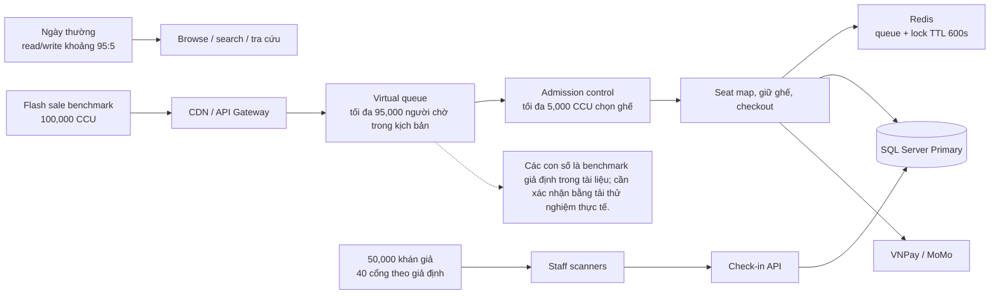

# 01 — Ước Tính Lưu Lượng & Thông Lượng (Traffic & Throughput Estimation: QPS & CCU)

## 1. Giới Thiệu & Bối Cảnh Tải Hệ Thống (System Load Context)

Hệ thống bán vé sự kiện âm nhạc (Concert Ticketing Platform) có đặc thù lưu lượng mang tính chất **đột biến cực đoan (Extreme Flash-Sale Spike)**. Khác với các hệ thống thương mại điện tử thông thường có lưu lượng dàn trải trong ngày, hệ thống vé concert có hai trạng thái vận hành hoàn toàn trái ngược:
1. **Ngày thường (Normal Baseline Days):** Lưu lượng truy cập trung bình, người dùng chủ yếu tìm kiếm thông tin, xem concert sắp tới, tra cứu lịch sử vé, tỉ lệ đọc/ghi khoảng $95:5$.
2. **Giờ G Mở Bán Sự Kiện Lớn (Mega Concert Flash-Sale Peak):** Ví dụ concert quy mô 50.000 vé của nghệ sĩ hàng đầu. Trước giờ mở bán 15 phút, hàng trăm nghìn người hâm mộ cùng lúc truy cập hệ thống; đúng giờ G ($T$), toàn bộ lượng người này đồng thời tranh chấp số lượng vé giới hạn.

Tài liệu này cung cấp các mô hình toán học và bảng tính toán định lượng về **Người dùng đồng thời (Concurrent Users - CCU)**, **Truy vấn mỗi giây (Queries Per Second - QPS)**, và **Giao dịch mỗi giây (Transactions Per Second - TPS)** để làm căn cứ cho việc thiết kế kiến trúc phân tán, chọn cấu hình hạ tầng và cài đặt bộ đệm Caching.

---

## 2. Các Giả Định Cơ Bản (Baseline Assumptions)

Để lượng hóa bài toán, hệ thống thiết lập bộ tham số tiêu chuẩn cho một kịch bản bán vé tải cực đại (**Mega Concert Benchmark**):

| Tham số giả định | Giá trị định lượng | Giải thích nghiệp vụ |
|---|---|---|
| **Sức chứa sân vận động (Venue Capacity)** | 50.000 chỗ ngồi | Quy mô tương đương Sân vận động Quốc gia Mỹ Đình / SVĐ Quân khu 7 |
| **Số lượng vé phát hành** | 50.000 vé | Phân bổ thành 8–10 khu vực (Zone / Cat) |
| **Lượng người dùng đồng thời đỉnh (Peak CCU)** | 100.000 người | Số lượng tài khoản truy cập cùng lúc trong khoảng $T - 15$ phút đến $T + 30$ phút |
| **Sức chứa khu vực chọn ghế (Active Selectors)** | 5.000 CCU | Số lượng người dùng tối đa được phép vào vùng chọn ghế đồng thời (qua Waiting Room) |
| **Tần suất Heartbeat phòng chờ (Polling Rate)** | 3 giây / lần | Mỗi khách hàng trong hàng chờ gửi một request ping để duy trì vị trí |
| **Thời gian giữ ghế tối đa (Hold Window)** | 10 phút (600 giây) | Thời gian hoàn tất thanh toán trước khi ghế bị thu hồi |
| **Thời gian vé bán hết dự kiến (Sell-out Time)** | 15–20 phút | Toàn bộ 50.000 vé được giữ và thanh toán trong vòng 20 phút |
| **Khung giờ soát vé tại cổng (Check-in Window)** | 120 phút (2 giờ) | 50.000 khán giả đi qua 30–50 cổng soát vé trước giờ diễn |

---

## 3. Phân Tích Thông Lượng Ngày Thường vs Giờ Cao Điểm

| Chỉ số đo lường | Ngày thường (Baseline) | Giờ mở bán cao điểm (Flash-Sale Peak) | Mức độ tăng trưởng (Spike Factor) |
|---|---|---|---|
| **Người dùng hoạt động đồng thời (CCU)** | 2.000 – 5.000 CCU | 100.000 CCU | $\times 20$ – $\times 50$ lần |
| **Tổng thông lượng truy vấn (Peak Total QPS)** | 150 – 300 QPS | **35.000 – 42.000 QPS** | $\times 120$ – $\times 140$ lần |
| **Tỷ lệ Đọc : Ghi (Read : Write Ratio)** | $95 : 5$ (Chủ yếu duyệt thông tin) | $75 : 25$ (Ghi tăng vọt do xếp hàng, giữ ghế, tạo đơn) | Thay đổi căn bản bản chất tải |
| **Lưu lượng mạng ra (Egress Bandwidth)** | 50 – 100 Mbps | **2.5 – 4.0 Gbps** (phần lớn được CDN giảm tải) | $\times 40$ lần |
| **Thông lượng quét vé tại cổng (Check-in TPS)** | 0 TPS | 15 TPS trung bình (Đỉnh: 80 – 100 TPS) | Chỉ phát sinh ngày diễn ra sự kiện |

---

## 4. Bảng Tính QPS / TPS Chi Tiết Theo Từng Endpoint Trọng Yếu

Trong thời điểm mở bán cao điểm ($100.000\text{ CCU}$), lưu lượng không phân bổ đều mà tập trung cao độ vào một số API then chốt. Dưới đây là bảng tính toán thông lượng dự kiến cho từng Endpoint:

| Endpoint API | Phương thức | Mục đích nghiệp vụ | Công thức ước tính QPS | QPS Trung bình (Peak) | QPS Đỉnh tức thời (Burst QPS) | Giải pháp xử lý tải |
|---|---|---|---|---|---|---|
| `/api/v1/queue/status` | GET | Khách hàng trong phòng chờ polling lấy vị trí thứ tự | $\frac{95.000\text{ user chờ}}{3\text{ giây}}$ | **31.667 QPS** | **38.000 QPS** | Redis Sorted Set + Edge Caching / Short-polling token |
| `/api/v1/concerts/{id}/seat-map` | GET | Tải cấu trúc sơ đồ ghế & trạng thái ghế | $\frac{5.000\text{ user chọn}}{5\text{ giây}}$ | **1.000 QPS** | **2.500 QPS** | CDN Caching (cấu trúc tĩnh SVG) + WebSocket/SSE (trạng thái động) |
| `/api/v1/seats/hold` | POST | Giữ ghế (Distributed Lock) | $5.000\text{ user} \times 0.2\text{ click/s}$ | **1.000 TPS** | **3.000 TPS** | Redis Cluster (`SETNX` + Lua Script) + message broker queue |
| `/api/v1/orders/checkout` | POST | Xác nhận đặt vé & tạo mã thanh toán | $\frac{50.000\text{ vé}}{4\text{ vé/đơn}} \div (15\text{ phút} \times 60)$ | **14 TPS** | **50 – 100 TPS** | RDBMS Master Write + Transaction Isolation |
| `/api/v1/payments/ipn` | POST | Webhook nhận kết quả từ VNPay / MoMo | Khớp với tốc độ thanh toán của khách | **14 – 25 TPS** | **60 TPS** | Idempotency Key Filter + Async Event-Driven Worker |
| `/api/v1/tickets/check-in` | POST | Quét QR tại cổng vào sân vận động | $\frac{50.000\text{ lượt}}{7.200\text{ giây}}$ | **7 – 15 TPS** | **80 – 100 TPS** | Online validation; atomic DB transition; Redis chỉ là tối ưu, không xác thực offline |
| `/api/v1/concerts/search` | GET | Tìm kiếm và xem thông tin concert | Lưu lượng khách vãng lai | **200 QPS** | **500 QPS** | Elasticsearch Cluster + Redis Cache Layer |

---

## 5. Mô Hình Tính Toán Lưu Lượng Phòng Chờ Ảo (Virtual Queue Math Model)

### 1. Phân Tích Thông Lượng Polling
- Khi có $N = 95.000$ người dùng phải chờ bên ngoài khu vực chọn ghế:
- Nếu chu kỳ polling là $T_p = 3$ giây:
$$\text{QPS}_{\text{queue}} = \frac{N}{T_p} = \frac{95.000}{3} \approx 31.667\text{ requests/second}$$
- Nếu không có giải pháp phòng vệ, $31.667\text{ QPS}$ chạm trực tiếp vào cơ sở dữ liệu sẽ làm sập toàn bộ hệ thống trong vòng vài giây.

### 2. Chiến Lược Giảm Tải Polling (Jitter & Dynamic Backoff)
Để triệt tiêu hiện tượng thắt cổ chai (Thundering Herd Problem):
1. **Adaptive Polling Interval:** Điều chỉnh chu kỳ thăm dò dựa trên khoảng cách số thứ tự:
   - Người đứng ở top 1.000: Polling mỗi 2 giây.
   - Người đứng từ 1.001 – 10.000: Polling mỗi 5 giây.
   - Người đứng sau 10.000: Polling mỗi 10 giây (giảm từ $31.667\text{ QPS}$ xuống chỉ còn $\approx 7.500\text{ QPS}$).
2. **Random Jitter:** Cộng thêm sai số ngẫu nhiên $\pm 500\text{ ms}$ vào mỗi request phía client để ngăn hàng chục nghìn client gửi request tại cùng một mốc tích-tắc đồng hồ.

---

## 6. Phân Tích Tải Giao Dịch Giữ Ghế & Ngăn Chặn Bán Trùng (Concurrency & Lock TPS)

Trong khu vực chọn ghế ($5.000\text{ CCU}$ hoạt động đồng thời):
- Mỗi người dùng cố gắng nhấp chọn từ 1 đến 4 ghế trong những giây đầu tiên.
- **Tần suất tranh chấp ghế (Contention Rate):** Tại các khu vực hot (VIP 1, VIP 2 sát sân khấu với khoảng 500 ghế), có tới $3.000$ người cùng nhấp chọn đồng thời.
- **Yêu cầu xử lý khóa (Lock Operations):**
  - Hệ thống sử dụng Redis Cluster chạy Lua Script nguyên tử để xử lý `SET lock:seat:{id} {user_id} NX EX 600`.
  - Redis Cluster với 3 Master nodes có thể dễ dàng đáp ứng thông lượng **100.000 ops/second**, do đó mức tải $3.000\text{ TPS}$ ghi khóa ghế hoàn toàn nằm trong ngưỡng an toàn cao ($< 5\%$ công suất tối đa của Redis).

---

## 7. Phân Tích Tải Quét Vé Tại Cổng Sự Kiện (Check-In Peak Load)

- **Quy mô:** $50.000$ người tham gia.
- **Số cổng soát vé:** 40 cổng (Mỗi cổng có 1–2 nhân viên cầm máy quét mã QR).
- **Phân bổ thời gian đến sân của khán giả (Arrival Curve):**
  - $T - 120$ phút đến $T - 60$ phút: Đến sớm, rải rác ($15\%$ lượng khách $\approx 7.500$ người $\rightarrow 2.1\text{ scans/second}$).
  - $T - 60$ phút đến $T - 15$ phút: Giờ cao điểm dồn ứ ($70\%$ lượng khách $\approx 35.000$ người trong 45 phút $\rightarrow 13\text{ scans/second}$).
  - **Đỉnh điểm tức thời (Peak 10 phút):** $10.000$ người cùng qua cổng $\rightarrow \mathbf{16.6\text{ scans/second}}$ toàn sân.
  - Trung bình mỗi cổng xử lý: $\frac{16.6}{40} \approx 0.41\text{ scans/second/cổng}$ (Tương đương 1 khách qua cổng sau mỗi $2.4\text{ giây}$).
- **Yêu cầu độ trễ (Latency Target):** Thời gian phản hồi xác thực tại máy quét phải $\le 500\text{ ms}$ (P99 $\le 800\text{ ms}$) để đảm bảo dòng người không bị tắc nghẽn vật lý tại cửa khẩu an ninh.

<!-- BEGIN MERMAID DIAGRAM CAP-TRAFFIC -->
### Lưu lượng từ flash sale đến check-in

<!-- END MERMAID DIAGRAM CAP-TRAFFIC -->

---

## 8. Chiến Lược Giới Hạn Tải & Bảo Vệ Hệ Thống (Rate Limiting & Shedding)

Để hỗ trợ SLO 99.95% mỗi tháng cho critical first-party purchase APIs theo D-027, các ngưỡng giới hạn (Rate Limits) được cấu hình tại API Gateway:

| Đối tượng áp dụng | Ngưỡng giới hạn (Rate Limit) | Thuật toán áp dụng | Hành vi khi vượt ngưỡng |
|---|---|---|---|
| **Theo IP Client (Public Endpoints)** | 60 requests / phút | Token Bucket | Trả về `429 Too Many Requests` |
| **Theo User ID (Authenticated)** | 120 requests / phút | Leaky Bucket | Trả về `429 Too Many Requests` |
| **Endpoint Giữ Ghế (`/seats/hold`)** | 5 requests / 10 giây / user | Sliding Window Log | Chặn nhấp liên tục (chống spam bot click) |
| **Endpoint Thanh Toán (`/orders/checkout`)** | 2 requests / phút / user | Fixed Window | Chống tạo đơn hàng lặp |
| **Hàng Chờ Đầy (Queue Capacity Exceeded)** | Khi hàng chờ đạt 150.000 CCU | Load Shedding | Từ chối tiếp nhận thêm kèm thông báo: *"Hàng chờ đã đầy, vui lòng quay lại sau"* |

