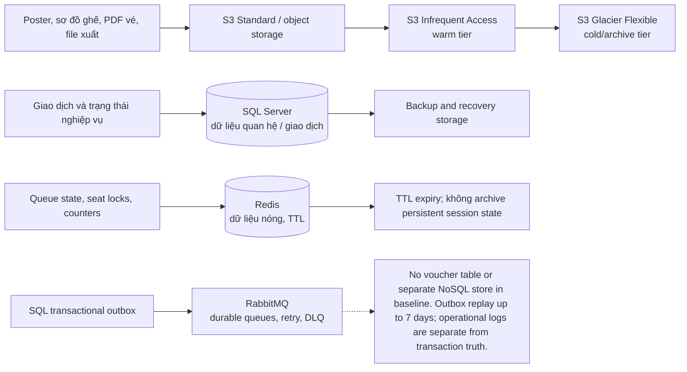

# 02 — Ước Tính Dung Lượng Lưu Trữ (Storage Capacity Estimation)

## 1. Giới Thiệu & Mục Tiêu Quy Hoạch

Quy hoạch dung lượng lưu trữ (**Storage Capacity Planning**) là tiền đề cốt lõi để đảm bảo hệ thống vận hành ổn định trong thời gian dài (1 năm, 3 năm, 5 năm) mà không gặp sự cố cạn kiệt đĩa cứng (Disk Exhaustion) hoặc suy giảm hiệu năng do kích thước bảng cơ sở dữ liệu phình to.

Tài liệu này lượng hóa chi tiết nhu cầu lưu trữ trên 5 tầng lưu trữ dữ liệu chuyên biệt:
1. **Cơ sở dữ liệu Quan hệ (RDBMS - SQL Server):** Lưu trữ dữ liệu giao dịch cốt lõi (ACID-compliant).
2. **Bộ đệm In-Memory (Redis Cluster):** Lưu trữ phiên làm việc, hàng chờ ảo, khóa giữ ghế và bộ đếm rate limit.
3. **Message Broker (RabbitMQ):** Lưu job/event bất đồng bộ; SQL Server transactional outbox là nguồn bền vững để phát lại tối đa 7 ngày.
4. **Kho Lưu Trữ Đối Tượng (Object Storage - AWS S3 / MinIO):** Lưu trữ hình ảnh vé, tài liệu pháp lý, hóa đơn PDF và file xuất báo cáo.
5. **Hệ Thống Phân Tích & Nhật Ký:** Log/search store phụ; SQL Server vẫn là nguồn sự thật cho dữ liệu giao dịch.

---

## 2. Các Giả Định Về Quy Mô Kinh Doanh (Business Scale Assumptions)

| Chỉ số kinh doanh | Năm 1 (Khởi động) | Năm 3 (Tăng trưởng) | Năm 5 (Trưởng thành) | Ghi chú nghiệp vụ |
|---|---|---|---|---|
| **Số lượng sự kiện (Concerts / Năm)** | 200 sự kiện | 600 sự kiện | 1.500 sự kiện | Bao gồm cả concert lớn và sự kiện âm nhạc vừa |
| **Tổng số vé phát hành / Năm** | 2.000.000 vé | 6.500.000 vé | 18.000.000 vé | Trung bình 10.000 – 12.000 vé/sự kiện |
| **Số lượng tài khoản người dùng (Users)** | 1.000.000 tài khoản | 3.500.000 tài khoản | 8.000.000 tài khoản | Tích lũy người hâm mộ âm nhạc |
| **Số lượng đơn hàng phát sinh (Orders)** | 600.000 đơn | 2.000.000 đơn | 5.500.000 đơn | Trung bình $3.2$ vé / đơn hàng |
| **Số lượt quét check-in tại cổng** | 1.800.000 lượt | 6.000.000 lượt | 16.500.000 lượt | Tỷ lệ tham dự thực tế đạt $\approx 90\%$ |
| **Tỷ lệ hủy/hoàn vé phát sinh** | $3\%$ tổng đơn | $3\%$ tổng đơn | $3\%$ tổng đơn | Đơn hàng hủy do cá nhân hoặc sự cố |

---

## 3. Ước Tính Kích Thước Bảng Cơ Sở Dữ Liệu Quan Hệ (SQL Server Schema Sizing)

Hệ thống sử dụng hệ số mở rộng **Hệ số Dự phòng & Chỉ mục (Index & Overhead Factor) = 1.6** (nghĩa là kích thước chỉ mục B-tree, foreign key và khoảng trống khối dữ liệu chiếm thêm $60\%$ so với dung lượng dữ liệu thô).

| Tên bảng dữ liệu | Kích thước 1 dòng (Row Size) | Số dòng Năm 1 | Dung lượng thô Năm 1 | Dung lượng gồm Index (Năm 1) | Dung lượng tích lũy (Năm 3) | Dung lượng tích lũy (Năm 5) |
|---|---|---|---|---|---|---|
| `users` & `user_credentials` | 400 bytes | 1.000.000 | 400 MB | **640 MB** | 2.24 GB | 5.12 GB |
| `concerts` & `ticket_zones` | 2.000 bytes | 2.000 | 4 MB | **6.4 MB** | 19.2 MB | 48 MB |
| `seats` (Sơ đồ ghế chi tiết) | 150 bytes | 2.000.000 | 300 MB | **480 MB** | 1.56 GB | 4.32 GB |
| `seat_holds` (Lịch sử giữ ghế) | 120 bytes | 5.000.000 | 600 MB | **960 MB** | 3.12 GB | 8.64 GB |
| `orders` & `order_items` | 500 bytes | 2.600.000 | 1.3 GB | **2.08 GB** | 6.76 GB | 18.72 GB |
| `tickets` (Vé điện tử chi tiết) | 350 bytes | 2.000.000 | 700 MB | **1.12 GB** | 3.64 GB | 10.08 GB |
| `payment_transactions` & `refunds` | 600 bytes | 800.000 | 480 MB | **768 MB** | 2.50 GB | 6.91 GB |
| `checkin_logs` (Nhật ký quét cổng) | 250 bytes | 1.800.000 | 450 MB | **720 MB** | 2.40 GB | 6.60 GB |
| `reviews` & `ratings` | 600 bytes | 300.000 | 180 MB | **288 MB** | 936 MB | 2.59 GB |
| `audit_logs` (Nhật ký kiểm toán) | 800 bytes | 10.000.000 | 8.0 GB | **12.80 GB** | 41.60 GB | 115.20 GB |
| **TỔNG CỘNG (RDBMS)** | — | — | **12.41 GB** | **19.86 GB** | **64.78 GB** | **178.22 GB** |

> **Ước lượng sơ bộ — chưa phải sizing đã xác nhận:** 
> Kích thước RDBMS cốt lõi (bỏ qua Audit Log) sau 5 năm hoạt động chỉ vào khoảng $\approx 63\text{ GB}$. Kể cả khi cộng toàn bộ Audit Log, dung lượng cũng chưa vượt quá $200\text{ GB}$.  
> $\rightarrow$ Mô hình một SQL Server database là giả định hoạch định ban đầu; storage/compute, giới hạn tăng trưởng, HA và licensing phải được kiểm tra bằng benchmark D-026/D-030 trước khi chốt. 
> Không dùng partition trong baseline theo D-028; dùng index, retention và archival. Chỉ đánh giá RANGE trên bảng lịch sử append-only nếu benchmark chứng minh cần. T-SQL không dùng cú pháp PARTITION BY RANGE của MySQL.

---

## 4. Ước Tính Bộ Đệm In-Memory (Redis Cluster Sizing)

Redis được dùng để lưu trữ dữ liệu nóng có độ trễ cực thấp trong giờ cao điểm:

| Cấu trúc dữ liệu Redis | Công thức tính dung lượng | Số lượng phần tử đỉnh | Dung lượng RAM cần thiết | Thời gian sống (TTL) |
|---|---|---|---|---|
| **Hàng chờ ảo (Waiting Room Sorted Set)** | Mỗi member lưu `user_id` + `timestamp` $\approx 64$ bytes | 100.000 user trong hàng | **6.4 MB** | 2 giờ |
| **Khóa giữ ghế (Distributed Seat Locks)** | Key: `lock:seat:{id}`, Value: `user_id` $\approx 100$ bytes | 50.000 ghế | **5.0 MB** | 600 giây (10 phút) |
| **Sơ đồ trạng thái ghế (Seat Status Bitmaps/Hashes)** | Trạng thái từng ghế (0: Trống, 1: Giữ, 2: Bán) $\approx 2$ bits/ghế | 50.000 ghế / concert | **1.5 MB** | 24 giờ |
| **Phiên làm việc người dùng (User Sessions / JWT Blacklist)** | Session cache $\approx 500$ bytes / session | 100.000 active sessions | **50.0 MB** | 24 giờ |
| **Bộ đếm Rate Limiting (Token Bucket Counters)** | Key `ip / user` + counter $\approx 48$ bytes | 200.000 keys | **9.6 MB** | 60 giây |
| **Cache Trang Chủ & Danh Mục Concert** | Dữ liệu JSON tóm tắt concert | 100 concerts | **2.0 MB** | 5 phút |
| **Hệ số an toàn bộ nhớ (Redis Overhead & Maxmemory Buffer)** | Hệ số nhân $\times 2.0$ để tránh rủi ro phân mảnh bộ nhớ (Fragmentation) | — | $\times 2.0$ | — |
| **TỔNG DUNG LƯỢNG RAM REDIS ĐỈNH** | $(6.4 + 5.0 + 1.5 + 50.0 + 9.6 + 2.0) \times 2$ | — | **$\approx 150\text{ MB}$ (Đỉnh)** | — |

> **Khuyến nghị cấu hình:**  
> Mặc dù dữ liệu thực tế chỉ chiếm $< 200\text{ MB}$, hệ thống yêu cầu một cụm **Redis Cluster gồm 3 Master + 3 Replica**, mỗi node cấp phát **4 GB RAM** (Tổng RAM cụm = 24 GB) để đảm bảo:
> 1. Xử lý thông lượng mạng lớn ($> 50.000\text{ ops/second}$).
> 2. Đủ bộ nhớ đệm cho các tác vụ snapshot RDB và lưu bản ghi AOF mà không gây áp lực tràn RAM (OOM Killer).

---

## 5. Ước Tính RabbitMQ Queue & Transactional Outbox

RabbitMQ durable queues vận chuyển event/job; SQL Server transactional outbox là nguồn bền vững để retry/replay tối đa 7 ngày theo D-029. Backlog và payload size ở broker là giả định sizing, không phải retention của nguồn sự thật.

| Tham số định lượng | Giá trị tính toán | Giải thích |
|---|---|---|
| **Kích thước trung bình 1 Event message** | $1\text{ KB}$ ($1.024\text{ bytes}$) | Chuỗi JSON chứa metadata sự kiện và payload |
| **Số sự kiện phát sinh trong 1 giờ mở bán cao điểm** | $1.500.000$ messages | Xếp hàng, chọn ghế, giữ ghế, gia hạn, trả ghế, tạo đơn, thanh toán |
| **Dung lượng phát sinh giờ cao điểm** | $1.500.000 \times 1\text{ KB} \approx \mathbf{1.5\text{ GB}}$ | Dữ liệu thô |
| **Bản sao quorum queue (mục tiêu 3 replicas)** | Dung lượng thực tế phụ thuộc queue quorum, payload, backlog và topology | Cấu hình RabbitMQ HA theo D-025/D-030; không lấy Kafka replication factor làm sizing |
| **Outbox replay window** | Tối đa 7 ngày theo D-029 | SQL Server giữ event bền vững; thời hạn lưu tại RabbitMQ do queue policy vận hành, không thay thế outbox |
| **Tổng dung lượng đĩa cứng message broker yêu cầu (Năm 1)** | Khoảng **50 GB – 100 GB** đĩa SSD trên mỗi Broker | Hoàn toàn đáp ứng dư dả cho toàn bộ các đợt mở bán trong tuần |

---

## 6. Ước Tính Kho Lưu Trữ Đối Tượng (Object Storage - AWS S3)

Object Storage lưu trữ các tài nguyên tĩnh và tệp nhị phân có dung lượng lớn:

| Loại tệp tin | Định dạng | Dung lượng trung bình 1 tệp | Tần suất phát sinh | Dung lượng Năm 1 | Dung lượng Năm 3 | Dung lượng Năm 5 |
|---|---|---|---|---|---|---|
| **Banner & Poster Concert** | WebP / JPG | 1.5 MB / ảnh | 5 ảnh / concert | 1.5 GB | 4.5 GB | 11.2 GB |
| **Sơ đồ khán đài SVG / Bản đồ ghế** | SVG / JSON | 800 KB / tệp | 2 tệp / concert | 320 MB | 960 MB | 2.4 GB |
| **Tài liệu pháp lý GPKD của BTC** | PDF | 5.0 MB / tệp | 3 tệp / concert | 3.0 GB | 9.0 GB | 22.5 GB |
| **Ảnh đại diện người dùng (Avatars)** | JPG / PNG | 300 KB / ảnh | $30\%$ user tải ảnh | 90 GB | 315 GB | 720 GB |
| **Vé điện tử PDF & Mã QR hình ảnh** | PDF / PNG | 200 KB / vé | 100% vé phát hành | 400 GB | 1.300 GB | 3.600 GB |
| **Tệp xuất báo cáo doanh thu** | XLSX / CSV | 2.0 MB / tệp | 20 tệp / concert | 8.0 GB | 24.0 GB | 60.0 GB |
| **TỔNG DUNG LƯỢNG S3** | — | — | — | **$\approx 503\text{ GB}$** | **$\approx 1.65\text{ TB}$** | **$\approx 4.42\text{ TB}$** |

---

## 7. Chiến Lược Phân Tầng Lưu Trữ & Vòng Đời Dữ Liệu (Data Tiering & Lifecycle Policy)

Nhằm tối ưu hóa chi phí vận hành hạ tầng đám mây:
1. **Dữ liệu Nóng (Hot Tier - NVMe SSD & AWS S3 Standard):**
   - Áp dụng cho: Dữ liệu sự kiện đang diễn ra hoặc đã kết thúc dưới 30 ngày.
   - Truy cập độ trễ thấp tức thì ($< 10\text{ ms}$).
2. **Dữ liệu Ấm (Warm Tier - AWS S3 Infrequent Access - S3-IA):**
   - Áp dụng cho: Vé điện tử, hóa đơn, hình ảnh của các concert đã kết thúc từ 31 đến 180 ngày.
   - Tiết kiệm $40\%$ chi phí lưu trữ so với Hot Tier.
3. **Dữ liệu Lạnh & Lưu Trữ Pháp Lý (Cold Tier - AWS S3 Glacier Flexible):**
   - Áp dụng cho: Dữ liệu giao dịch, hợp đồng pháp lý, nhật ký soát vé của sự kiện trên 180 ngày (lưu trữ phục vụ kiểm toán tài chính và nghĩa vụ thuế trong 5 năm theo quy định pháp luật Việt Nam).
   - Tiết kiệm đến $80\%$ chi phí lưu trữ. Thời gian phục hồi dữ liệu từ 1 đến 5 giờ.

<!-- BEGIN MERMAID DIAGRAM CAP-STORAGE -->
### Các tầng lưu trữ và vòng đời dữ liệu

<!-- END MERMAID DIAGRAM CAP-STORAGE -->

---

## 8. Kế Hoạch Sao Lưu & Phục Hồi Dữ Liệu (Backup & RTO/RPO Targets)

| Loại dữ liệu | Phương thức sao lưu | Tần suất thực hiện | Thời gian lưu giữ bản sao | Điểm phục hồi mục tiêu (RPO) | Thời gian phục hồi mục tiêu (RTO) |
|---|---|---|---|---|---|
| **Cơ sở dữ liệu SQL Server** | Native full/differential/transaction-log backups | Full hằng ngày; differential mỗi 6 giờ; transaction log mỗi 5 phút | 35 ngày | Local AG: RPO 0 / RTO ≤5 phút; cross-region DR: RPO ≤5 phút / RTO ≤60 phút theo D-026; cần diễn tập để xác nhận |
| **Dữ liệu Redis Cache** | Cache/queue/lock có TTL; tái tạo từ nguồn có thẩm quyền khi cần | Không áp dụng sao lưu bắt buộc cho dữ liệu ephemeral | Không lưu làm hồ sơ giao dịch | Không áp dụng RPO/RTO giao dịch; mất Redis không được làm sai dữ liệu giao dịch |
| **Object Storage (S3)** | Versioning/replication theo cấu hình bucket đã duyệt | Theo chính sách vận hành thực tế | Theo retention policy đã duyệt | Cần xác nhận theo cấu hình provider | Cần xác nhận qua restore test |
