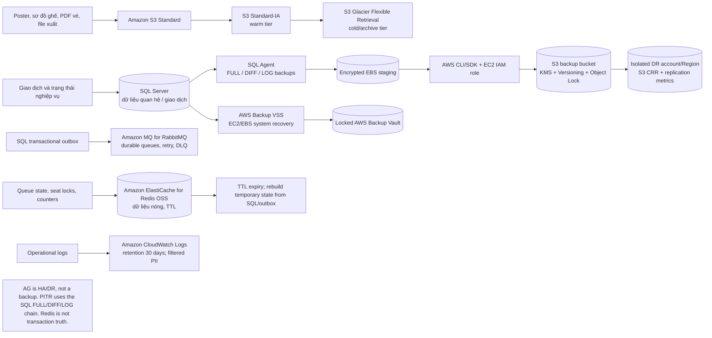

# 02 — Ước Tính Dung Lượng Lưu Trữ (Storage Capacity Estimation)

## 1. Giới Thiệu & Mục Tiêu Quy Hoạch

Quy hoạch dung lượng lưu trữ (**Storage Capacity Planning**) là tiền đề cốt lõi để đảm bảo hệ thống vận hành ổn định trong thời gian dài (1 năm, 3 năm, 5 năm) mà không gặp sự cố cạn kiệt đĩa cứng (Disk Exhaustion) hoặc suy giảm hiệu năng do kích thước bảng cơ sở dữ liệu phình to.

Tài liệu này lượng hóa chi tiết nhu cầu lưu trữ trên 5 tầng lưu trữ dữ liệu chuyên biệt:
1. **Cơ sở dữ liệu Quan hệ (RDBMS - SQL Server):** Lưu trữ dữ liệu giao dịch cốt lõi (ACID-compliant).
2. **Bộ đệm In-Memory (Amazon ElastiCache for Redis OSS):** Lưu trữ phiên làm việc, hàng chờ ảo, khóa giữ ghế và bộ đếm rate limit.
3. **Message Broker (Amazon MQ for RabbitMQ):** Lưu job/event bất đồng bộ; SQL Server transactional outbox là nguồn bền vững để phát lại tối đa 7 ngày.
4. **Kho Lưu Trữ Đối Tượng (Amazon S3):** Lưu trữ hình ảnh vé, tài liệu pháp lý, hóa đơn PDF và file xuất báo cáo.
5. **Giám sát và nhật ký vận hành (Amazon CloudWatch):** Metrics/logs phục vụ vận hành; SQL Server vẫn là nguồn sự thật cho dữ liệu giao dịch.

---

## 2. Các Giả Định Về Quy Mô Kinh Doanh (Business Scale Assumptions)

| Chỉ số kinh doanh | Năm 1 (Khởi động) | Năm 3 (Tăng trưởng) | Năm 5 (Trưởng thành) | Ghi chú nghiệp vụ |
|---|---|---|---|---|
| **Số lượng sự kiện (Concerts / Năm)** | 200 sự kiện | 600 sự kiện | 1.500 sự kiện | Bao gồm cả concert lớn và sự kiện âm nhạc vừa |
| **Tổng số vé phát hành / Năm** | 2.000.000 vé | 6.500.000 vé | 18.000.000 vé | Trung bình 10.000 – 12.000 vé/sự kiện |
| **Số lượng tài khoản người dùng (Users)** | 1.000.000 tài khoản | 3.500.000 tài khoản | 8.000.000 tài khoản | Tích lũy người hâm mộ âm nhạc |
| **Số lượng đơn hàng phát sinh (Orders)** | 600.000 đơn | 2.000.000 đơn | 5.500.000 đơn | Trung bình $3.2$ vé / đơn hàng |
| **Số lượt quét check-in tại cổng** | 1.800.000 lượt | 6.000.000 lượt | 16.500.000 lượt | Tỷ lệ tham dự thực tế đạt $\approx 90\%$ |
| **Tỷ lệ hủy/hoàn vé phát sinh** | $3\%$ tổng đơn | $3\%$ tổng đơn | $3\%$ tổng đơn | Đơn hàng hủy do cá nhân hoặc sự cố |

---

## 3. Ước Tính Kích Thước Bảng Cơ Sở Dữ Liệu Quan Hệ (SQL Server Schema Sizing)

Hệ thống sử dụng hệ số mở rộng **Hệ số Dự phòng & Chỉ mục (Index & Overhead Factor) = 1.6** (nghĩa là kích thước chỉ mục B-tree, foreign key và khoảng trống khối dữ liệu chiếm thêm $60\%$ so với dung lượng dữ liệu thô).

| Tên bảng dữ liệu | Kích thước 1 dòng (Row Size) | Số dòng Năm 1 | Dung lượng thô Năm 1 | Dung lượng gồm Index (Năm 1) | Dung lượng tích lũy (Năm 3) | Dung lượng tích lũy (Năm 5) |
|---|---|---|---|---|---|---|
| `users` & `user_credentials` | 400 bytes | 1.000.000 | 400 MB | **640 MB** | 2.24 GB | 5.12 GB |
| `concerts` & `ticket_zones` | 2.000 bytes | 2.000 | 4 MB | **6.4 MB** | 19.2 MB | 48 MB |
| `seats` (Sơ đồ ghế chi tiết) | 150 bytes | 2.000.000 | 300 MB | **480 MB** | 1.56 GB | 4.32 GB |
| `seat_holds` (Lịch sử giữ ghế) | 120 bytes | 5.000.000 | 600 MB | **960 MB** | 3.12 GB | 8.64 GB |
| `orders` & `order_items` | 500 bytes | 2.600.000 | 1.3 GB | **2.08 GB** | 6.76 GB | 18.72 GB |
| `tickets` (Vé điện tử chi tiết) | 350 bytes | 2.000.000 | 700 MB | **1.12 GB** | 3.64 GB | 10.08 GB |
| `payment_transactions` & `refunds` | 600 bytes | 800.000 | 480 MB | **768 MB** | 2.50 GB | 6.91 GB |
| `checkin_logs` (Nhật ký quét cổng) | 250 bytes | 1.800.000 | 450 MB | **720 MB** | 2.40 GB | 6.60 GB |
| `reviews` & `ratings` | 600 bytes | 300.000 | 180 MB | **288 MB** | 936 MB | 2.59 GB |
| `audit_logs` (Nhật ký kiểm toán) | 800 bytes | 10.000.000 | 8.0 GB | **12.80 GB** | 41.60 GB | 115.20 GB |
| **TỔNG CỘNG (RDBMS)** | — | — | **12.41 GB** | **19.86 GB** | **64.78 GB** | **178.22 GB** |

> **Ước lượng sơ bộ — chưa phải sizing đã xác nhận:** 
> Kích thước RDBMS cốt lõi (bỏ qua Audit Log) sau 5 năm hoạt động chỉ vào khoảng $\approx 63\text{ GB}$. Kể cả khi cộng toàn bộ Audit Log, dung lượng cũng chưa vượt quá $200\text{ GB}$.  
> $\rightarrow$ Mô hình một SQL Server database là giả định hoạch định ban đầu; storage/compute, giới hạn tăng trưởng, HA và licensing phải được kiểm tra bằng benchmark D-026/D-030 trước khi chốt. 
> Không dùng partition trong baseline theo D-028; dùng index, retention và archival. Chỉ đánh giá RANGE trên bảng lịch sử append-only nếu benchmark chứng minh cần. T-SQL không dùng cú pháp PARTITION BY RANGE của MySQL.

---

## 4. Ước Tính Bộ Đệm In-Memory (Amazon ElastiCache for Redis OSS sizing)

Redis được dùng để lưu trữ dữ liệu nóng có độ trễ cực thấp trong giờ cao điểm:

| Cấu trúc dữ liệu Redis | Công thức tính dung lượng | Số lượng phần tử đỉnh | Dung lượng RAM cần thiết | Thời gian sống (TTL) |
|---|---|---|---|---|
| **Hàng chờ ảo (Waiting Room Sorted Set)** | Mỗi member lưu `user_id` + `timestamp` $\approx 64$ bytes | 100.000 user trong hàng | **6.4 MB** | 2 giờ |
| **Khóa giữ ghế (Distributed Seat Locks)** | Key: `lock:seat:{id}`, Value: `user_id` $\approx 100$ bytes | 50.000 ghế | **5.0 MB** | 600 giây (10 phút) |
| **Sơ đồ trạng thái ghế (Seat Status Bitmaps/Hashes)** | Trạng thái từng ghế (0: Trống, 1: Giữ, 2: Bán) $\approx 2$ bits/ghế | 50.000 ghế / concert | **1.5 MB** | 24 giờ |
| **Phiên làm việc người dùng (User Sessions / JWT Blacklist)** | Session cache $\approx 500$ bytes / session | 100.000 active sessions | **50.0 MB** | 24 giờ |
| **Bộ đếm Rate Limiting (Token Bucket Counters)** | Key `ip / user` + counter $\approx 48$ bytes | 200.000 keys | **9.6 MB** | 60 giây |
| **Cache Trang Chủ & Danh Mục Concert** | Dữ liệu JSON tóm tắt concert | 100 concerts | **2.0 MB** | 5 phút |
| **Hệ số an toàn bộ nhớ (Redis Overhead & Maxmemory Buffer)** | Hệ số nhân $\times 2.0$ để tránh rủi ro phân mảnh bộ nhớ (Fragmentation) | — | $\times 2.0$ | — |
| **TỔNG DUNG LƯỢNG RAM REDIS ĐỈNH** | $(6.4 + 5.0 + 1.5 + 50.0 + 9.6 + 2.0) \times 2$ | — | **$\approx 150\text{ MB}$ (Đỉnh)** | — |

> **Khuyến nghị cấu hình AWS:** Phần ước tính bộ nhớ dữ liệu nóng khoảng 150 MB chỉ là mô hình lý thuyết, chưa gồm đầy đủ overhead, peak churn, replication và yêu cầu failover. Không suy ra node class hoặc số shard/replica chỉ từ con số này. Dùng Amazon ElastiCache for Redis OSS; chốt engine version, topology, node class, số replica, maxmemory/headroom và chi phí sau khi kiểm thử tương thích, benchmark tải và xác nhận quota/Region. Redis lỗi không được làm sai trạng thái giao dịch; SQL Server vẫn là nguồn quyết định cuối.
---

## 5. Ước Tính RabbitMQ Queue & Transactional Outbox

Amazon MQ for RabbitMQ durable queues vận chuyển event/job; SQL Server transactional outbox là nguồn bền vững để retry/replay tối đa 7 ngày theo D-029. Backlog và payload size ở broker là giả định sizing, không phải retention của nguồn sự thật.

| Tham số định lượng | Giá trị tính toán | Giải thích |
|---|---|---|
| **Kích thước trung bình 1 Event message** | $1\text{ KB}$ ($1.024\text{ bytes}$) | Chuỗi JSON chứa metadata sự kiện và payload |
| **Số sự kiện phát sinh trong 1 giờ mở bán cao điểm** | $1.500.000$ messages | Xếp hàng, chọn ghế, giữ ghế, gia hạn, trả ghế, tạo đơn, thanh toán |
| **Dung lượng phát sinh giờ cao điểm** | $1.500.000 \times 1\text{ KB} \approx \mathbf{1.5\text{ GB}}$ | Dữ liệu thô |
| **Quorum queue replicas (nếu bật)** | Dung lượng phụ thuộc số bản sao, backlog, payload và topology | Không mặc định số replica; kiểm tra queue type, giới hạn và thiết kế Amazon MQ theo Region trước khi cấu hình |
| **Outbox replay window** | Tối đa 7 ngày theo D-029 | SQL Server giữ event bền vững; thời hạn lưu tại Amazon MQ do queue policy vận hành, không thay thế outbox |
| **Dung lượng Amazon MQ cần thiết (Năm 1)** | Chưa chốt | Xác định từ backlog thực đo, thời gian lưu, message rate, replicated queue policy, giới hạn dịch vụ và benchmark D-030 |

---

## 6. Ước Tính Kho Lưu Trữ Đối Tượng (Object Storage - AWS S3)

Object Storage lưu trữ các tài nguyên tĩnh và tệp nhị phân có dung lượng lớn:

| Loại tệp tin | Định dạng | Dung lượng trung bình 1 tệp | Tần suất phát sinh | Dung lượng Năm 1 | Dung lượng Năm 3 | Dung lượng Năm 5 |
|---|---|---|---|---|---|---|
| **Banner & Poster Concert** | WebP / JPG | 1.5 MB / ảnh | 5 ảnh / concert | 1.5 GB | 4.5 GB | 11.2 GB |
| **Sơ đồ khán đài SVG / Bản đồ ghế** | SVG / JSON | 800 KB / tệp | 2 tệp / concert | 320 MB | 960 MB | 2.4 GB |
| **Tài liệu pháp lý GPKD của BTC** | PDF | 5.0 MB / tệp | 3 tệp / concert | 3.0 GB | 9.0 GB | 22.5 GB |
| **Ảnh đại diện người dùng (Avatars)** | JPG / PNG | 300 KB / ảnh | $30\%$ user tải ảnh | 90 GB | 315 GB | 720 GB |
| **Vé điện tử PDF & Mã QR hình ảnh** | PDF / PNG | 200 KB / vé | 100% vé phát hành | 400 GB | 1.300 GB | 3.600 GB |
| **Tệp xuất báo cáo doanh thu** | XLSX / CSV | 2.0 MB / tệp | 20 tệp / concert | 8.0 GB | 24.0 GB | 60.0 GB |
| **TỔNG DUNG LƯỢNG S3** | — | — | — | **$\approx 503\text{ GB}$** | **$\approx 1.65\text{ TB}$** | **$\approx 4.42\text{ TB}$** |

---

## 7. Chiến Lược Phân Tầng Lưu Trữ & Vòng Đời Dữ Liệu (Data Tiering & Lifecycle Policy)

Nhằm tối ưu hóa chi phí vận hành hạ tầng đám mây:
1. **Dữ liệu Nóng (Hot Tier - Amazon S3 Standard):**
   - Áp dụng cho: Dữ liệu sự kiện đang diễn ra hoặc đã kết thúc dưới 30 ngày.
   - Dùng cho dữ liệu truy cập thường xuyên; latency thực tế phụ thuộc kích thước object, Region, network path và client.
2. **Dữ liệu Ấm (Warm Tier - Amazon S3 Standard-IA):**
   - Áp dụng cho: Vé điện tử, hóa đơn, hình ảnh của các concert đã kết thúc từ 31 đến 180 ngày.
   - Phí lưu trữ, truy xuất và thời lượng tối thiểu phụ thuộc class/Region; xác nhận bằng AWS Pricing Calculator và access pattern thực tế.
3. **Dữ liệu Lạnh & Lưu Trữ Pháp Lý (Cold Tier - Amazon S3 Glacier Flexible Retrieval):**
   - Áp dụng cho: Dữ liệu giao dịch, hợp đồng pháp lý, nhật ký soát vé của sự kiện trên 180 ngày (lưu trữ phục vụ kiểm toán tài chính và thời hạn lưu trữ do Legal/Finance xác nhận trước khi áp dụng lifecycle).
   - Chi phí và thời gian truy xuất phụ thuộc retrieval tier, Region và khối lượng; kiểm tra yêu cầu restore trước khi áp dụng lifecycle.

<!-- BEGIN MERMAID DIAGRAM CAP-STORAGE -->
### Các tầng lưu trữ và vòng đời dữ liệu

<!-- END MERMAID DIAGRAM CAP-STORAGE -->

---

## 8. Kế Hoạch Sao Lưu & Phục Hồi Dữ Liệu (Backup & RPO/RTO Targets)

| Kịch bản/dữ liệu | Phương thức và lịch | Retention | Mục tiêu phục hồi |
|---|---|---|---|
| SQL Server — PITR | SQL Agent: FULL hằng ngày, DIFF mỗi 6 giờ, LOG mỗi 5 phút; ghi vào EBS staging mã hóa rồi upload object đã hoàn tất lên S3 bằng AWS CLI/SDK và IAM instance role | PITR 35 ngày; giữ chuỗi/object tối thiểu 37 ngày để bao phủ full backup nền và phần đệm chuỗi | Backup fallback: RPO ≤30 phút, RTO ≤4 giờ là mục tiêu khởi điểm chưa benchmark; đo end-to-end tới khi log object đã replicate |
| Same-Region SQL HA | Always On AG synchronous Primary + secondary | Không thay thế backup | RPO 0 / RTO ≤5 phút theo D-026; xác nhận trong diễn tập |
| Cross-Region SQL DR | Ưu tiên asynchronous AG replica; S3 copy là đường PITR thay thế | Theo D-026 và backup-chain policy | AG: RPO ≤5 phút / RTO ≤60 phút mục tiêu thiết kế; không áp sang S3 restore |
| EC2/EBS SQL host recovery | AWS Backup Windows VSS application-consistent snapshots hằng ngày nếu host/instance được hỗ trợ; Vault Lock; Restore Testing | 14 ngày cho bản snapshot máy chủ | RPO theo recovery point thành công gần nhất; RTO đo qua restore test. PITR giao dịch dùng riêng native SQL backup chain |
| Dữ liệu Redis | Cache/queue/lock tạm; dựng lại trạng thái nghiệp vụ từ SQL/outbox | Không giữ như bản sao giao dịch | Không áp RPO/RTO nghiệp vụ cho Redis; fail-safe và tái tạo/invalidate state |
| Tệp trong S3 | Versioning, KMS và CRR theo bucket, retention theo loại dữ liệu | Theo policy dữ liệu/Legal/Finance | Theo test phục hồi object và trạng thái replication |

### Công thức ước lượng dung lượng backup

Gọi **F** là dung lượng trung bình của một full backup đã nén, **D** là dung lượng trung bình của một differential, **L** là dung lượng trung bình của một transaction-log backup 5 phút.

- SQL backup vùng chính trong retention-chain 37 ngày: **37 × F + 37 × 4 × D + 37 × 288 × L**.
- S3 vùng DR cần dung lượng xấp xỉ tương đương bản nguồn; tổng dung lượng object hai Region xấp xỉ **2 × dung lượng vùng chính**, chưa gồm version thừa và AWS Backup snapshots.
- EBS staging phải chứa được ít nhất một full backup đang tạo cùng log backups phát sinh trong thời gian S3 gián đoạn đã chọn làm giả định thiết kế; cộng headroom vận hành. Chốt dung lượng bằng kích thước backup nén, tốc độ log thực tế và kiểm thử upload.
- Không lấy dung lượng database hiện tại nhân 35 để đại diện toàn bộ backup: cần tính riêng FULL, DIFF, LOG, staging, CRR và snapshot; mọi con số phải được đo ở dữ liệu gần production.

Các target RPO/RTO là tiêu chí nghiệm thu thiết kế, chưa phải kết quả đã đo. Region, chi phí transfer/replication, Object Lock mode, AWS Backup retention, quota và DBA/Finance approval vẫn là go-live gates.
