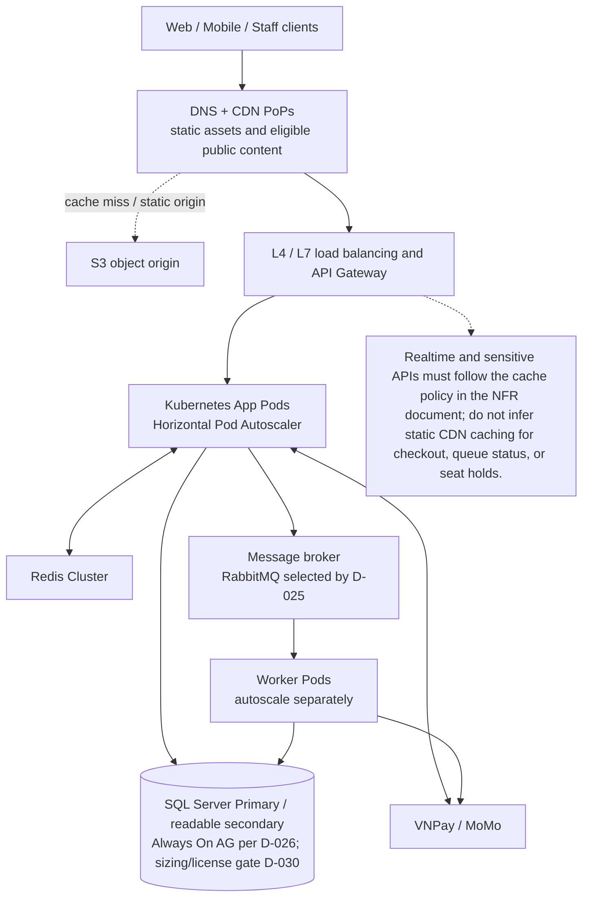

# 03 — Ước Tính Băng Thông, CDN & Số Lượng Máy Chủ (Bandwidth, CDN & Server Estimation)

## 1. Giới Thiệu & Mục Tiêu

Tài liệu này lượng hóa chi tiết:
1. **Lưu lượng mạng & Băng thông (Network Bandwidth & Egress):** Phân tích lưu lượng truyền tải dữ liệu chiều vào (Ingress) và chiều ra (Egress) trong trạng thái bình thường và giờ cao điểm mở bán vé.
2. **Chiến lược CDN (Content Delivery Network):** Tỷ lệ phân tán tải tại biên mạng (Edge Caching), mục tiêu tỷ lệ trúng bộ đệm (CDN Hit Rate) và cách CDN bảo vệ cụm máy chủ gốc (Origin Shielding).
3. **Quy hoạch Máy chủ & Tài nguyên Tính toán (Compute Sizing & Instance Estimation):** Tính toán số lượng Pods / Nodes / Servers cần thiết cho từng tầng kiến trúc (API Gateway, Microservices, Worker, Database, Redis, message broker) và quy tắc co giãn tự động (Horizontal Pod Autoscaler - HPA).

---

## 2. Ước Tính Băng Thông Mạng (Bandwidth Estimation)

### 1. Phân Loại Dữ Liệu Truyền Tải
Trong thời gian mở bán vé cao điểm ($100.000\text{ CCU}$), lưu lượng mạng được chia thành 2 nhóm chính:
- **Tài nguyên tĩnh (Static Assets):** Tệp HTML, CSS, JavaScript bundle, WebP posters, SVG sơ đồ khán đài, icon và font chữ. Kích thước tải trang ban đầu $\approx 2.5\text{ MB}$ (nén Gzip/Brotli còn $\approx 800\text{ KB}$).
- **Dữ liệu động API (Dynamic Payloads):** Các yêu cầu JSON (vị trí hàng chờ, trạng thái ghế, giữ ghế, đơn hàng). Kích thước trung bình một response JSON $\approx 1.5\text{ KB} – 5.0\text{ KB}$.

### 2. Bảng Tính Băng Thông Chiều Ra (Egress Bandwidth Math)

| Tình huống tải | Thành phần dữ liệu | Thông lượng truy vấn | Kích thước gói tin | Băng thông thô chưa qua CDN | Băng thông thực tế từ máy chủ gốc (Origin) |
|---|---|---|---|---|---|
| **Giờ cao điểm ($100.000\text{ CCU}$)** | Trang tĩnh, Sơ đồ SVG, Script | $10.000\text{ page views/s}$ | $800\text{ KB / request}$ | **$64.0\text{ Gbps}$** | **$1.28\text{ Gbps}$** (Nhờ CDN Hit Rate $98\%$) |
| **Hàng chờ ảo (Virtual Queue Polling)** | JSON trạng thái queue | $32.000\text{ req/s}$ | $1.2\text{ KB / response}$ | **$307.2\text{ Mbps}$** | **$307.2\text{ Mbps}$** (Bypass CDN vì dữ liệu realtime) |
| **Sơ đồ trạng thái ghế (Seat Updates)** | JSON diff trạng thái ghế | $2.000\text{ req/s}$ | $3.5\text{ KB / response}$ | **$56.0\text{ Mbps}$** | **$56.0\text{ Mbps}$** (Dữ liệu động biến đổi từng giây) |
| **Giao dịch giữ ghế & Đặt vé** | JSON request / response | $1.500\text{ req/s}$ | $2.0\text{ KB / response}$ | **$24.0\text{ Mbps}$** | **$24.0\text{ Mbps}$** (Giao dịch ghi DB cốt lõi) |
| **TỔNG LƯU LƯỢNG ĐỈNH (PEAK EGRESS)** | — | — | — | **$\approx 64.38\text{ Gbps}$** | **$\approx 1.67\text{ Gbps}$** |

---

## 3. Chiến Lược Mạng Phân Phối Nội Dung (CDN Architecture & Caching Strategy)

Hệ thống triển khai dịch vụ CDN toàn cầu (Cloudflare Enterprise / AWS CloudFront) kết hợp cụm máy chủ biên đặt tại Việt Nam (PoP tại Hà Nội và TP. Hồ Chí Minh) nhằm giảm thiểu tối đa độ trễ mạng:

| Nhóm tài nguyên | Chiến lược Cache tại CDN | Thời gian sống (TTL) | Mục tiêu Cache Hit Rate | Cơ chế làm mới (Invalidation) |
|---|---|---|---|---|
| **Frontend SPA Bundle (JS/CSS/Fonts)** | Cache công khai vĩnh viễn (Content Hashing: `app.[hash].js`) | 1 năm (31.536.000s) | $\ge 99.5\%$ | Thay đổi tên tệp (Cache-Busting bằng build hash) |
| **Hình ảnh Poster, Banner, Sơ đồ SVG gốc** | Cache công khai dài hạn | 30 ngày (2.592.000s) | $\ge 98.0\%$ | Purge theo Tag/URL khi Organizer cập nhật |
| **API Danh mục Concert (`GET /concerts`)** | Cache ngắn hạn tại Edge CDN (Stale-While-Revalidate) | 60 giây | $\ge 90.0\%$ | Tự động làm mới nền khi có request mới |
| **API Sơ đồ ghế tĩnh (Tọa độ ghế & Tên khu vực)** | Cache tại Edge | 10 phút | $\ge 95.0\%$ | Tách riêng cấu trúc ghế với trạng thái khả dụng |
| **API Động (Queue, Hold, Checkout, Check-in)** | **No-Store / Private** (Bypass CDN Cache hoàn toàn) | 0 giây | $0\%$ | Chuyển tiếp thẳng về Cụm Kubernetes Origin |

> **Hiệu quả thực tế của CDN:**  
> CDN giúp hấp thụ đến **$97.4\%$** tổng lưu lượng băng thông ra ngoài Internet (giảm tải từ $64.38\text{ Gbps}$ xuống chỉ còn $1.67\text{ Gbps}$ tới máy chủ gốc). Điều này giúp tiết kiệm hơn $80\%$ chi phí truyền dữ liệu đám mây (Cloud Data Egress Fees) và bảo vệ máy chủ ứng dụng không bị nghẽn card mạng vật lý.

---

## 4. Ước Tính Số Lượng Máy Chủ & Tài Nguyên Tính Toán (Compute Sizing)

Hệ thống được đóng gói dạng Container Docker và điều phối trên cụm **Kubernetes (K8s)** đa vùng sẵn sàng (Multi-AZ Deployment).

### 1. Bảng Tính Toán Tài Nguyên Từng Tầng Ứng Dụng (Giờ Cao Điểm $100.000\text{ CCU}$)

| Tầng kiến trúc / Dịch vụ | Tải xử lý mục tiêu | Cấu hình 1 Pod / Node (vCPU / RAM) | Khả năng đáp ứng / 1 Pod | Số lượng Pods giờ thấp điểm | Số lượng Pods giờ cao điểm (Peak) | Dự phòng an toàn (+30%) |
|---|---|---|---|---|---|---|
| **API Gateway (Kong / Envoy)** | $35.000\text{ QPS}$ | 4 vCPU / 8 GB RAM | $3.500\text{ QPS}$ | 4 pods | 10 pods | **14 pods** |
| **Waiting Room & Queue Service** | $32.000\text{ QPS}$ | 2 vCPU / 4 GB RAM | $2.500\text{ QPS}$ (xử lý nhẹ bằng Go/Rust) | 4 pods | 13 pods | **18 pods** |
| **Booking & Seat Hold Service** | $3.000\text{ TPS}$ | 4 vCPU / 8 GB RAM | $300\text{ TPS}$ (Redis Lock + Logic) | 4 pods | 10 pods | **14 pods** |
| **Order & Checkout Service** | $100\text{ TPS}$ | 2 vCPU / 4 GB RAM | $30\text{ TPS}$ (DB Transaction) | 2 pods | 4 pods | **6 pods** |
| **Payment & Webhook Service** | $60\text{ TPS}$ | 2 vCPU / 4 GB RAM | $50\text{ TPS}$ | 2 pods | 2 pods | **4 pods** |
| **Concert & Catalog Service** | $500\text{ QPS}$ | 2 vCPU / 4 GB RAM | $250\text{ QPS}$ | 2 pods | 2 pods | **4 pods** |
| **Check-in Service (Tại cổng)** | $100\text{ TPS}$ | 2 vCPU / 4 GB RAM | $100\text{ TPS}$ | 2 pods | 2 pods | **4 pods** |
| **Notification Worker Pods** | $5.000\text{ events/s}$ | 2 vCPU / 4 GB RAM | $500\text{ events/s}$ | 2 pods | 10 pods | **14 pods** |
| **Async Report & Batch Workers** | Xử lý nền | 4 vCPU / 8 GB RAM | Batch Worker | 2 pods | 4 pods | **6 pods** |
| **TỔNG SỐ PODS ỨNG DỤNG** | — | — | — | **24 pods** | **57 pods** | **84 pods** |

---

### 2. Quy Hoạch Tầng Cơ Sở Dữ Liệu & Bộ Nhớ Đệm (Stateful Infrastructure)

| Thành phần hạ tầng | Cấu hình phần cứng tối thiểu | Số lượng Nodes | Vai trò & Cơ chế chịu lỗi |
|---|---|---|---|
| **SQL Server Primary (Write)** | Sizing phần cứng/licensing cần benchmark (D-030) | Primary theo topology D-026 | Xử lý giao dịch ghi; thông số hiện tại chỉ là giả định sizing |
| **SQL Server synchronous readable secondary + async DR replica** | Sizing/licensing theo D-026/D-030 | Một synchronous readable secondary và một asynchronous cross-region DR replica theo D-026 | Topology HA/DR đã chọn; đọc secondary chỉ cho truy vấn đủ điều kiện; thời gian thực tế phải đo trước go-live |
| **HikariCP (connection pools)** | Không phải node hạ tầng riêng | Pool tại mỗi JVM; tổng ngân sách theo D-030 | Pool đọc/ghi riêng, sizing theo D-030 |
| **Redis Cluster (In-Memory)** | 8 vCPU, 16 GB RAM, High Network Bandwidth (10 Gbps) | 6 nodes (3 Master + 3 Replica) | Phân mảnh dữ liệu khóa ghế, hàng chờ ảo, chia đều tải I/O bộ nhớ |
| **RabbitMQ** | Sizing/HA cần benchmark gate D-030 | Cluster theo RabbitMQ baseline D-025 | Durable queues, retry/DLQ; sizing theo measured message rate, retention, queue depth, unacked messages và oldest-message age; không dùng Kafka replication assumptions |
| **Log/search store** | Engine và sizing theo D-029 | Chưa chốt | Thành phần phụ; không làm nguồn dữ liệu giao dịch |

---

## 5. Chính Sách Co Giãn Tự Động (Auto-Scaling Policies - HPA)

Để đáp ứng tức thì sự gia tăng lưu lượng đột ngột trong $T - 15$ phút mà không gây lãng phí chi phí trong những ngày bình thường:

### 1. Quy Tắc Kích Hoạt Horizontal Pod Autoscaler (HPA)
- **Ngưỡng CPU:** Tự động tăng số lượng Pod khi mức sử dụng CPU trung bình vượt quá **$70\%$** trong 60 giây liên tiếp.
- **Ngưỡng Memory:** Co giãn khi mức sử dụng RAM vượt quá **$75\%$**.
- **Chỉ số tùy biến (Custom Metric - Prometheus / KEDA):**
  - Đối với `Waiting Room Service`: Co giãn dựa trên tổng số CCU đang kết nối (`active_connections > 5.000 / pod`).
  - Đối với Notification Worker: co giãn theo queue depth, unacked messages và tuổi message lâu nhất của RabbitMQ; ngưỡng và giới hạn pod chốt sau benchmark D-030.

### 2. Cơ Chế Warm-Up Chủ Động (Scheduled Pre-Warming)
Vì cơ chế tự động co giãn bằng chỉ số CPU thường mất từ 2 đến 4 phút để khởi động và sẵn sàng (Container Startup Time + Readiness Probe), hệ thống áp dụng chính sách **Pre-Warming theo lịch trình**:
- Trước giờ mở bán Mega Concert **30 phút**, Quản trị viên kích hoạt chế độ "Sắp mở bán" (Scheduled Warm-Up).
- Hệ thống tự động nâng số lượng Pods của toàn bộ ứng dụng Modular Monolith lên mức tối đa dự kiến ($84\text{ pods}$) và kiểm tra tính sẵn sàng trước khi dòng người đầu tiên truy cập.
- Sau khi vé đã bán hết hoặc sau $T + 60$ phút, hệ thống tự động hạ dần số lượng Pods về mức bình thường (Scale-Down Cooldown Period = 15 phút) để tránh hiện tượng co giật tài nguyên (Flapping).

<!-- BEGIN MERMAID DIAGRAM CAP-NETWORK -->
### Đường đi mạng và co giãn hạ tầng

<!-- END MERMAID DIAGRAM CAP-NETWORK -->

---

## 6. Tổng Kết Ước Lượng Chi Phí Hạ Tầng (Cost Optimization & Summary)

| Hạng mục tài nguyên | Quy mô triển khai giờ cao điểm | Quy mô duy trì ngày thường | Chiến lược tối ưu chi phí |
|---|---|---|---|
| **Cụm Máy tính Kubernetes (EKS / GKE)** | 10 – 12 VM Nodes lớn (c6g.4xlarge - 16 vCPU) | 3 – 4 VM Nodes tiêu chuẩn (c6g.xlarge - 4 vCPU) | Sử dụng kiến trúc chip ARM64 (AWS Graviton) tiết kiệm $20\%$ chi phí; Dùng Spot Instances cho tầng Worker xử lý nền |
| **Tầng Cơ sở Dữ liệu SQL Server** | SKU, CPU/RAM, storage và licensing chờ benchmark (D-030) | Primary/readable-secondary topology theo D-026 | Chỉ chốt sau khi xác nhận nền tảng hỗ trợ SQL Server |
| **Tầng Bộ nhớ Đệm (Redis Cluster)** | 6 Nodes (cache.r6g.xlarge) | 6 Nodes (cache.r6g.large) | Duy trì cấu hình cố định đảm bảo độ sẵn sàng cao |
| **Băng thông & CDN (Cloudflare / CloudFront)** | Đỉnh $64\text{ Gbps}$ (chủ yếu tại Edge) | Trung bình $100\text{ Mbps}$ | Tận dụng gói Flat-Rate Enterprise của CDN để chặn chi phí phát sinh bất thường khi bị tấn công DDoS |

