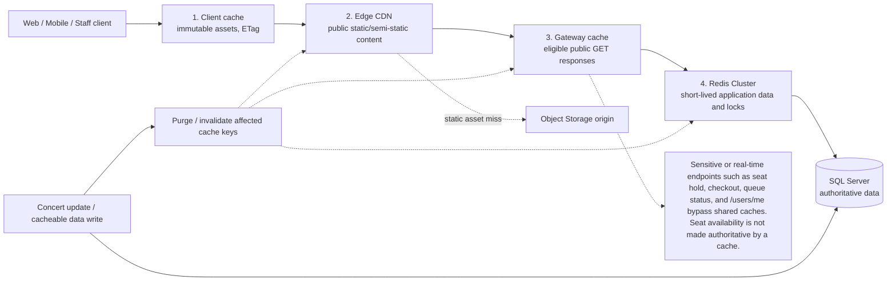
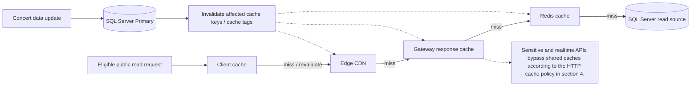

# 01 — Đa Nền Tảng, Chiến Lược Bộ Đệm (Caching) & CDN

> **Phạm vi:** check-in online-only; scanner fail-closed khi mất mạng theo D-023. Không dùng local cache để xác nhận vé.

## 1. Giới Thiệu & Mục Tiêu Kỹ Thuật

Hệ thống bán vé sự kiện âm nhạc phục vụ người dùng trên đa dạng nền tảng thiết bị: **Trình duyệt Web (Desktop & Mobile Browser)**, **Ứng dụng Di động (iOS & Android Native/Flutter)** và **Thiết bị Quét Cầm tay Soát Vé (Staff Handheld Scanners)**.

Mục tiêu kỹ thuật của tài liệu này:
1. Thiết lập kiến trúc **API-First & Headless**: Toàn bộ các nền tảng khách hàng giao tiếp thống nhất qua một chuẩn RESTful API & WebSocket chung.
2. Thiết kế chiến lược bộ đệm đa tầng (**Multi-Tier Caching Architecture**): Bộ đệm tại máy khách (Client Cache), Bộ đệm mạng phân phối (Edge CDN Cache), Bộ đệm dịch vụ trung gian (API Gateway Cache) và Bộ đệm dữ liệu nóng (Redis In-Memory Cache).
3. Đảm bảo tính nhất quán dữ liệu (Data Consistency), chống hiện tượng đọc phải dữ liệu rác/lỗi thời (Stale Data) nhưng vẫn triệt tiêu được $90\%+$ tải đọc trên cơ sở dữ liệu gốc.

---

## 2. Kiến Trúc Hỗ Trợ Đa Nền Tảng (Cross-Platform Architecture)

### 1. Chuẩn Giao Tiếp Dữ Liệu Thống Nhất
- **Giao thức:** HTTPS (TLS 1.3) bắt buộc cho tất cả API; WSS (Secure WebSocket) cho cập nhật trạng thái thời gian thực.
- **Định dạng tải trọng:** JSON (UTF-8 encoding). Tất cả phản hồi tuân thủ cấu trúc chuẩn (Envelope Pattern):
```json
{
  "success": true,
  "code": 200,
  "message": "Thao tác thành công",
  "data": {},
  "meta": {
    "server_time": 1729774800,
    "request_id": "req-9a8b7c-4d3e"
  }
}
```
- **Xác thực phiên:** JSON Web Token (JWT) mang trong tiêu đề `Authorization: Bearer <token>`. Trên Web sử dụng `HttpOnly`, `Secure`, `SameSite=Strict` Cookie để lưu Refresh Token, ngăn chặn triệt để lỗ hổng XSS đánh cắp phiên.

### 2. Xử Lý Khác Biệt Nền Tảng

| Yếu tố kỹ thuật | Web Desktop / Mobile Web | Mobile App (iOS / Android) | Thiết bị Staff Check-In |
|---|---|---|---|
| **Cơ chế tải ứng dụng ban đầu** | Tải SPA Bundle qua CDN; nén Brotli | Cài đặt nhị phân từ App Store / Google Play | Cài đặt gói APK doanh nghiệp (Enterprise MDM) |
| **Kênh thông báo đẩy** | Web Push API (Service Worker) | Apple Push Notification (APNs) & Firebase (FCM) | Âm thanh & Rung phần cứng tức thì |
| **Lưu trữ ngoại tuyến** | Cache tài nguyên không nhạy cảm; không làm nguồn sự thật giao dịch | Có thể xem tài liệu vé đã lưu; không xác thực check-in ngoại tuyến | Không lưu trạng thái vé để quét offline; fail-closed theo D-023 |
| **Bảo mật sinh trắc học** | WebAuthn / Passkeys (Tùy chọn) | FaceID / Fingerprint để xác thực giao dịch nhanh | Khóa thiết bị theo Device ID phần cứng |

---

## 3. Chiến Lược Bộ Đệm Đa Tầng (Multi-Tier Caching Strategy)

Hệ thống triển khai 4 tầng bộ đệm kế tiếp nhau:

<!-- BEGIN MERMAID DIAGRAM CONVERT-01_Cross_Platform_Caching_And_CDN -->
### Multi-tier cache path


<!-- END MERMAID DIAGRAM CONVERT-01_Cross_Platform_Caching_And_CDN -->


### Chi Tiết Cấu Hình Từng Tầng Bộ Đệm

| Tầng bộ đệm | Công nghệ sử dụng | Loại dữ liệu lưu trữ | Thời gian lưu (TTL) | Cơ chế xóa / Cập nhật (Invalidation) |
|---|---|---|---|---|
| **Tầng 1: Client Cache** | Trình duyệt / Ứng dụng di động | Bundle JS/CSS, Fonts, Ảnh poster, Cấu trúc sơ đồ ghế tĩnh | Tĩnh: 1 năm; API: 0 – 60s | Cache-Control headers, ETag validation, Version hash |
| **Tầng 2: Edge CDN** | Cloudflare / AWS CloudFront | Trang chủ, Chi tiết concert công khai, Bản đồ rạp SVG | 60s đến 30 ngày | Cloudflare API Purge by Cache-Tag khi sự kiện thay đổi |
| **Tầng 3: Gateway Cache** | Kong Proxy Cache Plugin | Kết quả tìm kiếm concert, Danh sách nghệ sĩ, Metadata | 10s đến 120s | LRU (Least Recently Used) tự động thu hồi khi tràn RAM |
| **Tầng 4: Redis Cluster** | Redis In-Memory Cluster | Vị trí hàng chờ, Khóa ghế (`SETNX`), Token phiên, Rate limits | 3s đến 24 giờ | Chủ động xóa bằng lệnh `DEL` ngay khi có sự kiện ghi |

<!-- BEGIN MERMAID DIAGRAM NFR-CACHE -->
### Luồng cache miss và vô hiệu hóa cache


<!-- END MERMAID DIAGRAM NFR-CACHE -->


---

## 4. Chính Sách Tiêu Đề Bộ Đệm HTTP (HTTP Caching Headers Policy)

Để kiểm soát hành vi bộ đệm của trình duyệt và CDN một cách chặt chẽ, API Gateway tự động gắn các tiêu đề HTTP chuẩn hóa theo từng nhóm endpoint:

### 1. Tài Nguyên Tĩnh Tuyệt Đối (Static Immutable Assets)
- **Áp dụng cho:** File build frontend (`app.8f9b2c.js`, `styles.4a1e9d.css`), icon, font chữ.
- **Tiêu đề:**
  ```http
  Cache-Control: public, max-age=31536000, immutable
  ETag: "w/33a64df551425fcc55e4d42a148795d9f25f89d4"
  ```
- **Ý nghĩa:** Trình duyệt lưu vĩnh viễn trong 1 năm không cần gửi request xác thực lại máy chủ. Khi có phiên bản mới, tên tệp tự động đổi hash.

### 2. Dữ Liệu Công Khai Biến Đổi Chậm (Public Semi-Static Content)
- **Áp dụng cho:** `GET /api/v1/concerts/{id}`, danh mục thể loại nhạc, thông tin nghệ sĩ.
- **Tiêu đề:**
  ```http
  Cache-Control: public, max-age=60, s-maxage=300, stale-while-revalidate=600
  ETag: W/"concert-info-v12"
  ```
- **Ý nghĩa:**
  - `max-age=60`: Trình duyệt khách cache tối đa 60 giây.
  - `s-maxage=300`: Máy chủ CDN Edge cache trong 5 phút ($300\text{s}$).
  - `stale-while-revalidate=600`: Trong 10 phút tiếp theo, CDN được phép trả ngay dữ liệu cũ cho khách hàng đồng thời gửi truy vấn ngầm về máy chủ gốc để cập nhật bản mới mà không bắt người dùng chờ.

### 3. Dữ Liệu Thời Gian Thực & Nhạy Cảm (Real-Time & Sensitive Data)
- **Áp dụng cho:** `POST /api/v1/seats/hold`, `POST /api/v1/orders/checkout`, `GET /api/v1/queue/status`, `GET /api/v1/users/me`.
- **Tiêu đề:**
  ```http
  Cache-Control: no-store, no-cache, must-revalidate, private
  Pragma: no-cache
  Expires: 0
  ```
- **Ý nghĩa:** Nghiêm cấm mọi tầng trung gian và trình duyệt lưu bản sao. Mọi yêu cầu bắt buộc phải chuyển tiếp trực tiếp về cụm xử lý Backend.

---

## 5. Chiến Lược Đồng Bộ & Vô Hiệu Hóa Bộ Đệm (Cache Invalidation Patterns)

Sự cố phổ biến nhất trong hệ thống Caching là **Dữ liệu mâu thuẫn (Cache Inconsistency)** — ví dụ: Ban tổ chức đã đổi giá vé hoặc giờ diễn trên Admin Portal nhưng khách hàng vẫn nhìn thấy giá cũ do CDN chưa hết hạn.

Hệ thống áp dụng các mô hình xử lý sau:

### 1. Mô Hình Cache-Aside (Lazy Loading) Kết Hợp Write-Through
- Khi có yêu cầu đọc: Ứng dụng kiểm tra Redis trước. Nếu có (Cache Hit) $\rightarrow$ trả về ngay. Nếu không (Cache Miss) $\rightarrow$ đọc từ SQL Server readable secondary; dùng Primary trong cửa sổ read-your-write, ghi vào Redis với TTL xác định rồi trả về.
- Khi có thao tác sửa đổi (Organizer cập nhật concert): Service cập nhật Database thành công $\rightarrow$ Phát sự kiện qua RabbitMQ theo D-025 `concert.updated` $\rightarrow$ Worker xóa ngay lập tức key tương ứng trong Redis (`DEL cache:concert:{id}`).

### 2. Vô Hiệu Hóa Mạng Biên Theo Thẻ (Surrogate-Key / Cache-Tag Purging)
- Khi CDN cache thông tin một concert, máy chủ trả kèm tiêu đề:
  ```http
  Cache-Tag: concert-102, organizer-5, category-rock
  ```
- Khi Admin hoặc Organizer phê duyệt thay đổi thông tin concert #102:
  - Hệ thống gọi API Cloudflare / CloudFront: `POST /purge_by_tag` với payload `["concert-102"]`.
  - Toàn bộ các máy chủ biên CDN trên toàn thế giới xóa sạch bản lưu của concert này trong vòng $< 150\text{ ms}$.

### 3. Phòng Ngừa Hiện Tượng Sập Bộ Đệm Hàng Loạt (Cache Stampede / Thundering Herd)
- Khi một concert cực nóng hết hạn cache trong Redis đúng lúc có 10.000 người cùng truy cập:
  - Không để 10.000 request cùng đổ dồn xuống Database SQL Server.
  - **Áp dụng Mutex Lock trong Cache:** Chỉ request đầu tiên phát hiện Cache Miss được phép lấy khóa tạm (Mutex Lock trong Redis 2 giây) để truy vấn Database và cập nhật lại cache. 9.999 request còn lại tạm dừng chờ 50ms hoặc sử dụng giá trị cũ tạm thời (Stale Data Serving).

