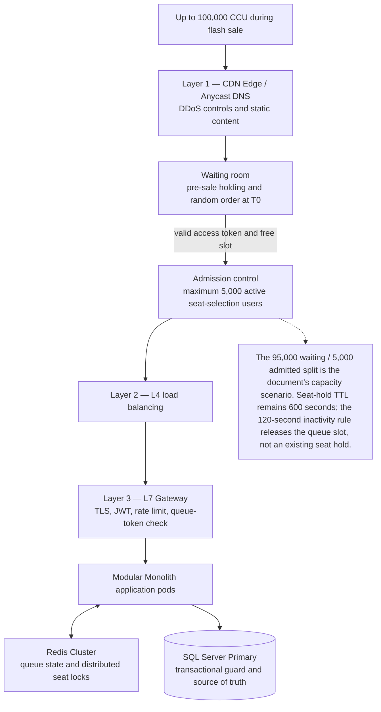
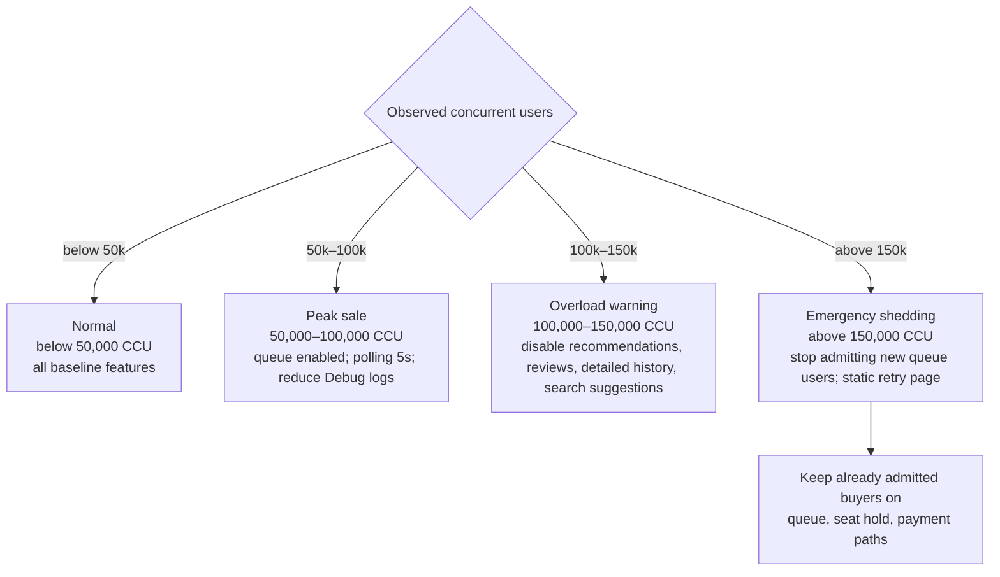

# 02 — Xử Lý 100.000 Người Dùng Đồng Thời (Handling 100K CCU)

## 1. Giới Thiệu & Thách Thức Kỹ Thuật

Xử lý tải $100.000$ người dùng đồng thời (**100K Concurrent Users - CCU**) trong các sự kiện mở bán vé concert quy mô lớn (Mega Flash-Sale) là bài toán kỹ thuật phức tạp nhất của nền tảng. Khi $100.000$ người cùng truy cập trong một khung giờ hẹp ($T - 15$ phút đến $T + 30$ phút), hệ thống đối mặt với 4 nguy cơ hiện hữu:
1. **Nghẽn cổng mạng & Socket cạn kiệt (File Descriptors Exhaustion):** Hệ điều hành máy chủ hết cổng kết nối hoặc rơi vào trạng thái `TIME_WAIT`.
2. **Sập cơ sở dữ liệu quan hệ (RDBMS Connection Throttling):** Hàng chục nghìn kết nối đồng thời vượt ngân sách kết nối và làm cạn connection pool hoặc tài nguyên SQL Server, làm treo cụm cơ sở dữ liệu.
3. **Hiệu ứng bầy đàn (Thundering Herd Problem):** Hàng trăm nghìn yêu cầu cùng ập vào một tài nguyên (ví dụ trang sơ đồ ghế VIP), gây sập tầng bộ nhớ đệm và lan sang toàn bộ hệ thống (Cascading Failure).
4. **Bất công bằng cho người hâm mộ chân chính (Bot & Script Exploitation):** Các công cụ đầu cơ vé (Scalper Bots) có đường truyền siêu nhanh chiếm hết lượt trước người dùng bình thường nếu dùng cơ chế xếp hàng đến trước phục vụ trước (FIFO thô sơ).

Tài liệu này đặc tả toàn bộ giải pháp kiến trúc và quy trình kỹ thuật để kiểm soát và điều tiết thành công lưu lượng $100.000\text{ CCU}$ với SLO availability 99.95%/tháng cho critical first-party purchase APIs theo D-027.

---

## 2. Kiến Trúc Điều Tiết Tải Nhiều Tầng (Multi-Layer Traffic Regulation)

Hệ thống bảo vệ tài nguyên lõi thông qua 4 lớp lá chắn tuần tự:

<!-- BEGIN MERMAID DIAGRAM CONVERT-02_Handling_100K_Concurrent_Users -->
### Traffic regulation layers


<!-- END MERMAID DIAGRAM CONVERT-02_Handling_100K_Concurrent_Users -->


---

## 3. Cơ Chế Phòng Chờ Ảo & Xếp Hàng Ngẫu Nhiên (Virtual Queue & Random Shuffle)

Để đảm bảo tính công bằng và triệt tiêu lợi thế đường truyền của bot đầu cơ, hệ thống triển khai cơ chế **Phòng chờ ảo 2 giai đoạn**:

### Giai Đoạn 1: Gom Người Chờ Trước Giờ Mở Bán ($T - 15$ Phút Đến $T$)
- Mọi người dùng truy cập trang concert trong khoảng thời gian từ $T - 15$ phút đến $T$ đều được đưa vào **Phòng Chờ Tập Tập Trung (Holding Room)**.
- Trong giai đoạn này, **chưa có số thứ tự nào được cấp phát**. Tất cả người đến lúc $T - 14$ phút hay $T - 1$ phút đều có cơ hội ngang nhau.
- Giao diện người dùng hiển thị đồng hồ đếm ngược đến giờ mở bán chính thức.

### Giai Đoạn 2: Trộn Ngẫu Nhiên Số Thứ Tự Đúng Giờ G (Random Shuffling at $T$)
- Đúng thời khắc $T$ (Ví dụ 10:00:00 AM): Hệ thống đóng tiếp nhận vào nhóm ưu tiên ban đầu.
- Một thuật toán xáo trộn ngẫu nhiên phân tán (**Distributed Fisher-Yates Shuffle**) chạy trong Redis gán số thứ tự ngẫu nhiên từ $1$ đến $N$ cho toàn bộ những người đã có mặt trong phòng chờ.
- Những người đến sau thời điểm $T$ sẽ tự động được xếp vào cuối hàng theo thứ tự thời gian (FIFO).

### Giai Đoạn 3: Cấp Quyền Vào Khu Vực Mua Vé Theo Van Điều Tiết (Regulated Admission)
- Hệ thống áp dụng thuật toán **Van xả điều tiết (Leaky Bucket)**:
  - Khung vực chọn ghế chỉ duy trì tối đa **$5.000\text{ CCU}$**.
  - Cứ mỗi 30 giây, hệ thống tính toán số lượng người vừa rời đi (đã đặt vé xong hoặc không gửi heartbeat xác thực trong 120 giây) để cấp quyền slot admission cho người tiếp theo. Queue token revocation không release các seat hold đang còn TTL 600 giây.
- Khi được phép vào, người dùng nhận được một thẻ thông hành điện tử **Queue Access Token**:
  - Queue Access Token được ký HMAC-SHA256, TTL 120 giây từ hoạt động hợp lệ cuối và được gia hạn bằng heartbeat xác thực mỗi 30 giây khi trang chọn ghế foreground; WebSocket đơn thuần không gia hạn (D-015).
  - API Gateway kiểm tra tính hợp lệ của token này trên mọi request vào vùng chọn ghế và giữ ghế (`/seats/hold`). Bất kỳ ai cố vượt hàng (Bypass Queue) mà không có token hợp lệ đều bị từ chối ngay tại Gateway với mã `403 Forbidden`.

---

## 4. Tầng Cân Bằng Tải & Tối Ưu Hóa Socket Mạng (Load Balancer & Network Tuning)

### 1. Phân Tách Cân Bằng Tải 2 Tầng (L4 & L7 Load Balancing)
- **Cân bằng tải Lớp 4 (Layer 4 - AWS NLB / IPVS):** Hoạt động ở tầng TCP, có khả năng xử lý hàng triệu gói tin mỗi giây với độ trễ micro-giây. Chịu trách nhiệm phân phối lưu lượng vào các node Gateway mà không giải mã SSL.
- **Cân bằng tải Lớp 7 (Layer 7 - Kong / Envoy Gateway):** Thực hiện giải mã TLS 1.3, định tuyến đường dẫn URI, xác thực JWT, kiểm tra Rate Limit và chèn tiêu đề kiểm toán (Tracing Header).

### 2. Tinh Chỉnh Tham Số Hệ Điều Hành Linux (OS Kernel Parameter Tuning)
Các node máy chủ chạy Gateway và Microservices được cấu hình tham số nhân Linux để chịu tải $100.000$ kết nối TCP mở đồng thời:

```ini
# Tăng giới hạn số lượng file descriptors mở đồng thời
fs.file-max = 2097152
* soft nofile 1048576
* hard nofile 1048576

# Tối ưu hóa hàng đợi kết nối TCP (Backlog)
net.core.somaxconn = 65535
net.ipv4.tcp_max_syn_backlog = 65535

# Tái sử dụng nhanh các socket ở trạng thái TIME_WAIT
net.ipv4.tcp_tw_reuse = 1
net.ipv4.tcp_fin_timeout = 15

# Mở rộng dải cổng kết nối nội bộ
net.ipv4.ip_local_port_range = 1024 65535

# Bộ nhớ đệm TCP Socket (Receive & Send Buffers)
net.core.rmem_max = 16777216
net.core.wmem_max = 16777216
```

---

## 5. Áp Lực Ngược & Giảm Tải Duyên Dáng (Backpressure & Graceful Degradation)

Khi lưu lượng truy cập vượt quá kịch bản dự kiến (ví dụ đột biến lên $150.000\text{ CCU}$ thay vì $100.000\text{ CCU}$), hệ thống tự động kích hoạt chế độ **Bảo Vệ Suy Giảm Duyên Dáng (Graceful Degradation)**:

| Cấp độ tải | Trạng thái hệ thống | Biện pháp kỹ thuật kích hoạt | Trải nghiệm người dùng |
|---|---|---|---|
| **Cấp độ 1: Bình thường** ($< 50.000\text{ CCU}$) | Xanh lá (Normal) | Vận hành toàn bộ tính năng đầy đủ | Trải nghiệm đầy đủ 100% |
| **Cấp độ 2: Cao điểm** ($50.000 – 100.000\text{ CCU}$) | Vàng (Peak Sale) | Kích hoạt phòng chờ ảo; Giãn tần suất polling queue từ 3s lên 5s; Vô hiệu hóa ghi log chi tiết mức Debug | Người dùng xếp hàng theo thứ tự; Giao diện mượt mà |
| **Cấp độ 3: Quá tải cảnh báo** ($100.000 – 150.000\text{ CCU}$) | Cam (Overload) | Tắt toàn bộ các tính năng phụ: Gợi ý concert liên quan, bình luận đánh giá, lịch sử chi tiết; Tắt đồng bộ gợi ý tìm kiếm | Chỉ giữ lại 3 luồng sống còn: Xếp hàng, Giữ ghế, Thanh toán |
| **Cấp độ 4: Tải cực đại (Emergency)** ($> 150.000\text{ CCU}$) | Đỏ (Shedding) | Cơ chế **Load Shedding** tại Gateway: Từ chối tiếp nhận thêm người mới vào phòng chờ; Trả về trang tĩnh thông báo: *"Hệ thống đang phục vụ tối đa lượt khách, vui lòng thử lại sau 15 phút"* | Bảo vệ $100\%$ những người dùng đã vào trong phòng mua không bị văng ra ngoài |

<!-- BEGIN MERMAID DIAGRAM NFR-DEGRADE -->
### Chế độ phục vụ theo mức tải


<!-- END MERMAID DIAGRAM NFR-DEGRADE -->


---

## 6. Bảo Vệ Tầng Cơ Sở Dữ Liệu Cốt Lõi (Database Protection Strategies)

Để đảm bảo SQL Server Primary không bao giờ bị nghẽn trong lúc mở bán:
1. **Phân Tách Đọc / Ghi Tuyệt Đối (Read/Write Splitting):**
   - Truy vấn đọc chỉ dùng readable secondary khi consistency policy cho phép; mọi read-your-write trong 5 giây sau thao tác ghi đi Primary (D-013). Read/write routing dùng topology D-026; read-your-write luôn về Primary.
   - SQL Server Primary phục vụ toàn bộ thao tác ghi giao dịch: cập nhật trạng thái ghế/hold, tạo và cập nhật order/order_items, payment/refund, phát hành ticket, hủy và audit. Mọi sizing TPS phải tính đủ các ghi phát sinh trên cùng luồng; benchmark 100.000 CCU và sign-off sizing/licensing là release gate D-030.
2. **Gom Nhóm Kết Nối Bằng HikariCP (Connection Pooling):**
   - Không cho phép hàng chục Pods kết nối trực tiếp vào SQL Server.
   - Mỗi JVM dùng HikariCP với pool ghi/đọc riêng; giới hạn được đặt theo ngân sách kết nối SQL Server tổng hợp trên toàn bộ app/worker instances. HikariCP không phải proxy pooler dùng chung và không được xem là transaction pooling. Kích thước pool phải được xác nhận bằng benchmark production-like trước go-live (D-030).

