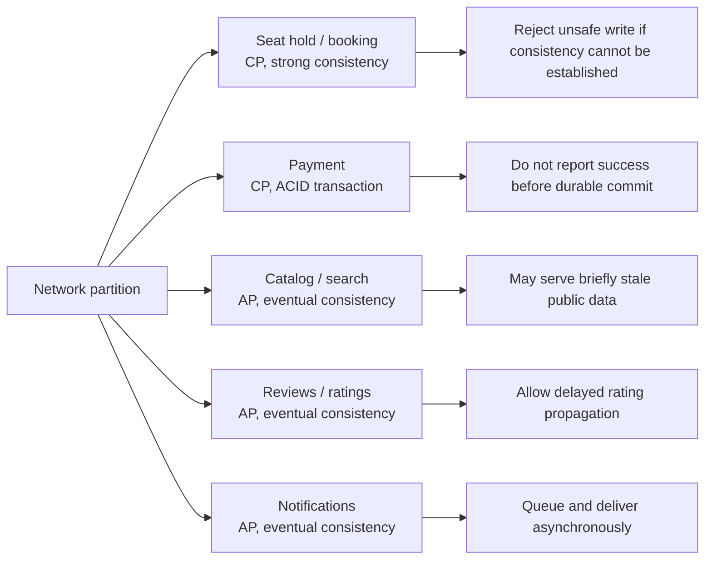
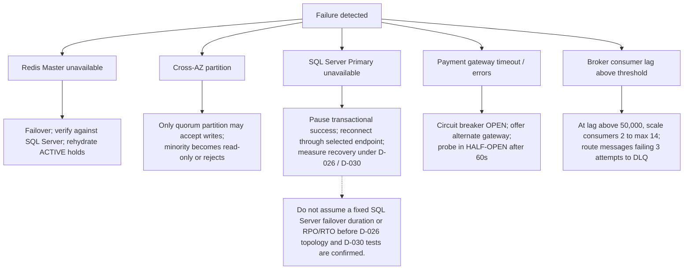

# 04 — Đồng Thời & Kịch Bản Sự Cố Theo Định Lý CAP (Concurrency & CAP Theorem)

## 1. Giới Thiệu & Ứng Dụng Định Lý CAP Trong Hệ Thống Bán Vé

Định lý CAP (Brewer's CAP Theorem) khẳng định rằng một hệ thống phân tán khi gặp sự cố phân mảnh mạng (**Network Partition - P**) chỉ có thể lựa chọn tối đa một trong hai thuộc tính:
- **Tính Nhất Quán Tuyệt Đối (Consistency - C):** Mọi thao tác đọc đều nhận được dữ liệu được ghi mới nhất hoặc trả về lỗi.
- **Tính Sẵn Sàng (Availability - A):** Mọi yêu cầu không bị lỗi đều nhận được phản hồi (không đảm bảo dữ liệu là mới nhất).

Đối với hệ thống bán vé sự kiện âm nhạc quy mô lớn, **không thể áp dụng một mô hình CAP đồng nhất cho toàn bộ hệ thống**, mà phải phân định kiến trúc theo từng miền nghiệp vụ cụ thể:

| Miền nghiệp vụ (Domain) | Lựa chọn CAP | Mô hình nhất quán (Consistency Model) | Lý do kiến trúc & Rủi ro chấp nhận |
|---|---|---|---|
| **Giữ Ghế & Đặt Vé (Seat Hold & Booking)** | **CP** (Consistency + Partition Tolerance) | **Nhất quán Tuyệt đối (Strong Consistency)** | Thà từ chối một yêu cầu chọn ghế của người dùng khi đứt mạng còn hơn để 2 người cùng mua thành công một ghế (Zero Double-Booking). |
| **Xử Lý Thanh Toán (Payment Processing)** | **CP** (Consistency + Partition Tolerance) | **Nhất quán Giao dịch (ACID Transactions)** | Tiền bạc và dòng tiền bắt buộc phải chính xác 100%, không chấp nhận chênh lệch số dư. |
| **Tìm Kiếm & Xem Concert (Catalog & Search)** | **AP** (Availability + Partition Tolerance) | **Nhất quán Cuối cùng (Eventual Consistency)** | Chấp nhận người dùng xem thông tin mô tả concert hoặc số lượng vé còn lại chậm hơn thực tế vài giây, đổi lại trang web luôn mở được 100%. |
| **Đánh Giá & Nhận Xét (Reviews & Ratings)** | **AP** (Availability + Partition Tolerance) | **Nhất quán Cuối cùng (Eventual Consistency)** | Bình luận và điểm sao của khán giả có thể cập nhật sau 1–2 phút qua Message Broker. |
| **Hệ Thống Thông Báo (Notifications)** | **AP** (Availability + Partition Tolerance) | **Nhất quán Cuối cùng (Eventual Consistency)** | Thông báo đẩy và email được xếp hàng trong message broker, có thể trễ vài giây trong giờ cao điểm. |

<!-- BEGIN MERMAID DIAGRAM NFR-CAP-DOMAINS -->
### Consistency policy by business domain

<!-- END MERMAID DIAGRAM NFR-CAP-DOMAINS -->

---

## 2. Các Kịch Bản Sự Cố Phân Tán Trọng Yếu & Cơ Chế Xử Lý (Failure Scenarios)

### Kịch Bản 1: Node Redis Master Bị Sập Trong Giờ Mở Bán Vé
- **Hiện tượng:** Máy chủ Redis Master giữ khóa ghế của Zone VIP bị mất nguồn hoặc quá tải bộ nhớ đột ngột.
- **Nguy cơ:** Mất khóa ghế đang giữ, dẫn đến việc người khác có thể chọn đè vào ghế vừa được giữ.
- **Giải pháp xử lý:**
  1. **Tự động chuyển vùng (Redis Cluster Failover):** Các node Redis Replica phát hiện Master không phản hồi Heartbeat sau 3 giây, tiến hành bầu chọn (Election) và nâng một Replica lên làm Master mới.
  2. **Bảo vệ bằng Database Source of Truth:** Mọi yêu cầu xác nhận đơn hàng bắt buộc phải kiểm tra lại trạng thái trong cơ sở dữ liệu SQL Server (`SELECT status FROM dbo.seats WITH (UPDLOCK, ROWLOCK) WHERE id = ? trong transaction`). Nếu Redis bị mất dữ liệu khóa, SQL Server đóng vai trò chốt chặn cuối cùng ngăn chặn bán trùng.
  3. **Tái lập bộ đệm (Cache Re-hydration Worker):** Ngay sau khi Master mới online, một tiến trình nền quét các bản ghi `seat_holds` đang `ACTIVE` trong SQL Server và đồng bộ ngược lại vào Redis.

---

### Kịch Bản 2: Phân Mảnh Mạng Đa Vùng Khả Dụng (Cross-AZ Network Partition)
- **Hiện tượng:** Tuyến cáp quang kết nối giữa Vùng Khả Dụng 1 (AZ1) và Vùng Khả Dụng 2 (AZ2) bị đứt, chia cắt cụm máy chủ thành hai nửa cô lập.
- **Nguy cơ: Não phân liệt (Split-Brain Problem)** — Cả hai nửa cụm đều tưởng nửa kia đã chết và cùng tự bầu mình làm chủ, cho phép bán cùng một tập vé độc lập ở cả 2 vùng.
- **Giải pháp xử lý:**
  1. **Quy tắc Đa số Tối thiểu (Quorum Rule: $N/2 + 1$):**
     - Cụm cơ sở dữ liệu và cụm Redis được triển khai tối thiểu trên **3 Vùng Khả Dụng độc lập (AZ1, AZ2, AZ3)**.
     - Một phân vùng chỉ được phép tiếp nhận thao tác ghi nếu nó kết nối được với đa số các node (ví dụ: $2/3$ node trở lên).
  2. Phân vùng thiểu số (chỉ có $1/3$ node) tự động chuyển sang chế độ **Chỉ Đọc (Read-Only)** hoặc từ chối phục vụ, triệt tiêu hoàn toàn khả năng phát sinh Split-Brain.

---

### Kịch Bản 3: Sự Cố Cơ Sở Dữ Liệu SQL Server Primary Sập
- **Hiện tượng:** SQL Server Primary bị lỗi phần cứng hoặc mất kết nối.
- **Nguy cơ:** Tạm dừng thao tác ghi đơn hàng và phát hành vé cho tới khi dịch vụ khôi phục.
- **Giải pháp xử lý:**
  1. Cơ chế HA/failover, quorum, đồng bộ dữ liệu và endpoint kết nối theo SQL Server 2025 Enterprise Always On AG baseline D-026; DBA/Finance xác nhận license và sizing trước go-live.
  2. Ứng dụng reconnect qua endpoint/listener đã chọn; HikariCP cấp lại connection nhưng không tự quyết định failover hoặc read/write routing.
  3. Thời gian chuyển đổi và khả năng bảo toàn commit phải được xác nhận bằng fault-injection test; không coi timeout hay RPO/RTO cố định là cam kết trước benchmark D-030.
- **Trải nghiệm người dùng:** Trong thời gian chuyển đổi, API trả trạng thái có thể retry; không báo đơn thành công trước khi SQL Server xác nhận commit.

---
### Kịch Bản 4: Cổng Thanh Toán Đối Tác (VNPay / MoMo) Bị Gián Đoạn Hoặc Nghẽn Mạng
- **Hiện tượng:** Cổng thanh toán bên ngoài phản hồi rất chậm ($> 10\text{ giây}$) hoặc trả về lỗi `502 Bad Gateway` liên tục.
- **Nguy cơ:** Hàng nghìn kết nối bị treo chờ phản hồi, làm cạn kiệt tài nguyên Thread Pool của hệ thống.
- **Giải pháp xử lý: Áp Dụng Circuit Breaker Pattern (Bộ Ngắt Mạch)**
  - **Trạng thái Đóng (Closed - Bình thường):** Các giao dịch gọi tới Cổng thanh toán diễn ra bình thường.
  - **Trạng thái Mở (Open - Ngắt mạch):** Khi tỷ lệ lỗi hoặc timeout vượt quá **$50\%$** trong 20 request liên tiếp, Circuit Breaker tự động chuyển sang trạng thái `OPEN`. Mọi yêu cầu thanh toán qua cổng này lập tức bị chặn tại Service nội bộ trong vòng 60 giây (không gửi request ra ngoài đối tác).
  - **Hành động chuyển đổi (Graceful Fallback):** Hệ thống hiển thị thông báo trên giao diện: *"Cổng VNPay đang bảo trì, vui lòng chọn phương thức MoMo hoặc Thẻ Quốc Tế"* để khách hàng tiếp tục mua vé mà không bị nghẽn.
  - **Trạng thái Thử nghiệm (Half-Open):** Sau 60 giây, hệ thống cho phép $5\%$ lượng request đi qua để thăm dò. Nếu thành công $\rightarrow$ Đóng mạch trở lại bình thường.

---

### Kịch Bản 5: Hàng Đợi message broker Bị Nghẽn Tiêu Thụ (Consumer Lag Accumulation)
- **Hiện tượng:** Số lượng thông báo hoặc tác vụ gửi vé tăng đột biến vượt quá tốc độ tiêu thụ của các worker tiêu thụ (Consumer Lag $> 50.000$ messages).
- **Nguy cơ:** Trễ thông báo vé điện tử, khách hàng hoang mang vì đã trừ tiền mà chưa nhận được email xác nhận.
- **Giải pháp xử lý:**
  1. **Tự động mở rộng Consumer (KEDA):** theo dõi RabbitMQ queue depth, unacked messages và tuổi message lâu nhất; scale trong giới hạn được benchmark production-like D-030 xác nhận.
  2. **Dead Letter Queue (DLQ):** Message lỗi xử lý quá số lần retry giới hạn được chuyển vào RabbitMQ dead-letter queue để điều tra, không chặn các message hợp lệ phía sau.

<!-- BEGIN MERMAID DIAGRAM NFR-FAILURES -->
### Các nhánh xử lý sự cố phân tán

<!-- END MERMAID DIAGRAM NFR-FAILURES -->
