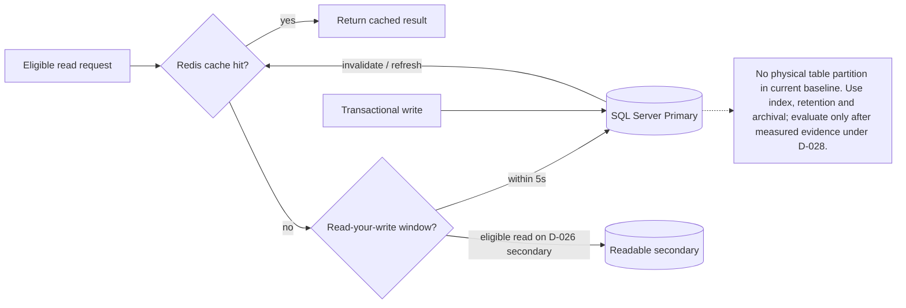
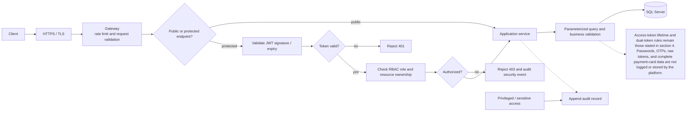

# 05 — Tối Ưu Hóa Cơ Sở Dữ Liệu & An Toàn Bảo Mật Hệ Thống (DB Optimization & Security)

## 1. Giới Thiệu & Mục Tiêu

Một hệ thống bán vé concert quy mô lớn phải đáp ứng đồng thời hai yêu cầu tưởng chừng như đối nghịch:
1. **Tối ưu hóa hiệu năng cơ sở dữ liệu cực đại:** Đảm bảo thời gian phản hồi câu truy vấn < 10ms cho các bảng chứa hàng chục triệu bản ghi trong điều kiện tải ghi dồn dập.
2. **An toàn bảo mật cấp độ doanh nghiệp (Enterprise Security):** Bảo vệ tuyệt đối thông tin thanh toán, chống tấn công đánh cắp vé, ngăn chặn tài khoản ảo (Bot Farming) và tuân thủ các tiêu chuẩn bảo mật dữ liệu.

Tài liệu này đặc tả chi tiết kiến trúc tối ưu hóa cơ sở dữ liệu SQL Server và toàn bộ các lớp phòng thủ an ninh thông tin của hệ thống.

---

## 2. QUYẾT ĐỊNH KIẾN TRÚC: CÓ NÊN DÙNG DATABASE SHARDING KHÔNG?

> **Kết luận chính thức: KHÔNG sử dụng Horizontal Sharding trong giai đoạn hiện tại.**

### 2.1. Sharding Là Gì & Khi Nào Cần Dùng?

**Database Sharding (Horizontal Sharding)** là kỹ thuật chia nhỏ một bảng dữ liệu khổng lồ thành nhiều phân mảnh (Shard), mỗi Shard lưu trên một máy chủ SQL Server riêng biệt, theo một khóa phân mảnh (Shard Key — ví dụ `user_id % 4`, `concert_id % 8`).

**Sharding chỉ thực sự cần thiết khi:**
- Bảng dữ liệu đã vượt quá **1 tỷ bản ghi** và Index B-tree không còn fit vào RAM.
- Tốc độ ghi vượt quá giới hạn vật lý của **một máy chủ SSD NVMe** (thường > 500.000 writes/giây).
- Dung lượng lưu trữ vượt quá **10 TB** trên một máy chủ đơn.

### 2.2. Phân Tích Quy Mô Thực Tế Của Hệ Thống

| Bảng | Ước tính bản ghi (5 năm vận hành) | Kích thước ước tính | Cần Sharding? |
|---|---|---|---|
| `users` | ~2 triệu người dùng | ~2 GB | ❌ Không |
| `concerts` | ~5.000 sự kiện | ~50 MB | ❌ Không |
| `seats` | ~10 triệu ghế (500 concert × 20K ghế) | ~3 GB | ❌ Không |
| `orders` | ~20 triệu đơn hàng | ~15 GB | ❌ Không |
| `tickets` | ~15 triệu vé điện tử | ~10 GB | ❌ Không |
| `payment_transactions` | ~25 triệu giao dịch | ~20 GB | ❌ Không |
| `checkin_logs` | ~15 triệu lượt soát vé | ~8 GB | ❌ Không |
| `notifications` | ~100 triệu bản ghi | ~60 GB | ❌ Không partition baseline; dùng index, retention và archival theo D-028 |
| `audit_logs` | ~200 triệu bản ghi | ~120 GB | ❌ Không partition baseline; dùng index, retention và archival theo D-028 |

**Tổng ước tính storage sau 5 năm: ~240 GB** — Hoàn toàn nằm trong giới hạn một SQL Server Primary Server với SSD NVMe 2 TB. SQL Server với buffer pool 64 GB có thể phục vụ lượng này hiệu quả.

### 2.3. Tại Sao KHÔNG Dùng Sharding? (5 Lý Do Kỹ Thuật)

#### ❌ Lý do 1: Phá vỡ tính toàn vẹn ACID — Mất đi lợi thế lớn nhất của Modular Monolith

Hệ thống vừa chuyển từ Microservices sang **Modular Monolith** để có được `@Transactional` ACID. Nếu bật Sharding:
- Bảng `orders` ở Shard-1 và `payment_transactions` ở Shard-2 → không thể `@Transactional` trong một giao dịch.
- Phải quay lại dùng **Distributed Transaction (XA/2PC)** hoặc Saga Pattern → đúng là vòng tròn trở lại độ phức tạp của Microservices.

```
Modular Monolith + Sharding = Worst of both worlds
  (phức tạp như Microservices, nhưng không có lợi ích scale độc lập)
```

#### ❌ Lý do 2: Truy vấn JOIN liên bảng trở nên bất khả thi

Các truy vấn nghiệp vụ quan trọng cần JOIN nhiều bảng:
```sql
-- Báo cáo số vé bán theo concert/zone; chỉ lấy vé còn hiệu lực
SELECT c.title, tz.name, COUNT(DISTINCT oi.id) AS tickets_sold, SUM(oi.price) AS gross_ticket_amount
FROM orders o
JOIN order_items oi ON oi.order_id = o.id
JOIN tickets t ON t.order_item_id = oi.id
JOIN seats s ON s.id = oi.seat_id
JOIN ticket_zones tz ON tz.id = s.zone_id
JOIN concerts c ON c.id = o.concert_id
WHERE o.status = 'PAID' AND t.status = 'ORDERED'
GROUP BY c.id, c.title, tz.id, tz.name;
```
Nếu các bảng nằm trên các Shard khác nhau → **Cross-Shard JOIN không thể thực thi** → phải pull toàn bộ data về application layer để JOIN → cực kỳ chậm và tốn RAM.

#### ❌ Lý do 3: Phức tạp hóa vận hành gấp bội

| Tác vụ vận hành | Không Sharding | Có Sharding (4 shards) |
|---|---|---|
| Backup database | `BACKUP DATABASE [ticketdb] ...` | Backup 4 DB riêng + merge script |
| Restore khi sự cố | Restore 1 file | Restore 4 files, re-balance |
| Schema migration (ALTER TABLE) | 1 lệnh | 4 lệnh tuần tự, lock phức tạp |
| Monitor slow queries | 1 slow log | 4 slow logs phải tổng hợp |
| Rebalance khi data lệch | Không cần | Phải viết data migration tool |

#### ❌ Lý do 4: Shard Key lựa chọn sai gây Hot Shard

Bài toán bán vé có đặc điểm: **tất cả traffic đổ vào concert_id hot nhất** (ví dụ concert BTS). Nếu Shard theo `concert_id`:
- Shard chứa BTS concert → nhận 90% traffic → **Hot Shard** → sập.
- Các Shard khác → nhàn rỗi → lãng phí.

Không có Shard Key nào phân phối đều cho bài toán flash-sale event.

#### ❌ Lý do 5: 100K CCU là tải có thể xử lý bằng vertical scaling + caching

Với thiết kế đúng:
- **Redis** xử lý 99% read traffic (concert info, seat status, queue).
- **SQL Server Primary** chỉ nhận write traffic thuần túy (hold, order, payment).
- Ước tính write QPS thực tế vào SQL Server: ~500–2.000 writes/giây (đặt ghế + đơn hàng).
- Thông lượng ghi phụ thuộc schema, chỉ mục, giao dịch và phần cứng; mọi capacity cần benchmark theo D-030, không dùng con số ước tính làm cam kết.

### 2.4. Chiến Lược Thay Thế Sharding — Được Áp Dụng

Thay vì Sharding ngang (Horizontal Sharding), hệ thống áp dụng **3 chiến lược tối ưu phù hợp hơn**:

| Chiến lược | Áp dụng cho | Lợi ích |
|---|---|---|
| **1. Partitioning** | Không có physical partition trong baseline | Index, retention và archival; chỉ xét RANGE append-only nếu benchmark chứng minh cần (D-028) |
| **2. Read Replica (Read/Write Splitting)** | SELECT đủ điều kiện consistency | Route đọc đủ điều kiện sang readable synchronous secondary trong Always On AG theo D-026; read-your-write về Primary 5 giây (D-013) |
| **3. Redis Cache Layer** | Concert info, seat map, user session | 99% read traffic không chạm SQL Server |

---

## 3. Chiến Lược Tối Ưu Hóa Cơ Sở Dữ Liệu (SQL Server Optimization)

### 3.1. Thiết Kế Chỉ Mục Thông Minh (Targeted & Partial Indexing)

Tránh tạo chỉ mục tràn lan gây chậm thao tác ghi (`INSERT`/`UPDATE`), hệ thống tập trung vào các chỉ mục có tính chọn lọc cao:

```sql
-- 1. Composite Index tìm ghế trống theo concert (sử dụng composite index)
CREATE INDEX idx_seats_concert_status ON seats (concert_id, status, zone_id);

-- 2. Composite Index tối ưu hóa truy vấn lịch sử đơn hàng của người dùng
CREATE INDEX idx_orders_user_created ON orders (user_id, created_at DESC, status);

-- 3. Unique Index chống tạo đơn trùng lặp cho cùng một lượt giữ ghế
CREATE UNIQUE INDEX uq_order_hold_token ON orders (hold_token);\nCREATE UNIQUE INDEX uq_orders_idempotency_key ON orders (idempotency_key);

-- 4. B-tree Index phục vụ quét vé siêu tốc tại cổng (covering index)
CREATE INDEX idx_tickets_qr ON tickets (qr_code_hash, status, concert_id);

-- 5. Index cho payment IPN webhook lookup
CREATE UNIQUE INDEX uq_payment_provider_ref ON payment_transactions (provider, provider_transaction_id) WHERE provider_transaction_id IS NOT NULL;
```

### 3.2. Chính sách lưu trữ lịch sử

Không sử dụng physical table partitioning trong baseline theo D-028. Tối ưu bằng index, retention policy, archival và batch deletion phù hợp. Chỉ đánh giá partition RANGE theo created_at cho bảng lịch sử append-only nếu benchmark thực tế chứng minh cần; mọi đề xuất phải kiểm tra unique index/FK, retention, restore và cost trước khi được duyệt. Không dùng HASH(user) hoặc partition bảng giao dịch trong release hiện tại.
### 3.3. Phân Tách Đọc / Ghi (Read/Write Splitting)

```
Writes (INSERT/UPDATE/DELETE) → SQL Server Primary
Reads đủ điều kiện             → readable secondary qua Always On AG/listener theo D-026
Sau thao tác ghi (tối đa 5s)   → SQL Server Primary (D-013)
```

Readable synchronous secondary và routing dùng SQL Server 2025 Enterprise Always On AG theo D-026. Cần hai Hikari pools riêng cùng routing layer ở ứng dụng; @Transactional(readOnly = true) không tự động chọn secondary. Mọi read-your-write trong 5 giây sau thao tác ghi phải đi Primary; cache TTL 5 giây không thay thế bảo đảm đó.

```java
// Pseudocode: routing layer picks write pool, eligible read pool, or Primary sticky window
if (requestContext.hasWriteWithinSeconds(5)) {
    return primaryDataSource;
}
return isReadOnly && readableSecondaryAvailable
    ? readDataSource
    : primaryDataSource;
```

### 3.4. Quản Lý Kết Nối Bằng HikariCP (Connection Pooling)

```yaml
# Illustrative pool settings; aggregate size is benchmarked (D-030)
app:
  datasource:
    write:
      hikari:
        maximum-pool-size: 50
        connection-timeout: 3000
    read:
      hikari:
        maximum-pool-size: 50
        connection-timeout: 3000
```

Các giá trị pool trên chỉ để minh họa. Mỗi application instance có pool riêng; tổng kết nối tiềm năng bằng số instance nhân với giới hạn mỗi pool. Cần đặt ngân sách riêng cho pool ghi/đọc, worker và migration rồi xác nhận bằng benchmark SQL Server theo D-030. Không giả định một số kết nối cố định đủ cho 100K CCU.

<!-- BEGIN MERMAID DIAGRAM NFR-DB-ROUTING -->
### Luồng đọc/ghi và cache


<!-- END MERMAID DIAGRAM NFR-DB-ROUTING -->


## 4. Kiến Trúc Xác Thực & Phân Quyền (Authentication & RBAC)

### 4.1. Cơ Chế Xác Thực Kép (Dual-Token Pattern)

- **Access Token:** JWT chuẩn (RS256 - ký bằng Private Key). Thời hạn sống ngắn (**15 phút**). Mang thông tin phân quyền tối thiểu (`user_id`, `role`, `email`).
- **Refresh Token:** Chuỗi ngẫu nhiên 256 bits, mã hóa băm SHA-256 lưu trong `user_sessions`. Thời hạn sống dài (**7 ngày**).
- **Bảo vệ Cookie trên Web:**
  ```http
  Set-Cookie: refresh_token=abc123xyz; Path=/api/v1/auth; HttpOnly; Secure; SameSite=Strict; Max-Age=604800
  ```
  - `HttpOnly`: JavaScript không thể đọc → miễn nhiễm XSS token theft.
  - `Secure`: Chỉ truyền qua HTTPS.
  - `SameSite=Strict`: Ngăn CSRF hoàn toàn.

### 4.2. Ma Trận Phân Quyền Theo Vai Trò (RBAC)

| Nhóm quyền hạn | Customer | Organizer | Admin | Check-in Staff |
|---|---|---|---|---|
| **Xem concert & Chọn ghế** | ✅ | ✅ | ✅ | ❌ |
| **Giữ ghế & Thanh toán** | ✅ | ❌ | ❌ | ❌ |
| **Tạo & Cập nhật Concert** | ❌ | ✅ Chỉ của mình | ✅ Toàn quyền | ❌ |
| **Phê duyệt & Hủy Concert** | ❌ | ❌ | ✅ | ❌ |
| **Xem Báo cáo Doanh thu** | ❌ | ✅ Chỉ của mình | ✅ Toàn bộ | ❌ |
| **Quét mã QR Check-in** | ❌ | ❌ | ✅ Giám sát | ✅ Cổng được gán |
| **Khóa / Mở khóa Tài khoản** | ❌ | ❌ | ✅ | ❌ |

---

## 5. Các Biện Pháp Bảo Mật Ứng Dụng (Application Security Controls)

### 5.1. Phòng Chống SQL Injection & XSS

- **Zero SQL Injection:** Nghiêm cấm 100% nối chuỗi SQL. Toàn bộ truy vấn dùng **Parameterized Queries (Prepared Statements)** qua Spring Data JPA / Hibernate.
- **Zero XSS:** Toàn bộ input từ người dùng được sanitize và HTML Entity Encoding trước khi render ra giao diện.

### 5.2. Phòng Chống IDOR (Insecure Direct Object Reference)

```java
// ĐÚNG — Luôn kèm authenticated_user_id vào mọi query tài nguyên nhạy cảm
@Transactional(readOnly = true)
public OrderDto getOrder(Long orderId, Long authenticatedUserId) {
    return orderRepository.findByIdAndUserId(orderId, authenticatedUserId)
        .map(OrderDto::from)
        .orElseThrow(() -> new AccessDeniedException("Order not found or access denied"));
}
// → SQL: SELECT * FROM orders WHERE id = ? AND user_id = ?
```

### 5.3. An Toàn Dữ Liệu Thẻ Thanh Toán (PCI-DSS Compliance)

- **HOÀN TOÀN KHÔNG** lưu số thẻ tín dụng đầy đủ (PAN), ngày hết hạn, hoặc mã CVV/CVC.
- Mọi thao tác nhập thẻ được redirect tới cổng thanh toán **PCI-DSS Level 1** (VNPay, MoMo).
- Hệ thống chỉ lưu **mã tham chiếu giao dịch (Transaction Reference)** và trạng thái.

### 5.4. Tường Lửa & Chống DDoS (WAF & Rate Limiting)

- **Cloudflare WAF** tuyến đầu — lọc OWASP Top 10, chặn scanner tự động.
- **API Gateway Rate Limit** — Redis INCR + EXPIRE: > 120 req/phút/IP → 429 Too Many Requests.
- **Cloudflare Turnstile CAPTCHA** — kích hoạt khi phát hiện hành vi bot trước khi vào hàng chờ.

<!-- BEGIN MERMAID DIAGRAM NFR-SECURITY-PATH -->
### Đường đi xác thực và bảo vệ dữ liệu


<!-- END MERMAID DIAGRAM NFR-SECURITY-PATH -->
