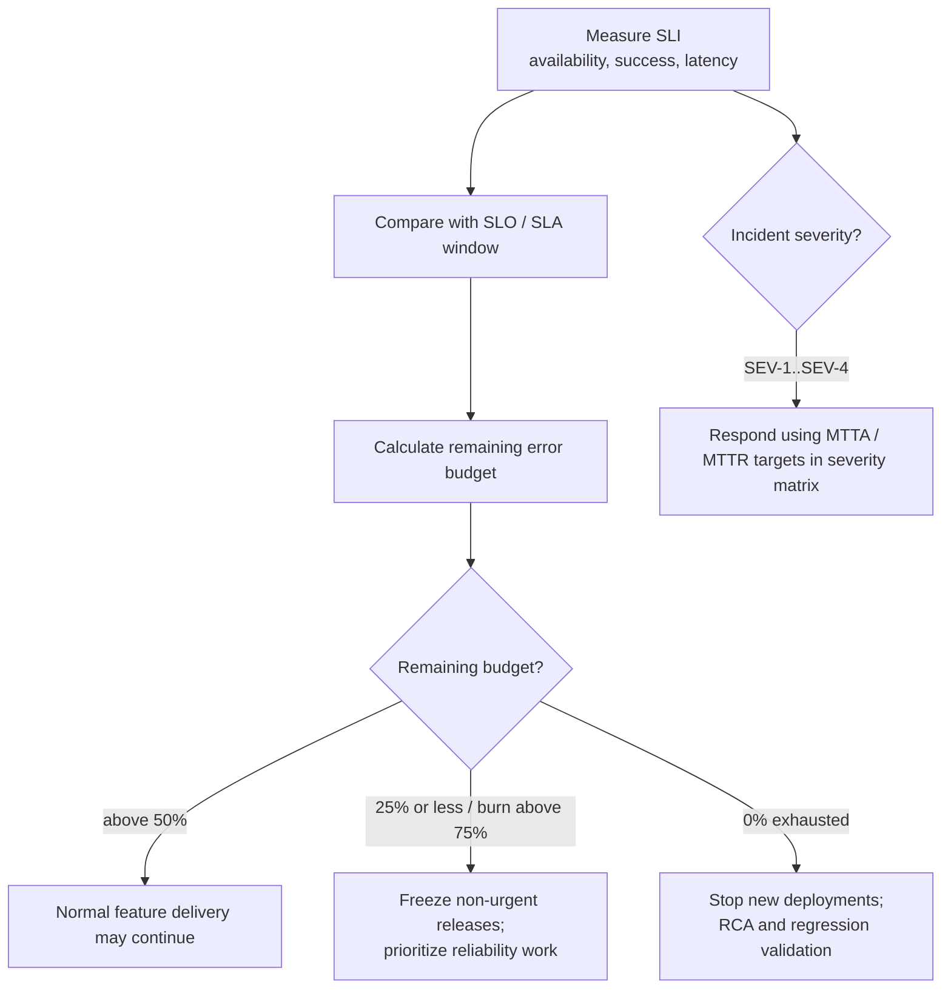

# 06 — Mục Tiêu Hiệu Năng & Độ Sẵn Sàng (Performance & Availability Targets - SLA/SLO/SLI)

## 1. Giới Thiệu & Khung Tiêu Chuẩn SLA, SLO, SLI

Để đảm bảo chất lượng dịch vụ của hệ thống bán vé sự kiện âm nhạc, nhóm kỹ thuật và vận hành thiết lập khung quản lý độ tin cậy chuẩn công nghiệp dựa trên 3 khái niệm cốt lõi:
1. **Chỉ Số Mức Dịch Vụ (Service Level Indicator - SLI):** Thước đo định lượng trực tiếp về hiệu năng hệ thống theo thời gian thực (ví dụ: tỷ lệ request thành công, thời gian phản hồi mili-giây).
2. **Mục Tiêu Mức Dịch Vụ (Service Level Objective - SLO):** Ngưỡng mục tiêu nội bộ mà nhóm kỹ thuật cam kết duy trì trong một chu kỳ đo lường (ví dụ: 99.95% monthly availability cho critical first-party purchase APIs theo D-027).
3. **Thỏa Thuận Mức Dịch Vụ (Service Level Agreement - SLA):** Cam kết pháp lý và thương mại giữa nền tảng bán vé với Ban tổ chức (Organizer) và đối tác thanh toán, đi kèm chế tài bồi thường tài chính nếu vi phạm.

---

## 2. SLO Độ Sẵn Sàng & Error Budget

SLO baseline duy nhất là **99.95% mỗi tháng** cho critical first-party purchase APIs (catalog/read, queue admission/status, seat hold, checkout/order status). Đo theo tổng phút khả dụng trong cửa sổ tháng; lỗi của VNPay/MoMo được đo riêng và không bị tính là first-party API outage khi platform API phục vụ được degraded response. Check-in API được theo dõi riêng theo latency/error SLO. Đây là mục tiêu vận hành, không phải SLA hợp đồng.

| Chu kỳ tham chiếu | Availability equivalent | Downtime equivalent |
|---|---:|---:|
| 1 ngày | 99.95% | 43.2 giây |
| 30 ngày | 99.95% | 21.6 phút |
| 90 ngày | 99.95% | 64.8 phút |
| 365 ngày | 99.95% | 4.38 giờ |

Error budget 30 ngày là 0.05% thời lượng đo, tương đương 21.6 phút. Khi còn trên 50%, phát hành theo quy trình bình thường; khi đã tiêu thụ trên 75%, đóng băng thay đổi không khẩn cấp; khi cạn, dừng release tính năng và tập trung xử lý nguyên nhân độ tin cậy. Bảo trì có kế hoạch phải được loại trừ/bao gồm nhất quán trong SLI theo chính sách đo được công bố; không được âm thầm bỏ khỏi mẫu số.
## 3. Bảng Mục Tiêu Độ Trễ Phản Hồi Chi Tiết (Latency SLOs)

Độ trễ được đo lường tại tầng API Gateway từ lúc nhận byte đầu tiên của request đến lúc gửi byte cuối cùng của response cho client, phân loại theo các phân vị:
- **P50 (Median):** $50\%$ số người dùng nhận phản hồi nhanh hơn mức này.
- **P95:** $95\%$ số người dùng nhận phản hồi nhanh hơn mức này.
- **P99 (Tail Latency):** Phản ánh trải nghiệm của nhóm $1\%$ người dùng gặp điều kiện bất lợi nhất (mạng xa, giờ mở bán cực điểm).

| Endpoint API / Luồng nghiệp vụ | Mức ưu tiên | P50 Target | P95 Target | P99 Target | Tỷ lệ thành công (Success SLO) |
|---|---|---|---|---|---|
| **Thăm dò hàng chờ (`GET /queue/status`)** | 🔴 Critical | $< 25\text{ ms}$ | $< 60\text{ ms}$ | $< 120\text{ ms}$ | ≥ 99.95% (D-027) |
| **Tải sơ đồ ghế (`GET /seat-map`)** | 🔴 Critical | $< 40\text{ ms}$ | $< 120\text{ ms}$ | $< 250\text{ ms}$ | ≥ 99.95% (D-027) |
| **Khóa giữ ghế (`POST /seats/hold`)** | 🔴 Critical | $< 60\text{ ms}$ | $< 180\text{ ms}$ | $< 350\text{ ms}$ | ≥ 99.95% (D-027) |
| **Xác nhận thanh toán (`POST /checkout`)** | 🔴 Critical | $< 120\text{ ms}$ | $< 300\text{ ms}$ | $< 500\text{ ms}$ | ≥ 99.95% (D-027) |
| **Quét mã QR tại cổng (`POST /check-in`)** | Critical; theo dõi riêng | $< 80\text{ ms}$ | $< 220\text{ ms}$ | $< 450\text{ ms}$ | Availability SLO riêng cần xác nhận; không gộp vào D-027 |
| **Tìm kiếm concert (`GET /concerts/search`)** | 🟡 High | $< 50\text{ ms}$ | $< 150\text{ ms}$ | $< 300\text{ ms}$ | $\ge 99.90\%$ |
| **Đăng bài đánh giá (`POST /reviews`)** | 🟢 Normal | $< 150\text{ ms}$ | $< 400\text{ ms}$ | $< 800\text{ ms}$ | $\ge 99.50\%$ |
| **Xuất file báo cáo lớn (`POST /reports/export`)** | 🟢 Normal | $< 2.0\text{ s}$ (Sync) | $< 4.0\text{ s}$ | Async Worker | $\ge 99.00\%$ |

---

## 4. Mục Tiêu Thông Lượng Hệ Thống (Throughput Benchmarks)

| Thành phần hệ thống | Thông lượng định danh (Sustained Throughput) | Khả năng chịu tải đỉnh ngắn hạn (Burst Capacity) | Tiêu chí đạt chuẩn |
|---|---|---|---|
| **Tầng Tiếp Nhận (API Gateway)** | $35.000\text{ QPS}$ | $45.000\text{ QPS}$ trong 5 phút | Không rơi rụng gói tin (Packet drop rate $= 0\%$) |
| **Tầng Hàng Chờ Ảo (Redis Queue)** | $32.000\text{ QPS}$ | $40.000\text{ QPS}$ | CPU Redis không vượt quá $75\%$ |
| **Tầng Giữ Ghế (Distributed Locking)** | $1.500\text{ TPS}$ | $3.500\text{ TPS}$ | Sai số giữ trùng ghế $= 0$ (Zero Double-Booking) |
| **Tầng Giao Dịch Ghi (SQL Server Primary)** | $150\text{ TPS}$ | $300\text{ TPS}$ | Thời gian giữ Connection HikariCP $< 50\text{ ms}$ |
| **Tầng Soát Vé Tại Cổng (Check-In Staff)** | $20\text{ TPS}$ | $100\text{ TPS}$ | Phản hồi tại thiết bị cầm tay $\le 500\text{ ms}$ |
| **Phân Phối Thông Báo (RabbitMQ D-025)** | $3.000\text{ msgs/s}$ | $8.000\text{ msgs/s}$ | Queue depth/consumer lag trở về ngưỡng mục tiêu trong 10 phút; đo và xác nhận trong release gate D-030 |

---

## 5. Quy Trình Khắc Phục Sự Cố & Phân Loại Mức Độ Nghiêm Trọng (Incident Severity Matrix)

| Cấp độ | Tên mức độ | Định nghĩa sự cố | Thời gian phản hồi mục tiêu (MTTA) | Thời gian khắc phục mục tiêu (MTTR) |
|---|---|---|---|---|
| **SEV-1** | 🔴 Blocker / Critical | Hệ thống bán vé sập hoàn toàn; Không thể thanh toán; Bán trùng ghế diện rộng; Sập hệ thống soát vé tại cổng khi sự kiện đang diễn ra | **$< 5\text{ phút}$** | **$< 30\text{ phút}$** |
| **SEV-2** | 🟠 Major Outage | Một cổng thanh toán bị lỗi (nhưng cổng khác vẫn hoạt động); Phòng chờ ảo bị chậm trễ $100\%$; Độ trễ API P99 vượt quá $2.0\text{ giây}$ | **$< 15\text{ phút}$** | **$< 2\text{ giờ}$** |
| **SEV-3** | 🟡 Moderate Impact | Không gửi được thông báo Marketing; Tính năng bình luận/đánh giá bị lỗi; Báo cáo doanh thu cập nhật chậm hơn 15 phút | **$< 60\text{ phút}$** | **$< 8\text{ giờ}$** |
| **SEV-4** | 🟢 Minor Issue | Lỗi hiển thị giao diện nhỏ trên phiên bản trình duyệt cũ; Lỗi chính tả trong email thông báo | **$< 4\text{ giờ}$** | Trong chu kỳ Sprint tiếp theo |

<!-- BEGIN MERMAID DIAGRAM NFR-SLO-BUDGET -->
### Đo SLI, quản trị error budget và phản ứng sự cố

<!-- END MERMAID DIAGRAM NFR-SLO-BUDGET -->
