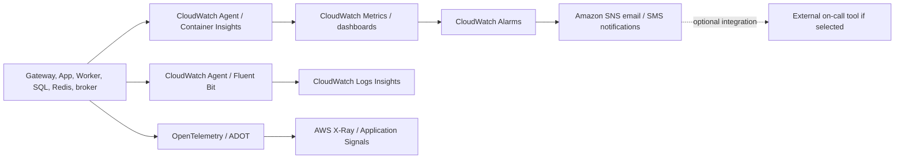
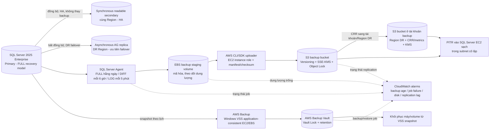

# 07 — Giám Sát, Sao Lưu & Phục Hồi Thảm Họa (Monitoring, Backup & Disaster Recovery)

## 1. Giới Thiệu & Mục Tiêu

Một nền tảng bán vé sự kiện âm nhạc quy mô lớn không thể duy trì độ tin cậy nếu thiếu đi:
1. **Khả năng quan sát toàn diện (Full-Stack Observability):** Phát hiện sớm các bất thường về lưu lượng, độ trễ và tài nguyên trước khi khách hàng cảm nhận được sự cố.
2. **Chiến lược sao lưu đa lớp (Multi-Layer Backup Strategy):** Bảo vệ toàn vẹn lịch sử giao dịch và tài chính khỏi rủi ro hỏng hóc phần cứng, lỗi phần mềm hoặc tấn công mã độc tống tiền (Ransomware).
3. **Kế hoạch phục hồi sau thảm họa (Disaster Recovery - DR):** Đảm bảo khôi phục toàn bộ hệ sinh thái trong thời gian ngắn nhất khi cả một trung tâm dữ liệu đám mây (Cloud Region) bị sập.

Tài liệu này đặc tả chi tiết kiến trúc giám sát, quy trình sao lưu và các kịch bản diễn tập phục hồi thảm họa thực tế.

---

## 2. Kiến Trúc Giám Sát Ba Trụ Cột (The Three Pillars of Observability)

Hệ thống triển khai mô hình quan sát thống nhất chuẩn mở (**OpenTelemetry**):

### 1. Trụ Cột 1: Thu Thập Chỉ Số Định Lượng (Metrics - Amazon CloudWatch)
- **Hạ tầng thu thập:** Amazon CloudWatch Observability EKS add-on (CloudWatch Agent / Fluent Bit và ADOT) thu thập metrics/logs/traces; chu kỳ 15 giây là mục tiêu cấu hình cần kiểm tra chi phí và tải, không phải mặc định dịch vụ.
- **Bảng điều khiển trực quan (Dashboards):**
  - **Executive Business Dashboard:** Doanh số bán vé theo phút, tổng số vé giữ thành công, số người đang trong phòng chờ, tỷ lệ thanh toán thành công qua VNPay/MoMo.
  - **SRE & Infra Dashboard:** CPU/RAM theo node, RabbitMQ queue depth/unacked/oldest-message age, Redis hit rate và kết nối HikariCP theo read/write pool.
  - **Application Performance Dashboard:** Thông lượng QPS, phân vị độ trễ (P50, P95, P99), tỷ lệ mã lỗi HTTP (2xx, 4xx, 5xx).

### 2. Trụ Cột 2: Thu Thập Nhật Ký Tập Trung (Logging - Amazon CloudWatch Logs)
- **Nguyên tắc cấu trúc:** Mọi log ứng dụng bắt buộc phải xuất ra chuẩn **JSON có cấu trúc (Structured Logging)** qua `stdout/stderr`.
- **Trường thông tin bắt buộc trong mỗi log line:**
  - `timestamp`: Thời điểm chính xác theo chuẩn ISO 8601 UTC.
  - `trace_id`: Định danh vết duy nhất xuyên suốt ứng dụng Modular Monolith.
  - `level`: `INFO`, `WARN`, `ERROR`, `FATAL`.
  - service_name: Tên process/module phát sinh log (ví dụ ticket-api hoặc ticket-worker), do baseline là Modular Monolith.
  - `user_id` / `order_id`: Định danh ngữ cảnh nghiệp vụ (nếu có).
  - `message`: Nội dung mô tả sự kiện.
- **Lưu trữ & Tìm kiếm:** CloudWatch Observability add-on thu thập structured logs vào **CloudWatch Logs**, retention 30 ngày phục vụ điều tra lỗi nhanh.

### 3. Trụ Cột 3: Theo Vết Phân Tán (Distributed Tracing - AWS X-Ray / CloudWatch Application Signals)
- OpenTelemetry SDK/ADOT trong ứng dụng tạo hoặc tiếp nhận traceparent chuẩn W3C, propagate qua request nội bộ và xuất trace tới AWS X-Ray/CloudWatch Application Signals. X-Amzn-Trace-Id của ALB chỉ được map nếu cấu hình tracing tương ứng.
- Cho phép kỹ sư xem sơ đồ chuỗi thời gian chi tiết của một giao dịch: Gateway (10ms) $\rightarrow$ Booking Service (30ms) $\rightarrow$ Redis Lock (5ms) $\rightarrow$ Database Insert (15ms). Dễ dàng định vị chính xác điểm nghẽn độ trễ khi có sự cố.

<!-- BEGIN MERMAID DIAGRAM NFR-OBSERVABILITY -->
### Thu thập quan sát và định tuyến cảnh báo

<!-- END MERMAID DIAGRAM NFR-OBSERVABILITY -->

---

## 3. Hệ Thống Cảnh Báo Chủ Động (Alerting Rules & Escalation Matrix)

CloudWatch Alarms gửi cảnh báo qua Amazon SNS tới các subscription email/SMS đã cấu hình. Slack hoặc PagerDuty chỉ là tích hợp on-call tùy chọn bên ngoài AWS và cần quyết định riêng.

| Mã cảnh báo | Điều kiện kích hoạt | Mức độ khẩn cấp | Kênh thông báo | Hành động xử lý tức thì |
|---|---|---|---|---|
| **ALERT-5XX-SPIKE** | Tỷ lệ lỗi HTTP 5xx > 1% trong 2 phút liên tiếp | 🔴 P1 - Critical | Amazon SNS email/SMS; on-call integration tùy chọn | Bật Circuit Breaker; kiểm tra CloudWatch Logs Insights |
| **ALERT-LATENCY-P99** | Độ trễ API P99 > 1.000 ms trong 3 phút | 🔴 P1 - Critical | Amazon SNS email/SMS; on-call integration tùy chọn | Kiểm tra Database Locks và mở rộng số Pods theo chính sách đã kiểm thử |
| **ALERT-REDIS-OOM** | ElastiCache memory/eviction vượt ngưỡng đã benchmark | 🔴 P1 - Critical | Amazon SNS email/SMS | Kiểm tra eviction/headroom; scale hoặc điều chỉnh node class theo runbook |
| **ALERT-BROKER-LAG** | Queue depth/consumer lag của order.paid vượt ngưỡng được benchmark | 🟠 P2 - High | Amazon SNS email/SMS; on-call integration tùy chọn | Kiểm tra DLQ/oldest-message age và tăng Worker theo capacity đã thử tải |
| **ALERT-GATEWAY-DOWN** | Cổng VNPay/MoMo trả lỗi vượt ngưỡng trong 1 phút | 🟠 P2 - High | Amazon SNS email/SMS | Mở Circuit Breaker; chỉ chuyển kênh thanh toán khi chính sách nghiệp vụ và kết quả attempt cho phép |
| **ALERT-DISK-WARN** | SQL data/log hoặc backup-staging EBS còn dưới 30% free; nâng mức khi còn dưới 20% | 🟠 P2 - High | Amazon SNS email/SMS | Bổ sung dung lượng theo runbook; không xóa backup chưa có bản S3 verified/replicated, tránh làm đầy SQL log volume |
| **ALERT-BACKUP-LAG** | Transaction-log backup gần nhất quá 10 phút; critical khi vượt 15 phút | 🔴 P1 - Critical | Amazon SNS email/SMS | Kiểm tra SQL Agent, staging EBS, IAM/KMS và uploader; không xóa backup chưa replicate |
| **ALERT-S3-REPLICATION** | Object pending replication quá 15 phút hoặc có replication failure | 🟠 P2 - High | Amazon SNS email/SMS | Kiểm tra CRR role, destination Object Lock/versioning, KMS key và backlog; không dùng object DR chưa COMPLETED |
| **ALERT-AWSBACKUP-JOB** | AWS Backup VSS job hoặc restore test thất bại | 🟠 P2 - High | Amazon SNS email/SMS | Kiểm tra VSS Writer, SSM permissions, instance support và Backup Vault; giữ recovery point tốt gần nhất |

---

## 4. Chiến Lược Sao Lưu Dữ Liệu (Backup Architecture)

### 4.1. Nguyên tắc bảo vệ dữ liệu

- **Always On AG là HA/DR, không phải backup:** AG giúp duy trì dịch vụ khi replica/Region gặp sự cố, nhưng cũng có thể sao chép thao tác xóa nhầm hoặc dữ liệu hỏng. PITR phải dựa trên backup SQL độc lập.
- **SQL Server là nguồn sự thật:** backup giao dịch dùng native SQL Server ở FULL recovery model. Redis là trạng thái tạm; không dùng Redis snapshot làm bản sao phục hồi order/payment/ticket.
- **Khởi tạo log chain:** trước khi dựa vào transaction-log backup, DBA xác nhận database ở FULL recovery model và đã có full backup nền thành công; mọi backup tiếp theo phải liên tục theo LSN.
- **Tách bản sao khỏi tài khoản production:** bản SQL backup được copy sang S3 bucket ở tài khoản backup riêng và Region DR đã duyệt. Bản sao ở đích có quyền ghi hạn chế, không cấp quyền xóa/bypass retention cho workload production.
- **Có thể khôi phục theo chuỗi:** giữ full, differential và tất cả log backup phụ thuộc trong cùng cửa sổ PITR; không xóa từng file chỉ dựa trên tuổi nếu file đó còn cần để dựng chuỗi.
- **Mục tiêu chưa phải SLA:** số liệu RPO/RTO dưới đây là mục tiêu thiết kế cần DBA/SRE xác nhận bằng backup thực và diễn tập trên dữ liệu gần production.

### 4.2. Kiến trúc backup nhiều lớp

<!-- BEGIN MERMAID DIAGRAM BACKUP-RESTORE-ARCH -->

<!-- END MERMAID DIAGRAM BACKUP-RESTORE-ARCH -->

### 4.3. Lịch sao lưu và thời gian lưu giữ

| Dữ liệu/phương án | Cách thực hiện | Tần suất | Retention và mục đích |
|---|---|---|---|
| SQL Server — PITR | SQL Agent tạo native backup có `CHECKSUM` và compression trên EBS staging riêng; job AWS CLI/SDK dùng IAM instance role chuyển file đã hoàn tất lên S3. Mỗi object có tên duy nhất, metadata/manifest ghi database, loại backup, UTC time, LSN, checksum và trạng thái replication. | FULL mỗi ngày; DIFF mỗi 6 giờ; transaction LOG mỗi 5 phút. Backup chạy trên Primary theo lịch được DBA quản lý; đo tải I/O/CPU trước go-live. | Cửa sổ PITR 35 ngày. Giữ backup chain và Object Lock tối thiểu 37 ngày để còn full backup nền cho điểm khôi phục ở đầu cửa sổ. S3 source và destination đều bật Versioning, SSE-KMS và Object Lock; Governance là mode đề xuất, còn chọn Governance hay Compliance phải chốt tại Q-023 sau khi đánh giá chi phí/retention. Lifecycle không xóa object đang còn retention lock. |
| Bản SQL backup ở DR | S3 Cross-Region Replication sang bucket ở tài khoản backup riêng; destination bật Versioning/Object Lock và dùng KMS key tại Region đích. Bật replication metrics/events; khuyến nghị S3 RTC cho prefix backup nếu giữ mục tiêu backup RPO ≤30 phút và ngân sách được duyệt. Nếu không bật hoặc lag thực tế vượt ngưỡng, phải cập nhật lại target RPO. | Tự động sau khi object được tải lên; theo dõi trạng thái từng object và replication backlog. | Cùng retention/backup-chain policy; sao lưu này là đường PITR dự phòng nếu AG DR replica không dùng được. Mục tiêu backup-based RPO ≤30 phút là mục tiêu ban đầu, phải đo end-to-end từ lần LOG gần nhất tới lúc object đã replicate. |
| Máy SQL Server và EBS volumes | AWS Backup Windows VSS application-consistent snapshot nếu SQL EC2 chạy Windows/instance được hỗ trợ; gồm OS/data/log volumes, không gồm EBS staging. Đây là phục hồi máy/volume, không thay SQL PITR. | Hằng ngày; AWS Backup Restore Testing kiểm tra recovery point định kỳ. | 14 ngày cho snapshot máy chủ; RPO thực tế là tuổi recovery point thành công gần nhất. Dùng Vault Lock theo retention đã duyệt; kiểm tra OS, SQL VSS Writer, SSM permissions và instance support trước go-live. |
| Tệp nghiệp vụ trên S3 | Versioning/CRR và KMS theo bucket policy; phân biệt tệp vé/hóa đơn với SQL backup. | Theo sự kiện ghi và cấu hình replication. | Retention theo chính sách dữ liệu/Legal/Finance; không áp cùng lifecycle SQL backup một cách máy móc. |
| Redis | Không coi cache, queue token, lock hay counter là bản sao dữ liệu giao dịch. Khôi phục bằng cách dựng lại trạng thái cho phép từ SQL/outbox và thu hồi token tạm khi cần. | Không backup như nguồn giao dịch. | Không có PITR nghiệp vụ; SQL Server vẫn là nguồn sự thật. |
| Mã nguồn và cấu hình | GitHub protected branches/tags là nguồn IaC/manifests; lưu release artifact và bản export cấu hình vận hành trong S3 được bảo vệ. Không lưu secret trong Git. | Mỗi release/thay đổi được duyệt. | Retention theo chính sách repository và artifact; Secrets Manager/KMS được khôi phục theo runbook riêng. |

**Kiểm soát an toàn:** IAM role của uploader chỉ được ghi vào prefix backup cần thiết; không có quyền xóa object, sửa retention hoặc bypass Object Lock. Quản trị bucket/vault dùng vai trò riêng và quy trình break-glass có phê duyệt/audit. Backup phải mã hóa bằng KMS; quyền dùng key ở Region DR phải được kiểm tra định kỳ. Versioning/Object Lock cần bật ở cả hai bucket S3 để replication hoạt động đúng.

### 4.4. Mục tiêu phục hồi theo loại sự cố

| Kịch bản | Đường phục hồi chính | Mục tiêu hiện tại |
|---|---|---|
| Hỏng instance/AZ trong Region chính | Failover Always On sang synchronous secondary đã đồng bộ | RPO 0 / RTO ≤5 phút theo D-026; phải đo trong diễn tập. |
| Mất Region chính | Ưu tiên promote asynchronous AG replica tại DR Region nếu lag nằm trong ngưỡng được duyệt; backup S3 là phương án thay thế | RPO ≤5 phút / RTO ≤60 phút theo D-026 cho AG failover; không áp các mục tiêu này cho S3 restore. |
| Xóa nhầm, lỗi ứng dụng ghi sai, hỏng logic hoặc ransomware | Cô lập nguồn lỗi; PITR từ chuỗi backup được khóa retention và replicate vào SQL Server EC2 sạch | Mục tiêu khởi điểm: PITR RPO ≤30 phút và RTO ≤4 giờ. Đây là mục tiêu đề xuất chưa được benchmark/DBA phê duyệt. |
| Hỏng OS/volume/instance | Restore EC2/EBS bằng AWS Backup VSS snapshot; sau đó đối chiếu và apply SQL log backups nếu cần | RPO phụ thuộc snapshot gần nhất và log chain; RTO phải đo bằng restore test. |

Local/DR AG objectives tại D-026 chỉ áp dụng cho failover topology Always On. Backup-based PITR là đường phục hồi độc lập, có mục tiêu riêng và không được ghi nhận là đã đạt trước khi có bằng chứng diễn tập.

### 4.5. Giám sát và cảnh báo backup

CloudWatch nhận trạng thái SQL Agent/uploader và AWS Backup; cảnh báo qua SNS. Dashboard phải hiển thị tuổi của full/diff/log gần nhất, lỗi job, dung lượng EBS staging, checksum/upload failures, số lượng/tuổi object đang pending replication, replication failures, Backup Vault job status và quyền truy cập KMS.

- Cảnh báo khi không có transaction-log backup thành công trong 10 phút; nâng mức nghiêm trọng khi quá 15 phút.
- Cảnh báo khi staging volume còn dưới 30% dung lượng hoặc backup job/verification thất bại.
- Cảnh báo khi S3 replication pending vượt 15 phút hoặc có object replication failed; không tuyên bố đạt backup RPO nếu log chain chưa có ở bucket DR.
- Cảnh báo nếu AWS Backup VSS job hoặc restore test thất bại; không xóa bản backup tốt gần nhất để xử lý lỗi job.

## 5. Quy Trình Phục Hồi (Restore & DR Runbooks)

### 5.1. Khôi phục PITR khi dữ liệu bị xóa/hỏng

1. Incident Commander khai báo sự cố; dừng hoặc cô lập luồng ghi gây hỏng dữ liệu. Giữ nguyên database/volume bị ảnh hưởng để phục vụ điều tra, không restore đè lên bản duy nhất.
2. Chọn thời điểm khôi phục `STOPAT` ngay trước sự kiện lỗi; kiểm tra log payment/callback, outbox và audit để xác định phạm vi.
3. Chọn recovery point từ S3 DR nếu Region/tài khoản chính bị ảnh hưởng; chỉ dùng object có VersionId, checksum hợp lệ và replication status `COMPLETED`.
4. Khởi tạo SQL Server 2025 Enterprise EC2 sạch trong subnet cô lập; xác nhận version/edition, EBS layout, KMS decrypt permission, certificate/TDE key nếu database có bật mã hóa ở tầng SQL.
5. Tải và xác minh chuỗi backup: FULL gần nhất trước `STOPAT` → DIFF gần nhất sau FULL và trước `STOPAT` (nếu có) → toàn bộ LOG backup theo đúng thứ tự LSN đến `STOPAT`.
6. Restore FULL/DIFF/LOG với `NORECOVERY`; restore log cuối với `STOPAT` và `RECOVERY`. Nếu thiếu một log trong chain, dừng quy trình, chọn thời điểm sớm hơn còn đầy đủ; không bỏ qua khoảng trống.
7. Chạy `RESTORE VERIFYONLY` trước restore như bước kiểm tra sơ bộ; sau restore chạy `DBCC CHECKDB`, kiểm tra constraint và đối soát invariants: ghế/order/ticket, số tiền payment/refund, idempotency và transaction cuối cùng.
8. Giữ hệ thống ở chế độ maintenance/read-only cho tới khi DBA/Incident Commander phê duyệt; đối soát provider cho các payment/refund quanh khoảng thời gian khôi phục, xử lý đơn đã thu tiền nhưng mất fulfillment theo business rule, không tạo charge/refund mới khi kết quả còn UNKNOWN. Reconcile outbox bằng idempotency key, không phát lại mù event/notification trước khi chuyển application endpoint/traffic.
9. Ghi thời điểm dữ liệu cuối cùng phục hồi được, thời gian dịch vụ mở lại, phần dữ liệu mất/khôi phục và kết quả so với RPO/RTO; lưu biên bản, không ghi đè evidence.

### 5.2. Khôi phục Region

1. Xác nhận outage thực sự qua AWS Health/CloudWatch và đánh giá replica health, log send/redo queue, thời điểm commit cuối.
2. Nếu async AG replica khỏe và mức lag nằm trong RPO được duyệt, DBA/Incident Commander thực hiện failover theo runbook; nếu buộc forced failover có nguy cơ mất dữ liệu, ghi nhận/chấp thuận mức mất dữ liệu trước khi promote.
3. Fence Region cũ để tránh split-brain; xác nhận một Primary duy nhất, endpoint/listener, security groups, secrets/KMS và dependencies.
4. Nếu AG DR không dùng được hoặc dữ liệu bị lỗi logic đã replicate, tạo SQL Server EC2 sạch tại DR Region và PITR từ S3 backup copy theo mục 5.1.
5. Chạy smoke test nghiệp vụ và reconciliation, sau đó mới chuyển DNS/traffic bằng Route 53 theo quy trình phê duyệt. Ghi số đo RPO/RTO thực tế.
6. Sau khi Region chính phục hồi, không tự động failback; đồng bộ dữ liệu, đánh giá drift, lập kế hoạch failback có phê duyệt và cửa sổ bảo trì.

### 5.3. Khôi phục EC2/EBS từ AWS Backup VSS

1. Chọn recovery point VSS đã hoàn tất và đúng thời điểm trước lỗi; tạo bản restore vào subnet cô lập, không thay thế máy đang giữ evidence.
2. Dùng AWS Backup/Systems Manager restore automation để dựng EC2/EBS; xác nhận SQL Server service, volume mapping, SQL VSS Writer và trạng thái database.
3. VSS snapshot chỉ phục hồi máy/volume tại recovery point của nó. Không giả định có thể nối SQL transaction-log chain lên VSS restore; nếu cần thời điểm PITR chính xác hơn, chạy riêng quy trình SQL native restore tại mục 5.1 vào EC2 sạch.
4. Chạy DBCC CHECKDB, kiểm tra ứng dụng và đối soát nghiệp vụ; chỉ cutover sau khi DBA/Incident Commander ký xác nhận.

### 5.4. Tài liệu kỹ thuật tham chiếu

- [AWS Prescriptive Guidance — SQL Server on EC2 HA/DR and native backup to S3](https://docs.aws.amazon.com/prescriptive-guidance/latest/sql-server-ec2-ha-dr/options-considerations.html)
- [AWS Backup — Windows VSS backups](https://docs.aws.amazon.com/aws-backup/latest/devguide/windows-backups.html)
- [AWS — Restore SQL Server on EC2 from VSS snapshots](https://docs.aws.amazon.com/sql-server-ec2/latest/userguide/ms-ssdb-ec2-restore-vss.html)
- [Amazon S3 — Object Lock](https://docs.aws.amazon.com/AmazonS3/latest/userguide/object-lock.html)
- [Amazon S3 — replication requirements](https://docs.aws.amazon.com/AmazonS3/latest/userguide/replication-requirements.html)
- [AWS Backup — restore testing](https://docs.aws.amazon.com/aws-backup/latest/devguide/restore-testing.html)
- [Microsoft Learn — backups on Always On secondary replicas](https://learn.microsoft.com/en-us/sql/database-engine/availability-groups/windows/active-secondaries-backup-on-secondary-replicas-always-on-availability-groups?view=sql-server-ver17)

## 6. Diễn Tập, Kiểm Thử Phục Hồi & Chaos Engineering

- **Mỗi tháng:** khôi phục thật một recovery point SQL từ S3 vào EC2 cô lập; kiểm tra checksum, chuỗi FULL/DIFF/LOG, DBCC CHECKDB, business invariants và ghi lại thời gian.
- **Mỗi tháng:** chạy AWS Backup Restore Testing cho recovery point EC2/EBS; xác minh SQL Server/VSS Writer khởi động và volumes được gắn đúng.
- **Mỗi quý:** diễn tập khôi phục Region bằng promote AG DR hoặc phương án PITR từ S3; đo RPO/RTO, verify DNS/endpoint, KMS, Secrets Manager và traffic cutover.
- **Mỗi 6 tháng:** tổ chức game day tổng hợp cho ElastiCache failover, SQL AG, Amazon MQ, EKS/EC2 và đường thanh toán. Chaos Mesh chỉ tác động workloads Kubernetes đã được giới hạn, không làm hỏng trực tiếp tài nguyên production.

Mỗi diễn tập lưu: recovery point/object version, trạng thái replication, thời điểm bắt đầu/kết thúc, dữ liệu cuối cùng xác nhận, RPO/RTO đo được, sai lệch so với target, người phê duyệt và hành động khắc phục. `RESTORE VERIFYONLY` là kiểm tra sơ bộ; không thay thế việc restore database thật.
