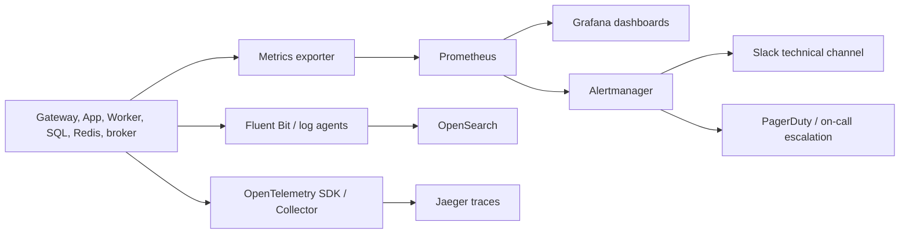
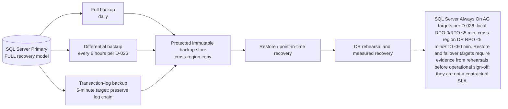

# 07 — Giám Sát, Sao Lưu & Phục Hồi Thảm Họa (Monitoring, Backup & Disaster Recovery)

## 1. Giới Thiệu & Mục Tiêu

Một nền tảng bán vé sự kiện âm nhạc quy mô lớn không thể duy trì độ tin cậy nếu thiếu đi:
1. **Khả năng quan sát toàn diện (Full-Stack Observability):** Phát hiện sớm các bất thường về lưu lượng, độ trễ và tài nguyên trước khi khách hàng cảm nhận được sự cố.
2. **Chiến lược sao lưu đa lớp (Multi-Layer Backup Strategy):** Bảo vệ toàn vẹn lịch sử giao dịch và tài chính khỏi rủi ro hỏng hóc phần cứng, lỗi phần mềm hoặc tấn công mã độc tống tiền (Ransomware).
3. **Kế hoạch phục hồi sau thảm họa (Disaster Recovery - DR):** Đảm bảo khôi phục toàn bộ hệ sinh thái trong thời gian ngắn nhất khi cả một trung tâm dữ liệu đám mây (Cloud Region) bị sập.

Tài liệu này đặc tả chi tiết kiến trúc giám sát, quy trình sao lưu và các kịch bản diễn tập phục hồi thảm họa thực tế.

---

## 2. Kiến Trúc Giám Sát Ba Trụ Cột (The Three Pillars of Observability)

Hệ thống triển khai mô hình quan sát thống nhất chuẩn mở (**OpenTelemetry**):

### 1. Trụ Cột 1: Thu Thập Chỉ Số Định Lượng (Metrics - Prometheus & Grafana)
- **Hạ tầng thu thập:** Prometheus Operator chạy trong Kubernetes thu thập (scrape) số liệu mỗi **15 giây** từ ứng dụng Modular Monolith, Ingress Controller, Redis và SQL Server Exporters.
- **Bảng điều khiển trực quan (Dashboards):**
  - **Executive Business Dashboard:** Doanh số bán vé theo phút, tổng số vé giữ thành công, số người đang trong phòng chờ, tỷ lệ thanh toán thành công qua VNPay/MoMo.
  - **SRE & Infra Dashboard:** CPU/RAM theo node, RabbitMQ queue depth/unacked/oldest-message age, Redis hit rate và kết nối HikariCP theo read/write pool.
  - **Application Performance Dashboard:** Thông lượng QPS, phân vị độ trễ (P50, P95, P99), tỷ lệ mã lỗi HTTP (2xx, 4xx, 5xx).

### 2. Trụ Cột 2: Thu Thập Nhật Ký Tập Trung (Logging - FluentBit & OpenSearch)
- **Nguyên tắc cấu trúc:** Mọi log ứng dụng bắt buộc phải xuất ra chuẩn **JSON có cấu trúc (Structured Logging)** qua `stdout/stderr`.
- **Trường thông tin bắt buộc trong mỗi log line:**
  - `timestamp`: Thời điểm chính xác theo chuẩn ISO 8601 UTC.
  - `trace_id`: Định danh vết duy nhất xuyên suốt ứng dụng Modular Monolith.
  - `level`: `INFO`, `WARN`, `ERROR`, `FATAL`.
  - `service_name`: Tên Microservice phát sinh log.
  - `user_id` / `order_id`: Định danh ngữ cảnh nghiệp vụ (nếu có).
  - `message`: Nội dung mô tả sự kiện.
- **Lưu trữ & Tìm kiếm:** FluentBit thu thập và đẩy vào cụm **OpenSearch Cluster**, lưu trữ nóng 30 ngày phục vụ điều tra lỗi nhanh.

### 3. Trụ Cột 3: Theo Vết Phân Tán (Distributed Tracing - OpenTelemetry & Jaeger)
- Khi một yêu cầu từ người dùng chạm vào API Gateway, hệ thống tự động sinh một mã `traceparent` (chuẩn W3C Trace Context) và truyền qua tiêu đề HTTP tới tất cả các dịch vụ nội bộ tiếp theo.
- Cho phép kỹ sư xem sơ đồ chuỗi thời gian chi tiết của một giao dịch: Gateway (10ms) $\rightarrow$ Booking Service (30ms) $\rightarrow$ Redis Lock (5ms) $\rightarrow$ Database Insert (15ms). Dễ dàng định vị chính xác điểm nghẽn độ trễ khi có sự cố.

<!-- BEGIN MERMAID DIAGRAM NFR-OBSERVABILITY -->
### Thu thập quan sát và định tuyến cảnh báo

<!-- END MERMAID DIAGRAM NFR-OBSERVABILITY -->

---

## 3. Hệ Thống Cảnh Báo Chủ Động (Alerting Rules & Escalation Matrix)

Alertmanager được cấu hình để gửi thông báo tức thì qua **Slack (Kênh kỹ thuật)** và cuộc gọi khẩn cấp **PagerDuty** cho kỹ sư trực ca (On-Call SRE):

| Mã cảnh báo | Điều kiện kích hoạt | Mức độ khẩn cấp | Kênh thông báo | Hành động xử lý tức thì |
|---|---|---|---|---|
| **ALERT-5XX-SPIKE** | Tỷ lệ lỗi `HTTP 5xx > 1%` trong 2 phút liên tiếp | 🔴 P1 - Critical | PagerDuty Call + SMS | Bật Circuit Breaker; Kiểm tra log lỗi tại OpenSearch |
| **ALERT-LATENCY-P99** | Độ trễ API P99 `> 1.000 ms` trong 3 phút | 🔴 P1 - Critical | PagerDuty Call | Kiểm tra Database Locks và mở rộng số Pods tự động |
| **ALERT-REDIS-OOM** | Mức sử dụng RAM Redis `> 85%` | 🔴 P1 - Critical | PagerDuty Call | Xóa bớt cache phụ; Mở rộng RAM cụm Redis |
| **ALERT-BROKER-LAG** | Queue depth/consumer lag của `order.paid` `> 5.000 msgs` | 🟠 P2 - High | Slack `@sre-team` | Tăng số lượng Worker Pods để tiêu thụ nhanh |
| **ALERT-GATEWAY-DOWN** | Cổng VNPay/MoMo trả về lỗi `> 30%` trong 1 phút | 🟠 P2 - High | Slack `@payment-team` | Kích hoạt Fallback sang cổng thanh toán dự phòng |
| **ALERT-DISK-WARN** | Dung lượng ổ đĩa SSD máy chủ `> 80%` | 🟡 P3 - Warning | Slack Alert | Dọn dẹp tệp tạm; Tăng dung lượng đĩa EBS |

---

## 4. Chiến Lược Sao Lưu Dữ Liệu (Backup Architecture)

Mục tiêu RPO/RTO là mục tiêu cần diễn tập và xác nhận theo topology D-026 và capacity/licensing D-030; các con số chưa phải cam kết đã kiểm chứng.

<!-- BEGIN MERMAID DIAGRAM CONVERT-07_Monitoring_Backup_And_Disaster_Recovery -->
### Backup and restore path

<!-- END MERMAID DIAGRAM CONVERT-07_Monitoring_Backup_And_Disaster_Recovery -->

PITR yêu cầu chuỗi restore nhất quán: full backup, differential gần nhất (nếu dùng), rồi toàn bộ transaction-log backups theo thứ tự đến thời điểm cần khôi phục. Theo D-026: FULL recovery model; full backup hằng ngày, differential mỗi 6 giờ, transaction log mỗi 5 phút; mã hóa; retention 35 ngày; cross-region async DR; kiểm thử restore hằng tháng. Restore chain và actual RPO/RTO phải được chứng minh qua diễn tập. Backup log mỗi 5 phút chỉ đạt RPO mục tiêu nếu job, lưu trữ và replication đều hoạt động đúng.

### Chi Tiết Tần Suất & Thời Gian Lưu Trữ Bản Sao (Backup Schedule)

| Loại dữ liệu | Phương thức sao lưu | Tần suất thực hiện | Thời gian lưu giữ bản sao | Ghi chú |
|---|---|---|---|---|
| **Cơ sở dữ liệu SQL Server** | Native full/differential/transaction-log backups | Full hằng ngày; differential mỗi 6 giờ; transaction log mục tiêu mỗi 5 phút | 35 ngày | Mục tiêu D-026: local RPO 0/RTO ≤5 phút; DR RPO ≤5 phút/RTO ≤60 phút; xác nhận bằng diễn tập và DBA/Finance sign-off. |
| **Redis** | Cache/queue state tạm thời, có thể dựng lại từ SQL Server | Không backup như nguồn dữ liệu giao dịch | Không áp retention backup | Redis là ephemeral theo D-029; không dùng RDB/AOF làm nguồn sự thật cho hold, queue hoặc thanh toán. |
| **Tài liệu & Vé S3** | Cross-Region Replication (CRR) | Theo cấu hình bucket | Theo retention policy | Xác nhận versioning và bảo vệ xóa |
| **Cấu hình Hạ tầng & K8s** | GitOps (ArgoCD Repository) | Mỗi khi có commit mới | Theo chính sách Git | Repository cần backup và access controls |

## 5. Quy Trình Phục Hồi Sau Thảm Họa (Disaster Recovery Playbook)

### 1. Phục Hồi Dữ Liệu Về Một Thời Điểm Quá Khứ (Point-In-Time-Recovery - PITR)
- **Áp dụng khi:** Lỗi phần mềm do deploy nhầm phiên bản làm sai lệch dữ liệu giao dịch hoặc kẻ xấu xóa nhầm bảng lúc $14:32$.
- **Quy trình:**
  1. Khởi động SQL Server tương thích với bản backup.
  diff["Differential backup every 6 hours per D-026"]
  3. Dừng restore tại thời điểm cần khôi phục (STOPAT) khi chuỗi log đầy đủ và hợp lệ.
  4. Xác minh tính toàn vẹn dữ liệu và chuyển đổi ứng dụng sang cơ sở dữ liệu đã phục hồi; ghi thời gian thực tế. Chưa đặt RTO riêng cho PITR ngoài các mục tiêu đã duyệt tại D-026.

### 2. Kịch Bản Sập Hoàn Toàn Vùng Đám Mây Chính (Primary Region Outage Failover)
- **Tình huống:** Primary cloud region/center bị sự cố toàn vùng; AWS Singapore hiện là ví dụ triển khai trong tài liệu, provider và geography phải được xác nhận trong deployment/go-live decision.
- **Kế hoạch ứng phó:** Dùng async DR replica tại region độc lập theo D-026; vị trí cụ thể phụ thuộc quyết định cloud/data residency.
  1. **Bước 1 (0 – 5 phút):** Đội ngũ SRE xác nhận sự cố toàn vùng thông qua trạng thái Cloud Status Dashboard.
  2. **Bước 2 (checkpoint 5–15 phút):** Kích hoạt compute tại DR region đã duyệt bằng IaC/GitOps; khoảng thời gian là kế hoạch diễn tập, không phải kết quả đã xác nhận.
  3. **Bước 3 (15 – 25 phút):** Khôi phục/failover SQL Server theo topology và backup chain cross-region đã được kiểm chứng; DR async replica khác region theo D-026; chuyển vùng chỉ sau khi xác minh dữ liệu và phê duyệt incident commander.
  4. **Bước 4 (checkpoint 25–30 phút):** Chuyển traffic qua DNS/load balancer đã chọn tới DR endpoint sau khi kiểm tra endpoint, TLS và health check.
  5. **Hoàn tất:** Chỉ mở traffic sau khi xác minh nhất quán. Đo và lưu bằng chứng so với D-026: local RPO 0/RTO ≤5 phút; cross-region DR RPO ≤5 phút/RTO ≤60 phút. Các mốc checkpoint ở trên không khẳng định đã đạt RTO.

---

## 6. Diễn Tập Sự Cố & Kỹ Thuật Hỗn Loạn (Chaos Engineering & DR Drills)

- **Nguyên tắc:** Một kế hoạch phục hồi thảm họa chưa từng được diễn tập thực tế là một kế hoạch vô giá trị.
- **Lịch diễn tập bắt buộc (Game Day):** Định kỳ **6 tháng một lần**, đội ngũ kỹ thuật tổ chức ngày hội diễn tập sự cố (Game Day) trên môi trường Staging/Production:
  - Chủ động bắn hạ ngẫu nhiên một node Redis Master hoặc SQL Server Replica trong lúc chạy kịch bản mô phỏng $50.000\text{ CCU}$ (sử dụng công cụ Chaos Mesh / Gremlin).
  - Mô phỏng ngắt kết nối mạng tới Cổng thanh toán để kiểm tra khả năng chuyển đổi mạch (Circuit Breaker).
  - Đo đạc thực tế chỉ số MTTR (Mean Time to Recover) và cập nhật bổ sung quy trình vận hành tiêu chuẩn (SOP).

