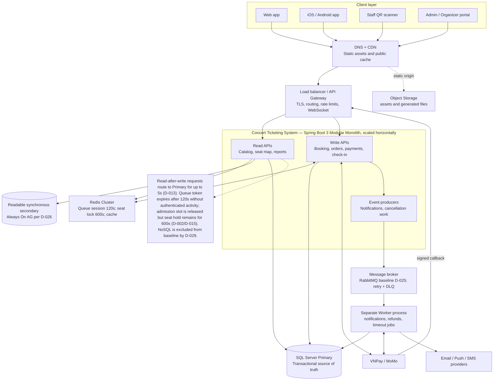

# 01 — Kiến Trúc Tổng Thể Client-Server & Load Balancer (High-Level Architecture)

## 1. Giới Thiệu & Mục Đích Tài Liệu

Tài liệu này đặc tả kiến trúc tổng thể cấp cao (**High-Level System Architecture**) của nền tảng bán vé sự kiện âm nhạc quy mô lớn. Kiến trúc được thiết kế theo chuẩn **System Design Primer**: tách biệt luồng Read / Write / Async Queue, sử dụng Redis Cache & Lock, SQL Server Primary / Readable Secondary và hàng chờ tin nhắn (Message Queue) cho xử lý bất đồng bộ.

Tài liệu cung cấp toàn bộ các thành phần, các lớp kiến trúc (Architectural Layers), biên giới mạng, cơ chế tiếp nhận lưu lượng và đường đi của dữ liệu qua từng tầng để làm cơ sở cho kỹ sư hệ thống vẽ sơ đồ kiến trúc tổng thể (**High-Level Architecture Diagram**) và sơ đồ luồng dữ liệu (**Data Flow Diagram**).

> **Ghi chú kiến trúc:** Backend được tổ chức theo mô hình **Modular Monolith** (Spring Boot 3) — nhưng bổ sung **RabbitMQ message broker** và **Worker Service** độc lập để xử lý các tác vụ bất đồng bộ nặng (gửi email, hoàn tiền tự động, hủy đơn trễ). Đây là mô hình **Hybrid: Modular Monolith + Lightweight Async Workers**.

---

## 2. Phân Tầng Kiến Trúc Hệ Thống (Layered Architecture Breakdown)

> **Kiến trúc mục tiêu theo sơ đồ:** Modular Monolith Spring Boot scale ngang; Write API/Read API tách theo luồng; HikariCP write pool tới SQL Server Primary và read-intent pool tới readable synchronous secondary trong Always On AG theo D-026; Redis giữ queue access token tối đa 120 giây, seat hold 600 giây và cache TTL theo data class; RabbitMQ theo D-025 cùng worker; SQL Server là nguồn sự thật cho audit/outbox, không có NoSQL theo D-029. Read-your-write đi Primary tối đa 5 giây; cache TTL không thay thế định tuyến nhất quán. Check-in online-only, fail-closed theo D-023.

Hệ thống được tổ chức thành **8 tầng kiến trúc** phân tách rõ ràng theo sơ đồ kiến trúc mục tiêu:

<!-- BEGIN MERMAID DIAGRAM CONVERT-01_High_Level_Client_Server_And_API_Gateway_Architecture -->
### Architecture overview


<!-- END MERMAID DIAGRAM CONVERT-01_High_Level_Client_Server_And_API_Gateway_Architecture -->


---

## 3. Mô Tả Chi Tiết Từng Tầng

### Tầng 1: Client & Presentation Layer
- **Web Portal (SPA):** React / Next.js — tối ưu SEO, tải tức thì.
- **Mobile App (iOS & Android):** Flutter / React Native — QR Token Generator, Push Notification (APNs/FCM).
- **Staff QR Scanner App:** Ứng dụng soát vé trực tuyến; fail-closed khi không kết nối được Check-in Service theo D-023.
- **Admin Management Portal:** Giao diện quản trị tập trung cho Quản trị viên sàn.

### Tầng 2: DNS & CDN Layer
- **Cloudflare Anycast DNS:** Phân giải tên miền độ trễ thấp, chuyển hướng thông minh theo vùng địa lý.
- **Cloudflare / CloudFront CDN:** Cache và phân phối tài nguyên tĩnh (Poster concert, Banner sự kiện, Sơ đồ ghế SVG) tại các PoP Hà Nội / TP.HCM / Đà Nẵng. Tải từ CDN < 20ms.
- **Kết nối CDN → Object Store (S3/R2):** Pull-through cache — file không có trong Edge thì kéo từ Origin S3.

### Tầng 3: Load Balancer Layer
- **Công nghệ:** Nginx (Docker / Kubernetes Ingress).
- **Chức năng:**
  - Phân phối traffic đến nhiều instance Monolith (Round-Robin / Least-Connection).
  - Rate Limiting sơ cấp tại tầng L4/L7 cho các endpoint nhạy cảm (`/login`, `/orders`, `/seats/hold`).
  - Health-check các instance — loại bỏ instance lỗi khỏi pool tự động.
  - Hỗ trợ WebSocket Upgrade (sticky session cho WSS connections).
  - SSL/TLS Termination (forward HTTP nội bộ).

### Tầng 4: Modular Monolith Application Layer (Spring Boot 3)

Một ứng dụng Spring Boot 3 chứa 4 nhóm endpoint phân tách rõ ràng theo luồng xử lý:

#### 4.1. Web Server / Auth Module
- **Vai trò:** Điểm tiếp nhận request, xác thực và điều tiết lưu lượng vào.
- **Chức năng:**
  - JWT RS256 Authentication & OAuth2 Social Login.
  - RBAC — kiểm tra vai trò (Customer / Organizer / Admin / Staff) trên mọi request.
  - **Phòng Chờ Ảo (Virtual Queue):** Giới hạn tối đa **5.000 CCU** vào khu vực chọn ghế tại một thời điểm. Những người còn lại đứng trong hàng chờ Redis (Sorted Set).

#### 4.2. Write API Module (Đồng bộ — Critical Path)
- **Vai trò:** Xử lý các thao tác ghi giao dịch nhạy cảm, đòi hỏi tính nhất quán tức thì (ACID).
- **Chức năng:**
  - Giữ ghế (tối đa 4 ghế/lần) — `SETNX EX 600` Redis + `INSERT seat_holds` SQL Server.
  - Tạo đơn hàng (`INSERT orders + order_items`).
  - Khởi tạo thanh toán — redirect URL tới VNPay/MoMo.
  - Nhận IPN Webhook từ cổng thanh toán — xác minh Idempotency Key, cập nhật trạng thái.
  - Soát vé QR tại cổng check-in.
- **Kết nối:** Redis (SET NX EX), SQL Server Primary, VNPay/MoMo (HTTP webhook).

#### 4.3. Write API Async Module (Bất đồng bộ — Non-Critical)
- **Vai trò:** Khởi tạo các tác vụ bất đồng bộ không cần kết quả tức thì.
- **Chức năng:**
  - Phát sự kiện gửi thông báo (Email / Push / In-App) lên **Message Queue**.
  - Phát sự kiện hủy đơn hàng (khi timeout thanh toán 10 phút).
  - Phát sự kiện hoàn tiền tự động (khi concert bị hủy bởi Admin).
- **Kết nối:** → RabbitMQ (Producer).

#### 4.4. Read API Module (Chỉ đọc)
- **Vai trò:** Phục vụ toàn bộ truy vấn đọc — không ghi vào DB.
- **Chức năng:**
  - Xem / Lọc / Tìm kiếm concert.
  - Xem sơ đồ ghế và trạng thái ghế real-time.
  - Xem lịch sử đơn hàng cá nhân.
  - Xem báo cáo doanh thu (Organizer / Admin).
- **Kết nối:** Redis (GET cache concert, seat map) → SQL Server Readable Secondaries → Object Store (Signed URL).

### Tầng 5: Message Queue & Worker Layer

#### 5.1. Message Queue (RabbitMQ)
- **Công nghệ:** RabbitMQ; durable queues, publisher confirms, retry/DLQ, idempotent consumer; transactional outbox trong SQL Server (D-025/D-029).
- **Tính năng quan trọng:**
  - **Retry Policy:** Tự động retry 3 lần với exponential backoff khi Worker xử lý thất bại.
  - **Dead-Letter Queue (DLQ):** Message thất bại sau 3 lần retry → chuyển sang DLQ để team kỹ thuật kiểm tra thủ công.
- **RabbitMQ exchanges / queues chính:**
  - `notification.send` — Gửi Email, Push, In-App.
  - `order.cancel` — Hủy đơn hàng timeout.
  - `refund.process` — Hoàn tiền tự động.

#### 5.2. Worker Service (Process riêng biệt)
- **Công nghệ:** Spring Boot Worker (riêng biệt với Monolith app) hoặc Spring Boot Scheduler.
- **Vai trò:** Consumer — lắng nghe Queue và xử lý từng message:
  - **Gửi Email / In-App Notification:** Gọi SendGrid / AWS SES / FCM.
  - **Xử lý Hoàn Tiền Tự Động:** Gọi VNPay Refund API / MoMo Refund API → cập nhật `refunds` vào SQL Server.
- **Lý do tách Worker riêng (không dùng @Async trong Monolith):**
  - Worker có thể scale độc lập mà không cần restart toàn bộ Monolith.
  - Failure trong Worker không ảnh hưởng đến luồng mua vé chính.
  - Dễ monitor hàng đợi và bottleneck riêng biệt.

### Tầng 6: Redis Cache & Distributed Lock Layer

| Mục đích | Key Pattern | TTL | Chi tiết |
|---|---|---|---|
| **Virtual Queue** | `queue:{concertId}` (Sorted Set) | Đến hết giờ mở bán | ZADD score=timestamp — xếp hàng ngẫu nhiên |
| **Seat Lock** | `seat:lock:{seatId}` | 600 giây (10 phút) | `SET NX EX 600` — atomic; TTL 600 giây theo D-002 |
| **Session Timeout Queue** | `queue:timeout:{userId}` | 120 giây (2 phút) | Hết hạn phiên → thu hồi queue slot; seat hold đã tạo tiếp tục theo TTL 600 giây (D-002) |
| **Concert Cache** | `concert:{id}` (Hash) | 300 giây (5 phút) | Giảm load SQL Server khi browse concert |
| **JWT Blacklist** | `jwt:blacklist:{jti}` | TTL còn lại của token | Logout → revoke token tức thì |
| **Rate Limit Counter** | `ratelimit:{ip}:{minute}` | 60 giây | INCR + EXPIRE — > ngưỡng → 429 |

### Tầng 7: Data Layer

Sau thao tác ghi, read-your-write được route về Primary tối đa 5 giây (D-013). Readable secondary, listener routing và HA phụ thuộc edition/topology D-026; read-only annotation không tự route kết nối.

#### 7.1. Audit, transactional outbox và operational logs
- SQL Server lưu audit_logs và outbox_events; outbox row được ghi cùng transaction nghiệp vụ và publish tới RabbitMQ với publisher confirm.
- Redis chỉ lưu queue/lock/cache có TTL; không lưu transaction truth.
- ELK/OpenSearch lưu operational logs đã lọc PII theo retention NFR; không dùng để đối soát giao dịch.

#### 7.2. SQL Server Primary (Ghi dữ liệu giao dịch)
- **Vai trò:** Primary server — tiếp nhận toàn bộ write operations.
- **Nguồn schema:** [ERD SQL Server](<03_ERD_And_Database_Schema_Design.md>); các index minh họa dưới đây phải khớp tên cột trong ERD trước khi thành migration.
- **Tính năng ACID:**
  - Spring @Transactional bao các thay đổi ACID trong SQL Server; Redis lock nằm ngoài DB transaction và cần compensation/reconciliation khi lỗi.
  - Unique constraints trên `orders.idempotency_key` và `orders.hold_token` — chống replay tạo đơn và bảo đảm một order cho mỗi hold group.
  - `SELECT ... WITH (UPDLOCK, ROWLOCK) trong transaction` — row-level lock khi cần kiểm tra và cập nhật trạng thái ghế.
  - Optimistic Locking (`@Version`) — chống concurrent update conflict trên entity.
- **Quản lý bảng lịch sử quy mô lớn:** audit_logs, checkin_logs, notifications dùng index, retention và archival; không physical partition trong baseline (D-028).

#### 7.3. SQL Server Readable Secondaries (Đọc báo cáo & Tìm kiếm)
- **Vai trò:** Readable synchronous secondary cùng region và asynchronous DR replica khác region theo SQL Server 2025 Enterprise Always On AG D-026.
- **Phân tách đọc trong Spring Boot:**
  ```java
  @Transactional(readOnly = true)  // routing layer chọn secondary nếu đủ điều kiện; D-013 giữ Primary sau write
  public Page<ConcertDto> searchConcerts(...) { ... }
  ```
- **Phục vụ:** Xem concert, lịch sử đơn hàng, báo cáo doanh thu, thống kê ghế.

#### 7.4. Phân Vùng Theo Domain (SQL Server Logical Grouping)
Các bảng được phân nhóm theo domain trong cùng SQL Server instance:

| Nhóm | Bảng | Chiến lược Index |
|---|---|---|
| **Users & Auth** | `users`, `user_credentials`, `user_sessions` | Index (`email`), Index (`phone`) |
| **Orders** | `orders`, `order_items` (voucher không có trong baseline D-031) | Composite Index (`user_id`, `created_at DESC`) |
| **Concerts & Seats** | `concerts`, `venues`, `ticket_zones`, `seats`, `seat_holds` | Index (`concert_id`, `seat_id`), Index (`concert_id`, `status`) |
| **Historical tables** | audit_logs, checkin_logs, notifications | index + retention/archive; no partition in baseline (D-028) |

#### 7.5. Object Store (S3 / Cloudflare R2)
- Lưu: Poster concert, Banner sự kiện, File vé PDF, Sơ đồ ghế gốc SVG.
- **Signed URL (TTL=15 phút):** Client không truy cập trực tiếp S3 — phải xin URL có chữ ký từ server.

---

## 4. Đường Đi Của Yêu Cầu (Request Lifecycle)

### Kịch Bản: Đặt Vé Trong Giờ Cao Điểm

| Giai đoạn | Luồng | Công nghệ |
|---|---|---|
| **1. Truy cập** | Client → CDN (< 20ms) | Cloudflare Edge Cache |
| **2. Phân giải** | Client → DNS → Load Balancer | Cloudflare Anycast + Nginx |
| **3. Xếp hàng** | Load Balancer → Auth/Queue Module → Redis | ZADD Sorted Set + Queue Token |
| **4. Xem ghế** | Read API → Redis Cache / readable secondary; Primary trong cửa sổ read-your-write | GET concert:{id} / SELECT seats |
| **5. Giữ ghế** | Write API → Redis (SETNX) + SQL Server Write | Atomic lock + INSERT seat_holds |
| **6. Tạo đơn** | Write API → SQL Server Primary (@Transactional) | INSERT orders + order_items |
| **7. Thanh toán** | Write API ↔ VNPay/MoMo | Redirect + IPN Webhook verify |
| **8. Xác nhận** | Write API → SQL Server Primary (UPDATE PAID) | UPDATE orders + INSERT tickets |
| **9. Thông báo** | Write Async → Queue → Worker → Email/Push | RabbitMQ theo D-025 → Worker → SendGrid/FCM |

---

## 5. Kiến Trúc Tổng Thể Mục Tiêu

Luồng chính: ứng dụng web/di động → CDN/WAF → Load Balancer/API Gateway → Spring Boot Modular Monolith. Gateway chuyển yêu cầu vào các module nội bộ; Redis phục vụ virtual queue, seat lock và cache.

- **Đường ghi:** Write API → HikariCP write pool → SQL Server Primary. SQL Server là nguồn sự thật cho account, seats, orders, payments, tickets và giao dịch ACID.
- **Đường đọc:** Read API → Redis cache hoặc HikariCP read pool → readable secondary khi topology/edition cho phép. Trong tối đa 5 giây sau thao tác ghi, request cần read-your-write quay về Primary (D-013).
- **Xử lý bất đồng bộ:** Modular Monolith → RabbitMQ broker (D-025) → Worker riêng để gửi thông báo, xử lý tác vụ hoàn tiền và hủy đơn.
- **Dữ liệu phụ:** SQL Server outbox/audit là nguồn sự thật; ELK chỉ lưu operational logs (D-029). Object storage giữ poster, tài liệu và tài sản tĩnh.
- **Redis TTL:** queue inactivity 120 giây; seat hold chính xác 600 giây (10 phút); cache TTL không được dùng thay read-your-write.
- **Baseline đã chốt:** SQL Server 2025 Enterprise HA/DR (D-026), RabbitMQ (D-025), không partition/NoSQL (D-028/D-029), online-only check-in (D-023). **Cổng go-live còn phải có bằng chứng:** benchmark 100.000 CCU và DBA/Finance license/sizing sign-off (D-030); các mục này chưa được coi là đã nghiệm thu.
