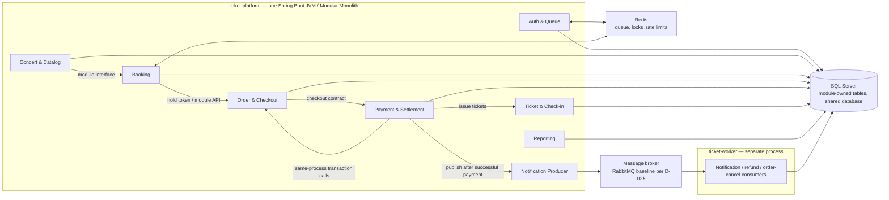

# 02 — Kiến Trúc Modular Monolith & Thiết Kế Module (Modular Monolith Architecture & Design)

> **Kiến trúc chính thức:** Hệ thống áp dụng mô hình **Hybrid — Modular Monolith + Async Worker**:
> - **Modular Monolith** (Spring Boot 3): Xử lý đồng bộ — Auth, Write API, Read API trong một JVM.
> - **Message Queue** (RabbitMQ): Tách biệt các tác vụ bất đồng bộ không cần kết quả tức thì.
> - **Worker Service** (Spring Boot riêng biệt): Consumer xử lý Email, Push, Hoàn tiền tự động.

---

## 1. Triết Lý Thiết Kế (Design Philosophy)

Hệ thống áp dụng **Domain-Driven Design (DDD)** với các nguyên tắc cốt lõi:

1. **Ranh Giới Module Rõ Ràng (Clear Module Boundaries):** Mỗi module sở hữu trọn vẹn một domain nghiệp vụ cụ thể. Các module KHÔNG gọi trực tiếp vào class của nhau — mọi tương tác qua **Module API Interface** công khai.

2. **Tách Biệt Luồng Read / Write / Async (CQRS-lite):**
   - **Read API:** Đọc cache hoặc readable secondary qua read pool khi dữ liệu cho phép.
   - **Write API (Sync):** Ghi giao dịch ACID vào SQL Server Primary — blocking, có kết quả ngay.
   - **Read-your-write:** Sau thao tác ghi, các lần đọc phụ thuộc kết quả đó đi Primary tối đa 5 giây; cache TTL không thay thế quy tắc này (D-013).
   - **Write API (Async):** Đẩy message vào Queue — non-blocking, xử lý nền.

3. **Giao Dịch ACID Trên Luồng Sync:** SQL Server transaction bao các thay đổi giao dịch trong database. Redis lock nằm ngoài transaction DB; nếu một bước thất bại, service phải chạy bù/trả khóa và tiến trình đối soát xử lý trạng thái lệch.

4. **Message Queue Cho Luồng Async:** RabbitMQ với Dead-Letter Queue (DLQ) và Retry Policy — đảm bảo at-least-once delivery cho Email, Thông báo, Hoàn tiền.

5. **Redis Cho Tốc Độ Cực Cao:** Seat Lock (SET NX EX 600), Virtual Queue (Sorted Set), Rate Limit Counter — giảm tải đọc và điều phối giữ ghế; SQL Server vẫn là nguồn sự thật giao dịch.

---

## 2. Cấu Trúc Dự Án (Project Structure)

### 2.1. Monolith Application (`ticket-platform/`)

```
com.ticketplatform/
├── TicketPlatformApplication.java        ← Main entry point (@SpringBootApplication)
│
├── shared/                               ← Thành phần dùng chung
│   ├── exception/                        ← GlobalExceptionHandler, AppException
│   ├── response/                         ← ApiResponse<T> wrapper chuẩn
│   ├── security/                         ← JwtFilter, SecurityConfig, RateLimitFilter
│   ├── event/                            ← ApplicationEvent (để publish sang Queue)
│   └── util/                             ← DateUtils, QRCodeUtils, PaginationUtils
│
├── auth/                                 ← MODULE 1: Auth & Account + Queue Gate
│   ├── api/AuthModuleApi.java
│   ├── controller/AuthController.java    ← /api/v1/auth/* (login, register, refresh)
│   ├── controller/QueueController.java   ← /api/v1/queue/* (enter, status, token)
│   ├── service/AuthService.java
│   ├── service/VirtualQueueService.java  ← Redis Sorted Set, Leaky Bucket 5K CCU
│   └── domain/{User, UserSession, Role}.java
│
├── concert/                              ← MODULE 2: Concert & Catalog (READ-heavy)
│   ├── api/ConcertModuleApi.java
│   ├── controller/ConcertController.java ← /api/v1/concerts/* (READ API)
│   ├── service/ConcertService.java       ← readOnly transaction → routing layer chọn secondary hoặc Primary theo chính sách
│   └── domain/{Concert, Venue, Artist, TicketZone, Seat}.java
│
├── booking/                              ← MODULE 3: Booking & Seat Reservation (WRITE SYNC)
│   ├── api/BookingModuleApi.java
│   ├── controller/BookingController.java ← /api/v1/seats/hold, /release
│   ├── service/BookingService.java       ← Redis SETNX + @Transactional SQL Server
│   └── domain/{SeatHold}.java
│
├── order/                                ← MODULE 4: Order & Checkout (WRITE SYNC)
│   ├── api/OrderModuleApi.java
│   ├── controller/OrderController.java   ← /api/v1/orders/*
│   ├── service/OrderService.java
│   └── domain/{Order, OrderItem}.java
│
├── payment/                              ← MODULE 5: Payment & Settlement (WRITE SYNC + ASYNC)
│   ├── api/PaymentModuleApi.java
│   ├── controller/PaymentController.java ← /api/v1/payments/*, /webhook/vnpay, /webhook/momo
│   ├── service/PaymentService.java       ← IPN verify + @Transactional update
│   ├── producer/RefundEventProducer.java ← Publish "refund.process" → Queue (ASYNC)
│   └── domain/{PaymentTransaction, Refund, Settlement}.java
│
├── ticket/                               ← MODULE 6: Ticket & Check-In (WRITE SYNC)
│   ├── api/TicketModuleApi.java
│   ├── controller/TicketController.java  ← /api/v1/tickets/*, /check-in
│   ├── service/TicketService.java        ← Sinh QR JWT, soát vé
│   └── domain/{Ticket, CheckinLog}.java
│
├── notification/                         ← MODULE 7: Notification Producer (ASYNC)
│   ├── producer/NotificationProducer.java ← Publish "notification.send" → Queue
│   └── event/PaymentSuccessEvent.java
│
├── review/                               ← MODULE 8: Review & Social (READ/WRITE)
│   ├── api/ReviewModuleApi.java
│   ├── controller/ReviewController.java
│   └── domain/{Review, ReviewReport}.java
│
└── reporting/                            ← MODULE 9: Reporting & Analytics (READ ONLY)
    ├── controller/ReportController.java  ← /api/v1/reports/*
    ├── service/ReportingService.java     ← readOnly transaction → routing layer chọn secondary hoặc Primary theo chính sách
    └── dto/                              ← RevenueReportDto, TicketSalesDto
```

### 2.2. Worker Application (`ticket-worker/`) — Process Riêng Biệt

```
com.ticketplatform.worker/
├── TicketWorkerApplication.java
├── notification/
│   ├── NotificationConsumer.java    ← @RabbitListener("notification.send")
│   └── EmailSender.java             ← SendGrid / AWS SES API
├── refund/
│   ├── RefundConsumer.java          ← @RabbitListener("refund.process")
│   └── RefundProcessor.java         ← Gọi VNPay Refund API, cập nhật SQL Server
└── cancellation/
    ├── OrderCancellationConsumer.java ← @RabbitListener("order.cancel")
    └── CancellationService.java
```

---

## 3. Danh Mục Module & Ranh Giới Nghiệp Vụ

| # | Module | Package | Luồng | Trách nhiệm cốt lõi | Bảng DB sở hữu |
|---|---|---|---|---|---|
| 1 | **Auth & Queue** | `auth` | Sync | JWT/OAuth2, RBAC, Phòng chờ ảo 5K CCU | `users`, `user_credentials`, `user_sessions`, `roles` |
| 2 | **Concert & Catalog** | `concert` | Read | Xem/lọc concert, nghệ sĩ, sơ đồ ghế | `concerts`, `venues`, `artists`, `ticket_zones`, `seats` |
| 3 | **Booking** | `booking` | Write Sync | Giữ ghế (≤4 ghế), Redis Lock 10 phút | `seat_holds` |
| 4 | **Order** | `order` | Write Sync | Tạo đơn, tính hóa đơn snapshot; discount_amount = 0 theo D-031 | `orders`, `order_items`` |
| 5 | **Payment & Settlement** | payment | Write Sync + Async | IPN, refund, đối soát, lập và phê duyệt settlement | payment_transactions, refunds, organizer_settlements, settlement_entries |
| 6 | **Ticket** | `ticket` | Write Sync | Phát hành QR vé, soát vé cổng check-in | `tickets`, `checkin_logs` |
| 7 | **Notification** | `notification` | Async Producer | Publish event sang Queue (Email/Push/In-App) | *(Queue Producer)* |
| 8 | **Review** | `review` | Read/Write | Đánh giá sao, bình luận (Verified Attendees) | `reviews`, `review_reports` |
| 9 | **Reporting** | `reporting` | Read Only | Báo cáo doanh thu, xuất Excel/PDF | *(read pool → readable secondary, nếu topology D-026 hỗ trợ)* |

<!-- BEGIN MERMAID DIAGRAM DESIGN-MODULE-MAP -->
### Ranh giới module và luồng giao tiếp


<!-- END MERMAID DIAGRAM DESIGN-MODULE-MAP -->


---

## 4. Cơ Chế Giao Tiếp (Communication Patterns)

### 4.1. Sync — Gọi Module Qua Interface (Write API)

```java
// BookingService gọi Concert Module qua Interface (cùng JVM)
@Service
@RequiredArgsConstructor
public class BookingService implements BookingModuleApi {

    private final ConcertModuleApi concertApi;  // Inject Interface
    private final RedisTemplate<String, String> redis;

    @Transactional  // ACID: Redis SETNX + INSERT seat_holds cùng lúc
    public SeatHoldResponse holdSeat(Long userId, Long seatId) {
        SeatInfo info = concertApi.getSeatInfo(seatId);  // Gọi Concert Module

        boolean locked = redis.opsForValue()
            .setIfAbsent("seat:lock:" + seatId, userId.toString(), Duration.ofSeconds(600));
        if (!locked) throw new SeatAlreadyHeldException(seatId);

        return SeatHoldResponse.from(seatHoldRepo.save(new SeatHold(userId, seatId)));
    }
}
```

### 4.2. Async — Publish Message Vào Queue (Write API Async)

```java
// PaymentService publish event sau khi IPN xác nhận thành công
@Transactional
public void handleIpnCallback(VnpayIpnRequest ipn) {
    validateSignature(ipn);
    paymentRepo.updateStatus(ipn.getTxnRef(), PaymentStatus.PAID);
    orderApi.markOrderPaid(ipn.getOrderId());     // Đồng bộ — cùng transaction
    ticketApi.issueTicket(ipn.getOrderId());      // Đồng bộ — cùng transaction

    // COMMIT transaction DB — rồi mới publish async
    notificationProducer.sendOrderPaidEvent(ipn.getOrderId(), ipn.getUserId());
}

// NotificationProducer — publish sang RabbitMQ
@Component
@RequiredArgsConstructor
public class NotificationProducer {
    private final RabbitTemplate rabbitTemplate;

    public void sendOrderPaidEvent(Long orderId, Long userId) {
        rabbitTemplate.convertAndSend(
            "notification.exchange",
            "notification.send",
            new NotificationMessage(orderId, userId, NotificationType.PAYMENT_SUCCESS)
        );
    }
}
```

### 4.3. Worker Consumer — Xử Lý Message Từ Queue

```java
// Worker Application — lắng nghe Queue và gửi thông báo
@RabbitListener(queues = "notification.send")
public void onNotificationMessage(NotificationMessage msg) {
    try {
        emailSender.sendTicketConfirmation(msg.getUserId(), msg.getOrderId());
        pushService.sendPush(msg.getUserId(), "Vé của bạn đã sẵn sàng!");
    } catch (Exception e) {
        // Retry 3 lần với exponential backoff
        // Sau 3 lần → Dead-Letter Queue "notification.dlq"
        throw new AmqpRejectAndDontRequeueException("Retry via DLQ", e);
    }
}
```

---

## 5. Quản Lý Giao Dịch (Transaction Boundaries)

### Luồng Happy Path — Đặt Vé Thành Công

```
[@Transactional BẮT ĐẦU]
  1. Redis SETNX "seat:lock:{id}" NX EX 600     ← Atomic seat lock
  2. INSERT seat_holds                            ← SQL Server Primary
  3. INSERT orders (status=PENDING)              ← SQL Server Primary
  4. INSERT order_items                           ← SQL Server Primary
  5. INSERT payment_transactions (status=PENDING) ← SQL Server Primary
[@Transactional COMMIT — tất cả hoặc không gì cả]

Client redirect → VNPay → Thanh toán

[@Transactional BẮT ĐẦU — IPN Callback]
  6. UPDATE payment_transactions → PAID          ← SQL Server Primary
  7. UPDATE orders → PAID                        ← SQL Server Primary
  8. INSERT tickets (+ QR JWT token)             ← SQL Server Primary
[@Transactional COMMIT]

[Sau COMMIT — Non-blocking]
  9. Publish "notification.send" → RabbitMQ     ← Fire & Forget
     Worker nhận → SendGrid email + FCM push
```

### Luồng Rollback — Timeout Thanh Toán (10 phút)

```
[Scheduler @Scheduled mỗi 30 giây]
  Quét orders WHERE status=PENDING AND expires_at <= SYSUTCDATETIME()
  [@Transactional]
    UPDATE orders → CANCELLED
    DELETE seat_holds WHERE order_id=?
    Redis DEL "seat:lock:{seatId}"              ← Giải phóng seat lock
  [COMMIT]
  Publish "order.cancel" → Queue → Worker → Gửi thông báo hủy đơn
```

---

## 6. Vai Trò Redis Trong Kiến Trúc

| Mục đích | Key Pattern | TTL | Ghi chú |
|---|---|---|---|
| **Virtual Queue** | `queue:{concertId}` | Đến hết giờ mở bán | ZADD score=random shuffle |
| **Queue Timeout** | `queue:timeout:{userId}` | 120 giây | Hết hạn phiên → thu hồi queue slot; seat hold đã tạo tiếp tục theo TTL 600 giây (D-002) |
| **Seat Lock** | `seat:lock:{seatId}` | 600 giây | SET NX EX — atomic, chống double-booking |
| **Concert Cache** | `concert:{id}` | 300 giây | HGETALL — giảm read SQL Server |
| **JWT Blacklist** | `jwt:blacklist` (Set) | Per-token TTL | SADD jti khi logout |
| **Rate Limit** | `ratelimit:{ip}:{min}` | 60 giây | INCR + EXPIRE |

---

## 7. Cấu Hình Spring Boot & Broker (application.yml)

```yaml
# Illustrative SQL Server JDBC configuration; use separate HikariDataSource beans
# app.datasource.write.jdbc-url: jdbc:sqlserver://${DB_PRIMARY_HOST}:1433;databaseName=${DB_NAME};encrypt=true
# app.datasource.read.jdbc-url: jdbc:sqlserver://${DB_AG_LISTENER}:1433;databaseName=${DB_NAME};applicationIntent=ReadOnly;encrypt=true;trustServerCertificate=false
spring:
  application:
    name: ticket-platform

  datasource:
    url: jdbc:sqlserver://${DB_PRIMARY_HOST}:1433;databaseName=${DB_NAME};encrypt=true;trustServerCertificate=false
    username: ${DB_USERNAME}
    password: ${DB_PASSWORD}
    hikari:
      maximum-pool-size: 50  # illustrative only; benchmark aggregate pool budget (D-030)
      minimum-idle: 10  # illustrative only
      connection-timeout: 3000

  data:
    redis:
      cluster:
        nodes: [ redis-1:6379, redis-2:6379, redis-3:6379 ]
      password: ${REDIS_PASSWORD}

  rabbitmq:
    host: ${RABBITMQ_HOST}
    port: 5672
    username: ${RABBITMQ_USERNAME}
    password: ${RABBITMQ_PASSWORD}
    listener:
      simple:
        retry:
          enabled: true
          max-attempts: 3
          initial-interval: 1000
          multiplier: 2.0   # Exponential backoff

server:
  port: 8080
  tomcat:
    threads:
      max: 200
      min-spare: 20
```
