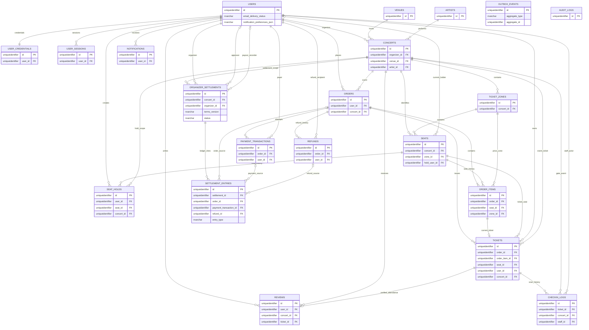

# 03 — Thiết Kế Cơ Sở Dữ Liệu & Thực Thể (ERD & Database Schema Design)

## 1. Giới Thiệu & Nguyên Tắc Thiết Kế

Tài liệu này đặc tả toàn bộ lược đồ cơ sở dữ liệu quan hệ của hệ thống bán vé sự kiện âm nhạc, gồm 20 bảng nghiệp vụ và 1 transactional outbox (21 bảng baseline); không có bảng voucher theo D-031. Kiểu dữ liệu logic tương thích Microsoft SQL Server (phiên bản/edition theo D-026), có PK/FK và ràng buộc toàn vẹn.

Người đọc và kỹ sư kiến trúc dùng tài liệu này làm đầu vào trực tiếp để vẽ sơ đồ **Entity Relationship Diagram (ERD) trên công cụ Astah** và sinh mã di chuyển lược đồ cơ sở dữ liệu (**Database Migrations - Flyway / Liquibase** trong dự án Java Spring Boot).

---

> **Quy ước kiểu dữ liệu:** đây là đặc tả logic, chưa phải DDL chạy trực tiếp. UUID dùng UNIQUEIDENTIFIER và sinh ở ứng dụng; thời điểm UTC dùng DATETIME2(6) với SYSUTCDATETIME(); chuỗi Unicode dùng NVARCHAR; JSON lưu NVARCHAR(MAX) kèm ISJSON khi cần. Đây là mô hình logic, không phải DDL chạy trực tiếp; kiểu/version-specific defaults và constraints phải được chốt trong migration.

## 2. Ma Trận Quan Hệ Giữa Các Thực Thể (Entity Relationship Matrix)

| Thực thể nguồn (From) | Mối quan hệ | Thực thể đích (To) | Ràng buộc toàn vẹn & Khóa ngoại | Ý nghĩa nghiệp vụ |
|---|---|---|---|---|
| outbox_events | Không có FK polymorphic | Các aggregate nghiệp vụ | aggregate_type + aggregate_id, không đặt FK để event tồn tại độc lập với vòng đời aggregate | Ghi cùng SQL transaction rồi publisher xác nhận gửi sang RabbitMQ |
| `users` | $1 : N$ | `user_sessions` | `ON DELETE CASCADE` | Một người dùng có nhiều phiên đăng nhập trên nhiều thiết bị |
| `users` | $1 : 1$ | `user_credentials` | `ON DELETE CASCADE` | Một người dùng có duy nhất một bản ghi xác thực mật khẩu |
| `venues` | $1 : N$ | `concerts` | `ON DELETE RESTRICT` | Một địa điểm (SVĐ) có thể tổ chức nhiều concert theo thời gian |
| `artists` | $1 : N$ | `concerts` | `ON DELETE RESTRICT` | Một nghệ sĩ có thể có nhiều show diễn |
| `users (Organizer)` | $1 : N$ | `concerts` | `ON DELETE RESTRICT` | Một Ban tổ chức quản lý nhiều concert trên nền tảng |
| `concerts` | $1 : N$ | `ticket_zones` | `ON DELETE CASCADE` | Một concert chia thành nhiều khu vực/hạng vé (VIP, CAT 1...) |
| `ticket_zones` | $1 : N$ | `seats` | `ON DELETE CASCADE` | Mỗi khu vực chứa hàng nghìn ghế ngồi vật lý |
| `seats` | $1 : N$ | `seat_holds` | `ON DELETE CASCADE` | Một ghế có thể có nhiều lịch sử giữ chỗ qua các phiên |
| `users` | $1 : N$ | `seats` (current hold) | FK `seats.hold_user_id` → `users(id)` | Người dùng hiện tại giữ ghế khi `seats.status = HELD` |
| `users` | $1 : N$ | `orders` | `ON DELETE RESTRICT` | Khách hàng sở hữu nhiều đơn hàng |
| `orders` | $1 : N$ | `order_items` | `ON DELETE CASCADE` | Một đơn hàng chứa từ 1 đến 4 vé (chi tiết từng ghế) |
| `seats` | $1 : N$ | `order_items` | `ON DELETE RESTRICT` | Lưu lịch sử nhiều lần bán/hoàn của ghế; trạng thái `seats` và transaction bảo đảm chỉ một lần bán hiệu lực |
| `orders` | $1 : N$ | `tickets` | `ON DELETE RESTRICT` | Một đơn hàng thành công phát hành số lượng vé tương ứng |
| `orders` | $1 : N$ | `payment_transactions` | `ON DELETE RESTRICT` | Một đơn hàng có thể có nhiều giao dịch thử thanh toán |
| `orders` | $1 : N$ | `refunds` | `ON DELETE RESTRICT` | Đơn hàng hủy phát sinh bản ghi hoàn tiền |
| `tickets` | $1 : N$ | `checkin_logs` | `ON DELETE RESTRICT` | Một vé lưu vết các lần quét qua cổng (thành công hoặc lỗi) |
| `tickets` | $1 : 0..1$ | `reviews` | `ON DELETE RESTRICT` | Review giữ FK bắt buộc đến vé đã check-in; không xóa vé đã được dùng để xác minh |
| `users` | $1 : N$ | `notifications` | `ON DELETE CASCADE` | Người dùng nhận nhiều thông báo trong hộp thư |
| concerts | 1 : N | organizer_settlements | FK organizer_settlements.concert_id → concerts.id; ON DELETE RESTRICT | Mỗi kỳ quyết toán gắn với một concert |
| users (Organizer) | 1 : N | organizer_settlements | FK organizer_settlements.organizer_id → users.id; ON DELETE RESTRICT | Chỉ quyết toán cho Organizer sở hữu concert |
| users (Admin/Finance) | 1 : N | organizer_settlements | FK approved_by/paid_by → users.id; nullable; thao tác được audit | Người duyệt và người ghi nhận payout |
| organizer_settlements | 1 : N | settlement_entries | FK settlement_entries.settlement_id → organizer_settlements.id; ON DELETE RESTRICT | Các dòng payment/refund/adjustment cấu thành số phải trả |
| orders | 1 : 0..N | settlement_entries | FK nullable order_id → orders.id | Dòng nguồn payment/refund tham chiếu order tương ứng |
| payment_transactions | 1 : 0..N | settlement_entries | FK nullable payment_transaction_id → payment_transactions.id | Dòng doanh thu chỉ ghi payment đã xác nhận |
| refunds | 1 : 0..N | settlement_entries | FK nullable refund_id → refunds.id | Dòng giảm trừ chỉ ghi refund đã xác nhận |

<!-- BEGIN MERMAID DIAGRAM DESIGN-ERD -->
### ERD theo các FK đã khai báo; cần đối chiếu ma trận quan hệ

<!-- END MERMAID DIAGRAM DESIGN-ERD -->

---

## 3. Đặc Tả 21 Bảng Dữ Liệu Baseline (20 bảng nghiệp vụ và transactional outbox)

### Nhóm 1: Quản Trị Người Dùng & Phiên (User & Authentication)

#### 1. Bảng `users` (Thông tin người dùng)
| Tên cột | Kiểu dữ liệu | Nullable | Mặc định | Khóa / Ràng buộc | Diễn giải |
|---|---|---|---|---|---|
| `id` | UNIQUEIDENTIFIER | No | `Sinh tại ứng dụng` | **PK** | Định danh duy nhất người dùng |
| `email` | NVARCHAR(255) | No | — | **UNIQUE** | Địa chỉ thư điện tử |
| `email_delivery_status` | NVARCHAR(20) | No | 'ACTIVE' | CHECK (email_delivery_status IN ('ACTIVE', 'BOUNCED')) | Tình trạng nhận email; BOUNCED chặn marketing email tới khi người dùng cập nhật địa chỉ |
| `phone_number` | NVARCHAR(20) | No | — | **UNIQUE** | Số điện thoại chuẩn VN (E.164) |
| `full_name` | NVARCHAR(100) | No | — | — | Họ và tên hiển thị |
| `role` | NVARCHAR(30) | No | `'CUSTOMER'` | **CHECK** (`role IN ('CUSTOMER', 'ORGANIZER', 'ADMIN', 'STAFF')`) | Vai trò phân quyền |
| `status` | NVARCHAR(20) | No | 'ACTIVE' | **CHECK** (`status IN ('ACTIVE', 'LOCKED', 'DELETED')`) | Trạng thái tài khoản |
| `avatar_url` | NVARCHAR(MAX) | Yes | NULL | — | Đường dẫn ảnh đại diện trên object storage |
| `notification_preferences_json` | NVARCHAR(MAX) | No | N'{}' | CHECK (ISJSON(notification_preferences_json)=1) | Tùy chọn marketing/reminder theo kênh; không lưu quyền tắt notification in-app bắt buộc |
| `created_at` | DATETIME2(6) | No | `SYSUTCDATETIME()` | — | Thời điểm đăng ký |
| `updated_at` | DATETIME2(6) | No | `SYSUTCDATETIME()` | — | Thời điểm cập nhật cuối |

#### 2. Bảng `user_credentials` (Bảo mật tài khoản)
| Tên cột | Kiểu dữ liệu | Nullable | Mặc định | Khóa / Ràng buộc | Diễn giải |
|---|---|---|---|---|---|
| `id` | UNIQUEIDENTIFIER | No | `Sinh tại ứng dụng` | **PK** | Khóa chính |
| `user_id` | UNIQUEIDENTIFIER | No | — | **FK** $\rightarrow$ `users(id)`, **UNIQUE** | Khóa ngoại người dùng |
| `password_hash` | NVARCHAR(255) | No | — | — | Mật khẩu băm bcrypt cost 12 |
| `failed_attempts` | SMALLINT | No | 0 | — | Số lần đăng nhập sai liên tiếp |
| `locked_until` | DATETIME2(6) | Yes | NULL | — | Thời điểm hết hạn khóa tạm thời |
| `two_factor_secret` | NVARCHAR(64) | Yes | NULL | — | Khóa bí mật 2FA TOTP (nếu bật) |
| `created_at` | DATETIME2(6) | No | `SYSUTCDATETIME()` | — | Thời điểm tạo |

#### 3. Bảng `user_sessions` (Quản lý phiên đăng nhập)
| Tên cột | Kiểu dữ liệu | Nullable | Mặc định | Khóa / Ràng buộc | Diễn giải |
|---|---|---|---|---|---|
| `id` | UNIQUEIDENTIFIER | No | `Sinh tại ứng dụng` | **PK** | Khóa chính |
| `user_id` | UNIQUEIDENTIFIER | No | — | **FK** $\rightarrow$ `users(id)` | Khóa ngoại người dùng |
| `refresh_token_hash`| NVARCHAR(64) | No | — | **UNIQUE** | Băm SHA-256 của Refresh Token |
| `device_info` | NVARCHAR(255) | Yes | NULL | — | Tên trình duyệt / Thiết bị |
| `ip_address` | NVARCHAR(45) | Yes | NULL | — | Địa chỉ IP đăng nhập |
| `expires_at` | DATETIME2(6) | No | — | — | Thời điểm hết hạn (7 ngày) |
| `created_at` | DATETIME2(6) | No | `SYSUTCDATETIME()` | — | Thời điểm khởi tạo phiên |

---

### Nhóm 2: Sự Kiện, Địa Điểm & Sơ Đồ Khán Đài (Catalog & Venues)

#### 4. Bảng `venues` (Địa điểm tổ chức)
| Tên cột | Kiểu dữ liệu | Nullable | Mặc định | Khóa / Ràng buộc | Diễn giải |
|---|---|---|---|---|---|
| `id` | UNIQUEIDENTIFIER | No | `Sinh tại ứng dụng` | **PK** | Định danh địa điểm |
| `name` | NVARCHAR(200) | No | — | — | Tên địa điểm (VD: SVĐ Mỹ Đình) |
| `address` | NVARCHAR(MAX) | No | — | — | Địa chỉ chi tiết |
| `city` | NVARCHAR(100) | No | — | — | Thành phố (Hà Nội, TP.HCM...) |
| `total_capacity`| INTEGER | No | — | **CHECK** (`total_capacity > 0`) | Tổng sức chứa thiết kế |
| `layout_svg_url`| NVARCHAR(MAX) | Yes | NULL | — | File SVG sơ đồ kiến trúc gốc |
| `created_at` | DATETIME2(6) | No | `SYSUTCDATETIME()` | — | Thời điểm tạo |

#### 5. Bảng `artists` (Nghệ sĩ biểu diễn)
| Tên cột | Kiểu dữ liệu | Nullable | Mặc định | Khóa / Ràng buộc | Diễn giải |
|---|---|---|---|---|---|
| `id` | UNIQUEIDENTIFIER | No | `Sinh tại ứng dụng` | **PK** | Định danh nghệ sĩ |
| `name` | NVARCHAR(150) | No | — | — | Tên nghệ sĩ / Ban nhạc |
| `bio` | NVARCHAR(MAX) | Yes | NULL | — | Giới thiệu tiểu sử nghệ sĩ |
| `image_url` | NVARCHAR(MAX) | Yes | NULL | — | Đường dẫn ảnh đại diện nghệ sĩ |
| `created_at` | DATETIME2(6) | No | `SYSUTCDATETIME()` | — | Thời điểm tạo |

#### 6. Bảng `concerts` (Thông tin sự kiện ca nhạc)
| Tên cột | Kiểu dữ liệu | Nullable | Mặc định | Khóa / Ràng buộc | Diễn giải |
|---|---|---|---|---|---|
| `id` | UNIQUEIDENTIFIER | No | `Sinh tại ứng dụng` | **PK** | Định danh concert |
| `organizer_id` | UNIQUEIDENTIFIER | No | — | **FK** $\rightarrow$ `users(id)` | Ban tổ chức sở hữu |
| `venue_id` | UNIQUEIDENTIFIER | No | — | **FK** $\rightarrow$ `venues(id)` | Địa điểm tổ chức |
| `artist_id` | UNIQUEIDENTIFIER | No | — | **FK** $\rightarrow$ `artists(id)` | Nghệ sĩ chính |
| `title` | NVARCHAR(255) | No | — | — | Tên buổi biểu diễn |
| `description` | NVARCHAR(MAX) | Yes | NULL | — | Mô tả chi tiết chương trình |
| `banner_url` | NVARCHAR(MAX) | Yes | NULL | — | Ảnh poster chính thức |
| `status` | NVARCHAR(30) | No | `'DRAFT'` | **CHECK** (`status IN ('DRAFT', 'PENDING_REVIEW', 'PUBLISHED', 'ON_SALE', 'SOLD_OUT', 'CLOSED', 'PENDING_CANCELLATION', 'COMPLETED', 'CANCELLED')`) | Trạng thái vòng đời concert |
| `status_before_cancellation` | NVARCHAR(30) | Yes | NULL | **CHECK** theo các trạng thái có thể khôi phục | Trạng thái trước khi yêu cầu hủy; dùng khôi phục nếu Admin từ chối |
| `cancellation_requested_at` | DATETIME2(6) | Yes | NULL | — | Thời điểm Organizer gửi yêu cầu hủy đang chờ Admin |
| `sale_start_time`| DATETIME2(6) | No | — | — | Giờ bắt đầu mở bán vé |
| `show_start_time`| DATETIME2(6) | No | — | — | Giờ bắt đầu biểu diễn |
| `show_end_time` | DATETIME2(6) | No | — | — | Giờ kết thúc dự kiến |
| `created_at` | DATETIME2(6) | No | `SYSUTCDATETIME()` | — | Thời điểm tạo |
| `updated_at` | DATETIME2(6) | No | `SYSUTCDATETIME()` | — | Thời điểm cập nhật cuối |

#### 7. Bảng `ticket_zones` (Phân khu / Hạng vé)
| Tên cột | Kiểu dữ liệu | Nullable | Mặc định | Khóa / Ràng buộc | Diễn giải |
|---|---|---|---|---|---|
| `id` | UNIQUEIDENTIFIER | No | `Sinh tại ứng dụng` | **PK** | Định danh khu vực vé |
| `concert_id` | UNIQUEIDENTIFIER | No | — | **FK** $\rightarrow$ `concerts(id)` | Khóa ngoại sự kiện |
| `name` | NVARCHAR(100) | No | — | — | Tên hạng vé (VIP 1, CAT 1...) |
| `code` | NVARCHAR(20) | No | — | — | Mã phân khu (Z_VIP_1) |
| `price` | BIGINT| No | — | **CHECK** (`price >= 0`) | Đơn giá niêm yết (VNĐ) |
| `total_capacity`| INTEGER | No | — | **CHECK** (`total_capacity > 0`) | Tổng số ghế/vé của Zone |
| `color_hex` | NVARCHAR(7) | No | `'#3B82F6'` | — | Mã màu hiển thị trên sơ đồ |
| `is_seated` | BIT | No | 1 | — | `TRUE`: Ghế ngồi; `FALSE`: Đứng (GA) |
| `created_at` | DATETIME2(6) | No | `SYSUTCDATETIME()` | — | Thời điểm tạo |

#### 8. Bảng `seats` (Ghế ngồi vật lý chi tiết)
| Tên cột | Kiểu dữ liệu | Nullable | Mặc định | Khóa / Ràng buộc | Diễn giải |
|---|---|---|---|---|---|
| `id` | UNIQUEIDENTIFIER | No | `Sinh tại ứng dụng` | **PK** | Định danh ghế |
| `concert_id` | UNIQUEIDENTIFIER | No | — | **FK** $\rightarrow$ `concerts(id)` | Thuộc concert nào |
| `zone_id` | UNIQUEIDENTIFIER | No | — | **FK** $\rightarrow$ `ticket_zones(id)` | Thuộc khu vực nào |
| `row_label` | NVARCHAR(10) | Yes | NULL | — | Tên hàng ghế (Hàng A, B, C...) |
| `seat_number` | NVARCHAR(10) | Yes | NULL | — | Số ghế (Số 01, 02...) |
| status | NVARCHAR(20) | No | AVAILABLE | CHECK (AVAILABLE, HELD, SOLD, BLOCKED) | Trạng thái ghế theo SM02; ghế thuộc concert CANCELLED không đưa lại vào bán |
| `hold_user_id` | UNIQUEIDENTIFIER | Yes | NULL | **FK** → `users(id)` | Chủ thể giữ ghế hiện tại; NULL ngoài trạng thái HELD |
| `hold_started_at` | DATETIME2(6) | Yes | NULL | — | Thời điểm bắt đầu TTL 600 giây |
| `hold_expires_at` | DATETIME2(6) | Yes | NULL | — | Hạn giữ cố định; tạo một lần khi hold thành công, không gia hạn khi checkout |
| `version` | BIGINT | No | 0 | — | Số phiên bản cho conditional update/optimistic concurrency |
| `coordinate_x` | INTEGER | Yes | NULL | — | Tọa độ X trên sơ đồ SVG |
| `coordinate_y` | INTEGER | Yes | NULL | — | Tọa độ Y trên sơ đồ SVG |
| `created_at` | DATETIME2(6) | No | `SYSUTCDATETIME()` | — | Thời điểm tạo |
| `updated_at` | DATETIME2(6) | No | `SYSUTCDATETIME()` | — | Thời điểm cập nhật cuối |

---

### Nhóm 3: Giữ Ghế, Đơn Hàng & Thanh Toán (Booking, Orders & Payments)

#### 9. Bảng `seat_holds` (Nhật ký giữ ghế tạm thời)
| Tên cột | Kiểu dữ liệu | Nullable | Mặc định | Khóa / Ràng buộc | Diễn giải |
|---|---|---|---|---|---|
| `id` | UNIQUEIDENTIFIER | No | `Sinh tại ứng dụng` | **PK** | Khóa chính |
| `user_id` | UNIQUEIDENTIFIER | No | — | **FK** $\rightarrow$ `users(id)` | Người đang giữ ghế |
| `seat_id` | UNIQUEIDENTIFIER | No | — | **FK** $\rightarrow$ `seats(id)` | Ghế được giữ |
| `concert_id` | UNIQUEIDENTIFIER | No | — | **FK** $\rightarrow$ `concerts(id)` | Sự kiện liên quan |
| `hold_token` | NVARCHAR(64) | No | — | **INDEX** (không UNIQUE) | Token nhóm dùng chung cho 1–4 dòng seat_holds trong cùng một lần giữ |
| status | NVARCHAR(20) | No | ACTIVE | CHECK (ACTIVE, COMPLETED, EXPIRED, RELEASED) | Nhật ký giữ ghế; ACTIVE có hạn cố định 600 giây, COMPLETED khi chuyển thành bán |
| `expires_at` | DATETIME2(6) | No | — | **INDEX** | Hạn cố định = thời điểm bắt đầu giữ + 600 giây; checkout không gia hạn TTL |
| `created_at` | DATETIME2(6) | No | `SYSUTCDATETIME()` | — | Thời điểm ghế được giữ; group expiry tính từ lần giữ đầu tiên và không gia hạn khi checkout |

#### 10. Bảng `orders` (Đơn hàng đặt vé)
| Tên cột | Kiểu dữ liệu | Nullable | Mặc định | Khóa / Ràng buộc | Diễn giải |
|---|---|---|---|---|---|
| `id` | UNIQUEIDENTIFIER | No | `Sinh tại ứng dụng` | **PK** | Khóa chính đơn hàng |
| `order_code` | NVARCHAR(32) | No | — | **UNIQUE** | Mã hiển thị cho khách (VD: `ORD-20261024-8F9B`) |
| `user_id` | UNIQUEIDENTIFIER | No | — | **FK** $\rightarrow$ `users(id)` | Khách hàng mua vé |
| `concert_id` | UNIQUEIDENTIFIER | No | — | **FK** $\rightarrow$ `concerts(id)` | Sự kiện đặt vé |
| `total_amount` | BIGINT| No | — | — | Tổng giá vé theo snapshot trong order_items, trước giảm giá/thuế/phí |
| `discount_amount`| BIGINT| No | 0 | — | Số tiền giảm; luôn bằng 0 trong baseline theo D-031 |
| `service_fee_amount` | BIGINT | No | 0 | **CHECK** (`service_fee_amount >= 0`) | Phí dịch vụ snapshot tại thời điểm đặt |
| `tax_amount` | BIGINT | No | 0 | **CHECK** (`tax_amount >= 0`) | Thuế snapshot tại thời điểm đặt |
| `final_amount` | BIGINT| No | — | **CHECK** (`final_amount >= 0`) | Số tiền thanh toán; `total_amount - discount_amount + service_fee_amount + tax_amount` |
| `status` | NVARCHAR(30) | No | `'PENDING'` | **CHECK** (`status IN ('PENDING', 'PAID', 'CANCELLED', 'OUT_TIME', 'REFUND_PENDING', 'REFUNDED', 'REFUND_FAILED')`) | Trạng thái đơn hàng |
| `payment_gateway`| NVARCHAR(20) | Yes | NULL | **CHECK** (`payment_gateway IN ('VNPAY', 'MOMO')`) | Cổng thanh toán lựa chọn |
| `hold_token` | NVARCHAR(64) | No | — | **UNIQUE** | Token nhóm của hold group; tối đa một order được tạo từ một hold group |
| `idempotency_key` | NVARCHAR(64) | No | — | **UNIQUE** | Khóa tạo đơn bền vững; retention tối thiểu 24 giờ (BR-ORD-008) |
| `expires_at` | DATETIME2(6) | No | — | **INDEX** | Hạn đơn bằng expires_at của hold group; không tính lại từ created_at |
| `created_at` | DATETIME2(6) | No | `SYSUTCDATETIME()` | — | Thời điểm tạo đơn |
| `updated_at` | DATETIME2(6) | No | `SYSUTCDATETIME()` | — | Thời điểm cập nhật cuối |

#### 11. Bảng `order_items` (Chi tiết ghế trong đơn)
| Tên cột | Kiểu dữ liệu | Nullable | Mặc định | Khóa / Ràng buộc | Diễn giải |
|---|---|---|---|---|---|
| `id` | UNIQUEIDENTIFIER | No | `Sinh tại ứng dụng` | **PK** | Khóa chính |
| `order_id` | UNIQUEIDENTIFIER | No | — | **FK** $\rightarrow$ `orders(id)` | Thuộc đơn hàng nào |
| `seat_id` | UNIQUEIDENTIFIER | No | — | **FK** $\rightarrow$ `seats(id)` | Ghế được mua; không UNIQUE để giữ lịch sử khi vé bị hủy và ghế được bán lại |
| `zone_id` | UNIQUEIDENTIFIER | No | — | **FK** $\rightarrow$ `ticket_zones(id)` | Hạng vé của ghế |
| `price` | BIGINT| No | — | — | Giá tiền tính tại thời điểm mua |
| `created_at` | DATETIME2(6) | No | `SYSUTCDATETIME()` | — | Thời điểm tạo |

#### 12. Bảng `tickets` (Vé điện tử phát hành)
| Tên cột | Kiểu dữ liệu | Nullable | Mặc định | Khóa / Ràng buộc | Diễn giải |
|---|---|---|---|---|---|
| `id` | UNIQUEIDENTIFIER | No | `Sinh tại ứng dụng` | **PK** | Định danh vé |
| `ticket_code` | NVARCHAR(32) | No | — | **UNIQUE** | Mã vé in trên vé điện tử |
| `order_id` | UNIQUEIDENTIFIER | No | — | **FK** $\rightarrow$ `orders(id)` | Đơn hàng phát hành |
| `order_item_id` | UNIQUEIDENTIFIER | No | — | **FK** $\rightarrow$ `order_items(id)`, **UNIQUE** | Một vé hiện hành tối đa cho mỗi item; vé lịch sử của lần bán trước vẫn được lưu ở item cũ |
| `seat_id` | UNIQUEIDENTIFIER | No | — | **FK** $\rightarrow$ `seats(id)` | Ghế tương ứng |
| `user_id` | UNIQUEIDENTIFIER | No | — | **FK** $\rightarrow$ `users(id)` | Chủ sở hữu vé |
| `concert_id` | UNIQUEIDENTIFIER | No | — | **FK** $\rightarrow$ `concerts(id)` | Sự kiện tham gia |
| `qr_code_hash` | NVARCHAR(128) | No | — | **UNIQUE** | Chuỗi băm đối chiếu mã QR |
| status | NVARCHAR(30) | No | ORDERED | CHECK (ORDERED, CHECKED, CANCELLED, EXPIRED_UNATTENDED) | Trạng thái vé theo SM04; không đồng nhất với trạng thái notification |
| `created_at` | DATETIME2(6) | No | `SYSUTCDATETIME()` | — | Thời điểm phát hành |
| `updated_at` | DATETIME2(6) | No | `SYSUTCDATETIME()` | — | Thời điểm cập nhật |

#### 13. Bảng `payment_transactions` (Lịch sử giao dịch cổng thanh toán)
| Tên cột | Kiểu dữ liệu | Nullable | Mặc định | Khóa / Ràng buộc | Diễn giải |
|---|---|---|---|---|---|
| `id` | UNIQUEIDENTIFIER | No | `Sinh tại ứng dụng` | **PK** | Khóa chính |
| `order_id` | UNIQUEIDENTIFIER | No | — | **FK** $\rightarrow$ `orders(id)` | Đơn hàng thanh toán |
| `user_id` | UNIQUEIDENTIFIER | No | — | **FK** $\rightarrow$ `users(id)` | Người chuyển tiền |
| `provider` | NVARCHAR(20) | No | — | **CHECK** (`provider IN ('VNPAY', 'MOMO')`) | Đơn vị cổng |
| `provider_transaction_id`| NVARCHAR(100)| Yes | NULL | **Filtered UNIQUE** (`provider`, `provider_transaction_id`) khi khác NULL | Mã giao dịch ngân hàng đối tác; chống xử lý callback trùng |
| `idempotency_key` | NVARCHAR(64) | No | — | **UNIQUE** | Khóa chống trùng lặp |
| `amount` | BIGINT| No | — | — | Số tiền thanh toán (VNĐ) |
| `status` | NVARCHAR(30) | No | `'INITIATED'` | **CHECK** (`status IN ('INITIATED', 'PROCESSING', 'SUCCESS', 'FAILED', 'UNKNOWN', 'SUCCESS_UNFULFILLED')`) | Chỉ trạng thái thanh toán; trạng thái hoàn tiền nằm riêng trong `refunds` |
| `payload_raw` | NVARCHAR(MAX) | Yes | NULL | — | Toàn bộ phản hồi thô từ Webhook IPN |
| `created_at` | DATETIME2(6) | No | `SYSUTCDATETIME()` | — | Thời điểm bắt đầu |
| `updated_at` | DATETIME2(6) | No | `SYSUTCDATETIME()` | — | Thời điểm hoàn tất |

#### 14. Bảng `refunds` (Yêu cầu & Lịch sử hoàn tiền)
| Tên cột | Kiểu dữ liệu | Nullable | Mặc định | Khóa / Ràng buộc | Diễn giải |
|---|---|---|---|---|---|
| `id` | UNIQUEIDENTIFIER | No | `Sinh tại ứng dụng` | **PK** | Khóa chính hoàn tiền |
| `order_id` | UNIQUEIDENTIFIER | No | — | **FK** $\rightarrow$ `orders(id)` | Đơn hàng được hoàn |
| `user_id` | UNIQUEIDENTIFIER | No | — | **FK** $\rightarrow$ `users(id)` | Người nhận hoàn tiền |
| `provider` | NVARCHAR(20) | No | — | **CHECK** (`provider IN ('VNPAY', 'MOMO')`) | Provider nhận lệnh hoàn tiền |
| `idempotency_key` | NVARCHAR(100) | No | — | **UNIQUE** | Khóa duy nhất cho logical refund request |
| `reason` | NVARCHAR(MAX) | No | — | — | Lý do hoàn tiền |
| `refund_rate` | SMALLINT | No | — | **CHECK** (`refund_rate IN (100, 50, 0)`) | Tỷ lệ hoàn theo chính sách (%) |
| `refund_amount` | BIGINT| No | — | — | Số tiền thực tế hoàn lại |
| status | NVARCHAR(20) | No | PENDING | CHECK (PENDING, PROCESSING, UNKNOWN, COMPLETED, FAILED, REJECTED) | Trạng thái refund theo SM05; UNKNOWN phải reconcile, không retry mù |
| `attempt_count` | SMALLINT | No | 0 | **CHECK** (`attempt_count >= 0`) | Số lần gửi/retry đã ghi audit |
| `provider_refund_id`| NVARCHAR(100)| Yes | NULL | **Filtered UNIQUE** (`provider`, `provider_refund_id`) khi refund ID khác NULL | Mã giao dịch hoàn tiền phía đối tác |
| `created_at` | DATETIME2(6) | No | `SYSUTCDATETIME()` | — | Thời điểm tạo yêu cầu |
| `updated_at` | DATETIME2(6) | No | `SYSUTCDATETIME()` | — | Thời điểm hoàn tất |

---

### Nhóm 4: Soát Vé, Đánh Giá & Vận Hành (Gate, Reviews & Auditing)

#### 15. Bảng `checkin_logs` (Nhật ký quét mã QR tại cổng)
| Tên cột | Kiểu dữ liệu | Nullable | Mặc định | Khóa / Ràng buộc | Diễn giải |
|---|---|---|---|---|---|
| `id` | UNIQUEIDENTIFIER | No | `Sinh tại ứng dụng` | **PK** | Khóa chính bản ghi |
| `ticket_id` | UNIQUEIDENTIFIER | No | — | **FK** $\rightarrow$ `tickets(id)` | Vé được quét |
| `concert_id` | UNIQUEIDENTIFIER | No | — | **FK** $\rightarrow$ `concerts(id)` | Sự kiện |
| `gate_id` | NVARCHAR(30) | No | — | — | Cổng soát vé (GATE_A_VIP) |
| `staff_id` | UNIQUEIDENTIFIER | No | — | **FK** $\rightarrow$ `users(id)` | Nhân viên thực hiện quét |
| `device_id` | NVARCHAR(64) | No | — | — | Mã thiết bị cầm tay |
| `checkin_time` | DATETIME2(6) | No | `SYSUTCDATETIME()` | — | Thời điểm quét chính xác |
| checkin_mode | NVARCHAR(20) | No | ONLINE | CHECK IN (ONLINE, MANUAL_OVERRIDE) | Chế độ soát vé; không có OFFLINE_SYNC theo D-023 |
| `result` | NVARCHAR(30) | No | — | **CHECK** (`result IN ('SUCCESS', 'ALREADY_USED', 'INVALID_SIGNATURE', 'CANCELLED', 'WRONG_GATE')`) | Kết quả kiểm tra |

#### 16. Bảng `reviews` (Đánh giá của khán giả thực tế)
| Tên cột | Kiểu dữ liệu | Nullable | Mặc định | Khóa / Ràng buộc | Diễn giải |
|---|---|---|---|---|---|
| `id` | UNIQUEIDENTIFIER | No | `Sinh tại ứng dụng` | **PK** | Khóa chính bài đánh giá |
| `user_id` | UNIQUEIDENTIFIER | No | — | **FK** $\rightarrow$ `users(id)` | Tác giả bài viết |
| `concert_id` | UNIQUEIDENTIFIER | No | — | **FK** $\rightarrow$ `concerts(id)` | Concert được đánh giá |
| `ticket_id` | UNIQUEIDENTIFIER | No | — | **FK** $\rightarrow$ `tickets(id)`, **UNIQUE** | Chứng chỉ vé đã tham dự |
| `rating` | SMALLINT | No | — | **CHECK** (`rating BETWEEN 1 AND 5`) | Số sao đánh giá (1–5 sao) |
| `comment` | NVARCHAR(MAX) | Yes | NULL | — | Nội dung nhận xét |
| `is_verified_attendee`| BIT | No | 1 | — | Xác nhận đã qua cổng check-in |
| `created_at` | DATETIME2(6) | No | `SYSUTCDATETIME()` | — | Thời điểm đăng |

#### 17. Bảng `notifications` (Hộp thư thông báo người dùng)
| Tên cột | Kiểu dữ liệu | Nullable | Mặc định | Khóa / Ràng buộc | Diễn giải |
|---|---|---|---|---|---|
| `id` | UNIQUEIDENTIFIER | No | `Sinh tại ứng dụng` | **PK** | Khóa chính thông báo |
| `user_id` | UNIQUEIDENTIFIER | No | — | **FK** $\rightarrow$ `users(id)` | Người nhận thông báo |
| `event_type` | NVARCHAR(50) | No | — | — | Mã sự kiện (ORDER_SUCCESS...) |
| `channel` | NVARCHAR(20) | No | — | **CHECK** (`channel IN ('IN_APP', 'EMAIL', 'PUSH', 'SMS')`) | Kênh phân phối |
| `title` | NVARCHAR(255) | No | — | — | Tiêu đề thông báo |
| `content` | NVARCHAR(MAX) | No | — | — | Nội dung tóm tắt |
| `status` | NVARCHAR(20) | No | 'PENDING' | **CHECK** (`status IN ('PENDING', 'SENT', 'DELIVERED', 'READ', 'FAILED')`) | SENT: provider accepted; DELIVERED: provider receipt; READ: user opened; FAILED: terminal send failure |
| `deduplication_key` | NVARCHAR(128) | No | — | **UNIQUE** | Khóa ổn định từ event/recipient/channel/purpose để chống gửi trùng |
| `provider_message_id` | NVARCHAR(128) | Yes | NULL | — | Mã nhận diện do email/SMS/push provider trả về |
| `provider_response` | NVARCHAR(MAX) | Yes | NULL | — | Mã/kết quả provider đã lọc dữ liệu nhạy cảm |
| `attempt_count` | SMALLINT | No | 0 | — | Số lần gửi/retry |
| `created_at` | DATETIME2(6) | No | `SYSUTCDATETIME()` | — | Thời điểm tạo notification |
| `delivered_at` | DATETIME2(6) | Yes | NULL | — | Thời điểm provider xác nhận giao; NULL nếu chưa có receipt |
| `sent_at` | DATETIME2(6) | Yes | NULL | — | Thời điểm provider chấp nhận gửi; NULL nếu chưa có provider acceptance |
| `read_at` | DATETIME2(6) | Yes | NULL | — | Thời điểm người dùng mở đọc |

### Nhóm 5: Đối soát & Quyết toán (Finance & Settlement)

#### 18. Bảng organizer_settlements (Hồ sơ quyết toán Organizer)
| Tên cột | Kiểu dữ liệu | Nullable | Mặc định | Khóa / Ràng buộc | Diễn giải |
|---|---|---|---|---|---|
| id | UNIQUEIDENTIFIER | No | Sinh tại ứng dụng | PK | Khóa hồ sơ quyết toán |
| concert_id | UNIQUEIDENTIFIER | No | — | FK → concerts(id), ON DELETE RESTRICT | Concert được quyết toán |
| organizer_id | UNIQUEIDENTIFIER | No | — | FK → users(id), ON DELETE RESTRICT | Organizer thụ hưởng theo hợp đồng |
| period_start / period_end | DATETIME2(6) | No | — | CHECK (period_start < period_end) | Kỳ dữ liệu được tổng hợp |
| currency | CHAR(3) | No | VND | CHECK (currency = 'VND') | Đơn vị tiền baseline |
| captured_amount | BIGINT | No | 0 | CHECK (captured_amount >= 0) | Tổng tiền khách thực tế đã thanh toán/capture thành công |
| eligible_sales_amount | BIGINT | No | 0 | CHECK (eligible_sales_amount >= 0) | Căn cứ doanh thu được áp dụng payout theo snapshot hợp đồng; phân bổ phí/thuế theo điều khoản |
| refunded_amount | BIGINT | No | 0 | CHECK (refunded_amount >= 0) | Tổng refund đã xác nhận |
| platform_fee_amount | BIGINT | No | 0 | CHECK (platform_fee_amount >= 0) | Phí tính theo snapshot hợp đồng |
| adjustment_amount | BIGINT | No | 0 | — | Điều chỉnh có lý do, có audit; có thể âm/dương |
| payable_amount | BIGINT | No | 0 | CHECK (payable_amount >= 0) | Số ròng phải trả theo công thức và hợp đồng |
| terms_version | NVARCHAR(50) | No | — | — | Phiên bản điều khoản thương mại đã ký |
| terms_snapshot_json | NVARCHAR(MAX) | No | — | CHECK (ISJSON(terms_snapshot_json)=1) | Snapshot tỷ lệ/căn cứ tính, phí, thời điểm và điều kiện payout |
| reconciliation_status | NVARCHAR(20) | No | PENDING | CHECK (PENDING, MATCHED, DISCREPANCY) | Trạng thái đối soát trước khi phê duyệt |
| status | NVARCHAR(30) | No | DRAFT | CHECK (DRAFT, PENDING_RECONCILIATION, READY_FOR_APPROVAL, APPROVED, ON_HOLD, PAID, REJECTED) | Trạng thái hồ sơ; transition guard theo UC13/D-034 |
| approved_by / approved_at | UNIQUEIDENTIFIER / DATETIME2(6) | Yes | NULL | approved_by FK → users(id) | Người duyệt và thời điểm; bắt buộc khi APPROVED/PAID |
| paid_by / paid_at | UNIQUEIDENTIFIER / DATETIME2(6) | Yes | NULL | paid_by FK → users(id) | Người ghi nhận chuyển tiền và thời điểm; chỉ sau bằng chứng xác nhận |
| payout_reference | NVARCHAR(128) | Yes | NULL | CHECK status=PAID ⇒ non-NULL | Mã tham chiếu payout; không hàm ý tự động chuyển khoản |
| transfer_evidence_uri | NVARCHAR(512) | Yes | NULL | Secure storage reference | Bằng chứng chuyển tiền được kiểm soát quyền truy cập |
| created_at / updated_at | DATETIME2(6) | No | SYSUTCDATETIME() | — | Thời gian tạo/cập nhật UTC |

#### 19. Bảng settlement_entries (Sổ dòng quyết toán)
| Tên cột | Kiểu dữ liệu | Nullable | Mặc định | Khóa / Ràng buộc | Diễn giải |
|---|---|---|---|---|---|
| id | UNIQUEIDENTIFIER | No | Sinh tại ứng dụng | PK | Khóa dòng ledger |
| settlement_id | UNIQUEIDENTIFIER | No | — | FK → organizer_settlements(id), ON DELETE RESTRICT | Hồ sơ quyết toán cha |
| order_id | UNIQUEIDENTIFIER | Yes | NULL | FK → orders(id), ON DELETE RESTRICT | Bắt buộc với dòng PAYMENT/REFUND; null cho điều chỉnh cấp concert |
| payment_transaction_id | UNIQUEIDENTIFIER | Yes | NULL | FK → payment_transactions(id), ON DELETE RESTRICT | Nguồn PAYMENT đã xác nhận; duy nhất khi entry_type=PAYMENT |
| refund_id | UNIQUEIDENTIFIER | Yes | NULL | FK → refunds(id), ON DELETE RESTRICT | Nguồn REFUND đã xác nhận; duy nhất khi entry_type=REFUND |
| entry_type | NVARCHAR(20) | No | — | CHECK (PAYMENT, REFUND, ADJUSTMENT) | Loại dòng sổ; constraint yêu cầu nguồn tương ứng |
| captured_amount / eligible_sales_amount / refunded_amount | BIGINT | No | 0 | CHECK mỗi giá trị >= 0 | Tiền capture, căn cứ tính theo hợp đồng và refund xác nhận cho dòng ledger |
| platform_fee_amount | BIGINT | No | 0 | CHECK (platform_fee_amount >= 0) | Phí nền tảng theo snapshot hợp đồng |
| adjustment_amount | BIGINT | No | 0 | — | Điều chỉnh có thể âm/dương; ADJUSTMENT yêu cầu reason và audit |
| payable_amount | BIGINT | No | 0 | — | Giá trị ròng đóng góp vào tổng payable |
| idempotency_key | NVARCHAR(128) | No | — | UNIQUE | Chống ghi trùng event payment/refund/adjustment |
| adjustment_reason | NVARCHAR(500) | Yes | NULL | CHECK bắt buộc nếu entry_type=ADJUSTMENT | Lý do điều chỉnh thủ công |
| created_by / created_at | UNIQUEIDENTIFIER / DATETIME2(6) | Yes / No | NULL / SYSUTCDATETIME() | created_by FK → users(id) | Người tạo adjustment và thời gian ghi |

Tổng organizer_settlements phải đối chiếu bằng tổng settlement_entries cùng snapshot điều khoản. Ghi PAID chỉ khi đã có payout_reference, người ghi nhận, thời điểm và bằng chứng chuyển tiền; policy transfer/escrow và SLA vẫn là cổng hợp đồng/Legal/Finance D-034.

#### 20. Bảng audit_logs (Nhật ký kiểm toán bảo mật bất biến)
| Tên cột | Kiểu dữ liệu | Nullable | Mặc định | Khóa / Ràng buộc | Diễn giải |
|---|---|---|---|---|---|
| `id` | UNIQUEIDENTIFIER | No | `Sinh tại ứng dụng` | **PK** | Khóa chính bản ghi kiểm toán |
| `actor_id` | UNIQUEIDENTIFIER | No | — | — | ID của Admin/Organizer thực hiện |
| `actor_role` | NVARCHAR(30) | No | — | — | Vai trò tại thời điểm thực thi |
| `action_type` | NVARCHAR(50) | No | — | — | Hành động (VD: CONCERT_CANCELLED) |
| `resource_type` | NVARCHAR(50) | No | — | — | Đối tượng bị tác động |
| `resource_id` | NVARCHAR(100) | No | — | — | Khóa định danh của đối tượng |
| `ip_address` | NVARCHAR(45) | Yes | NULL | — | Địa chỉ IP máy thực hiện |
| `user_agent` | NVARCHAR(MAX) | Yes | NULL | — | Trình duyệt / Ứng dụng |
| `payload_before`| NVARCHAR(MAX) | Yes | NULL | — | Trạng thái dữ liệu trước thay đổi |
| `payload_after` | NVARCHAR(MAX) | Yes | NULL | — | Trạng thái dữ liệu sau thay đổi |
| `created_at` | DATETIME2(6) | No | `SYSUTCDATETIME()` | — | Thời điểm thực hiện (Bất biến) |

#### 21. Bảng outbox_events (Transactional Outbox)

| Tên cột | Kiểu dữ liệu | Nullable | Mặc định | Khóa / Ràng buộc | Diễn giải |
|---|---|---|---|---|---|
| id | UNIQUEIDENTIFIER | No | Sinh tại ứng dụng | PK | Định danh sự kiện outbox |
| aggregate_type | NVARCHAR(50) | No | — | INDEX | Loại thực thể gốc |
| aggregate_id | UNIQUEIDENTIFIER | No | — | INDEX | Định danh thực thể gốc; polymorphic, không đặt FK để lưu event độc lập |
| event_type | NVARCHAR(100) | No | — | INDEX | Loại domain event |
| payload_json | NVARCHAR(MAX) | No | — | ISJSON(payload_json)=1 | Payload đã loại dữ liệu nhạy cảm |
| idempotency_key | NVARCHAR(128) | No | — | UNIQUE | Chống tạo/phát event trùng |
| status | NVARCHAR(20) | No | PENDING | CHECK IN (PENDING, PUBLISHED, FAILED) | Trạng thái chuyển tiếp sang RabbitMQ |
| attempt_count | SMALLINT | No | 0 | CHECK attempt_count >= 0 | Số lần publish đã ghi nhận |
| occurred_at | DATETIME2(6) | No | SYSUTCDATETIME() | INDEX | Thời điểm ghi cùng transaction nghiệp vụ |
| published_at | DATETIME2(6) | Yes | NULL | — | Thời điểm broker xác nhận publish |
| expires_at | DATETIME2(6) | No | — | INDEX | Retention/replay tối đa 7 ngày theo D-029 |

Outbox row được ghi trong cùng SQL transaction với thay đổi nghiệp vụ; publisher chỉ đánh dấu PUBLISHED sau publisher confirm từ RabbitMQ. Consumer phải idempotent. Bản ghi hết hạn được archive/xóa theo retention đã phê duyệt; không dùng RabbitMQ hoặc ELK làm nguồn dữ liệu giao dịch.
