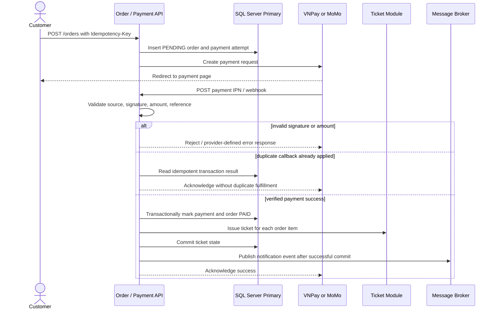

# 04 — Thiết Kế RESTful API & Webhook (API & Webhook Specifications)

## 1. Giới Thiệu & Quy Chuẩn Thiết Kế API (API Conventions)

Hệ thống tuân thủ nghiêm ngặt các nguyên tắc thiết kế **RESTful API tiêu chuẩn quốc tế** kết hợp tiêu chuẩn kiến trúc mở (**OpenAPI 3.1 / Swagger**):

### 1. Cấu Trúc Địa Chỉ Gốc & Phân Bản (Base URL & Versioning)
- **Production API Gateway:** `https://api.ticketplatform.vn/api/v1`
- **Staging / Sandbox:** `https://staging-api.ticketplatform.vn/api/v1`
- **Chiến lược phân bản (Versioning):** Phân bản trực tiếp trên đường dẫn URL (`/api/v1/`, `/api/v2/`) nhằm đảm bảo tính tương thích ngược cho các phiên bản ứng dụng di động cũ chưa kịp cập nhật.

### 2. Định Dạng Phản Hồi Chuẩn Hóa (Standard Response Envelope)

#### Phản Hồi Thành Công (HTTP 200 / 201):
```json
{
  "success": true,
  "code": 200,
  "message": "Thao tác thành công",
  "data": {},
  "meta": {
    "server_time": 1729774800,
    "request_id": "req_8f9b2c-4e1a-4d3b"
  }
}
```

#### Phản Hồi Thất Bại (HTTP 4xx / 5xx):
```json
{
  "success": false,
  "code": 409,
  "error_code": "SEAT_ALREADY_HELD",
  "message": "Ghế bạn chọn vừa được người khác giữ. Vui lòng chọn ghế khác.",
  "errors": [
    {
      "field": "seat_ids",
      "rejected_value": "seat_888",
      "reason": "Lock already acquired by another user"
    }
  ],
  "meta": {
    "server_time": 1729774801,
    "request_id": "req_8f9b2c-4e1a-4d3b"
  }
}
```

---

## 2. Danh Mục Các Endpoint API Cốt Lõi (Core API Endpoint Catalog)

### Nhóm 1: Xác Thực & Người Dùng (Auth & Users)

| Phương thức | Endpoint URI | Tiêu đề yêu cầu (Headers) | Tham số tải trọng (Payload) | Mã phản hồi | Diễn giải nghiệp vụ |
|---|---|---|---|---|---|
| `POST` | `/auth/register` | `Content-Type: application/json` | `phone_number`, `password`, `full_name`, `email` | `201 Created` | Đăng ký tài khoản; gửi mã OTP kích hoạt |
| `POST` | `/auth/login` | `Content-Type: application/json` | `phone_number`, `password` | `200 OK` | Đăng nhập; trả Access Token JWT và gắn Cookie Refresh Token |
| `POST` | `/auth/refresh` | `Cookie: refresh_token=...` | — | `200 OK` | Cấp mới Access Token mà không cần đăng nhập lại |
| `GET` | `/users/me` | `Authorization: Bearer <token>` | — | `200 OK` | Lấy thông tin hồ sơ của tài khoản đang đăng nhập |

---

### Nhóm 2: Hàng Chờ Ảo & Phòng Chờ (Waiting Room & Queue)

| Phương thức | Endpoint URI | Headers | Payload / Query | Response Data | Diễn giải |
|---|---|---|---|---|---|
| `POST` | `/queue/enter` | `Authorization: Bearer <token>` | `{"concert_id": "uuid"}` | `queue_id`, `status: "WAITING"`, `initial_position` | Khách hàng đăng ký vào phòng chờ ảo |
| `GET` | `/queue/status` | `Authorization: Bearer <token>` | `?concert_id=uuid` | `position`, `estimated_wait_seconds`, `queue_token` | Client polling trạng thái; khi được vào trả về `queue_token` |

---

### Nhóm 3: Danh Mục Sự Kiện & Sơ Đồ Ghế (Concerts & Seat Map)

| Phương thức | Endpoint URI | Headers | Query Parameters | Response Data | Diễn giải |
|---|---|---|---|---|---|
| `GET` | `/concerts` | Tùy chọn Auth | `?search=keyword&city=hanoi&page=1&limit=20` | `items: [...]`, `pagination` | Tìm kiếm & lọc concert theo tiêu chí |
| `GET` | `/concerts/{id}` | Tùy chọn Auth | — | Chi tiết concert, nghệ sĩ, danh sách Zones và giá vé | Xem trang thông tin chi tiết concert |
| `GET` | `/concerts/{id}/seat-map` | Tùy chọn Auth | `?zone_id=uuid` | Cấu trúc SVG ghế và mảng trạng thái ghế: `[id, status]` | Tải sơ đồ ghế phục vụ chọn chỗ trực quan |

---

### Nhóm 4: Giữ Ghế Phân Tán (Seat Reservation)

#### `POST /seats/hold` (Khóa Giữ Ghế 10 Phút)
- **Tiêu đề bắt buộc:**
  ```http
  Authorization: Bearer <Access_Token>
  X-Queue-Token: <Queue_Access_Token>
  Idempotency-Key: <UUID>
  ```
- **Tải trọng yêu cầu (Request Payload):**
  ```json
  {
    "concert_id": "550e8400-e29b-41d4-a716-446655440000",
    "seat_ids": [
      "9f8d7c6b-4e3a-4a1e-8b9c-1a2b3c4d5e01",
      "9f8d7c6b-4e3a-4a1e-8b9c-1a2b3c4d5e02"
    ]
  }
  ```
- **Phản hồi thành công (`200 OK`):**
  ```json
  {
    "success": true,
    "code": 200,
    "message": "Giữ ghế thành công",
    "data": {
      "hold_token": "hld_9a8b7c6d5e4f3a2b1c",
      "expires_at": 1729775400,
      "remaining_seconds": 600,
      "held_seats": [
        { "seat_id": "9f8d7c6b-...01", "row": "A", "number": "12", "price": 2500000 },
        { "seat_id": "9f8d7c6b-...02", "row": "A", "number": "14", "price": 2500000 }
      ],
      "total_price": 5000000
    }
  }
  ```

---

### Nhóm 5: Đặt Hàng & Thanh Toán (Order Checkout & Payment)

#### `POST /orders/checkout` (Tạo Đơn Hàng & Lấy Link Thanh Toán)

> Checkout baseline theo D-031 không nhận voucher_code; discount_amount trong response luôn bằng 0. Tất cả amount là số nguyên VND.
- **Tiêu đề:** `Authorization: Bearer <token>`, `Idempotency-Key: <uuid>`
- **Request Payload:**
  ```json
  {
    "concert_id": "550e8400-e29b-41d4-a716-446655440000",
    "hold_token": "hld_9a8b7c6d5e4f3a2b1c",
    "payment_gateway": "VNPAY"
  }
  ```
- **Phản hồi thành công (`201 Created`):**
  ```json
  {
    "success": true,
    "code": 201,
    "message": "Đơn hàng khởi tạo thành công",
    "data": {
      "order_code": "ORD-20261024-8F9B",
      "total_amount": 5000000,
      "discount_amount": 0,
      "service_fee_amount": 0,
      "tax_amount": 0,
      "final_amount": 5000000,
      "payment_url": "https://sandbox.vnpayment.vn/paymentv2/vpcpay.html?vnp_Amount=500000000&vnp_Command=pay...",
      "qr_payment_code": "00020101021238580010A0000007270128...",
      "expires_at": 1729775400
    }
  }
  ```

---

### Nhóm 6: Vé Điện Tử & Soát Vé Tại Cổng (Tickets & Gate Check-In)

#### 1. `GET /tickets/{id}/dynamic-qr` (Làm mới QR mỗi 30 giây; token có hiệu lực tối đa 60 giây)
- **Phản hồi:** Trả về JWT/JWS ký bằng RS256 theo SM04, chứa `ticket_id`, `concert_id`, `seat_id`, `iat`, `exp = iat + 60s` và `nonce`. Ứng dụng làm mới token mỗi 30 giây; token hiện tại chỉ hết hiệu lực tại `exp` (hoặc khi vé không còn hợp lệ), không bị từ chối chỉ vì đã phát hành token mới.

#### 2. `POST /check-in/scan` (Nhân Viên Quét Vé Tại Cổng)
- **Tiêu đề:** `Authorization: Bearer <Staff_Token>`, `X-Device-ID: scanner-001`
- **Request Payload:**
  ```json
  {
    "qr_token": "eyJhbGciOiJIUzI1NiIsInR5cCI6IkpXVCJ9.eyJ0aWQiOiJ0a3RfOTk5IiwiY2lkIjoiY29uXzEwMiIsImV4cCI6MTcyOTc3NDgzMH0.s8df9a...",
    "gate_id": "GATE_A_VIP",
    "timestamp": 1729774815
  }
  ```
- **Phản hồi thành công (`200 OK`):**
  ```json
  {
    "success": true,
    "code": 200,
    "message": "HỢP LỆ — MỜI VÀO",
    "data": {
      "ticket_id": "tkt_999",
      "attendee_name": "Nguyễn Văn A",
      "zone_name": "VIP 1 Khán đài A",
      "seat_row": "A",
      "seat_number": "12",
      "checked_in_at": "2026-10-24T18:30:15.220Z"
    }
  }
  ```

---

## 3. Đặc Tả Webhook Tích Hợp Cổng Thanh Toán (Payment Webhook IPN)

### 1. Webhook Tiếp Nhận Từ VNPay (`POST /payments/vnpay/ipn`)
VNPay gửi kết quả thanh toán ngầm qua phương thức HTTP GET/POST kèm theo các tham số:
- **Xác thực chữ ký số:** Hệ thống lấy toàn bộ các tham số bắt đầu bằng `vnp_` (loại trừ `vnp_SecureHash`), sắp xếp tăng dần theo bảng chữ cái (Alphabetical Order), nối chuỗi URL-encoded và tính mã băm **HMAC-SHA512** với bí mật `vnp_HashSecret`. So sánh chuỗi vừa tính với `vnp_SecureHash`.
- **Phản hồi trả về bắt buộc cho VNPay:**
  ```json
  {
    "RspCode": "00",
    "Message": "Confirm Success"
  }
  ```

### 2. Webhook Tiếp Nhận Từ MoMo (`POST /payments/momo/ipn`)
- **Tải trọng JSON gửi từ MoMo:**
  ```json
  {
    "partnerCode": "MOMO_TICKETING",
    "orderId": "ORD-20261024-8F9B",
    "requestId": "req_1729774800",
    "amount": 4500000,
    "orderInfo": "Thanh toan ve concert BlackPink",
    "transId": 2309823423,
    "resultCode": 0,
    "message": "Successful.",
    "signature": "d98e7a6b5c4d3e2f1a..."
  }
  ```
- **Kiểm tra chữ ký số MoMo:** Tạo chuỗi Raw Signature: `accessKey=$accessKey&amount=$amount&message=$message&orderId=$orderId...` rồi băm HMAC-SHA256 với Secret Key của đối tác.
- **Tính bất biến (Idempotent Callback Handling):** Nếu đơn hàng đã ở trạng thái `PAID`, hệ thống không lặp lại luồng cộng điểm hay gửi vé mà chỉ trả về HTTP 200 tức thì để MoMo dừng gửi lại.

<!-- BEGIN MERMAID DIAGRAM DESIGN-WEBHOOK-SEQUENCE -->
### Trình tự IPN thanh toán an toàn và idempotent


<!-- END MERMAID DIAGRAM DESIGN-WEBHOOK-SEQUENCE -->
