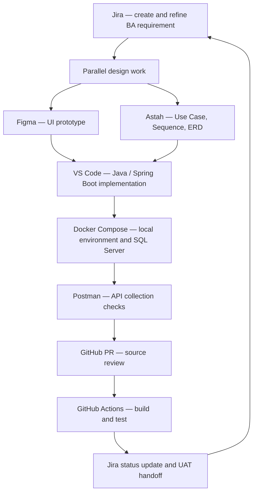

# 05 — Ngăn Xếp Công Nghệ & Công Cụ Phát Triển (Technology Stack & Development Tools)

## 1. Giới Thiệu & Định Hướng Công Nghệ Chuẩn Hóa

Hệ thống bán vé sự kiện âm nhạc trực tuyến (Concert Ticketing Platform) được thiết kế và xây dựng trên bộ công nghệ và công cụ tiêu chuẩn, đảm bảo tính thống nhất từ khâu thiết kế giao diện, mô hình hóa kiến trúc, quản lý mã nguồn, lập trình ứng dụng đến kiểm thử và đóng gói triển khai:

- **Ngôn ngữ phát triển cốt lõi (Core Backend Language):** **Java (Java 17 / Java 21 LTS)** với nền tảng **Spring Boot 3**.
- **Môi trường soạn thảo mã nguồn (Code Editor / IDE):** **Visual Studio Code (VS Code)** với bộ tiện ích mở rộng Java & Spring Enterprise.
- **Hệ quản trị cơ sở dữ liệu quan hệ (Primary RDBMS):** Microsoft SQL Server 2025 Enterprise cho production theo D-026; SQL Server 2025 Developer chỉ cho local. License, sizing và HA phải được DBA/Finance xác nhận trước go-live.
- **Công cụ thiết kế giao diện người dùng (UI/UX Design):** **Figma** (Design System, Wireframes & Interactive Prototypes).
- **Công cụ thiết kế sơ đồ mô hình hóa (UML Modeling):** **Astah (Astah Professional / Astah UML)** để vẽ toàn bộ sơ đồ Use Case, Sequence, State Machine, Class Diagram.
- **Công cụ kiểm thử & Kiểm chuẩn API (API Testing):** **Postman** (Postman Collections, Pre-request Scripts, Automated Test Assertions).
- **Quản lý tiến độ dự án & Quy trình Agile (Project Management):** **Jira (Jira Software)** quản lý Sprint, Backlog, User Stories và Bug Tracking.
- **Quản lý mã nguồn & Phiên bản (Version Control System):** **GitHub** (GitFlow Branching Strategy, Pull Requests, Code Review, GitHub Actions).
- **Đóng gói & Môi trường chứa ứng dụng (Containerization):** **Docker** (Multi-stage Dockerfile, Docker Compose, Docker Desktop).

---

## 2. Bảng Tổng Hợp Ngăn Xếp Công Nghệ Cốt Lõi (Master Tech Stack)

| Tầng kiến trúc / Lĩnh vực | Công nghệ chuẩn hóa | Phiên bản khuyến nghị | Vai trò & Lý do lựa chọn |
|---|---|---|---|
| **Ngôn ngữ Backend chính** | **Java** | **Java 17 LTS / Java 21 LTS** | Ngôn ngữ hướng đối tượng mạnh mẽ, kiểu tĩnh an toàn (Type-safe), quản lý bộ nhớ JVM tối ưu, hỗ trợ Virtual Threads (Project Loom) xử lý hàng trăm nghìn tác vụ đồng thời |
| **Framework Backend** | **Spring Boot** | **Spring Boot 3.2+** | Framework tiêu chuẩn doanh nghiệp: Spring Web MVC, Spring Data JPA / Hibernate, Spring Security (JWT / OAuth2), Spring Cloud |
| **Cơ Sở Dữ Liệu Quan Hệ** | **Microsoft SQL Server 2025 Enterprise** | Production theo D-026; Developer chỉ local | RDBMS giao dịch ACID; transaction amounts là số nguyên VND; production license/sizing cần DBA/Finance sign-off; không partition trong baseline theo D-028 |
| **Quản Lý Kết Nối Database**| **HikariCP** | Tích hợp sẵn trong Spring Boot | Thư viện Connection Pool tốc độ cao nhất trong hệ sinh thái Java, tách connection pool ghi tới Primary và pool read-intent tới readable secondary khi topology được chọn |
| **Bộ Nhớ Đệm & Khóa Ghế** | **Redis** | **Redis 7.2+** | Lưu trữ In-Memory: Chạy Lua Script khóa ghế nguyên tử (`SETNX EX 600`), cấu trúc Sorted Sets quản lý hàng chờ ảo và rate limit |
| **Message Broker** | **RabbitMQ** | Durable quorum queues, publisher confirms, retry + DLQ | Async events/jobs; consumer idempotent; transactional outbox trong SQL Server; không dùng Kafka trong baseline (D-025) |
| **Frontend Web Portal** | **React / Next.js (TypeScript)**| Next.js 14+ | Tải trang cực nhanh, tối ưu hóa SEO cho sự kiện, giao tiếp RESTful API & WebSocket cập nhật trạng thái ghế |
| **Ứng Dụng Di Động** | **Flutter / React Native** | Flutter 3.22+ | Xây dựng ứng dụng iOS & Android từ một mã nguồn; tích hợp hiển thị mã Dynamic QR Code tự đổi mỗi 30s |
| **NoSQL** | **Không có trong baseline** | — | Redis chỉ giữ state/lock có TTL; SQL Server lưu giao dịch, audit và outbox; ELK chỉ là operational logs theo D-029 |
| **Đóng gói ứng dụng** | **Docker Engine / Compose** | SQL Server 2025 Developer local; SQL Server 2025 Enterprise production; RabbitMQ theo D-025 |

---

## 3. Hệ Sinh Thái Công Cụ Phát Triển & Quản Lý Dự Án (Tooling Ecosystem)

### 1. Visual Studio Code (VS Code) — Môi Trường Lập Trình Chuẩn Hóa
Dự án sử dụng **VS Code** làm IDE phát triển thống nhất cho toàn bộ đội ngũ lập trình viên. Bộ cấu hình tiện ích (Extensions) bắt buộc trong `.vscode/extensions.json`:
- **Extension Pack for Java (Microsoft):** Hỗ trợ Language Server, biên dịch mã Java, hỗ trợ gợi ý IntelliSense, tự động import package.
- **Debugger for Java:** Hỗ trợ đặt Breakpoints, kiểm tra biến bộ nhớ và luồng thực thi JVM.
- **Spring Boot Extension Pack (VMware):** Hỗ trợ điều hướng Spring Beans, tự động hoàn thiện cấu hình trong `application.yml`, Live Application Information.
- **Docker Extension (Microsoft):** Quản lý containers, images, volumes và Docker Compose trực tiếp trong giao diện VS Code.
- **GitLens & GitHub Pull Requests:** Theo dõi lịch sử Git Blame từng dòng code, tạo và review Pull Request trực tiếp từ editor.
- **SonarLint:** Quét chất lượng mã sạch (Clean Code), phát hiện sớm các lỗi cú pháp và lỗ hổng bảo mật ngay khi gõ phím.

### 2. Astah (Astah Professional / Astah UML) — Thiết Kế Sơ Đồ Kỹ Thuật
**Astah** là công cụ mô hình hóa trực quan được chỉ định để người thiết kế chuyển hóa toàn bộ tài liệu BA thành các sơ đồ kỹ thuật chuẩn UML 2.5:
- **Use Case Diagram:** Vẽ sơ đồ tương tác giữa 4 Actor (Customer, Organizer, Admin, Staff) với 15 Use Cases cốt lõi và các quan hệ `<<include>>`, `<<extend>>`.
- **Sequence Diagram:** Vẽ luồng thông điệp thời gian thực cho:
  - Khóa giữ ghế phân tán (Client $\rightarrow$ API Gateway $\rightarrow$ Booking Service $\rightarrow$ Redis $\rightarrow$ SQL Server Primary).
  - Luồng thanh toán đối soát VNPay/MoMo Webhook Callback.
  - Luồng giải mã Dynamic QR soát vé tại cổng trong $\le 500\text{ ms}$.
- **State Machine Diagram:** Vẽ 5 cỗ máy trạng thái: Vòng đời Concert (6 trạng thái), Vòng đời Ghế (`AVAILABLE` $\leftrightarrow$ `HELD` $\rightarrow$ `SOLD`), Vòng đời Đơn hàng, Vòng đời Vé và Trạng thái Thanh toán.
- **Class Diagram & Component Diagram:** Mô hình hóa các lớp đối tượng Domain Entity trong mã nguồn Java Spring Boot và biên giới dịch vụ.

### 3. Figma — Thiết Kế Trải Nghiệm & Giao Diện Người Dùng (UI/UX)
- **Design System:** Xây dựng thư viện màu sắc (Color Palette), kiểu chữ (Typography), nút bấm (Buttons), thanh điều hướng và biểu tượng theo tiêu chuẩn nhận diện hiện đại.
- **Sơ Đồ Ghế Khán Đài Trực Quan (Interactive Seat Map):** Thiết kế bản đồ các khán đài (VIP, CAT 1, Khán đài A/B/C) và các trạng thái ghế ngồi (Trống, Đang giữ, Đã bán, Đang chọn).
- **Wireframes & Clickable Prototypes:** Mô phỏng luồng trải nghiệm khách hàng:
  - Màn hình phòng chờ ảo đếm ngược.
  - Luồng chọn chỗ ngồi trên sơ đồ ghế trực tiếp.
  - Màn hình thanh toán quét mã QR VietQR / VNPay.
  - Giao diện ví vé điện tử hiển thị mã QR động 30 giây.
  - Ứng dụng quét vé chuyên dụng cho nhân viên cổng soát vé.

### 4. Postman — Thiết Kế & Kiểm Chuẩn Tự Động Hóa API
- **Postman Workspace & Collections:** Toàn bộ API của hệ thống được tổ chức thành các thư mục tương ứng theo phân hệ (Auth, Catalog, Queue, Booking, Orders, Payments, Tickets, Check-in).
- **Quản Lý Biến Môi Trường (Environments):** Thiết lập linh hoạt biến URL và Token cho `Localhost (Docker)`, `Development`, `Staging`, và `Production`.
- **Pre-request Scripts:** Tự động sinh mã `Idempotency-Key` dạng UUID, tạo chữ ký số HMAC-SHA512 giả lập VNPay hoặc sinh JWT Bearer Token trước mỗi request.
- **Tests Scripts (Automated Assertions):** Viết mã JavaScript kiểm tra tự động:
  ```javascript
  pm.test("Status code is 200/201", function () {
      pm.response.to.be.oneOf([200, 201]);
  });
  pm.test("Response contains valid data envelope", function () {
      var jsonData = pm.response.json();
      pm.expect(jsonData.success).to.eql(true);
      pm.expect(jsonData.data).to.be.an("object");
  });
  ```
- **Postman Collection Runner:** Chạy kiểm thử tự động toàn bộ luồng nghiệp vụ (E2E API Testing) trước khi phát hành phiên bản mới.

### 5. Jira (Jira Software) — Quản Trị Dự Án & Tiến Độ Theo Mô Hình Agile/Scrum
- **Cấu Trúc Phân Cấp Công Việc (Work Hierarchy):**
  - **Epics:** Tương ứng với các phân hệ lớn (Ví dụ: `EPIC-01: Quản Trị Tài Khoản`, `EPIC-02: Phòng Chờ & Giữ Ghế`, `EPIC-03: Cổng Thanh Toán`).
  - **User Stories:** Bê nguyên văn các User Stories từ tài liệu BA (từ `US-01-01` đến `US-15-03`) kèm theo bảng tiêu chí nghiệm thu (Acceptance Criteria) làm Definition of Done (DoD).
  - **Sub-tasks / Bugs:** Phân rã cho lập trình viên Backend (Java), Frontend, Mobile và Tester.
- **Sprint Management:** Tổ chức chu kỳ Sprint 2 tuần một lần:
  - Sprint Planning: Ước lượng điểm Story Points (Fibonacci).
  - Daily Standup: Báo cáo tiến độ 3 câu hỏi trên Active Sprint Board.
  - Sprint Review & Retrospective: Đánh giá Burndown Chart và rút kinh nghiệm cải tiến.

### 6. GitHub — Quản Lý Mã Nguồn & Quy Trình GitFlow
- **Quy Chuẩn Nhánh (Branching Strategy - GitFlow):**
  - `main`: Chứa mã nguồn ổn định nhất đang chạy trên Production; bảo vệ nghiêm ngặt (Protected Branch).
  - `develop`: Nhánh tích hợp chính của toàn bộ đội ngũ phát triển.
  - `feature/TICK-xxx-seat-hold`: Nhánh phát triển tính năng mới tạo từ `develop`.
  - `bugfix/TICK-yyy-late-payment`: Nhánh sửa lỗi phát sinh.
  - `release/v1.0.0`: Nhánh chuẩn bị phát hành phiên bản.
- **Quy Chuẩn Kéo Mã (Pull Request - PR):**
  - Mỗi PR bắt buộc phải liên kết mã Ticket trên Jira (VD: `[TICK-102] Implement distributed seat hold in Java`).
  - Bắt buộc tối thiểu 2 thành viên cấp Senior Review và Approved trước khi gộp (Merge).
  - Toàn bộ bài kiểm tra tự động (CI) phải Pass $100\%$.
- **GitHub Actions (CI/CD Pipeline):** Tự động kích hoạt khi có commit:
  - Chạy `mvn clean test` kiểm tra Unit Test mã nguồn Java.
  - Quét chất lượng mã nguồn bằng SonarQube.
  - Xây dựng Docker Image và đẩy lên Docker Registry.

### 7. Docker & Docker Compose — Chuẩn Hóa Môi Trường Ứng Dụng
- **Multi-Stage Dockerfile Cho Ứng Dụng Java Spring Boot:**
  - *Stage 1 (Build):* Sử dụng image `maven:3.9-eclipse-temurin-21` để biên dịch mã nguồn và đóng gói file JAR.
  - *Stage 2 (Runtime):* Sử dụng image siêu nhẹ `eclipse-temurin:21-jre-alpine` (dung lượng $< 150\text{ MB}$) để chạy ứng dụng, tối ưu bảo mật và thời gian khởi động.
- **Docker Compose Cục Bộ (`docker-compose.yml`):**
  - Giúp bất kỳ lập trình viên nào khi clone dự án về cũng có thể chạy đầy đủ môi trường chỉ với một câu lệnh:
    ```bash
    docker compose up -d
    ```
  - Bao gồm các dịch vụ được cấu hình sẵn mạng nội bộ:
    1. sqlserver: SQL Server 2025 Developer (chỉ local, cổng 1433); database và application login được tạo qua migration/init task.
    2. redis: Redis 7.2 (cổng 6379, mật khẩu qua secret/env).
    3. RabbitMQ minh họa broker (cổng 5672; broker chuẩn theo D-025 (RabbitMQ)).
    4. `mailhog`: Giả lập SMTP Server cục bộ có Web UI kiểm tra email xác nhận vé (Port 8025).
    5. backend-api và worker: ứng dụng Spring Boot; Không triển khai NoSQL trong baseline theo D-029.

---

## 4. Tóm Tắt Quy Trình Phối Hợp Giữa Các Công Cụ (Integrated Workflow)

<!-- BEGIN MERMAID DIAGRAM CONVERT-05_Technology_Stack_And_Development_Tools -->
### Tool collaboration workflow


<!-- END MERMAID DIAGRAM CONVERT-05_Technology_Stack_And_Development_Tools -->
