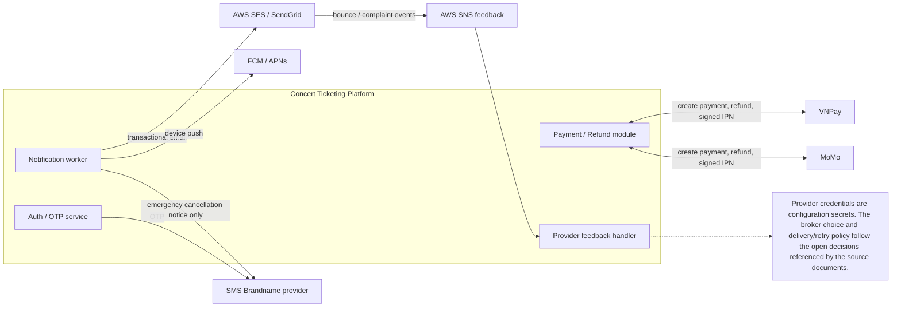

# 06 — Hợp Đồng Tích Hợp Hệ Thống Bên Thứ Ba (External Integration Contracts)

## 1. Giới Thiệu & Mục Tiêu

Để hoàn thiện quy trình mua bán vé và chăm sóc khách hàng, hệ thống bắt buộc phải tích hợp với nhiều đối tác dịch vụ bên ngoài (**Third-Party Providers**):
1. **Cổng thanh toán điện tử:** VNPay và MoMo (Hỗ trợ Thẻ ATM nội địa, Thẻ tín dụng Visa/Mastercard/JCB và Ví điện tử).
2. **Cổng gửi thư điện tử giao dịch (Transactional Email):** AWS Simple Email Service (SES) hoặc SendGrid.
3. **Cổng gửi tin nhắn viễn thông (SMS Brandname):** eSMS / FPT Telecom / Twilio.
4. **Cổng thông báo đẩy ứng dụng di động:** Google Firebase Cloud Messaging (FCM) & Apple Push Notification service (APNs).

Tài liệu này đặc tả các hợp đồng giao tiếp kỹ thuật (**Integration Contracts**), thuật toán tạo chữ ký bảo mật, cấu trúc dữ liệu trao đổi và bảng ánh xạ mã lỗi đối tác sang chuẩn mã lỗi nội bộ của hệ thống.

<!-- BEGIN MERMAID DIAGRAM DESIGN-INTEGRATIONS -->
### Biên tích hợp vào/ra với nhà cung cấp


<!-- END MERMAID DIAGRAM DESIGN-INTEGRATIONS -->


---

## 2. Hợp Đồng Tích Hợp Cổng Thanh Toán VNPay (VNPay Integration Contract)

### 1. Thông Số Cấu Hình Đối Tác
- **Môi trường Sandbox:** `https://sandbox.vnpayment.vn/paymentv2/vpcpay.html`
- **Môi trường Production:** `https://vnpayment.vn/paymentv2/vpcpay.html`
- **Mã định danh thương nhân (TMN Code):** `TICKETING_VNPAY_TMN`
- **Khóa bí mật tạo chữ ký số (Hash Secret):** Chuỗi ký tự bí mật 32–64 ký tự do VNPay cấp.
- **Thuật toán chữ ký số:** `HmacSHA512` bắt buộc.

### 2. Luồng Khởi Tạo Giao Dịch Thanh Toán (`create_payment_url`)
Hệ thống Backend ghép các tham số truy vấn (Query Parameters) theo bảng sau, sắp xếp tăng dần theo thứ tự chữ cái (ASCII Alphabetical Order):

| Tên tham số | Kiểu | Bắt buộc | Ví dụ giá trị | Giải thích |
|---|---|---|---|---|
| `vnp_Version` | String | Có | `2.1.0` | Phiên bản chuẩn API VNPay |
| `vnp_Command` | String | Có | `pay` | Mã lệnh thanh toán |
| `vnp_TmnCode` | String | Có | `TICKETING_TMN` | Mã website của nền tảng |
| `vnp_Amount` | Number | Có | `450000000` | Số tiền VNĐ nhân với 100 (4.500.000 VNĐ $\rightarrow$ 450.000.000) |
| `vnp_CurrCode` | String | Có | `VND` | Đơn vị tiền tệ |
| `vnp_TxnRef` | String | Có | `ORD_20261024_8F9B` | Mã đơn hàng duy nhất trên hệ thống |
| `vnp_OrderInfo` | String | Có | `Thanh toan ve concert BlackPink`| Nội dung hiển thị tại trang thanh toán |
| `vnp_OrderType` | String | Có | `ticket` | Loại hàng hóa dịch vụ |
| `vnp_ReturnUrl` | String | Có | `https://ticketplatform.vn/checkout/result` | URL chuyển hướng trình duyệt của khách hàng sau khi thanh toán |
| `vnp_IpAddr` | String | Có | `113.161.45.12` | Địa chỉ IP của khách hàng thực hiện giao dịch |
| `vnp_CreateDate` | String | Có | `20261024143000` | Định dạng thời gian `yyyyMMddHHmmss` |
| `vnp_ExpireDate` | String | Có | `20261024144000` | Thời điểm hết hạn trang thanh toán ($NOW + 10$ phút) |
| `vnp_SecureHash` | String | Có | `a8f9c...` (128 ký tự hex)| Mã băm HMAC-SHA512 của toàn bộ chuỗi tham số trên |

### 3. Bảng Ánh Xạ Mã Trạng Thái VNPay (`vnp_ResponseCode`)

| Mã phản hồi VNPay | Diễn giải trạng thái VNPay | Trạng thái cập nhật trên Hệ thống | Hành động xử lý tiếp theo |
|---|---|---|---|
| `00` | Giao dịch thành công | `PAID` | Chuyển ghế sang `SOLD`, sinh vé điện tử và gửi email xác nhận |
| `07` | Trừ tiền thành công nhưng nghi ngờ gian lận | `REFUND_PENDING` | Tạm giữ vé, đẩy vào hàng chờ đối soát khẩn cấp của kế toán |
| `09` | Thẻ/Tài khoản chưa đăng ký Internet Banking | `PENDING` | Giữ nguyên trạng thái để khách hàng thử lại phương thức khác |
| `10` | Khách hàng nhập sai thông tin xác thực quá 3 lần | `FAILED` | Thông báo khách liên hệ ngân hàng hoặc đổi thẻ |
| `24` | Khách hàng bấm nút "Hủy giao dịch" tại trang VNPay| `CANCELLED` | Giải phóng ghế trong Redis ngay lập tức |
| `51` | Tài khoản không đủ số dư | `FAILED` | Thông báo số dư không đủ; khách có thể quét lại qua thẻ khác |
| `99` | Lỗi hệ thống ngân hàng / Lỗi không xác định | `FAILED` | Hướng dẫn khách thử lại sau ít phút hoặc đổi sang MoMo |

---

## 3. Hợp Đồng Tích Hợp Cổng Thanh Toán MoMo (MoMo Integration Contract)

### 1. Thông Số Kỹ Thuật
- **Endpoint API Khởi tạo thanh toán:** `POST https://payment.momo.vn/v2/gateway/api/create`
- **Mã đối tác (Partner Code):** `MOMO_TICKETING`
- **Thuật toán chữ ký số:** `HmacSHA256` bằng Secret Key.
- **Quy tắc tạo chữ ký (Raw Signature String):**
  `accessKey=$accessKey&amount=$amount&extraData=$extraData&ipnUrl=$ipnUrl&orderId=$orderId&orderInfo=$orderInfo&partnerCode=$partnerCode&redirectUrl=$redirectUrl&requestId=$requestId&requestType=captureWallet`

### 2. Bảng Ánh Xạ Mã Kết Quả MoMo (`resultCode`)

| Mã kết quả MoMo | Ý nghĩa phía MoMo | Trạng thái hệ thống | Xử lý nghiệp vụ |
|---|---|---|---|
| `0` | Giao dịch thành công | `PAID` | Phát hành vé điện tử tức thì |
| `9000` | Giao dịch đã được xác nhận (Authorized) | `PROCESSING` | Chờ IPN callback cuối cùng |
| `1001` | Tài khoản người dùng không đủ số dư | `FAILED` | Báo lỗi trên màn hình thanh toán |
| `1006` | Người dùng từ chối xác nhận thanh toán trên App | `CANCELLED` | Giải phóng ghế về trạng thái trống |
| `2049` | Quá thời hạn thanh toán (Hết hạn 10 phút) | `OUT_TIME` | Đơn hàng hủy tự động; thu hồi ghế |

---

## 4. Hợp Đồng Tích Hợp Email Giao Dịch (AWS Simple Email Service - SES)

### 1. Phương Thức Tích Hợp
- Sử dụng **AWS SDK v3 / SES Client API** (qua HTTPS REST API) thay vì giao thức SMTP truyền thống nhằm giảm độ trễ gửi thư từ $1.5\text{ giây}$ xuống $< 200\text{ ms}$.
- Địa chỉ người gửi chính thức (Sender Identity): `ve@ticketplatform.vn` đã được xác thực toàn diện bản ghi **SPF**, **DKIM** (2048-bit) và **DMARC** (`p=reject`) để tránh tuyệt đối việc thư rơi vào hộp thư rác (Spam/Junk Box).

### 2. Xử Lý Phản Hồi Sự Cố Email Qua Webhook AWS SNS
Hệ thống đăng ký Webhook tiếp nhận sự kiện từ AWS SNS về endpoint `/api/v1/webhooks/aws-ses`:
- **Sự kiện `Bounce` (Thư bị trả lại do hòm thư không tồn tại hoặc đầy):** Hệ thống đánh dấu cờ `email_bounced = TRUE` trên tài khoản người dùng và ngừng gửi email marketing tới địa chỉ này.
- **Sự kiện `Complaint` (Người dùng bấm báo cáo Spam):** Hệ thống lập tức hủy đăng ký (Unsubscribe) người dùng khỏi toàn bộ danh sách bản tin tiếp thị.

---

## 5. Hợp Đồng Tích Hợp Thông Báo Đẩy Di Động (FCM & APNs)

### 1. Đăng Ký Token Thiết Bị (`POST /api/v1/users/device-token`)
- Mỗi khi người dùng cài đặt hoặc mở ứng dụng di động, ứng dụng gửi Device Token lên hệ thống:
  ```json
  {
    "device_token": "fcm_token_abc123xyz...",
    "platform": "IOS",
    "device_model": "iPhone 15 Pro",
    "app_version": "1.4.2"
  }
  ```

### 2. Định Dạng Gói Tin Đẩy (FCM HTTP v1 Protocol Payload)
Để đảm bảo thông báo hiển thị ngay cả khi ứng dụng bị tắt ngầm:
```json
{
  "message": {
    "token": "fcm_token_abc123xyz...",
    "notification": {
      "title": "Vé Xem Concert Của Bạn Đã Sẵn Sàng!",
      "body": "Đơn hàng ORD-20261024-8F9B thành công. Nhấn để mở vé điện tử."
    },
    "data": {
      "screen": "TICKET_DETAIL",
      "ticket_id": "tkt_999",
      "concert_id": "con_102"
    },
    "android": { "priority": "high" },
    "apns": {
      "headers": { "apns-priority": "10" },
      "payload": { "aps": { "sound": "default", "badge": 1 } }
    }
  }
}
```

---

## 6. Hợp Đồng Tích Hợp Tin Nhắn Viễn Thông (SMS Brandname)

- **Mục đích sử dụng:** Duy nhất cho việc gửi mã **OTP Xác Thực Đăng Ký / Quên Mật Khẩu** và **Thông Báo Khẩn Cấp Khi Hủy Sự Kiện**.
- **Tên thương hiệu hiển thị (Brandname):** `TICKETVN` (Đã đăng ký chứng nhận với Cục An toàn Thông tin - Bộ TT&TT).
- **Endpoint API Đối tác:** `POST https://api.esms.vn/MainService.svc/json/SendMultipleMessage_V4/`
- **Thời gian cam kết chuyển phát tin nhắn (SLA):** Mã OTP phải tới tay người dùng trong vòng **$< 10\text{ giây}$** kể từ khi bấm yêu cầu.
