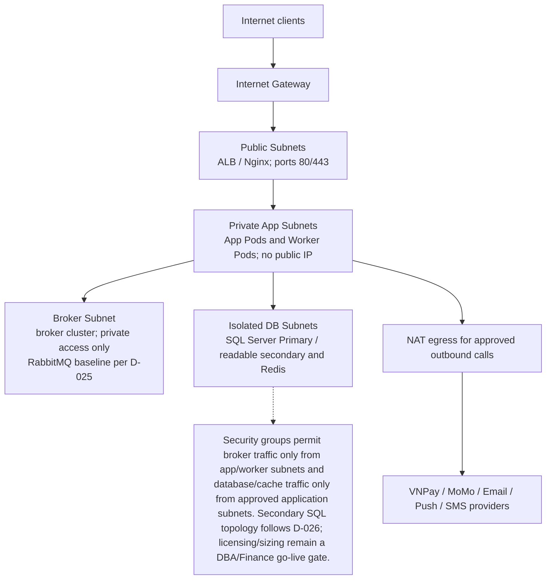
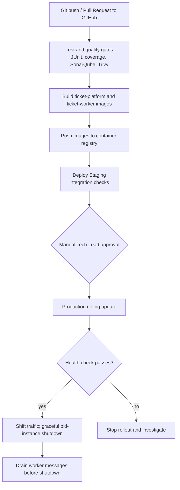

# 07 — Kiến Trúc Triển Khai & Vận Hành Hệ Thống (Deployment & Operations Architecture)

## 1. Giới Thiệu & Triết Lý Vận Hành

Tài liệu này đặc tả kiến trúc hạ tầng, quy trình CI/CD và runbook vận hành Flash-Sale cho hệ thống Concert Ticketing.

> **Ghi chú triển khai:** Nhờ kiến trúc **Hybrid Modular Monolith + Worker**, cấu trúc triển khai cân bằng giữa đơn giản và khả năng scale: **6 services minh họa trong Docker Compose** (nginx + app + worker + rabbitmq + redis + SQL Server). So với Microservices thuần túy (10+ services), cấu trúc này dễ vận hành hơn nhiều trong khi vẫn có khả năng scale Worker độc lập.

---

## 2. Cấu Trúc Docker Compose (Development & Staging)

Đây là mẫu local development dùng SQL Server 2025 Developer và RabbitMQ. Production dùng SQL Server 2025 Enterprise Always On AG theo D-026; Developer edition không dùng trong production.

```yaml
services:
  nginx:
    image: nginx:alpine
    ports:
      - "443:443"
      - "80:80"
    volumes:
      - ./nginx/nginx.conf:/etc/nginx/nginx.conf:ro
      - ./nginx/certs:/etc/nginx/certs:ro
    depends_on:
      app:
        condition: service_started
    networks: [ticketing-network]

  app:
    image: ticketplatform/monolith:${APP_VERSION}
    build:
      context: ./ticket-platform
      dockerfile: Dockerfile
    ports:
      - "8080:8080"
    environment:
      SPRING_PROFILES_ACTIVE: ${ENV:-dev}
      DB_HOST: sqlserver
      DB_PORT: 1433
      DB_NAME: ticketdb
      DB_USERNAME: ${DB_USERNAME}
      DB_PASSWORD: ${DB_PASSWORD}
      REDIS_HOST: redis
      RABBITMQ_HOST: rabbitmq
    depends_on:
      sqlserver:
        condition: service_healthy
      redis:
        condition: service_healthy
      rabbitmq:
        condition: service_healthy
    networks: [ticketing-network]

  worker:
    image: ticketplatform/worker:${WORKER_VERSION}
    build:
      context: ./ticket-worker
      dockerfile: Dockerfile
    environment:
      SPRING_PROFILES_ACTIVE: ${ENV:-dev}
      DB_HOST: sqlserver
      DB_PORT: 1433
      DB_NAME: ticketdb
      DB_USERNAME: ${DB_USERNAME}
      DB_PASSWORD: ${DB_PASSWORD}
      RABBITMQ_HOST: rabbitmq
      SENDGRID_API_KEY: ${SENDGRID_API_KEY}
      FCM_SERVER_KEY: ${FCM_SERVER_KEY}
    depends_on:
      sqlserver:
        condition: service_healthy
      rabbitmq:
        condition: service_healthy
    networks: [ticketing-network]

  rabbitmq:
    image: rabbitmq:3.12-management-alpine
    ports:
      - "5672:5672"
      - "15672:15672"
    environment:
      RABBITMQ_DEFAULT_USER: ${RABBITMQ_USERNAME}
      RABBITMQ_DEFAULT_PASS: ${RABBITMQ_PASSWORD}
    volumes:
      - rabbitmq-data:/var/lib/rabbitmq
    healthcheck:
      test: ["CMD", "rabbitmq-diagnostics", "ping"]
      interval: 10s
      retries: 5
    networks: [ticketing-network]

  redis:
    image: redis:7.2-alpine
    command: redis-server --requirepass ${REDIS_PASSWORD}
    environment:
      REDIS_PASSWORD: ${REDIS_PASSWORD}
    volumes:
      - redis-data:/data
    healthcheck:
      test: ["CMD-SHELL", "redis-cli -a \"$${REDIS_PASSWORD}\" ping | grep -q PONG"]
      interval: 5s
      retries: 5
    networks: [ticketing-network]

  sqlserver:
    image: mcr.microsoft.com/mssql/server:2025-latest
    environment:
      ACCEPT_EULA: "Y"
      MSSQL_SA_PASSWORD: ${MSSQL_SA_PASSWORD}
      MSSQL_PID: Developer
    ports:
      - "1433:1433"
    volumes:
      - sqlserver-data:/var/opt/mssql
    healthcheck:
      test:
        - CMD-SHELL
        - >-
          /opt/mssql-tools18/bin/sqlcmd -S localhost -U sa -P "$${MSSQL_SA_PASSWORD}"
          -C -Q "SELECT 1" || exit 1
      interval: 10s
      retries: 10
      start_period: 30s
    networks: [ticketing-network]

volumes:
  sqlserver-data:
  redis-data:
  rabbitmq-data:

networks:
  ticketing-network:
    driver: bridge
```

> SQL Server container example is for local development. Developer edition is not licensed for production. The image provisions the system administrator login; a migration/init task must create the database and least-privilege application login. Production uses SQL Server 2025 Enterprise Always On AG with synchronous local secondary and asynchronous cross-region DR per D-026. DBA/Finance must sign off license and sizing before go-live. NoSQL is excluded by D-029.

---

## 3. Dockerfile — Multi-Stage Build

### Monolith App

```dockerfile
FROM eclipse-temurin:21-jdk-alpine AS builder
WORKDIR /app
COPY pom.xml .
COPY src ./src
RUN ./mvnw package -DskipTests -pl ticket-platform

FROM eclipse-temurin:21-jre-alpine AS runtime
WORKDIR /app
COPY --from=builder /app/ticket-platform/target/ticket-platform-*.jar app.jar
EXPOSE 8080
ENTRYPOINT ["java", "-XX:+UseG1GC", "-Xms512m", "-Xmx2g", "-jar", "app.jar"]
```

### Worker Service

```dockerfile
FROM eclipse-temurin:21-jdk-alpine AS builder
WORKDIR /app
COPY pom.xml .
COPY src ./src
RUN ./mvnw package -DskipTests -pl ticket-worker

FROM eclipse-temurin:21-jre-alpine AS runtime
WORKDIR /app
COPY --from=builder /app/ticket-worker/target/ticket-worker-*.jar worker.jar
EXPOSE 8081
ENTRYPOINT ["java", "-XX:+UseG1GC", "-Xms256m", "-Xmx1g", "-jar", "worker.jar"]
```

---

## 4. Cấu Hình RabbitMQ — Queues & Dead-Letter

```
Exchange: notification.exchange (direct)
  ├── Queue: notification.send     → Worker Consumer (Email + Push)
  │     └── x-dead-letter-exchange: dlq.exchange
  │     └── x-message-ttl: 300000 (5 phút — nếu không xử lý được)
  ├── Queue: order.cancel          → Worker Consumer (Hủy đơn)
  └── Queue: refund.process        → Worker Consumer (Hoàn tiền VNPay/MoMo)

Exchange: dlq.exchange (fanout)
  └── Queue: notification.dlq      → Alert team kỹ thuật khi message thất bại 3 lần
```

---

## 5. Cấu Trúc Mạng Production (VPC & Subnet)

| Phân vùng mạng | Dải IP | Truy cập Internet | Thành phần | Bảo vệ |
|---|---|---|---|---|
| **Public Subnets** | `10.0.1.0/24–3.0/24` | Trực tiếp qua IGW | ALB / Nginx | Chỉ mở TCP 443 & 80 |
| **Private App Subnets** | `10.0.10.0/22–18.0/22` | Outbound qua NAT | App Pods, Worker Pods | Không IP công khai |
| **Message Broker Subnet** | `10.0.20.0/24` | Không | RabbitMQ Cluster | Chỉ từ App/Worker Subnet |
| **Isolated DB Subnets** | `10.0.30.0/24–32.0/24` | Không | SQL Server Primary/readable secondary, Redis | Chỉ từ App Subnet |

<!-- BEGIN MERMAID DIAGRAM DEPLOY-VPC -->
### Topology mạng Production theo trust boundary


<!-- END MERMAID DIAGRAM DEPLOY-VPC -->


---

## 6. CI/CD Pipeline (GitHub Actions)

<!-- BEGIN MERMAID DIAGRAM CONVERT-07_Deployment_And_Operations_Architecture -->
### CI/CD pipeline


<!-- END MERMAID DIAGRAM CONVERT-07_Deployment_And_Operations_Architecture -->


---

## 7. Cấu Hình Biến Môi Trường

| Biến | Mô tả | Ví dụ |
|---|---|---|
| `SPRING_PROFILES_ACTIVE` | Profile | `prod`, `staging`, `dev` |
| `DB_HOST` | SQL Server host | `sqlserver-primary.internal` |
| `DB_USERNAME` / `DB_PASSWORD` | SQL Server credentials | *(secret)* |
| `REDIS_HOST` / `REDIS_PASSWORD` | Redis cluster | *(secret)* |
| `RABBITMQ_HOST` | RabbitMQ host | `rabbitmq.internal` |
| `RABBITMQ_USERNAME` / `RABBITMQ_PASSWORD` | RabbitMQ credentials | *(secret)* |
| `JWT_PRIVATE_KEY_PATH` | RS256 private key | `/secrets/jwt-private.pem` |
| `VNPAY_TMN_CODE` / `VNPAY_HASH_SECRET` | VNPay credentials | *(secret)* |
| `MOMO_PARTNER_CODE` / `MOMO_SECRET_KEY` | MoMo credentials | *(secret)* |
| `SENDGRID_API_KEY` | Email gateway | *(secret)* |
| `FCM_SERVER_KEY` | Push notification | *(secret)* |
| `AWS_S3_BUCKET` / `AWS_REGION` | Object storage | `ticket-assets`, `ap-southeast-1` |

---

## 8. Flash-Sale Runbook (Trước Giờ Mở Bán)

| Mốc | Đội phụ trách | Hành động bắt buộc | Mục tiêu |
|---|---|---|---|
| **T - 2 Giờ** | Lead Backend + DevOps | Kiểm tra sức khỏe App, Worker, SQL Server, Redis, RabbitMQ<br>Xác minh RabbitMQ Queue rỗng (không còn message tồn đọng)<br>Kiểm tra hạn mức kết nối VNPay/MoMo | Hạ tầng sạch, sẵn sàng |
| **T - 60 Phút** | Lead Backend | Feature Freeze — ngừng deploy mới<br>Scale-out: tăng App instances lên tối đa<br>Tăng Worker instances (xử lý email nhanh hơn)<br>Pre-load Concert & Seat Map vào Redis Cache | Tránh cold-start khi surge |
| **T - 15 Phút** | Hệ thống tự động | Kích hoạt Virtual Queue (Holding Room)<br>Chuyển hướng tất cả traffic vào queue endpoint<br>Bật Minimal Logging mode | Hấp thụ traffic burst |
| **T = 0** | Hệ thống tự động | Fisher-Yates Shuffle số thứ tự hàng chờ<br>Mở van 5.000 CCU vào khu vực chọn ghế<br>Dev team theo dõi Grafana: P99 Latency, Error Rate, Queue depth | Bán vé chính thức |
| **T + 30 Phút** | PO + Lead Dev | Đóng hàng chờ (vé hết / traffic hạ)<br>Scale-in instances về mức bình thường<br>Đối soát: số vé bán = số tiền nhận = số tickets issued | Hoàn tất đợt bán |

---

## 9. Giám Sát & Quan Sát (Observability)

| Công cụ | Vai trò |
|---|---|
| **Spring Boot Actuator** | `/actuator/health`, `/actuator/metrics` — health check & JVM metrics |
| **Prometheus + Grafana** | Dashboard P50/P95/P99 Latency, Error Rate, RabbitMQ Queue Depth, JVM Heap |
| **RabbitMQ Management UI** | Monitor Queue depth, Consumer rate, DLQ messages |
| **Logback + ELK Stack** | Structured JSON logs → Elasticsearch → Kibana |
| **Sentry** | Exception tracking & alert real-time |
