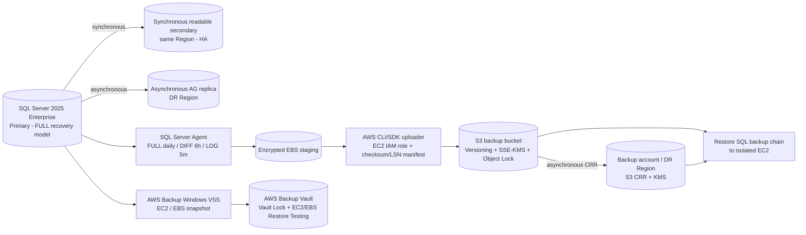
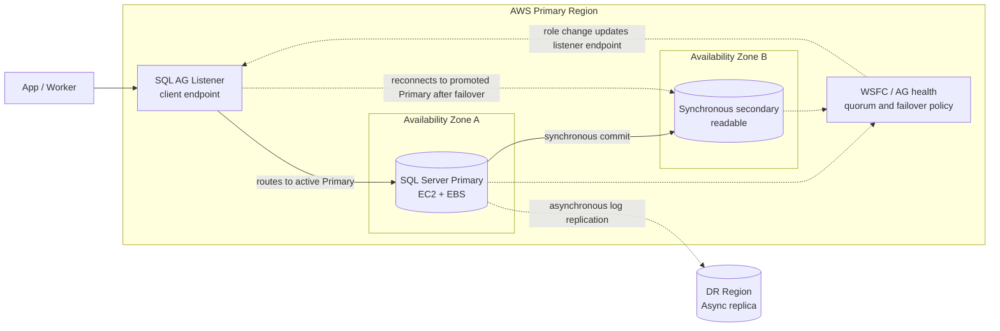
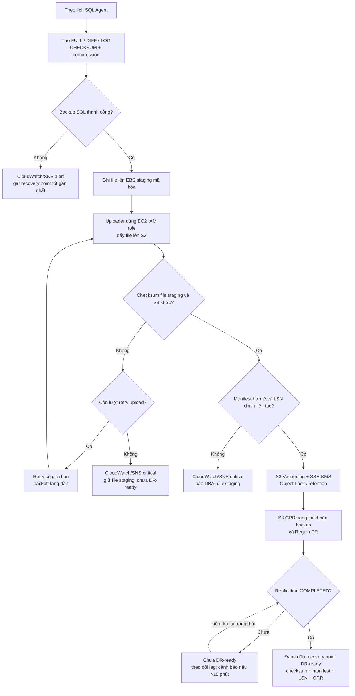
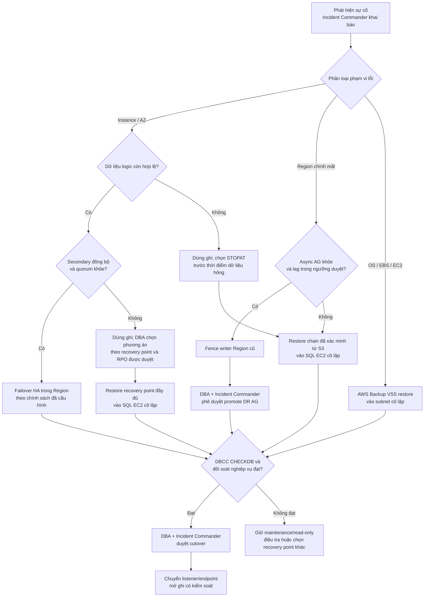
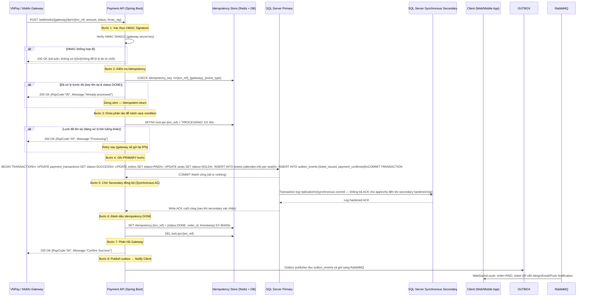
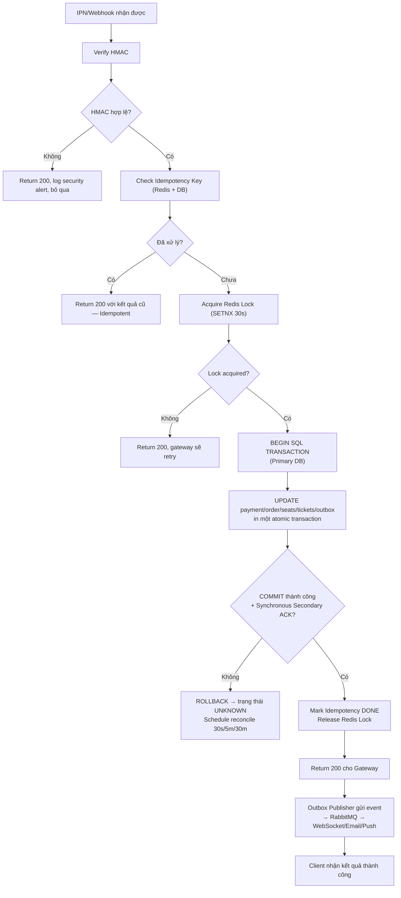

# Kiến trúc HA, Backup và Phục hồi Cơ sở dữ liệu

## Mục đích và trạng thái

Tài liệu này trình bày cách bảo vệ, duy trì sẵn sàng và phục hồi dữ liệu giao dịch của Concert Ticketing System. Phạm vi chính là **SQL Server 2025 Enterprise trên Amazon EC2**, Always On Availability Groups, Amazon S3 và AWS Backup.

Các con số RPO/RTO dưới đây là mục tiêu thiết kế lấy từ BA. Chỉ công bố là đạt sau khi DBA/SRE kiểm thử trên cấu hình và dữ liệu gần production, đo kết quả và được phê duyệt.

> **Quy tắc nghiệp vụ không thay đổi:** thời gian giữ ghế là 300 giây (5 phút) từ lần giữ đầu tiên. Phục hồi không được làm mới hoặc kéo dài deadline này.

## 1. Mục tiêu bảo vệ dữ liệu

- Duy trì dịch vụ khi SQL Server instance hoặc Availability Zone gặp sự cố.
- Phục hồi tại một thời điểm trước khi dữ liệu bị xóa nhầm, ghi sai hoặc hỏng logic.
- Có bản backup ngoài tài khoản production để giảm rủi ro ransomware hoặc xóa phá hoại.
- Đối soát đơn hàng, thanh toán, ghế và vé trước khi mở lại giao dịch.
- Đo RPO/RTO qua diễn tập thay vì chỉ dựa trên cấu hình.

## 2. Phân biệt HA, DR và Backup/PITR

| Cơ chế | Bảo vệ trước | Phương thức | Giới hạn |
|---|---|---|---|
| **HA trong Region** | Hỏng instance hoặc AZ | Always On AG với replica đồng bộ trong Region; chuyển Primary khi đủ điều kiện | Không khôi phục được trạng thái trước một thao tác sai đã đồng bộ |
| **DR khác Region** | Mất Region chính | Always On AG replica bất đồng bộ tại Region DR; promote theo runbook | Có thể mất các giao dịch chưa replicate |
| **SQL native backup / PITR** | Xóa nhầm, lỗi ứng dụng, hỏng logic, ransomware | FULL + DIFF + transaction LOG; restore đến thời điểm chọn | Chậm hơn failover HA |
| **AWS Backup VSS / EBS** | Hỏng EC2, OS hoặc volume | Khôi phục máy/volume từ recovery point VSS | Không thay thế chuỗi SQL log backup để PITR |

Always On là cơ chế HA/DR, **không phải bản backup**. Secondary replica không thay thế backup độc lập; thay đổi lỗi có thể được sao chép sang replica. [Microsoft: Always On Availability Groups](https://learn.microsoft.com/en-us/sql/database-engine/availability-groups/windows/overview-of-always-on-availability-groups-sql-server)

## 3. Kiến trúc tổng thể

### 3.1. Sơ đồ HA trong Region và DR khác Region

**Cách đọc sơ đồ:**

1. App/Worker kết nối qua SQL AG Listener, không cấu hình cứng địa chỉ IP Primary.
2. Trong Region chính, giao dịch chỉ có mục tiêu RPO 0 khi synchronous secondary đang synchronized và quorum còn khỏe; automatic failover chỉ áp dụng nếu đã cấu hình và kiểm thử.
3. WSFC/AG và quorum quyết định replica đủ điều kiện làm Primary. Listener giữ nguyên endpoint cho ứng dụng và theo vai trò Primary mới; không promote nếu thiếu quorum.
4. Replica khác Region nhận log bất đồng bộ. Trước promote phải đo lag và chấp nhận rõ khoảng mất dữ liệu có thể có; RPO ≤5 phút là mục tiêu cần diễn tập, không phải bảo đảm từ cấu hình.
5. Quorum witness không được giả định là S3. AWS FSx for Windows File Server có thể làm SMB file share witness cho một số kiến trúc WSFC; topology, vị trí witness, AD/network và thiết kế liên Region phải được kiểm chứng.
6. Nếu mô hình liên Region cần hai WSFC độc lập, DBA cần đánh giá distributed availability group; không tự ý kéo một WSFC qua Region khi chưa được phê duyệt.

### 3.2. Sơ đồ quy trình SQL backup đến bản sao ngoài Region

**Nguyên tắc xác nhận:** chỉ đánh dấu recovery point DR-ready khi upload hoàn tất, checksum giữa file staging và object S3 khớp, manifest hợp lệ, LSN chain liên tục và S3 CRR báo COMPLETED. Job SQL Agent “Succeeded” một mình chưa đủ. Chỉ retry có giới hạn cho lỗi truyền/checksum; lỗi manifest hoặc khoảng trống LSN phải cảnh báo DBA và giữ recovery point ở trạng thái chưa hợp lệ.
### Luồng bảo vệ

1. SQL Server Agent tạo SQL native backup trên EBS staging đã mã hóa.
2. Uploader dùng IAM instance role để chuyển file backup đã hoàn tất lên S3.
3. Manifest ghi database, loại backup, thời gian UTC, LSN, checksum và replication status.
4. S3 lưu phiên bản mã hóa bằng KMS, bật Versioning và Object Lock theo retention đã duyệt.
5. S3 CRR sao chép sang tài khoản backup và Region DR; chỉ coi bản sao DR sẵn sàng khi replication hoàn tất.
6. AWS Backup VSS tạo recovery point EC2/EBS bổ sung; restore testing của VSS kiểm tra máy/volume, không thay thế kiểm thử restore chuỗi SQL native.
7. Chỉ dọn file staging theo retention đã duyệt sau khi object S3 được xác minh và recovery point DR đã sẵn sàng; không xóa bản sao duy nhất còn dùng được.

S3 replication là bất đồng bộ; cần theo dõi trạng thái từng object và replication lag. Object Lock bảo vệ object version theo retention và cần bật S3 Versioning. [AWS: S3 Replication](https://docs.aws.amazon.com/AmazonS3/latest/userguide/replication.html), [AWS: S3 Object Lock](https://docs.aws.amazon.com/AmazonS3/latest/userguide/object-lock.html)

## 4. Lịch backup và lưu giữ

| Thành phần | Phương pháp / tần suất | Lưu giữ / ghi chú |
|---|---|---|
| Database giao dịch SQL Server | Recovery Model = FULL; FULL hằng ngày, DIFF mỗi 6 giờ, transaction LOG mỗi 5 phút | Cửa sổ PITR 35 ngày; giữ chuỗi backup và Object Lock tối thiểu 37 ngày để còn full backup nền cho đầu cửa sổ |
| Bản SQL backup ngoài Region | S3 CRR sang tài khoản backup riêng và Region DR được duyệt | Theo dõi replication status; backup RPO đo đến log backup đã replicate |
| EC2 và EBS volumes | AWS Backup Windows VSS application-consistent nếu OS/instance được hỗ trợ | Bổ sung cho phục hồi máy/volume; không mặc định nối vào SQL log chain |
| SQL system databases | Backup master, msdb, model theo runbook DBA; backup lại sau thay đổi login/job/config quan trọng | Hỗ trợ dựng lại instance và metadata vận hành |
| Mã hóa và cấu hình | Bảo vệ SQL backup encryption certificate/key nếu sử dụng; lưu cấu hình hạ tầng theo quy trình được duyệt | Giữ khóa riêng khỏi tài khoản production; kiểm tra quyền giải mã tại Region DR |

**Điều kiện vận hành:**

- DBA xác nhận FULL Recovery Model, full backup nền thành công và transaction log liên tục theo LSN.
- Chỉ xem backup ngoài Region là hợp lệ sau khi upload, checksum và replication status được xác minh.
- IAM role uploader chỉ ghi vào prefix cần thiết; workload production không được xóa object, đổi retention hoặc bypass Object Lock.
- Mã hóa EBS/S3 bằng KMS; thử quyền dùng key tại Region DR trong restore drill.
- Benchmark I/O, CPU, thời gian backup và tăng trưởng dữ liệu trước go-live.

SQL Server Full Recovery Model hỗ trợ log backup và point-in-time restore; restore hoàn chỉnh yêu cầu áp dụng data backup và log backup liên tiếp theo đúng thứ tự. [Microsoft: Recovery Models](https://learn.microsoft.com/en-us/sql/relational-databases/backup-restore/recovery-models-sql-server?view=sql-server-ver17), [Microsoft: Complete Database Restores](https://learn.microsoft.com/en-us/sql/relational-databases/backup-restore/complete-database-restores-full-recovery-model)

## 5. RPO/RTO mục tiêu

| Tình huống | Đường phục hồi | Mục tiêu theo BA | Trạng thái |
|---|---|---|---|
| Hỏng instance/AZ trong Region chính | Failover sang synchronous AG secondary | RPO 0 / RTO ≤ 5 phút | D-026; cần diễn tập |
| Mất Region chính | Promote asynchronous AG DR replica nếu lag nằm trong ngưỡng duyệt | RPO ≤ 5 phút / RTO ≤ 60 phút | D-026 chỉ áp dụng AG failover |
| Xóa nhầm, lỗi logic, ransomware | PITR từ S3 vào SQL Server EC2 sạch | RPO ≤ 30 phút / RTO ≤ 4 giờ | D-036 đề xuất; chờ DBA/SRE/Finance phê duyệt và benchmark |
| Hỏng OS/EC2/EBS | Restore bằng AWS Backup VSS, sau đó xác minh SQL | RPO theo recovery point gần nhất; RTO đo qua restore test | Cần kiểm thử theo instance thực tế |

> LOG mỗi 5 phút **không tự đảm bảo** backup RPO 5 phút ở S3. Đo backup RPO từ thời điểm transaction log mới nhất đã upload, xác minh và replicate tại nơi lưu trữ đích. Mục tiêu PITR backup hiện là ≤30 phút.

## 6. Runbook phục hồi

### 6.0. Sơ đồ chọn đường phục hồi theo loại sự cố

**Thứ tự ưu tiên khi xử lý:** bảo toàn evidence → dừng/fence luồng ghi lỗi → xác định recovery point có LSN đầy đủ và mức mất dữ liệu chấp nhận được → phục hồi trong môi trường cô lập → chạy DBCC và đối soát order/ghế/payment/vé/outbox → DBA và Incident Commander duyệt → mới chuyển endpoint và mở ghi. Nếu kiểm tra không đạt, tiếp tục maintenance/read-only và chọn recovery point khác. Chọn object từ tài khoản/Region còn tin cậy; khi production account/Region bị ảnh hưởng, dùng bản sao độc lập có CRR COMPLETED. VSS phục hồi host/volume; PITR vẫn dùng chuỗi SQL native.

### 6.1. Failover HA trong Region

1. Incident Commander và DBA xác nhận lỗi instance/AZ, AG health, log send/redo queue, trạng thái synchronized và quorum.
2. Nếu secondary synchronized và chính sách cho phép, thực hiện automatic hoặc manual failover theo cấu hình đã kiểm thử.
3. Nếu secondary không synchronized hoặc mất quorum, không tuyên bố RPO 0 và không forced failover mù; dừng ghi, DBA chọn sửa chữa hoặc recovery point an toàn theo RPO được phê duyệt.
4. Xác nhận listener trỏ tới Primary mới và chỉ còn một writer; ứng dụng reconnect bằng endpoint ổn định.
5. Chạy smoke test, kiểm tra booking/payment/ticket rồi ghi thời điểm, dữ liệu cuối cùng xác nhận và RPO/RTO đo được.

### 6.2. Failover DR khác Region

1. Xác nhận Region outage qua health signal độc lập; kiểm tra AG health, log send/redo queue, commit cuối và KMS/network tại DR.
2. So sánh lag với ngưỡng mất dữ liệu đã duyệt; forced failover có thể mất giao dịch chưa replicate và phải được DBA/Incident Commander chấp thuận.
3. Fence Region cũ hoặc xác nhận cơ chế fail-closed ngăn writer cũ hoạt động; chỉ duy trì một Primary.
4. Nếu lag nằm trong ngưỡng và DR AG đủ điều kiện, promote theo runbook. Nếu không, restore chuỗi SQL đã replicate COMPLETED từ S3 DR vào EC2 cô lập.
5. Kiểm tra endpoint, secrets, KMS, smoke test và đối soát order/payment/ticket/outbox trước khi chuyển DNS/traffic.
6. Không tự động failback; đồng bộ, kiểm tra drift và lập cửa sổ failback có phê duyệt.

### 6.3. PITR khi dữ liệu bị xóa hoặc ghi sai

1. Khai báo incident; dừng/cô lập luồng ghi gây lỗi. Giữ database/volume bị ảnh hưởng làm bằng chứng; không restore đè lên bản duy nhất.
2. Chọn thời điểm STOPAT ngay trước thao tác lỗi; kiểm tra audit, outbox và callback payment.
3. Nếu tài khoản/Region production bị ảnh hưởng, lấy backup từ S3 DR; chỉ dùng object có checksum hợp lệ và replication COMPLETED.
4. Tạo SQL Server EC2 sạch trong subnet cô lập; xác minh version/edition, EBS layout, KMS và certificate/key SQL nếu có mã hóa tầng SQL.
5. Restore theo thứ tự: FULL gần nhất trước STOPAT → DIFF phù hợp sau FULL → mọi transaction LOG tiếp theo theo LSN.
6. Dùng NORECOVERY cho các bước trung gian; restore log cuối đến STOPAT rồi RECOVERY. Nếu thiếu log trong chain, dừng và chọn thời điểm sớm hơn còn đầy đủ.
7. Chạy DBCC CHECKDB, kiểm tra constraint và invariants: ghế, order, payment/refund, ticket và idempotency. RESTORE VERIFYONLY chỉ là bước sơ bộ, không thay restore thật.
8. Đối soát payment/refund quanh thời điểm phục hồi; xử lý UNKNOWN với VNPay/MoMo. Không charge lại hoặc phát hành vé khi chưa xác định kết quả.
9. DBA/Incident Commander phê duyệt cutover; ghi thời điểm phục hồi, dữ liệu cuối cùng, sai lệch và RPO/RTO thực tế.

Microsoft hướng dẫn restore point-in-time bằng chuỗi full/differential/log, dùng NORECOVERY cho các bước trước khi hoàn tất restore. [Microsoft: Restore to a Point in Time](https://learn.microsoft.com/en-us/sql/relational-databases/backup-restore/restore-a-sql-server-database-to-a-point-in-time-full-recovery-model)

### 6.4. Phục hồi EC2/EBS bằng VSS

1. Chọn recovery point VSS thành công trước sự cố và restore sang subnet cô lập; không thay máy còn dùng điều tra.
2. Dựng EC2/EBS qua AWS Backup/Systems Manager; xác nhận SQL Server service, volume mapping và VSS Writer.
3. Chạy DBCC CHECKDB và đối soát nghiệp vụ.
4. Nếu cần PITR chính xác hơn snapshot, restore chuỗi SQL native riêng; không giả định có thể nối transaction log chain lên VSS snapshot.
5. Chỉ cutover sau khi DBA/Incident Commander phê duyệt.

## 7. Quy tắc phục hồi nghiệp vụ

- Dừng bán vé/ghi mới trong thời gian chưa xác minh dữ liệu.
- Thời hạn giữ ghế là **300 giây (5 phút) từ lần giữ đầu tiên**. Giữ nguyên expires_at; hold quá hạn được giải phóng, không cấp lại đủ 5 phút.
- Redis queue, admission token và lock là trạng thái tạm; SQL Server mới là nguồn sự thật cho order/payment/ticket.
- Thu hồi queue token cũ; chỉ dựng Redis lock cho hold SQL còn hạn và đặt TTL còn lại theo `max(0, expires_at - now)`, không cấp lại đủ 300 giây.
- Payment UNKNOWN phải được đối soát trước khi retry; phát hành vé idempotent và chỉ khi order đủ điều kiện.
- Reconcile outbox theo idempotency key; không phát lại mù sự kiện payment, ticket hoặc notification.

## 8. Giám sát, cảnh báo và diễn tập

### Dashboard

- Tuổi FULL, DIFF và transaction LOG gần nhất.
- Thời điểm LOG backup mới nhất đã upload và replicate thành công.
- SQL Agent job failure, checksum/upload failure và khoảng trống LSN.
- Dung lượng trống EBS staging; Always On replica lag.
- S3 replication backlog/failure, AWS Backup job và VSS restore test status.
- KMS decrypt/access errors và tuổi recovery point.

### Ngưỡng cảnh báo theo BA

| Cảnh báo | Ngưỡng ban đầu | Hành động |
|---|---|---|
| Backup LOG chậm | Cảnh báo khi không có LOG thành công >10 phút; Critical >15 phút | Kiểm tra SQL Agent, EBS staging, uploader, IAM/KMS; đánh giá backup RPO |
| S3 replication | Pending >15 phút hoặc replication failure | Kiểm tra CRR role, KMS và backlog; chưa tính object là bản DR sẵn sàng |
| Staging volume | Free space <30%; nâng mức khi <20% | Mở rộng dung lượng; không xóa backup chưa có bản S3 được xác minh |
| AWS Backup/VSS | Job hoặc restore test thất bại | Kiểm tra VSS Writer, SSM permissions và Vault; giữ recovery point tốt gần nhất |

### Lịch diễn tập

- **Hằng tháng:** restore thật một SQL recovery point từ S3 vào EC2 cô lập; xác minh chuỗi FULL/DIFF/LOG, checksum, DBCC CHECKDB và business invariants.
- **Hằng tháng:** AWS Backup Restore Testing cho recovery point EC2/EBS.
- **Hằng quý:** diễn tập Region failover bằng AG DR hoặc PITR từ S3; đo RPO/RTO và xác minh DNS, KMS, secrets, traffic cutover.
- Sau mỗi diễn tập, lưu recovery point/object version, replication status, thời gian, dữ liệu cuối cùng xác nhận, RPO/RTO đo được, sai lệch và action items.

### Phương pháp ứng phó sự cố và ma trận xử lý

### Quy trình xử lý 7 bước

1. **Khai báo và phân công:** Incident Commander điều phối; DBA chịu trách nhiệm database và recovery point; SRE phụ trách AWS/network/KMS; App lead phụ trách dừng/khôi phục traffic và kiểm tra API; Finance/Support phối hợp đối soát payment.
2. **Phân loại:** tách sự cố khả dụng (node/AZ/Region), dữ liệu logic (delete/corruption), OS/volume, hoặc phụ thuộc ngoài như payment provider.
3. **Khoanh vùng và bảo toàn:** dừng writes nếu có nguy cơ tiếp tục ghi sai; fence node/Region cũ khi failover; giữ volume/object/log phục vụ điều tra; không xóa backup duy nhất.
4. **Chọn cơ chế:** AG đồng bộ cho node/AZ khi secondary và quorum khỏe; async AG cho Region khi lag đạt ngưỡng; SQL PITR cho dữ liệu logic; VSS/EBS cho phục hồi máy/volume.
5. **Khôi phục cô lập:** dựng database/máy mục tiêu trong subnet riêng, xác minh phiên bản, KMS/certificate, object version, checksum, log chain và thời điểm `STOPAT`.
6. **Xác minh:** chạy `DBCC CHECKDB`, kiểm tra constraint và đối soát số ghế, order, payment/refund, ticket, outbox/idempotency. Payment `UNKNOWN` phải được inquiry với VNPay/MoMo.
7. **Phê duyệt và mở lại:** DBA + Incident Commander ký xác nhận; App lead chuyển listener/endpoint/traffic; mở lại luồng theo thứ tự đã định; theo dõi error rate, DB locks, callback lag và duplicate indicators.

### Ma trận xử lý tình huống

| Dấu hiệu / sự cố | Chẩn đoán đầu tiên | Hành động an toàn | Điều kiện mở lại |
|---|---|---|---|
| Primary EC2 hoặc AZ lỗi | WSFC/quorum, AG synchronization, log send/redo queue, last hardened log | Failover local khi replica synchronized và quorum đủ điều kiện; nếu không, dừng ghi và chọn sửa chữa/recovery point theo RPO được duyệt; không forced failover mù | Listener trỏ Primary mới, một writer duy nhất; smoke test và kiểm tra write/read pass |
| Secondary không synchronized | Log send/redo queue, network, storage/CPU pressure | Không tuyên bố RPO 0; khắc phục replication hoặc chuyển sang phương án đã duyệt | Replica synchronized và failover test thành công |
| Mất Region chính | AWS Health, AG replica health/lag, thời điểm commit cuối | Dừng ghi/fence Region cũ; đánh giá loss window; promote DR khi Incident Commander/DBA chấp thuận | Một Primary duy nhất; kết nối, KMS, secrets, payment callbacks và nghiệp vụ được xác minh |
| Bản ghi bị xóa hoặc dữ liệu bị ghi sai | Audit/log/outbox, thời điểm và phạm vi lỗi | Không failover sang replica đang nhận cùng dữ liệu lỗi; phục hồi PITR trước thời điểm lỗi vào EC2 cô lập | DBCC CHECKDB + đối soát business invariants pass |
| Transaction-log backup >10 phút / >15 phút | SQL Agent, dung lượng EBS staging, uploader, IAM/KMS | P1 khi vượt ngưỡng critical; kiểm tra log chain và tăng dung lượng; không xóa bản chưa verified/replicated | Có log backup hợp lệ liên tục và S3 lag trở lại trong ngưỡng |
| S3 replication pending >15 phút | CRR role, destination versioning/Object Lock, KMS quyền đích | Coi DR copy chưa sẵn sàng; xử lý backlog và cập nhật RPO thực tế | Object status COMPLETED, checksum/manifest đúng |
| EBS staging dưới 30% / 20% | Kích thước file backup, job treo, upload chậm | Cảnh báo ở 30%, critical ở 20%; mở rộng volume hoặc xử lý uploader; không xóa backup nguồn chưa xác minh | Có đủ headroom cho chu kỳ backup tiếp theo |
| Payment UNKNOWN sau restore | Provider inquiry, callback log, idempotency key, order/hold deadline | Không thu lại tiền theo kiểu retry mù; không phát vé khi chưa xác minh | Provider và sổ order/payment khớp; quyết định refund/fulfillment có audit |

### Cách tính số liệu trong diễn tập

- RPO thực tế = thời điểm incident trừ thời điểm dữ liệu cuối cùng phục hồi được và đối soát xác nhận.
- RTO thực tế = thời điểm nghiệp vụ được phê duyệt hoạt động lại trừ thời điểm incident được khai báo.
- Với PITR, ghi riêng thời gian provision EC2, tải backup từ S3, restore FULL/DIFF/LOG, DBCC/đối soát và cutover; các bước cộng vào RTO.
- Với DR AG, ghi replica lag tại thời điểm chọn failover và số giao dịch có thể chưa replicate.
- Nếu kết quả vượt target, ghi gap, owner và hạn khắc phục; không điều chỉnh báo cáo để thể hiện đạt.

### Các điểm cần DBA/SRE xác nhận trước production

- Cấu hình WSFC/AG, quorum/witness, vùng đặt witness, network latency và hành vi khi mất kết nối giữa AZ/Region.
- Failover local tự động hay manual; tiêu chí synchronized, health check và fencing.
- Thiết kế liên Region là một AG hay distributed AG trên các WSFC riêng.
- SQL Server edition/license, Windows support, EBS layout, KMS access và restore time.
- S3 Object Lock mode/retention, backup account permissions, CRR/KMS policy, lifecycle và chi phí.
- Lịch backup thực tế có đáp ứng cửa sổ, I/O, log chain, retention và RPO không.

## 9. Nội dung trình bày ngắn

> “Tôi tách bài toán thành HA, DR và backup. Always On xử lý failover: đồng bộ trong Region có mục tiêu RPO 0/RTO 5 phút; replica bất đồng bộ khác Region có mục tiêu RPO 5 phút/RTO 60 phút. Để xử lý xóa nhầm hoặc dữ liệu hỏng đã replicate, SQL Agent tạo FULL mỗi ngày, DIFF mỗi 6 giờ và LOG mỗi 5 phút. Backup được xác minh rồi chuyển sang S3 mã hóa, có versioning, Object Lock và bản sao tài khoản/Region riêng. Khi phục hồi, tôi dựng SQL Server cô lập, restore chuỗi đến STOPAT, chạy DBCC và đối soát payment/ghế/vé rồi mới cutover. RPO/RTO backup 30 phút/4 giờ vẫn là mục tiêu cần diễn tập. Hold ghế giữ nguyên 5 phút, không reset sau recovery.”

## 10. Quy Trình Cập Nhật Trạng Thái Giao Dịch Idempotent & Đồng Bộ Primary-Secondary

### 10.1 Mục Đích

Mục này mô tả luồng nghiệp vụ đảm bảo:
- **Idempotency liên tục**: IPN Webhook từ VNPay/MoMo có thể gửi lại nhiều lần; hệ thống xử lý an toàn không tạo đơn/vé trùng.
- **Thứ tự ghi đúng**: Primary DB xác nhận commit thành công → Đồng bộ về Secondary → Mới phản hồi client.
- **Không bao giờ phản hồi "thành công" khi DB chưa ghi xong**: Tránh tình trạng client thấy thành công nhưng dữ liệu chưa lưu.

---

### 10.2 Luồng Cập Nhật Status Transaction (IPN Processing)

---

### 10.3 Quy Tắc Đảm Bảo Thứ Tự & Idempotency

| Quy tắc | Mô tả |
|---|---|
| **PRIMARY trước, CLIENT sau** | Chỉ phản hồi thành công cho Client hoặc Gateway khi PRIMARY đã COMMIT và Synchronous Secondary đã hardened. Không trả response trước khi COMMIT. |
| **Idempotency Key bền vững** | Key được lưu trong cả Redis (TTL 24h cache) VÀ bảng `payment_idempotency_log` trong SQL Server (bền vững). Redis chỉ là lớp tăng tốc; SQL Server là nguồn sự thật chống trùng. |
| **Lock phân tán** | Dùng Redis SETNX với TTL ngắn (30 giây) để tránh 2 luồng xử lý cùng IPN đồng thời. Lock tự hết hạn nếu luồng chết giữa chừng. |
| **Transaction Atomic** | Tất cả các UPDATE (payment, order, seats, tickets, outbox) thực hiện trong 1 SQL transaction. Nếu bất kỳ bước nào fail → ROLLBACK toàn bộ. |
| **Outbox Pattern** | Không publish sang RabbitMQ bên trong SQL transaction. Dùng Transactional Outbox: ghi outbox_events trong transaction DB; publisher riêng đọc và gửi sau khi commit thành công, đảm bảo at-least-once delivery có idempotency. |
| **Synchronous Secondary trước phản hồi** | Với Always On AG synchronous mode, SQL Server không trả COMMIT ACK cho ứng dụng cho đến khi secondary đã hardened log. Điều này đảm bảo ngay cả khi Primary sập sau COMMIT, dữ liệu đã có trên Secondary. |
| **UNKNOWN không retry mù** | Nếu không nhận được ACK trong timeout (30 giây), ghi trạng thái UNKNOWN. Chỉ reconcile tại 30 giây, 5 phút, 30 phút. Không tạo payment attempt mới khi còn UNKNOWN. |

---

### 10.4 Trường Hợp Ngoại Lệ & Xử Lý

| Tình huống | Xử Lý |
|---|---|
| IPN đến trùng (gateway retry) | Idempotency check trả về kết quả cũ, không xử lý lại, trả 200 OK cho gateway |
| Primary COMMIT nhưng Secondary lag | Synchronous AG: không thể COMMIT khi secondary không ACK (đây là bảo đảm thiết kế). Nếu secondary xuống, AG chuyển unsynchronized → alert DBA |
| App crash giữa COMMIT và phản hồi Gateway | Gateway timeout → gửi lại IPN → Idempotency check phát hiện đã DONE → trả 200 OK |
| Outbox publisher chậm/down | Khách hàng chưa nhận notification nhưng dữ liệu đã PAID trong DB. Publisher resume tự động từ outbox; client có thể polling GET /orders/{id} |
| Lock Redis hết hạn trước khi xử lý xong | Log warning; transaction DB vẫn chạy; nếu luồng khác vào do lock expire, idempotency DB ngăn trùng lặp |

---

### 10.5 Sơ Đồ Tổng Quan Thứ Tự Ưu Tiên Ghi

## 11. Tài liệu liên quan

- [NFR — Giám sát, Sao lưu & Phục hồi Thảm họa](../../05_Non_Functional_Requirements_(NFR)/07_Monitoring_Backup_And_Disaster_Recovery.md)
- [Deployment & Operations Architecture](07_Deployment_And_Operations_Architecture.md)
- [Decision Log — D-026, D-036, Q-023](../../00_Project_Governance/03_Risks_Open_Questions_And_Decision_Log.md)

### Tài liệu tham khảo kỹ thuật

- [AWS Prescriptive Guidance — SQL Server HA on EC2](https://docs.aws.amazon.com/prescriptive-guidance/latest/migration-sql-server/ec2-sql-ha.html)
- [AWS Prescriptive Guidance — SQL Server DR on EC2](https://docs.aws.amazon.com/prescriptive-guidance/latest/migration-sql-server/ec2-sql-dr.html)
- [Amazon FSx — Using FSx for Windows File Server with SQL Server](https://docs.aws.amazon.com/fsx/latest/WindowsGuide/sql-server.html)

- [Microsoft Learn — Backup overview](https://learn.microsoft.com/en-us/sql/relational-databases/backup-restore/backup-overview-sql-server)
- [Microsoft Learn — Recovery models](https://learn.microsoft.com/en-us/sql/relational-databases/backup-restore/recovery-models-sql-server?view=sql-server-ver17)
- [Microsoft Learn — Complete database restores](https://learn.microsoft.com/en-us/sql/relational-databases/backup-restore/complete-database-restores-full-recovery-model)
- [Microsoft Learn — Always On Availability Groups](https://learn.microsoft.com/en-us/sql/database-engine/availability-groups/windows/overview-of-always-on-availability-groups-sql-server)
- [Microsoft Learn — Restore to a point in time](https://learn.microsoft.com/en-us/sql/relational-databases/backup-restore/restore-a-sql-server-database-to-a-point-in-time-full-recovery-model)
- [Amazon S3 — Object Lock](https://docs.aws.amazon.com/AmazonS3/latest/userguide/object-lock.html)
- [Amazon S3 — Replication](https://docs.aws.amazon.com/AmazonS3/latest/userguide/replication.html)
- [AWS — SQL Server on EC2 backup with VSS](https://docs.aws.amazon.com/sql-server-ec2/latest/userguide/ms-ssdb-ec2-bkup-vss.html)
