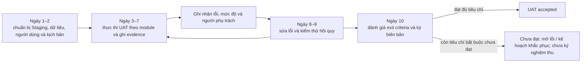

# 01 — Tiêu Chí Nghiệm Thu & Kế Hoạch Kiểm Thử Người Dùng (Acceptance Criteria & UAT Plan)

> **Phạm vi kiểm thử:** check-in online là baseline; khi mất kết nối phải fail-closed theo D-023. 100.000 CCU và HA/DR là release gates, không phải bằng chứng đã chạy.

## 1. Giới Thiệu & Mục Tiêu Nghiệm Thu (UAT Scope)

Kiểm thử Chấp nhận của Người dùng (**User Acceptance Testing - UAT**) là giai đoạn quyết định trước khi hệ thống bán vé sự kiện âm nhạc chính thức phát hành ra thị trường (Go-Live). Mục tiêu của tài liệu này:
1. Thiết lập các **Tiêu chí Nghiệm thu Nghiệp vụ (Business Acceptance Criteria)** chi tiết, có thể lượng hóa và kiểm chứng được cho từng module chức năng.
2. Cung cấp quy trình bàn giao và biểu mẫu nghiệm thu (**UAT Sign-Off Template**) để Ban Quản Trị Hệ Thống (Sàn vé) và Đại diện Ban Tổ Chức Sự Kiện (Organizer) cùng ký duyệt.
3. Bao phủ 15 Use Cases và các mã BR được khai báo trong Business Rules Catalog; UAT chỉ được ký sau khi từng tiêu chí bắt buộc có kết quả và bằng chứng, không còn lỗi Blocker/Critical. Kế hoạch này không khẳng định UAT đã chạy.

---

## 2. Tiêu Chí Nghiệm Thu Theo Từng Phân Hệ Chức Năng (Detailed Acceptance Criteria)

### Phân Hệ 1: Tài Khoản, Xác Thực & Phân Quyền (UC01 – UC03)
- [ ] **AC-UAT-01.1:** Khách hàng đăng ký tài khoản bằng số điện thoại Việt Nam hợp lệ; nhận mã OTP qua SMS trong vòng $\le 10\text{ giây}$ và kích hoạt tài khoản thành công.
- [ ] **AC-UAT-01.2:** Nhập sai mật khẩu 5 lần liên tiếp $\rightarrow$ Tài khoản tự động bị khóa tạm thời 15 phút; hiển thị thông báo rõ ràng kèm đồng hồ đếm lùi.
- [ ] **AC-UAT-01.3:** Đăng nhập thành công trả về JWT Token; trên trình duyệt Web, Refresh Token được lưu trong `HttpOnly Cookie`. Khi đăng xuất, Refresh Token bị hủy bỏ vĩnh viễn trên Database.
- [ ] **AC-UAT-01.4:** Phân quyền RBAC chính xác $100\%$: Khách hàng thông thường truy cập URL của Admin (`/admin/dashboard`) bị chặn ngay lập tức với mã lỗi `403 Forbidden`.
- [ ] **AC-UAT-01.5 (UC02/UC03):** Customer chỉ sửa hồ sơ của chính mình; Admin khóa tài khoản theo quyền, ghi audit log và user bị khóa không thể đăng nhập hoặc dùng refresh token còn hiệu lực.

---

### Phân Hệ 2: Tìm Kiếm, Phòng Chờ Ảo & Sơ Đồ Ghế (UC04 – UC06)
- [ ] **AC-UAT-02.0 (UC04):** Tìm kiếm/lọc concert theo từ khóa, thành phố và trạng thái công khai trả về đúng tập kết quả; concert chưa công khai không lộ ra cho Guest/Customer.
- [ ] **AC-UAT-02.1:** Trước giờ mở bán $15\text{ phút}$, truy cập trang concert tự động hiển thị giao diện Phòng Chờ Ảo (Waiting Room) kèm đồng hồ đếm ngược; không cho phép nhấp chọn ghế trước giờ G.
- [ ] **AC-UAT-02.2:** Đúng giờ mở bán ($T$), hệ thống xáo trộn ngẫu nhiên số thứ tự hàng chờ và cấp số cho toàn bộ người có mặt trong phòng chờ; thời gian xử lý xáo trộn $< 3\text{ giây}$.
- [ ] **AC-UAT-02.3:** Sơ đồ khán đài hiển thị trực quan các phân khu (Zone), hàng ghế và vị trí từng ghế; trạng thái màu sắc thay đổi mượt mà theo thời gian thực (Trắng: Trống; Vàng: Đang giữ; Đỏ: Đã bán).
- [ ] **AC-UAT-02.4:** Một tài khoản chỉ được phép chọn tối đa **4 vé** trong một lần giao dịch. Cố chọn chiếc thứ 5 lập tức bị hệ thống cảnh báo và vô hiệu hóa.
- [ ] **AC-UAT-02.5 (Tuyệt đối không bán trùng):** Khi 2 người dùng cùng nhấp vào 1 ghế trống tại cùng một thời điểm: Duy nhất 1 người nhận được thông báo "Giữ ghế thành công"; người còn lại nhận thông báo "Ghế vừa được người khác giữ" trong vòng $< 300\text{ ms}$.
- [ ] **AC-UAT-02.6:** Đồng hồ đếm lùi giữ ghế 10 phút ($600\text{ giây}$) hiển thị chính xác. Khi hết $600\text{ giây}$ mà khách chưa thanh toán, ghế tự động chuyển về trạng thái `AVAILABLE` cho cộng đồng.
- [ ] **AC-UAT-02.7:** Queue Access Token/slot hết hạn sau 120 giây không hoạt động hợp lệ; WebSocket còn mở không gia hạn. Seat hold đã tạo vẫn giữ đủ 600 giây tính từ lần giữ đầu tiên theo D-015.

---

### Phân Hệ 3: Đặt Hàng, Thanh Toán & Hoàn Tiền (UC07 – UC09)
- [ ] **AC-UAT-03.1:** Tính toán hóa đơn theo snapshot: `final_amount = total_amount - discount_amount + service_fee_amount + tax_amount`; trong baseline, discount_amount luôn bằng 0 theo D-031.
- [ ] **AC-UAT-03.2:** Khách hàng bấm thanh toán $\rightarrow$ Chuyển hướng mượt mà sang Cổng VNPay hoặc MoMo; mã QR thanh toán quét được bằng ứng dụng ngân hàng di động.
- [ ] **AC-UAT-03.3:** Nhấp đúp nút "Xác nhận thanh toán" hoặc tải lại trang thanh toán nhiều lần không bao giờ bị trừ tiền 2 lần (Nhờ Idempotency Key).
- [ ] **AC-UAT-03.4:** Sau khi chuyển tiền thành công, trạng thái đơn hàng tự động chuyển sang `PAID` trong vòng $< 3\text{ giây}$ mà không cần người dùng tải lại trang.
- [ ] **AC-UAT-03.5 (Chính sách hoàn tiền):** Với order không có ticket CHECKED, ngày địa phương còn ≥7 ngày hoàn 100%, còn 3–6 ngày hoàn 50% tổng giá vé đủ điều kiện (làm tròn half-up một lần), còn 0–2 ngày không hoàn tự nguyện; phí dịch vụ/thuế không hoàn. Tính theo timezone địa điểm (D-024, BR-RFD-001/006). Provider quyết định thời gian tiền về.
- [ ] **AC-UAT-03.6 (Late capture):** Nếu provider xác nhận capture sau khi hold 600 giây hết hạn, ghi SUCCESS_UNFULFILLED; không hồi sinh hold, không tạo order mới, không chiếm lại ghế. Chỉ sau khi xác minh capture mới tạo đúng một refund 100% số tiền thực thu (D-016/D-032).
- [ ] **AC-UAT-03.7 (UNKNOWN):** Payment/refund timeout chuyển UNKNOWN; đối soát tại 30 giây, 5 phút, 30 phút; không retry mù hoặc tạo payment attempt mới khi kết quả chưa rõ. Chỉ retry sau thất bại xác định; UNKNOWN refund quá 30 phút vào manual queue theo D-032/D-033.
- [ ] **AC-UAT-03.8 (UC08):** Lịch sử đơn chỉ trả đơn thuộc user đã xác thực; trạng thái đơn, số tiền snapshot và vé hiển thị khớp dữ liệu giao dịch, không lộ order của tài khoản khác.

---

### Phân Hệ 4: Quản Trị Concert & Báo Cáo Doanh Thu (UC11 – UC13)
- [ ] **AC-UAT-04.1:** Ban tổ chức tạo concert mới ở trạng thái `DRAFT`, tải lên đầy đủ thông tin, cấu hình sơ đồ ghế, giá vé và đính kèm Giấy phép biểu diễn $\rightarrow$ Gửi duyệt chuyển sang `PENDING_REVIEW`.
- [ ] **AC-UAT-04.2:** Admin xem xét tài liệu, phê duyệt (PUBLISHED) hoặc từ chối kèm lý do; trạng thái được lưu/audit và thông báo được enqueue trong ≤5 giây. Theo dõi riêng trạng thái provider; không đặt SLA giao email từ bên thứ ba.
- [ ] **AC-UAT-04.3:** Khi concert đã ở trạng thái `ON_SALE`, hệ thống khóa toàn bộ chức năng sửa đổi sơ đồ ghế, số lượng vé và giá niêm yết để bảo vệ quyền lợi người mua.
- [ ] **AC-UAT-04.4:** Dashboard của Organizer cập nhật số lượng vé đã bán và doanh thu ròng với độ trễ không quá $60\text{ giây}$ so với thời điểm thanh toán thực tế; hỗ trợ xuất file Excel báo cáo chi tiết.
- [ ] **AC-UAT-04.5 (Hủy concert):** Hủy trước COMPLETED hoàn 100% order.final_amount cho mọi order PAID, kể cả vé CHECKED; vô hiệu hóa mọi ticket, giữ nguyên checkin_logs, không mở lại ghế và áp dụng reconciliation khi refund UNKNOWN (D-017/D-032).
- [ ] **AC-UAT-04.6 (Quyết toán):** Số gross/refund/fee/payable khớp giao dịch đã xác nhận và snapshot hợp đồng; không có tỷ lệ hoặc thời gian payout hard-coded.
- [ ] **AC-UAT-04.7 (Chặn payout):** Settlement không thể được phê duyệt/ghi PAID khi concert chưa COMPLETED, reconciliation chưa MATCHED, còn giao dịch UNKNOWN/discrepancy hoặc thiếu điều kiện hợp đồng.
- [ ] **AC-UAT-04.8 (Audit payout):** Chỉ Admin/Finance được phê duyệt; trạng thái PAID yêu cầu người thực hiện, thời điểm, payout reference và bằng chứng chuyển tiền được lưu.
- [ ] **AC-UAT-04.9 (Hủy theo hợp đồng):** Organizer gửi yêu cầu để Admin xem xét theo điều khoản/chính sách đã ký; hệ thống không tự từ chối theo ngưỡng 72 giờ và không gán chi phí hoàn tiền nếu hợp đồng chưa xác định.

---

### Phân Hệ 5: Soát Vé Tại Cổng & Thông Báo Đa Kênh (UC14 – UC15)
- [ ] **AC-UAT-05.1:** Ứng dụng làm mới QR mỗi 30 giây; mỗi token có hiệu lực tối đa 60 giây. Token cũ không bị vô hiệu chỉ vì có token mới; token hết hạn bị từ chối khi `exp <= now()`, và vé không ở trạng thái hợp lệ vẫn bị từ chối theo trạng thái vé. Kiểm thử ảnh chụp sau khi token hết hạn, không mặc định mọi token cũ bị vô hiệu sau 30 giây.
- [ ] **AC-UAT-05.2:** Thiết bị nhân viên quét vé hợp lệ phản hồi trong vòng $\le 500\text{ ms}$: Màn hình xanh lá, âm báo thành công, hiển thị tên khách và số ghế; vé lập tức chuyển sang `CHECKED`.
- [ ] **AC-UAT-05.3:** Cùng một mã vé quét lần thứ 2 tại bất kỳ cổng nào lập tức bị còi báo động đỏ `TICKET_ALREADY_USED`.
- [ ] **AC-UAT-05.4:** Khi thiết bị mất kết nối tới dịch vụ xác thực, scanner không được xác nhận vé từ cache cục bộ; hiển thị lỗi kết nối, không đổi ticket sang CHECKED và hướng dẫn liên hệ Gate Supervisor theo quy trình sự cố (D-023).
- [ ] **AC-UAT-05.5:** Sau khi thanh toán thành công, hệ thống tạo và đưa tác vụ email xác nhận vào hàng đợi trong ≤ 5 giây; provider acceptance/delivery time phụ thuộc provider và không có SLA cố định. Lỗi gửi phải được ghi nhận và retry; không xem việc giao email từ bên thứ ba là bảo đảm 100%.
- [ ] **AC-UAT-05.6 (Dedup thông báo):** RabbitMQ redelivery, consumer retry hoặc callback lặp không tạo notification logic thứ hai cho cùng event/recipient/channel/purpose; unique key được bảo đảm trong SQL Server (BR-NOTI-003).
- [ ] **AC-UAT-05.7 (Tùy chọn và consent):** Tắt marketing/reminder chỉ ảnh hưởng nhóm/kênh đã chọn; không thể tắt thông báo in-app bắt buộc về giao dịch, bảo mật hoặc hủy/đổi sự kiện. Email bounce được ghi FAILED, cập nhật trạng thái email và không báo provider đã giao (BR-NOTI-001/002).

---

### Phân Hệ 6: Đánh Giá & Nhận Xét (UC10)
- [ ] **AC-UAT-06.1:** Chỉ user sở hữu ticket CHECKED được gửi một review cho concert đã COMPLETED; review nằm ngoài cửa sổ 30 ngày hoặc từ vé chưa check-in bị từ chối.
- [ ] **AC-UAT-06.2:** Review thứ hai của cùng user/concert bị từ chối; nội dung vi phạm policy moderation bị chặn; chủ review có thể sửa/xóa trong vòng 30 ngày theo BR-REV-001–004.

---

## 3. Quy Trình Vận Hành Kiểm Thử Chấp Nhận Người Dùng (UAT Execution Process)

Quy trình UAT kéo dài trong vòng 2 tuần (10 ngày làm việc) trên môi trường Staging chuyên biệt:

1. **Giai đoạn Chuẩn bị (Ngày 1 – 2):**
   - Thiết lập môi trường Staging có cấu hình tương đương $50\%$ Production.
   - Nạp dữ liệu giả lập (Mock Data): 5 concert mẫu, 1 địa điểm SVĐ 50.000 chỗ, 10.000 tài khoản người dùng thử nghiệm.
   - Kết nối cổng thanh toán VNPay Sandbox và MoMo Test Environment.
2. **Giai đoạn Thực thi Kịch bản UAT (Ngày 3 – 7):**
   - Đội ngũ đại diện khách hàng (End-Users), Ban tổ chức (Organizers) và Nhân viên soát vé (Staff) trực tiếp thao tác theo bộ kịch bản kiểm thử (Test Scripts).
   - Ghi nhận lỗi vào hệ thống Jira/Bug Tracker theo 4 mức độ: Blocker, Critical, Major, Minor.
3. **Giai đoạn Sửa lỗi & Kiểm thử hồi quy (Ngày 8 – 9):**
   - Đội ngũ phát triển khắc phục $100\%$ lỗi Blocker và Critical.
   - Chạy lại toàn bộ kiểm thử hồi quy tự động (Automated Regression Testing).
4. **Giai đoạn Ký duyệt Nghiệm thu (Ngày 10):**
   - Đánh giá chỉ số vượt qua nghiệm thu (Pass Rate $\ge 98\%$, không còn lỗi nghiêm trọng).
   - Các bên liên quan ký biên bản bàn giao UAT Sign-Off.

<!-- BEGIN MERMAID DIAGRAM TEST-UAT-FLOW -->
### Quy trình UAT 10 ngày làm việc


<!-- END MERMAID DIAGRAM TEST-UAT-FLOW -->


---

## 4. Biểu Mẫu Biên Bản Ký Duyệt Nghiệm Thu (UAT Sign-Off Template)

```markdown
# BIÊN BẢN NGHIỆM THU NGƯỜI DÙNG (UAT SIGN-OFF RECORD)
Dự án: Nền Tảng Bán Vé Sự Kiện Âm Nhạc Trực Tuyến (Concert Ticketing Platform)
Phiên bản phần mềm: v1.0.0-Release Candidate
Môi trường kiểm thử: Staging Environment (https://staging.ticketplatform.vn)
Thời gian thực hiện: Từ ngày DD/MM/2026 đến ngày DD/MM/2026

1. TỔNG KẾT KẾT QUẢ KIỂM THỬ:
- Tổng số kịch bản kiểm thử: [điền theo kết quả thực tế]
- Đạt: [điền] — Không đạt: [điền] — Bỏ qua: [điền kèm lý do]
- Lỗi tồn đọng theo mức độ: [điền theo bug tracker]
- Bằng chứng chạy kiểm thử / phiên bản / môi trường: [đính kèm]

2. KẾT LUẬN NGHIỆM THU:
[Chỉ ghi kết luận sau khi đối chiếu kết quả UAT thực tế, các câu hỏi mở liên quan và tiêu chí pass/fail đã được thống nhất. Không điền sẵn trạng thái sẵn sàng phát hành.]

3. ĐẠI DIỆN CÁC BÊN XÁC NHẬN KÝ TÊN:

Đại Diện Ban Quản Trị Hệ Thống          Đại Diện Ban Tổ Chức Sự Kiện (Organizer)
(Ký và ghi rõ họ tên)                  (Ký và ghi rõ họ tên)
Ngày: ..../..../2026                   Ngày: ..../..../2026
```

