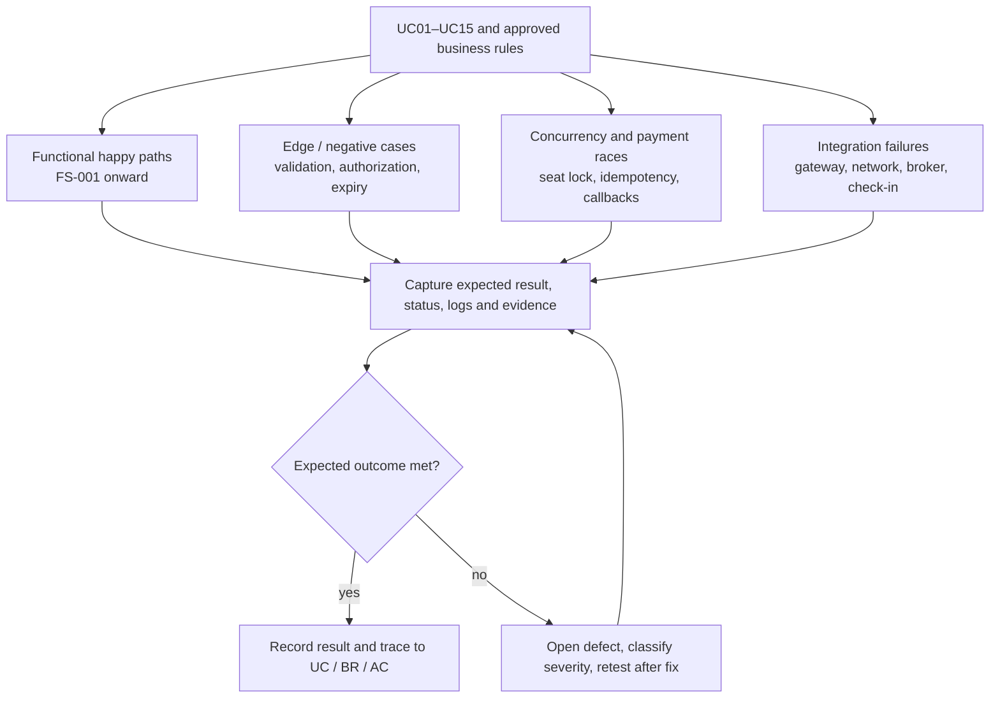

# 02 — Kịch Bản Kiểm Thử Chức Năng & Các Ca Biên Khắt Khe (Functional & Edge Case Test Scenarios)

> **Phạm vi kiểm thử:** check-in online thuộc baseline; khi không thể xác thực, scanner fail-closed theo D-023. Voucher nằm ngoài baseline theo D-031. Release gate 100.000 CCU phải có execution evidence trước go-live.

## 1. Giới Thiệu & Phân Loại Kiểm Thử

Để đảm bảo hệ thống vận hành hoàn hảo dưới mọi tình huống người dùng bình thường cũng như các hành vi cố tình gian lận hoặc sự cố mạng bất ngờ, tài liệu này thiết lập bộ kịch bản kiểm thử toàn diện được phân thành 2 nhóm:
1. **Kiểm Thử Chức Năng (Functional Test Scenarios - FS):** Xác minh luồng vận hành chuẩn (Happy Paths) của toàn bộ 15 Use Cases.
2. **Kiểm Thử Ca Biên & Điều Kiện Tranh Chấp (Edge Case & Concurrency Scenarios - EC):** Thử thách hệ thống trước các tình huống race conditions, xung đột thời gian thực, timeout mạng, tấn công replay mã QR và sự cố đối soát tài chính.

<!-- BEGIN MERMAID DIAGRAM TEST-SCENARIO-COVERAGE -->
### Phân luồng kiểm thử chức năng và ca biên

<!-- END MERMAID DIAGRAM TEST-SCENARIO-COVERAGE -->

---

## 2. Ma Trận Kịch Bản Kiểm Thử Chức Năng (Functional Test Scenarios)

| Mã Kịch Bản | Phân hệ / UC | Tên kịch bản kiểm thử | Dữ liệu đầu vào & Tiền điều kiện | Các bước thực hiện chính | Kết quả mong đợi (Expected Results) |
|---|---|---|---|---|---|
| **FS-001** | Tài khoản (UC01) | Đăng ký tài khoản mới bằng SĐT VN | SĐT `0912345678`, Mật khẩu `Pass@2026!`, Họ tên `Nguyễn Văn A` | 1. Điền form đăng ký 2. Nhận SMS OTP 3. Nhập mã OTP xác thực | Tài khoản được tạo trạng thái `ACTIVE`; tự động chuyển sang màn hình đăng nhập |
| **FS-002** | Tài khoản (UC01) | Đăng nhập hệ thống lấy JWT Token | SĐT và mật khẩu đã tạo | 1. Nhập SĐT & mật khẩu 2. Bấm "Đăng nhập" | Trả về Access Token JWT hợp lệ; Header gắn Cookie `refresh_token`; hiển thị tên trên thanh điều hướng |
| **FS-003** | Khám phá (UC04) | Tìm kiếm & lọc concert theo thành phố | Từ khóa `"Rock"`, Thành phố `"Hà Nội"` | 1. Nhập từ khóa tại ô tìm kiếm 2. Chọn filter Hà Nội | Hiển thị danh sách các concert Rock tại Hà Nội; phân trang chính xác 20 kết quả/trang |
| **FS-004** | Hàng chờ (UC04, UC05)| Vào phòng chờ trước giờ mở bán vé | Truy cập lúc $T - 10$ phút | 1. Mở trang chi tiết concert 2. Quan sát giao diện | Hiển thị giao diện Phòng Chờ Ảo; đồng hồ đếm lùi về $T$; các nút chọn ghế bị vô hiệu hóa |
| **FS-005** | Sơ đồ ghế (UC05) | Tải sơ đồ ghế khán đài trực quan | Concert đang `ON_SALE`; Khách có Queue Token | 1. Vượt qua hàng chờ vào phòng mua 2. Chọn Zone VIP A | Tải cấu trúc khán đài SVG; màu sắc ghế hiển thị chính xác theo trạng thái thời gian thực |
| **FS-006** | Giữ ghế (UC06) | Chọn và giữ thành công 2 ghế trống | Chọn Ghế A-10 và A-12 | 1. Nhấp chọn 2 ghế trên sơ đồ 2. Nhấn "Xác nhận giữ ghế" | Ghế đổi sang màu Vàng; đồng hồ đếm lùi 10 phút xuất hiện; tạo bản ghi `seat_holds` với `hold_token` |
| **FS-007** | Voucher (ngoài baseline) | Voucher không có trong release hiện tại | Không áp dụng | Không chạy trong UAT; tính năng voucher cần change request và scope/decision mới (D-031). |
| **FS-008** | Thanh toán (UC07) | Hoàn tất thanh toán qua Cổng VNPay | Thẻ ATM Sandbox số `9704198526191432198` | 1. Chọn VNPay $\rightarrow$ Chuyển sang cổng 2. Nhập thông tin thẻ và OTP ngân hàng | VNPay trừ tiền thành công; Webhook gọi về hệ thống; đơn hàng chuyển `PAID`; ghế chuyển `SOLD` |
| **FS-009** | Vé điện tử (UC08) | Xem vé điện tử & Dynamic QR trên App | Đơn hàng trạng thái `PAID` | 1. Vào "Vé của tôi" 2. Mở vé chi tiết | Hiển thị đầy đủ thông tin vé; mã QR động tự động làm mới mã sau mỗi 30 giây |
| **FS-010** | Soát vé (UC14) | Quét QR vé hợp lệ tại cổng vào | Vé trạng thái `ORDERED`; đúng cổng | 1. Nhân viên hướng máy quét vào mã QR | Phản hồi $\le 500\text{ ms}$: Màn hình Xanh lá, tiếng "Bíp", hiển thị số ghế; vé đổi sang `CHECKED` |
| **FS-011** | Hoàn tiền tự nguyện (UC09) | Yêu cầu hủy đơn khi còn ít nhất 7 ngày lịch địa phương | Đơn PAID, chưa có vé CHECKED; ngày diễn và ngày yêu cầu dùng timezone địa điểm | Gửi yêu cầu và xác nhận số tiền | Hoàn 100% phần giá vé đủ điều kiện; phí dịch vụ/thuế không hoàn; tạo REFUND_PENDING; thời gian tiền về do provider/ngân hàng quyết định, không cam kết cố định (D-024) |
| **FS-012** | Quản trị (UC11) | Ban tổ chức tạo concert mới | Organizer đăng nhập có giấy phép kinh doanh | 1. Điền thông tin concert, tải ảnh, sơ đồ 2. Bấm "Gửi phê duyệt" | Concert chuyển sang `PENDING_REVIEW`; Admin nhận được thông báo trong hàng chờ duyệt |
| **FS-013** | Quản trị (UC12) | Admin phê duyệt hồ sơ concert | Hồ sơ hợp lệ đầy đủ giấy phép | 1. Admin kiểm tra hồ sơ inline 2. Nhập ghi chú duyệt và bấm Phê duyệt | concert.status = PUBLISHED; sự kiện thông báo được enqueue và trạng thái provider được theo dõi; lên lịch kích hoạt phòng chờ tự động |
| **FS-014** | Đánh giá (UC10) | Khán giả thực tế đánh giá sau show | Vé của tài khoản đã `CHECKED` qua cổng | 1. Vào sự kiện đã xem 2. Chấm 5 sao và viết nhận xét | Bài viết hiển thị badge "Khán giả thực tế" (Verified Attendee); cập nhật điểm sao trung bình của concert |
| **FS-015** | Báo cáo (UC13) | Organizer xuất báo cáo doanh thu Excel | Concert đã bán được $5.000$ vé | 1. Vào Analytics $\rightarrow$ Chọn xuất file 2. Chọn định dạng Excel (.xlsx) | Tải xuống tệp Excel chứa đầy đủ doanh thu từng Zone, số lượng vé bán, phí sàn và số tiền thực nhận |

---

## 3. Ma Trận Kịch Bản Kiểm Thử Ca Biên & Điều Kiện Tranh Chấp (Edge Case & Concurrency)

| Mã Ca Biên | Miền nghiệp vụ | Kịch bản kiểm thử điều kiện biên | Hành vi mô phỏng thực tế | Kết quả mong đợi & Cơ chế bảo vệ hệ thống |
|---|---|---|---|---|
| **EC-001** | **Xung đột giữ ghế** | **2 người dùng bấm chọn CÙNG 1 GHẾ tại cùng một mili-giây** | Sử dụng script k6 bắn song song 2 request `POST /seats/hold` cùng `seat_id = VIP_A_12` tại cùng thời điểm | **Chống bán trùng:** Duy nhất 1 request thành công (`200 OK`); request thứ hai nhận lỗi `409 Conflict: Ghế vừa được giữ`. Không có ngoại lệ. |
| **EC-002** | Giới hạn số lượng | Người dùng cố giữ chiếc ghế thứ 5 bằng nhiều tab trình duyệt | Mở 2 tab trình duyệt cùng đăng nhập 1 user; tab 1 giữ 3 ghế, tab 2 cố tình giữ thêm 2 ghế | Hệ thống kiểm tra tổng số ghế đang giữ của `user_id` trong Redis; chặn yêu cầu ở ghế thứ 5: `422: Vượt quá giới hạn 4 vé/người`. |
| **EC-003** | Hàng chờ ảo | Một tài khoản mở 5 thiết bị/tab để lấy nhiều số thứ tự | Người dùng đăng nhập cùng 1 tài khoản trên máy tính, điện thoại, máy tính bảng để xếp hàng | **Tính công bằng:** Hệ thống chỉ gán duy nhất 1 số thứ tự hàng chờ cho mỗi `user_id`; 4 thiết bị còn lại tự động đồng bộ cùng số thứ tự đó. |
| **EC-004** | Timeout phiên chọn ghế | Không có thao tác UI/heartbeat hợp lệ quá 120 giây | Trang ở foreground nhưng không phát heartbeat/thao tác; WebSocket vẫn có thể kết nối | Thu hồi Queue Access Token và slot chọn ghế; cảnh báo tại giây 90; seat hold hiện hữu tiếp tục đủ 600 giây (D-015). |
| **EC-005** | **Hết hạn giữ ghế** | **Payment capture đến sau 10 phút hold** | Callback đến sau khi hold hết hạn và ghế đã được người khác mua | Hệ thống không claim ghế/không tạo order mới; ghi SUCCESS_UNFULFILLED; sau reconciliation xác nhận capture tạo refund 100% số tiền thực thu; timeout không tạo refund kép theo D-016/D-032. |
| **EC-006** | Mạng chập chờn | Khách hàng nhấp đúp liên tục nút "Thanh toán ngay" (Double-Click) | Người dùng sốt ruột bấm nút thanh toán 5 lần liên tiếp trong 2 giây | **Idempotency Key:** API Gateway nhận cùng một mã Idempotency Key; 4 request sau bị chặn với mã `409: Giao dịch đang xử lý`, chỉ 1 giao dịch được tạo. |
| **EC-007** | Gian lận mã vé | Dùng ảnh chụp QR cũ để vào cổng | Khách A chụp mã lúc 18:00:00; khách B đưa mã lúc 18:01:01 (sau TTL tối đa 60 giây) | **JWT/JWS RS256:** từ chối khi `exp <= now()` với `QR_TOKEN_EXPIRED`; ghi nhận lần thử không hợp lệ, không check-in vé. |
| **EC-008** | **Gian lận truyền mã** | **Cùng một vé hợp lệ được quét tại 2 cổng khác nhau cách nhau 10 giây** | Khách A vừa quét vào Cổng 1 thành công; lập tức gửi mã cho Khách B thử quét vào Cổng 2 | **Single-Scan Protection:** Tại Cổng 2 máy quét nhấp nháy ĐỎ RỰC, phát còi báo động: `CẢNH BÁO: VÉ ĐÃ CHECK-IN LÚC 18:30 TẠI CỔNG 1`. Nhân viên giữ đối tượng. |
| **EC-009** | Mất kết nối khi check-in | Mất toàn bộ kết nối tới Check-in Service tại cổng | Ngắt kết nối scanner trong giờ check-in | Scanner hiển thị lỗi kết nối; không xác nhận vé từ cache/JWT đơn lẻ, không chuyển ticket sang CHECKED; staff báo Gate Supervisor; sau khi mạng phục hồi scan lại cùng scan_id idempotent (D-023). |
| **EC-010** | Tranh chấp hoàn tiền | Khách hàng đã qua cổng check-in nhưng gửi yêu cầu đòi hoàn tiền | Khách đã vào sân xem ca nhạc; sau đó vào ứng dụng bấm "Yêu cầu hủy vé & hoàn tiền" | **Chặn hoàn tiền:** Hệ thống kiểm tra trạng thái vé `CHECKED`; từ chối ngay lập tức: `422: Vé đã sử dụng vào cổng, không thể hoàn tiền`. |
| **EC-011** | Toàn vẹn dữ liệu | Organizer cố tình sửa giá vé khi concert đang ở trạng thái `ON_SALE` | Ban tổ chức gọi trực tiếp API `PUT /concerts/{id}/zones` để tăng giá vé lên gấp đôi | **Khóa cấu hình:** Hệ thống kiểm tra trạng thái `ON_SALE`; chặn toàn bộ thao tác sửa đổi: `403: Không thể chỉnh sửa thông tin giá và ghế khi đang mở bán`. |
| **EC-012** | Hủy concert | Admin hủy concert trước COMPLETED khi đã có nhiều vé PAID, gồm vé CHECKED | Cancellation event được phê duyệt và audit đầy đủ | Tất cả order PAID chuyển REFUND_PENDING; hoàn 100% order.final_amount kể cả vé CHECKED; vô hiệu hóa ticket, giữ checkin_logs và không mở lại ghế (D-017). |
| **EC-013** | Xâm nhập trái phép | Hacker thay đổi `order_id` trên thanh URL để xem vé của người khác | User A đăng nhập tài khoản của mình nhưng cố tình gọi `GET /api/v1/orders/{order_id_cua_User_B}` | **Chống IDOR:** Service đối chiếu `orders.user_id != jwt.user_id`; lập tức chặn với mã `403 Forbidden` và ghi vết vào Audit Log an ninh. |
| **EC-014** | Cháy hàng (Sold Out) | Vé cuối cùng được thanh toán thành công trong lúc người dùng đang xếp hàng | Concert chuyển SOLD_OUT | Ngừng cấp lượt mới; cập nhật realtime trong in-app/waiting room; push nếu user opt-in; không cam kết email/SMS (D-020). |
| **EC-015** | Callback thanh toán bị mất | Provider đã xử lý giao dịch nhưng webhook không tới hệ thống | Giả lập callback thất lạc hoặc phản hồi endpoint timeout; provider status ban đầu chưa rõ | Ghi UNKNOWN; đối soát provider tại 30 giây, 5 phút, 30 phút; callback lặp phải idempotent; chỉ phát hành vé sau khi xác minh capture và claim ghế hợp lệ; không dựa vào lịch retry của provider (D-033). |

