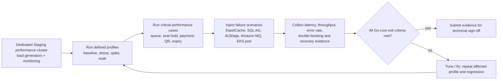

# 03 — Kế Hoạch Kiểm Thử Tải & Khả Năng Phục Hồi (Performance & Resilience Test Plan)

> **Phạm vi kiểm thử:** check-in online thuộc baseline; mất mạng phải fail-closed theo D-023. Test 100.000 CCU, HA/DR, licensing và sizing là release gates; kế hoạch này không khẳng định các bài test đã chạy.

> **Hạ tầng baseline:** RabbitMQ và SQL Server 2025 Enterprise Always On AG theo D-025/D-026. Sizing/license và số liệu hiệu năng cần được đo, DBA/Finance ký trước go-live theo D-030.

## 1. Giới Thiệu & Mục Tiêu Thử Nghiệm

Mục tiêu của kế hoạch kiểm thử hiệu năng và khả năng phục hồi (**Performance & Resilience Testing Plan**):
1. **Kiểm chứng khả năng chịu tải $100.000\text{ CCU}$:** Đảm bảo hệ sinh thái hạ tầng đám mây (Amazon EKS, ElastiCache for Redis OSS, Amazon MQ for RabbitMQ (D-025/D-035), SQL Server trên EC2 và ALB) vận hành mượt mà, không sập nguồn khi bước vào giờ mở bán vé sự kiện quy mô lớn.
2. **Đo lường độ trễ chuẩn hóa (Latency Benchmarking):** Xác minh các chỉ số độ trễ P50, P95, P99 đạt đúng cam kết mục tiêu trong tài liệu SLO/SLA (P99 $< 150\text{ ms}$ cho hàng chờ, $< 350\text{ ms}$ cho giữ ghế).
3. **Thực nghiệm kỹ thuật phục hồi:** Diễn tập failover được AWS hỗ trợ cho ElastiCache/Amazon MQ trong môi trường kiểm thử, lỗi SQL Server Primary và timeout cổng thanh toán; Chaos Mesh/Gremlin chỉ dùng cho EKS/EC2 workloads theo phạm vi cho phép. Chứng minh không bán trùng ghế và ghi lại số đo thực tế.

---

## 2. Quy Chuẩn Môi Trường Kiểm Thử (Test Environment Setup)

- **Môi trường:** Staging Dedicated Performance Cluster (Cách ly hoàn toàn với môi trường Development).
- **Hạ tầng cụm máy chủ:** Cấu hình SQL Server và broker theo topology đã chốt; Topology baseline được ghi tại D-025/D-026; sizing và licensing vẫn là cổng DBA/Finance D-030, chưa được xem là đã nghiệm thu.
- **Công cụ phát tải phân tán (Distributed Load Generators):**
  - Cụm máy chủ tạo tải gồm 10 máy ảo độc lập chạy công cụ mã nguồn mở **k6** và **Locust**.
  - Băng thông mạng máy phát tải: Đạt tối thiểu $10\text{ Gbps}$ ra vào Internet để không bị nghẽn cổ chai tại máy test.
- **Công cụ tiêm sự cố hỗn loạn (Fault Injection):** Sử dụng **Chaos Mesh** cài đặt trực tiếp trong cụm Kubernetes.

---

## 3. Các Hồ Sơ Kiểm Thử Tải (Performance Testing Profiles)

Hệ thống được kiểm thử qua 4 bài kiểm tra tải tiêu chuẩn:

| Loại hình kiểm thử | Mục đích thực hiện | Kịch bản mô phỏng tải | Tiêu chí đánh giá thành công |
|---|---|---|---|
| **1. Baseline Load Test (Tải cơ sở)** | Đo đạc hiệu năng ngày thường | Duy trì ổn định $5.000\text{ CCU}$ trong 2 giờ liên tục | P99 Latency $< 100\text{ ms}$; CPU máy chủ $< 30\%$; Tỷ lệ lỗi $= 0\%$ |
| **2. Stress Test (Thử thách cực hạn)** | Tìm điểm gãy (Breaking Point) của hệ thống | Tăng dần tải từ $10.000\text{ CCU} \rightarrow 150.000\text{ CCU}$ trong 30 phút | Hệ thống không sập toàn bộ; Cơ chế Load Shedding kích hoạt chính xác tại ngưỡng $120.000\text{ CCU}$ |
| **3. Spike / Flash-Sale Test (Sốc tải giờ G)** | Mô phỏng giờ mở bán Mega Concert | Đột biến từ $0 \rightarrow 100.000\text{ CCU}$ chỉ trong vòng **$60\text{ giây}$** đúng thời khắc mở bán | Phòng chờ ảo hấp thụ $100\%$ tải; Không rớt kết nối TCP; Không bán trùng ghế |
| **4. Soak / Endurance Test (Tải ngâm dài hạn)**| Phát hiện rò rỉ bộ nhớ (Memory Leak) | Duy trì $20.000\text{ CCU}$ liên tục trong suốt **$24\text{ giờ}$** | RAM của các Pod không tăng tuyến tính; Không cạn kiệt Connection Pool HikariCP |

---

## 4. Kịch Bản Kiểm Thử Hiệu Năng Trọng Yếu (Performance Test Scenarios)

| Mã | Tên kịch bản | Mô tả chi tiết thử nghiệm | Chỉ số đo lường chính | Ngưỡng đạt chuẩn (Pass Criteria) |
|---|---|---|---|---|
| **PT-001** | **Xếp hàng phòng chờ $100.000\text{ CCU}$** | $100.000$ client ảo đồng thời gửi request thăm dò vị trí `GET /queue/status` chu kỳ 3 giây/lần ($\approx 32.000\text{ QPS}$) | Thông lượng tiếp nhận (QPS), độ trễ phản hồi, mức sử dụng CPU Redis | Throughput $\ge 32.000\text{ QPS}$; P95 Latency $< 60\text{ ms}$; P99 $< 120\text{ ms}$; Tỷ lệ lỗi $< 0.01\%$ |
| **PT-002** | **Tải sơ đồ ghế $5.000\text{ CCU}$** | $5.000$ người trong khu vực chọn ghế tải cấu trúc sơ đồ khán đài SVG và nhận cập nhật diff trạng thái qua WebSocket/Polling | Thời gian tải trang ban đầu, tỷ lệ trúng bộ đệm Edge CDN | CDN Hit Rate $\ge 98\%$; Thời gian tải sơ đồ $< 300\text{ ms}$ cho $99\%$ người dùng |
| **PT-003** | **Tranh chấp giữ ghế cao độ ($3.000\text{ TPS}$)** | $5.000$ người dùng đồng thời nhấp chọn các ghế trong khu vực VIP (tổng 500 ghế VIP) | Thời gian thực thi Lua Script khóa ghế Redis; Tỷ lệ xung đột; Tính duy nhất | **Số vé bán trùng $= 0$**; P99 Latency khóa ghế $< 350\text{ ms}$; Không có deadlock DB |
| **PT-004** | **Bão Webhook thanh toán ($100\text{ TPS}$)** | Cổng thanh toán giả lập bắn dồn dập $100$ Webhook IPN callback mỗi giây sau khi khách hàng chuyển tiền | Độ trễ xử lý cập nhật trạng thái đơn hàng, độ trễ sinh vé điện tử | Xử lý hoàn tất trong $< 50\text{ ms}$/request; Không bị nghẽn Spring @EventListener Lag |
| **PT-005** | **Giải phóng ghế hết hạn hàng loạt** | Mô phỏng $10.000$ ghế đang giữ cùng hết hạn 10 phút tại cùng một mốc thời gian | Tốc độ quét và thu hồi khóa của tiến trình nền; Tải I/O cơ sở dữ liệu | Toàn bộ $10.000$ ghế chuyển về `AVAILABLE` trong $< 5\text{ giây}$; Không làm nghẽn CPU DB |
| **PT-006** | **Soát vé tại cổng tốc độ cao ($100\text{ TPS}$)** | Giả lập 40 cổng soát vé đồng thời quét mã QR của $50.000$ khán giả đến sân dồn dập | Thời gian phản hồi hiển thị màn hình thiết bị máy quét cầm tay | Thời gian phản hồi $\le 500\text{ ms}$ (P99 $\le 800\text{ ms}$); Tỷ lệ quét thành công $100\%$ |

---

## 5. Kịch Bản Kiểm Thử Khả Năng Phục Hồi & Kỹ Thuật Hỗn Loạn (Resilience & Chaos Scenarios)

| Mã | Thành phần bị tấn công | Kịch bản tiêm lỗi hỗn loạn (Fault Injection) | Hành vi dự kiến của hệ thống | Tiêu chuẩn nghiệm thu phục hồi |
|---|---|---|---|---|
| **RT-001** | **Amazon ElastiCache failover** | Thực hiện failover được AWS hỗ trợ trong môi trường kiểm thử; tạo đồng thời request queue/seat-hold và theo dõi retry/timeout | ElastiCache phục hồi theo topology đã cấu hình; SQL Server vẫn là nguồn quyết định cuối; app từ chối an toàn khi trạng thái chưa xác minh | Không double-booking; đo và lưu thời gian gián đoạn, lỗi, mất cache và thời gian ổn định lại; đặt ngưỡng nghiệm thu sau benchmark, không giả định mốc vài giây |
| **RT-002** | **Sập SQL Server Primary** | Ép tắt SQL Server Primary trong lúc có 50 transaction thanh toán | Quan sát failover/reconnect theo SQL Server Always On AG D-026; xác nhận endpoint và connection pool | Đo local RPO/RTO (mục tiêu 0/≤5 phút) và DR RPO/RTO (≤5/≤60 phút); kiểm tra dữ liệu COMMIT; lưu số đo và runbook evidence; chưa coi mục tiêu là đã nghiệm thu trước khi diễn tập |
| **RT-003** | **Chậm mạng Cổng Thanh Toán** | Tiêm độ trễ mạng thêm $3.000\text{ ms}$ vào mọi kết nối gọi ra ngoài VNPay | Circuit Breaker chuyển sang trạng thái `OPEN` sau 20 request bị chậm; Tự động kích hoạt Fallback | Thread pool không bị cạn kiệt; Khách hàng được chuyển hướng sang cổng MoMo mượt mà |
| **RT-004** | **Amazon MQ for RabbitMQ failover** | Tiêm lỗi/diễn tập failover theo topology Amazon MQ đã chọn | Xác nhận durable message được phục hồi/re-delivered; consumer idempotent không tạo tác động trùng | Đối soát outbox với message được xử lý; ghi nhận mất mát, lag, DLQ và thời gian phục hồi; không cam kết zero loss nếu chưa chứng minh bằng diễn tập |
| **RT-005** | **Mất mạng cổng soát vé** | Cắt toàn bộ mạng tới scanner tại Cổng A | Scanner báo lỗi kết nối; không xác nhận vé, không chuyển ticket sang CHECKED, không chấp nhận cache/JWT đơn lẻ | Khi mạng phục hồi, scan lại idempotent; log sự cố được giữ và không có check-in offline theo D-023 |
| **RT-006** | **Chết Pod Backend giữa chừng** | Kill Pod của `Order Service` đúng lúc đang xử lý lưu đơn hàng | Kubernetes tự động khởi động Pod mới (Self-healing); Client gửi lại request với cùng `Idempotency-Key` | Không phát sinh đơn hàng trùng lặp; Giao dịch hoàn tất thành công sau khi retry |
| **RT-007** | **SQL Server PITR từ S3** | Chọn recovery point đã replicate; dựng SQL Server EC2 cô lập; restore FULL/DIFF/LOG tới STOPAT | Không restore đè nguồn lỗi; thiếu log thì dừng ở thời điểm gần nhất có chain đầy đủ; kiểm tra payment UNKNOWN trước cutover | Đạt checksum, DBCC CHECKDB và business invariants; ghi backup RPO và thời gian restore; so với mục tiêu đề xuất RPO ≤30 phút/RTO ≤4 giờ, chưa coi là đạt trước khi ký |
| **RT-008** | **S3 backup replication trễ/lỗi** | Tạm chặn quyền/đường replication trong staging hoặc dùng failure injection an toàn; theo dõi object pending/failed | CloudWatch/SNS cảnh báo; không đánh dấu recovery point ở DR là sẵn sàng nếu chưa `COMPLETED`; không xóa bản nguồn | Phát hiện và phục hồi replication theo runbook; đo tuổi log đã replicate và xác nhận backup-based RPO |
| **RT-009** | **AWS Backup VSS EC2/EBS restore** | Chạy Restore Testing cho recovery point Windows/SQL EC2; dựng máy vào subnet cô lập | VSS snapshot được restore mà không thay thế host/evidence hiện hữu; volume mapping đúng; SQL service/database khởi động | Xác minh SQL VSS Writer, DBCC CHECKDB, KMS decrypt, RTO đo được và biên bản restore test |
<!-- BEGIN MERMAID DIAGRAM TEST-PERF-RESILIENCE -->
### Vòng kiểm thử tải và phục hồi

<!-- END MERMAID DIAGRAM TEST-PERF-RESILIENCE -->

---

## 6. Tiêu Chí Hoàn Tất & Điều Kiện Đủ Để Triển Khai Thực Tế (Go-Live Exit Criteria)

Hệ thống chỉ được phép chuyển từ môi trường Staging sang Production (Go-Live) khi thỏa mãn đồng thời **100% các tiêu chí bắt buộc** sau:
1. **Zero Double-Booking:** Không ghi nhận bất kỳ trường hợp bán trùng ghế nào trong toàn bộ các đợt kiểm thử tải đỉnh và thử nghiệm sập node Redis.
2. **Đạt chỉ tiêu thông lượng:** Chịu tải thành công $100.000\text{ CCU}$ trong kịch bản mở bán vé giả lập kéo dài tối thiểu 60 phút.
3. **Đạt chỉ tiêu độ trễ:**
   - Hàng chờ ảo: P99 Latency $< 150\text{ ms}$.
   - Khóa giữ ghế: P99 Latency $< 350\text{ ms}$.
   - Soát vé tại cổng: Phản hồi máy quét $\le 500\text{ ms}$.
4. **Độ ổn định khi phục hồi:** Chạy RT-001 đến RT-009 trên topology production-like; lưu số đo, dữ liệu commit và runbook evidence. So sánh HA/DR AG với D-026 (local RPO 0/RTO ≤5 phút; DR RPO ≤5 phút/RTO ≤60 phút), đồng thời đo riêng SQL PITR backup fallback (mục tiêu khởi điểm RPO ≤30 phút/RTO ≤4 giờ) và AWS Backup VSS restore. Các target chưa được xem là đạt trước khi có diễn tập và DBA/SRE sign-off.
5. **Ký duyệt biên bản:** Báo cáo kiểm thử tải được Trưởng nhóm Kiến trúc Hệ thống (Lead Architect), Trưởng nhóm SRE và Quản lý Dự án (Project Manager) cùng ký xác nhận nghiệm thu.
