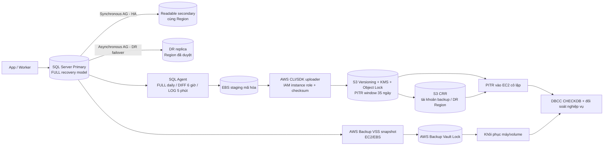

# System Design — Concert Ticketing System

Tài liệu trình bày được tổng hợp theo BA. Sơ đồ dùng Mermaid để xem trực tiếp bằng Markdown preview. Các mức capacity và HA/DR dưới đây là mục tiêu thiết kế, cần benchmark/diễn tập trước khi công bố là đã đạt. Hold ghế giữ nguyên 600 giây.

## 1. Giới thiệu hệ thống (System Design Presentation)

### 1.1. Bối cảnh và Lý do chọn đề tài

Thị trường concert có đặc điểm khác với bán hàng thông thường: một sự kiện chỉ có số lượng vé và ghế hữu hạn, nhưng lượng người quan tâm có thể tăng đột biến đúng thời điểm mở bán. Nếu mọi người cùng truy cập trang chọn ghế và gửi yêu cầu giao dịch, nền tảng dễ quá tải; người mua có thể thấy trạng thái ghế cũ, nhiều người tranh cùng một ghế, hoặc không biết giao dịch thanh toán đã thành công hay chưa.

Bài toán còn có các vấn đề vận hành và niềm tin: xếp hàng thiếu minh bạch tạo lợi thế cho bot hoặc việc tải lại trang liên tục; vé QR có nguy cơ bị sao chép; các kênh bán vé rời rạc làm dữ liệu đơn hàng, khách tham dự và doanh thu khó đối soát; Ban tổ chức thiếu công cụ theo dõi bán vé và nhân viên tại cổng thiếu cách xác thực thống nhất.

Vì vậy, đề tài xây dựng một **nền tảng bán vé concert trực tuyến tập trung** để quản lý xuyên suốt vòng đời sự kiện và vé: công bố concert, điều tiết lượt mua, chọn và giữ ghế, thanh toán, phát hành vé điện tử, check-in và đối soát. Đây là bài toán phù hợp để trình bày System Design vì phải đồng thời cân bằng ba yêu cầu: **chịu tải đột biến, phân bổ cơ hội mua vé có quy tắc và bảo vệ tính toàn vẹn của ghế/giao dịch**.

### 1.2. Mục tiêu của hệ thống

| Nhóm mục tiêu | Mục tiêu thiết kế / chỉ số theo BA | Ý nghĩa |
|---|---|---|
| Quy mô | Hỗ trợ mục tiêu 2 triệu tài khoản; kịch bản kiểm thử/release baseline 100.000 CCU; tối đa 5.000 người đồng thời ở khu chọn ghế | Tách lượng người truy cập lớn khỏi lượng phiên giao dịch cần xử lý đồng thời |
| Công bằng | Phòng chờ mở trước giờ bán 15 phút; xáo trộn nhóm có mặt tại T0; người đến sau nối hàng FIFO; mục tiêu khiếu nại về công bằng dưới 1% | Hạn chế lợi thế từ bot/F5 và quy định cách nhận lượt rõ ràng |
| Tính đúng đắn | Mục tiêu không bán trùng ghế; ghế chỉ được xác nhận khi giao dịch hợp lệ; hold tối đa 4 ghế trong **600 giây (10 phút)** | Bảo vệ số lượng ghế hữu hạn và tránh phát hành vé khi chưa đủ điều kiện |
| Khả dụng | SLO mục tiêu 99,95%/tháng cho các purchase API quan trọng do hệ thống trực tiếp vận hành; lỗi của cổng thanh toán được đo riêng | Nêu đúng ranh giới trách nhiệm của nền tảng và nhà cung cấp |
| Vé và kiểm soát vào cửa | Phát hành QR điện tử có chữ ký; check-in xác thực trực tuyến, fail-closed khi không kiểm chứng được | Hạn chế vé giả và ngăn một vé được chấp nhận nhiều lần |
| Vận hành và kinh doanh | Cung cấp công cụ duyệt concert, quản lý sự kiện, dashboard, báo cáo, đối soát và hồ sơ quyết toán | Giúp Organizer và đội vận hành quản lý sự kiện qua một quy trình có audit |

Các con số trên là **mục tiêu/giả định của BA**, không phải kết quả production đã được chứng minh. Năng lực thực tế chỉ được xác nhận sau benchmark, kiểm thử tải và diễn tập HA/DR. SLO 99,95% chỉ áp dụng purchase API phía hệ thống; không bao gồm SLA của VNPay/MoMo.

### 1.3. Phạm vi của hệ thống

**Trong phạm vi phiên bản baseline:**

| Giai đoạn | Chức năng |
|---|---|
| Khám phá và tài khoản | Đăng ký/đăng nhập; tìm kiếm, lọc và xem concert công khai |
| Chờ và mua vé | Waiting Room từ T−15 phút; shuffle nhóm có mặt tại T0, FIFO cho người đến sau; admission tối đa 5.000 người chọn ghế; hiển thị sơ đồ ghế; giữ tối đa 4 ghế trong 600 giây |
| Thanh toán và vé | Tạo order, thanh toán qua VNPay/MoMo, xác minh callback, chống xử lý lặp, đối soát trạng thái chưa rõ; phát hành vé QR sau khi thỏa điều kiện thanh toán |
| Vận hành sự kiện | Organizer tạo concert, sơ đồ và giá vé; Admin duyệt, giám sát hoặc xử lý hủy; Staff được phân công cổng để check-in trực tuyến |
| Sau bán và sau sự kiện | Xem lịch sử đơn; yêu cầu hủy/hoàn theo chính sách; gửi thông báo; đánh giá sau khi tham dự; báo cáo doanh thu/check-in và quy trình đối soát, phê duyệt hồ sơ quyết toán |

**Ngoài phạm vi baseline:** bán lại vé trên thị trường thứ cấp, live streaming, bảo hiểm vé, quản lý hợp đồng nghệ sĩ, quản lý thiết bị vật lý tại địa điểm, đặt phương tiện/lưu trú và thay thế ERP/kế toán của Organizer. Check-in offline không được hỗ trợ; mất kết nối thì scanner từ chối xác thực. Quy trình quyết toán lưu hồ sơ và bằng chứng, không giả định escrow hoặc tự động chuyển tiền ngân hàng. Voucher cũng chưa thuộc baseline.

VNPay, MoMo, dịch vụ email/push/SMS, nhà cung cấp OAuth và CDN/WAF là **hệ thống bên ngoài được tích hợp**; nền tảng quản lý hợp đồng gọi/nhận dữ liệu nhưng không kiểm soát khả dụng nội bộ của các nhà cung cấp đó.

### 1.4. Các đối tượng sử dụng hệ thống

| Đối tượng | Vai trò trong hệ thống | Quyền và giới hạn chính |
|---|---|---|
| Khách vãng lai (Guest) | Tìm, lọc và xem thông tin concert công khai | Chưa được vào queue, xem ghế chi tiết, giữ ghế hoặc tạo order; cần đăng nhập để mua |
| Khách hàng (Customer) | Mua và quản lý vé của chính mình | Tham gia phòng chờ, chọn/giữ ghế, thanh toán, xem vé và gửi yêu cầu refund theo điều kiện; tối đa 4 ghế/đơn |
| Ban tổ chức (Organizer) | Tạo và vận hành concert thuộc tổ chức của mình | Cấu hình sự kiện trước khi mở bán, quản lý Staff, xem báo cáo; không tự duyệt/xuất bản concert và không xem dữ liệu Organizer khác |
| Quản trị viên / Finance (Admin) | Quản trị nền tảng, duyệt concert, xử lý vận hành và tài chính | Có quyền giám sát, kiểm duyệt, xử lý hủy/đối soát; payout phải được phê duyệt và lưu bằng chứng theo quy trình |
| Nhân viên soát vé / Gate Supervisor (Staff) | Xác thực vé tại cổng được phân công | Chỉ check-in concert/gate được giao; không sửa vé, refund hoặc xem dữ liệu tài chính; cần kết nối để xác thực |
| Platform Ops | Theo dõi sức khỏe, năng lực, cảnh báo và sự cố | Vận hành hạ tầng theo quyền được cấp; thao tác nhạy cảm cần phân quyền và audit |
| Đối tác tích hợp | Cung cấp thanh toán, định danh, CDN/WAF hoặc gửi thông báo | Giao tiếp qua API/webhook; hệ thống phải xác minh chữ ký, trạng thái và khả năng retry theo hợp đồng tích hợp |

### 1.5. Những thách thức đặc thù của bài toán

| Thách thức | Vì sao khó | Nguyên tắc xử lý trong thiết kế |
|---|---|---|
| Đỉnh truy cập ngắn, rất lớn | 100.000 CCU cùng xuất hiện có thể tạo request burst vượt năng lực luồng chọn ghế | CDN phục vụ nội dung tĩnh; phòng chờ/admission giới hạn tối đa 5.000 phiên chọn ghế; polling có jitter/adaptive interval |
| Công bằng khi mở bán | Người dùng vào trước và đến sau T0 cần quy tắc khác nhau, đồng thời phải giảm bot/F5 | Shuffle nhóm trong holding room tại T0; nối FIFO người đến sau; token admission được kiểm tra ở API |
| Ghế hữu hạn và tranh chấp đồng thời | Hai request có thể cùng nhìn thấy một ghế trống | Redis owner-token lock giúp khóa nhanh; conditional update và transaction trên SQL Server là nguồn quyết định cuối; chỉ một order có thể chốt ghế |
| Queue và giữ ghế là hai thời hạn khác nhau | Queue quản lý quyền vào khu chọn ghế; seat hold quản lý ghế đã chọn | Queue token hết hạn sau 120 giây không hoạt động hợp lệ; seat hold luôn là 600 giây từ lần giữ đầu, không được gia hạn; token hết hạn không tự rút ngắn hold đang có |
| Thanh toán bất đồng bộ, callback lặp hoặc đến trễ | Người dùng, nền tảng và cổng thanh toán có thể quan sát kết quả ở các thời điểm khác nhau | Xác minh chữ ký, order và amount; idempotency; trạng thái UNKNOWN đi đối soát; thanh toán thành công sau hạn hold không hồi sinh order hoặc phát vé |
| Nhất quán giữa ghế, order, payment và ticket | Một giao dịch lỗi giữa chừng có thể để lại trạng thái lệch | SQL Server giữ dữ liệu giao dịch làm nguồn sự thật; transactional outbox và worker xử lý tác vụ nền; retry có kiểm soát và có audit |
| Check-in nhanh nhưng chống dùng lại vé | Nhiều cổng có thể quét cùng một QR gần như đồng thời | Xác minh chữ ký/hiệu lực QR và cập nhật trạng thái check-in có tính nguyên tử; khi không xác thực online được thì fail-closed |
| Hủy/refund/đối soát có tác động tài chính | Hủy concert, hoàn tiền và quyết toán phải nhất quán với trạng thái ticket, ledger và hợp đồng | Dùng quy tắc refund/settlement đã duyệt, lưu lịch sử và bằng chứng; không tự suy diễn payout ngân hàng |
| Bảo mật và cô lập dữ liệu | Dữ liệu đơn/vé cá nhân, quyền Organizer và quyền Staff có phạm vi khác nhau | Kiểm tra ownership/tenant/gate tại server; chống IDOR; xác minh webhook; giới hạn quyền và lưu audit log |
| Năng lực thực tế chưa thể suy ra chỉ từ CCU | Cùng CCU nhưng hành vi polling, kích thước payload và số thao tác ghi khác nhau sẽ tạo tải khác nhau | Ghi rõ giả định; benchmark production-like cho Redis, SQL Server, gateway, payment callbacks và check-in trước go-live |

~~~mermaid
flowchart LR
  surge["Đỉnh 100.000 CCU"] --> admission["Waiting Room / Admission tối đa 5.000 selector"]
  admission --> fairness["Shuffle nhóm trước T0 FIFO người đến sau"]
  admission --> seat["Chọn ghế và hold 600 giây"]
  seat --> integrity["Redis lock + SQL transaction chống bán trùng"]
  integrity --> payment["VNPay / MoMo callback idempotent + reconcile"]
  payment --> ticket["Phát hành QR sau khi đơn đủ điều kiện"]
  ticket --> gate["Check-in online fail-closed"]
  ops["Outbox / Worker / Audit"] -.-> payment
  ops -.-> ticket
  ops -.-> gate
~~~

### Sơ đồ tổng quan hệ thống

| Lớp | Thành phần baseline | Vai trò |
|---|---|---|
| Người dùng và kênh | Web, ứng dụng mobile, Staff scanner, Admin/Organizer portal | Mua vé, quản trị, vận hành và check-in |
| Tiếp nhận | Route 53, CloudFront/WAF, ALB | Phân phối asset, TLS, routing, rate limit và WebSocket |
| Ứng dụng | Spring Boot 3 Modular Monolith; Worker process riêng | Xử lý module nghiệp vụ đồng bộ và việc nền |
| Dữ liệu giao dịch | SQL Server Primary và Always On secondary/DR | Nguồn sự thật cho booking, order, payment, ticket, audit |
| Trạng thái nhanh | Redis | Queue session/token, seat lock và cache có TTL |
| Xử lý bất đồng bộ | SQL outbox + Amazon MQ for RabbitMQ | Phát lại event, retry/DLQ và chuyển việc cho Worker |
| Tích hợp | VNPay/MoMo, Email/Push/SMS, Object Storage | Thanh toán, gửi thông báo và lưu tài nguyên/tệp |

**Luồng người mua ở mức khái quát:** người dùng vào queue → được admission → chọn ghế → giữ ghế 10 phút → checkout và thanh toán → callback hợp lệ xác nhận order → phát hành vé QR → check-in trực tuyến. Payment UNKNOWN hoặc đến sau hạn giữ chỗ đi theo luồng đối soát/hoàn tiền; không tự động cấp vé.

~~~mermaid
flowchart LR
  subgraph ACTORS["Người dùng"]
    customer["Khách hàng"]
    organizer["Organizer / Admin"]
    staff["Staff check-in"]
  end
  edge["Route 53 + CloudFront + AWS WAF"]
  app["Concert Ticketing Spring Boot Modular Monolith"]
  worker["Worker riêng"]
  redis[("Redis queue, token, lock, cache")]
  sql[("SQL Server giao dịch và outbox")]
  rabbit["Amazon MQ for RabbitMQ"]
  payment["VNPay / MoMo"]
  notify["Email / Push / SMS"]
  object[("Object Storage")]
  customer --> edge
  organizer --> edge
  staff --> edge
  edge --> app
  app <--> redis
  app --> sql
  app <--> payment
  app --> rabbit
  sql --> rabbit
  rabbit --> worker
  worker --> sql
  worker --> notify
  edge -.-> object
~~~

### Cách dẫn nhập khi thuyết trình

> “Đây là nền tảng bán vé concert tập trung. Điểm khó không chỉ là hiển thị sự kiện, mà là xử lý đợt truy cập tăng đột biến trong khi số ghế hữu hạn, bảo đảm xếp lượt có quy tắc và không bán trùng. Vì vậy thiết kế dùng phòng chờ để điều tiết admission, SQL Server làm nguồn sự thật cho giao dịch, và luồng thanh toán/QR/check-in có xác minh, idempotency và audit. Các số capacity là mục tiêu theo BA và phải được kiểm thử trước khi xem là năng lực thực tế.”

Sáu chương tiếp theo đi từ **yêu cầu và quy mô**, sang **kiến trúc**, **dữ liệu/API**, rồi đi sâu vào các điểm nghẽn và kết thúc bằng **chịu lỗi, mở rộng, bảo mật**.
## Mục lục
1. Giới thiệu hệ thống (System Design Presentation)
2. Phân tích và Thiết kế Hệ thống (Requirements & System Modeling)
3. Ước lượng Quy mô & Tài nguyên (Capacity Estimation)
4. Thiết kế Tổng quan Kiến trúc (High-Level Design)
5. Thiết kế Dữ liệu, Máy trạng thái & API (Data Model & API Design)
6. Đi sâu Giải quyết Bài toán Khó (Deep Dive / Core Bottlenecks)
7. Khả năng Chịu lỗi, Mở rộng & Bảo mật (Fault Tolerance, Scaling & Security)

---

## 2. Phân tích và Thiết kế Hệ thống (Requirements & System Modeling)

Chương này chuyển các mục tiêu của Concert Ticketing System thành yêu cầu có thể kiểm tra, mô tả các phân hệ, mô hình hóa hành vi và trình bày các luồng nghiệp vụ có rủi ro cao. Nội dung bám theo các Use Case UC01–UC15, Business Rules, Business Flows BF01–BF06 và State Machines SM01–SM05 trong bộ BA.

> **Cách đọc số liệu:** các con số tải, độ trễ và khả dụng trong chương này là mục tiêu thiết kế/kiểm thử theo BA, không phải kết quả production đã được xác nhận. Kết quả thực tế cần được ghi ở phần kiểm thử sau khi có môi trường và bằng chứng đo.

### 2.1. Yêu cầu chức năng và phi chức năng

#### 2.1.1. Yêu cầu chức năng

| Nhóm | Yêu cầu hệ thống | Actor chính | Truy vết BA |
|---|---|---|---|
| Tài khoản và phân quyền | Đăng ký, đăng nhập, quản lý hồ sơ; Admin quản lý tài khoản và quyền | Guest, Customer, Admin | UC01–UC03 |
| Tra cứu concert | Xem, tìm kiếm, lọc concert và thông tin giá vé | Guest, Customer | UC04 |
| Phòng chờ và hàng đợi | Customer đã đăng nhập tham gia queue; nhận vị trí; được cấp quyền vào khu chọn ghế theo admission control | Customer, Admin giám sát | BF01; quy tắc queue |
| Sơ đồ và giữ ghế | Tải sơ đồ ghế; xem trạng thái; chọn, giữ hoặc tự giải phóng ghế trong giới hạn cho phép | Customer | UC05–UC06; BF02; SM02 |
| Đơn hàng và thanh toán | Tạo đơn từ hold còn hiệu lực; thanh toán qua VNPay/MoMo; xử lý callback, lỗi, timeout và đối soát | Customer, hệ thống, đối tác thanh toán | UC07; BF03; SM03; SM05 |
| Vé điện tử và check-in | Phát hành vé khi đơn đủ điều kiện; hiển thị QR; kiểm tra vé và ghi nhận check-in một lần | Customer, Staff | UC14; BF06; SM04 |
| Hủy đơn và hoàn tiền | Hủy đơn PENDING; tiếp nhận yêu cầu refund theo chính sách; xử lý hủy concert và đối soát refund | Customer, Admin/Finance | UC09; BF04–BF05; SM03; SM05 |
| Quản lý concert | Organizer tạo và quản lý concert; Admin xét duyệt, giám sát hoặc xử lý hủy | Organizer, Admin | UC11–UC12; BF05; SM01 |
| Báo cáo và thông báo | Xem báo cáo bán vé/doanh thu; gửi email, push hoặc SMS theo sự kiện nghiệp vụ | Organizer, Admin, Customer | UC13; UC15 |
| Đánh giá | Khách hàng đủ điều kiện gửi và xem nhận xét sau concert | Customer, Admin kiểm duyệt | UC10 |

#### 2.1.2. Yêu cầu phi chức năng và quy tắc ràng buộc

| Thuộc tính | Yêu cầu / mục tiêu theo BA | Cách áp dụng |
|---|---|---|
| Khả năng chịu tải | Kịch bản baseline 100.000 CCU; tối đa 5.000 người đồng thời ở khu chọn ghế của một concert | Phòng chờ hấp thụ lượng người chờ; admission giới hạn tải vào booking |
| Độ trễ | Mục tiêu P95: queue status < 60 ms; seat map < 120 ms; hold < 180 ms; checkout < 300 ms; check-in < 220 ms | Đây là latency targets tại API, phải xác nhận bằng benchmark |
| Khả dụng | SLO 99,95%/tháng cho critical first-party purchase APIs; sự cố VNPay/MoMo được đo riêng | Không coi đây là SLA hợp đồng hoặc kết quả đã đạt |
| Tính toàn vẹn ghế | Mục tiêu zero double-booking; chỉ một người có thể sở hữu hold hợp lệ hoặc mua một ghế | Redis owner-token lock là lớp nhanh; SQL Server conditional update/transaction là thẩm quyền cuối |
| Thời hạn giữ ghế | 600 giây từ lần giữ đầu tiên; tối đa 4 ghế mỗi đơn; không gia hạn khi thêm ghế, checkout hoặc heartbeat | Deadline được lưu bền vững; tác vụ nền kiểm tra và giải phóng ghế hết hạn |
| Thời hạn queue | Queue token hết hiệu lực sau 120 giây không có hoạt động hợp lệ; heartbeat foreground theo quy tắc BA | Hết queue token giải phóng admission slot; không tự rút ngắn hold 600 giây đã tạo |
| Thanh toán | Xác minh chữ ký, mã giao dịch, đơn và số tiền; xử lý lặp theo idempotency; trạng thái UNKNOWN phải đối soát | Không retry thu tiền mù khi chưa biết kết quả phía provider |
| Thanh toán đến trễ | Nếu provider đã capture nhưng hold/order không còn đủ điều kiện, ghi SUCCESS_UNFULFILLED | Không hồi sinh order/hold, không phát vé; hoàn số tiền thực thu sau khi xác minh capture |
| Check-in | Online-only và fail-closed khi không xác thực được với server | QR hợp lệ một mình không thay thế việc kiểm tra trạng thái ticket trên server |
| Bảo mật | Xác thực JWT; kiểm tra ownership, role, tenant và gate assignment; xác thực chữ ký webhook; audit thao tác nhạy cảm | Quyền phải được kiểm tra ở server, không tin role hoặc trạng thái do client gửi |
| Khả năng phục hồi | Mục tiêu cùng vùng RPO 0/RTO ≤ 5 phút; DR RPO ≤ 5 phút/RTO ≤ 60 phút | Chỉ công bố đạt sau kiểm thử chuyển đổi và diễn tập phục hồi |
| Tương thích và dữ liệu | Hỗ trợ Web, iOS, Android; dữ liệu lưu UTC, hiển thị giờ địa phương ICT; tiền tệ VND | Cấu trúc client và API dùng chung quy tắc nghiệp vụ |

#### 2.1.3. Quy tắc nghiệp vụ quan trọng

1. Chỉ Customer đã đăng nhập mới được tham gia queue, xem sơ đồ ghế chi tiết, giữ ghế và tạo đơn.
2. Một Customer chỉ có một lượt queue cho một concert; người vào trước T0 thuộc nhóm được shuffle tại T0, người vào sau nối vào cuối theo FIFO.
3. Queue access token chỉ cho phép truy cập khu chọn ghế; token không phải vé và không đặt trước ghế.
4. Hold group có deadline cố định 600 giây từ lần giữ đầu tiên. Tạo order không khởi động lại đồng hồ này.
5. Mọi ghế trong một đơn phải được claim thành công trong cùng quy trình giao dịch trước khi order chuyển PAID.
6. Chỉ callback/webhook hoặc reconciliation hợp lệ mới là căn cứ cập nhật kết quả thanh toán; trang return của trình duyệt chỉ phục vụ hiển thị.
7. Ticket được phát hành sau khi order chuyển PAID hợp lệ. QR phải được xác thực và ticket phải còn trạng thái ORDERED khi check-in.
8. Mỗi vé chỉ được check-in một lần. Mất kết nối tới dịch vụ kiểm chứng thì từ chối check-in.
9. Khi hủy concert trước COMPLETED, xử lý vô hiệu hóa vé và refund theo quy tắc BA; không mở lại ghế đã bán.

### 2.2. Các chức năng chính của hệ thống

| Phân hệ | Chức năng tiêu biểu | Actor / kết quả |
|---|---|---|
| Tài khoản | Đăng ký, đăng nhập, quản lý hồ sơ, quản lý tài khoản và phân quyền | Customer và nhân sự nội bộ truy cập đúng phạm vi |
| Concert Catalog | Tạo, duyệt, công bố, tìm kiếm và xem chi tiết concert | Guest/Customer xem sự kiện; Organizer quản lý concert của mình |
| Waiting Room | Mở phòng chờ trước giờ bán, xếp hàng, hiển thị vị trí và cấp admission token | Điều tiết lượng người vào luồng mua vé |
| Seat Map & Booking | Xem sơ đồ, cập nhật trạng thái ghế, khóa ghế, giải phóng hold | Customer chọn ghế; hệ thống chống tranh chấp |
| Order & Payment | Tạo order, khởi tạo giao dịch, nhận webhook, đối soát và xử lý refund | Quản lý trạng thái tiền và order có thể kiểm toán |
| Ticket & Check-in | Tạo ticket, cấp QR động, xác thực vé, ghi nhận lượt vào | Customer trình vé; Staff kiểm tra tại đúng event/gate |
| Organizer & Admin | Quản lý sự kiện, xét duyệt, dừng bán/hủy và giám sát | Tách quyền theo tổ chức và vai trò |
| Report & Settlement | Báo cáo vé/doanh thu, đối soát ledger và phê duyệt hồ sơ quyết toán | Organizer xem phạm vi của mình; Finance/Admin duyệt |
| Notification & Review | Gửi thông báo giao dịch; tiếp nhận và kiểm duyệt đánh giá | Cập nhật khách hàng và hỗ trợ sau sự kiện |

Các phân hệ nghiệp vụ được tổ chức trong Spring Boot Modular Monolith theo định hướng kiến trúc của BA. Worker là tiến trình triển khai riêng để xử lý tác vụ nền; điều đó không đồng nghĩa hệ thống được chia thành nhiều microservice nghiệp vụ.

### 2.3. Các sơ đồ mô hình hóa hệ thống

#### 2.3.1. Sơ đồ Use Case tổng quan

Sơ đồ thể hiện các Actor và nhóm chức năng. Guest chỉ tra cứu sự kiện công khai; thao tác mua vé cần đăng nhập. Organizer chỉ quản lý dữ liệu thuộc tổ chức của mình; Staff chỉ check-in concert/gate được phân công.

~~~mermaid
flowchart LR
  guest["Khách vãng lai"]
  customer["Khách hàng"]
  organizer["Organizer"]
  admin["Admin / Finance"]
  staff["Nhân viên soát vé"]
  provider["VNPay / MoMo"]
  notifyProvider["Email / Push / SMS"]

  subgraph CTS["Concert Ticketing System"]
    auth["Tài khoản và xác thực"]
    catalog["Tìm kiếm / xem concert"]
    queue["Tham gia phòng chờ"]
    seats["Xem sơ đồ / giữ ghế"]
    orderPay["Tạo đơn / thanh toán"]
    tickets["Xem vé / QR"]
    refund["Yêu cầu hủy / hoàn tiền"]
    review["Đánh giá concert"]
    manage["Quản lý concert"]
    approve["Duyệt / hủy concert"]
    reports["Báo cáo / đối soát"]
    checkin["Xác thực vé / check-in"]
    notifications["Nhận thông báo"]
  end

  guest --> catalog
  guest --> auth
  customer --> auth
  customer --> catalog
  customer --> queue
  customer --> seats
  customer --> orderPay
  customer --> tickets
  customer --> refund
  customer --> review
  organizer --> manage
  organizer --> reports
  admin --> approve
  admin --> reports
  admin --> auth
  staff --> checkin
  provider <--> orderPay
  provider <--> refund
  notifications --> notifyProvider
  notifications --> customer
~~~

#### 2.3.2. Sơ đồ tuần tự: từ phòng chờ đến phát hành vé

Sơ đồ khái quát các module nghiệp vụ trong cùng ứng dụng lõi, đồng thời thể hiện các thành phần lưu trữ và xử lý bất đồng bộ.

~~~mermaid
sequenceDiagram
  actor C as Customer
  participant EDGE as CloudFront + AWS WAF + ALB
  participant Q as Queue Module
  participant APP as Spring Boot Booking / Order Modules
  participant R as Redis
  participant DB as SQL Server
  participant PG as VNPay / MoMo
  participant MQ as Amazon MQ for RabbitMQ
  participant W as Worker / Ticket Module

  C->>EDGE: Đăng nhập và gửi yêu cầu tham gia queue
  EDGE->>Q: Xác thực JWT, kiểm tra concert
  Q->>R: Ghi lượt chờ duy nhất theo customer/concert
  Q-->>C: Trạng thái chờ / vị trí queue

  Note over Q,R: Tại T0: shuffle nhóm đã có mặt; khách đến sau nối FIFO
  Q->>R: Cấp admission nếu active selectors < 5.000
  Q-->>C: Queue access token, TTL hoạt động 120 giây

  C->>EDGE: GET seat map với JWT và queue token
  EDGE->>APP: Chuyển request đã qua gateway
  APP->>R: Xác minh owner-token lock cho seat, TTL 600 giây
  APP->>DB: Conditional update AVAILABLE → HELD, ghi deadline cố định
  DB-->>APP: Kết quả giữ ghế
  APP-->>C: Hold thành công hoặc 409 Conflict

  C->>EDGE: Tạo order từ hold group, gửi Idempotency-Key
  EDGE->>APP: Kiểm tra ownership, trạng thái và deadline
  APP->>DB: Tạo order PENDING với expires_at kế thừa hold
  APP->>PG: Khởi tạo giao dịch thanh toán
  PG-->>C: Trang/ứng dụng thanh toán

  PG->>EDGE: Gửi IPN / webhook
  EDGE->>APP: Chuyển callback đến Payment Module
  APP->>APP: Xác thực chữ ký, mã giao dịch, amount và idempotency

  alt Callback hợp lệ; order và toàn bộ hold còn hiệu lực
    APP->>DB: Transaction xác nhận payment, order PAID, ghế SOLD, ghi outbox
    DB-->>APP: Commit thành công
    APP->>MQ: Outbox publisher phát OrderPaidEvent
    MQ->>W: Worker nhận event idempotent
    W->>DB: Tạo ticket và ghi audit
    W-->>C: Vé điện tử sẵn sàng
  else Đã thu tiền nhưng hold/order đã hết hạn hoặc không claim đủ ghế
    APP->>DB: Ghi SUCCESS_UNFULFILLED; không phát ticket
    APP->>MQ: Tạo tác vụ reconciliation/refund sau xác minh capture
  else Chưa xác định được kết quả từ provider
    APP->>DB: Ghi UNKNOWN và đưa vào reconciliation
    Note over APP,PG: Không khởi tạo lần thu tiền khác theo kiểu retry mù
  end
~~~

#### 2.3.3. Sơ đồ trạng thái ghế

~~~mermaid
stateDiagram-v2
  [*] --> AVAILABLE
  AVAILABLE --> HELD: Customer có JWT và queue token hợp lệ; Redis lock thành công
  HELD --> AVAILABLE: Chủ ghế release, order hủy hoặc hết deadline 600 giây
  HELD --> SOLD: Thanh toán hợp lệ; tất cả ghế được claim trong transaction
  AVAILABLE --> BLOCKED: Organizer/Admin khóa theo quyền và điều kiện concert
  BLOCKED --> AVAILABLE: Được mở khóa theo quyền
  SOLD --> AVAILABLE: Refund được chấp thuận khi concert còn ON_SALE, theo BR
~~~

**Điều kiện quan trọng:** Redis TTL giúp khóa nhanh, nhưng thời điểm hết hạn có thẩm quyền được kiểm tra từ deadline đã lưu trong SQL Server. Redis keyspace notification chỉ là tín hiệu đánh thức, không phải nguồn bảo đảm duy nhất. Việc mở lại ghế sau refund phụ thuộc quy tắc nghiệp vụ; hủy concert không tự động mở lại ghế đã bán.

#### 2.3.4. Sơ đồ trạng thái order và payment

~~~mermaid
stateDiagram-v2
  [*] --> PENDING
  PENDING --> PAID: Callback hợp lệ và hold còn hạn
  PENDING --> OUT_TIME: Đến expires_at
  PENDING --> CANCELLED: Customer hủy khi còn PENDING
  PAID --> REFUND_PENDING: Refund được chấp nhận hoặc concert bị hủy
  REFUND_PENDING --> REFUNDED: Provider xác nhận hoàn thành
  REFUND_PENDING --> REFUND_FAILED: Provider xác nhận lỗi / hết retry
  REFUND_FAILED --> REFUND_PENDING: Retry hoặc xử lý thủ công được duyệt
~~~

~~~mermaid
stateDiagram-v2
  [*] --> INITIATED
  INITIATED --> PROCESSING: Giao dịch được khởi tạo
  INITIATED --> UNKNOWN: Timeout, chưa rõ provider đã thu tiền chưa
  PROCESSING --> SUCCESS: Callback hợp lệ xác nhận capture
  PROCESSING --> FAILED: Provider xác nhận thất bại
  PROCESSING --> UNKNOWN: Mất phản hồi hoặc callback
  UNKNOWN --> SUCCESS: Reconciliation xác nhận đã thu và fulfillment hợp lệ
  UNKNOWN --> FAILED: Reconciliation xác nhận chưa thu tiền
  UNKNOWN --> SUCCESS_UNFULFILLED: Đã thu nhưng không thể fulfillment
  SUCCESS --> SUCCESS_UNFULFILLED: Callback đến sau hạn hold / order OUT_TIME
~~~

Order và payment là hai state machine riêng. Payment UNKNOWN chưa phải FAILED; cần reconciliation. SUCCESS_UNFULFILLED ghi nhận tiền đã capture nhưng không đủ điều kiện cấp vé, nên không được làm order quay lại PENDING hay phát ticket.

#### 2.3.5. Sơ đồ trạng thái vé

~~~mermaid
stateDiagram-v2
  [*] --> ORDERED: Order PAID và ticket được tạo
  ORDERED --> CHECKED: QR hợp lệ, đúng thời gian và Staff được phân công
  ORDERED --> CANCELLED: Refund hoàn tất hoặc concert bị hủy
  ORDERED --> EXPIRED_UNATTENDED: Concert COMPLETED nhưng vé chưa được check-in
  CHECKED --> [*]
  CANCELLED --> [*]
  EXPIRED_UNATTENDED --> [*]
~~~

Vé CHECKED không thể check-in lần nữa. QR bị hủy phải bị từ chối ngay cả khi token chưa hết hạn.

#### 2.3.6. Sơ đồ thành phần (Component Diagram)

Sơ đồ thể hiện các thành phần chính theo kiến trúc baseline; các module nghiệp vụ nằm trong Modular Monolith, Worker có thể mở rộng độc lập.

~~~mermaid
flowchart LR
  subgraph CLIENTS["Kênh người dùng"]
    web["Web Customer"]
    portal["Organizer / Admin Portal"]
    staff["Staff Check-in App"]
  end

  subgraph EDGE["Tiếp nhận"]
    cdn["CDN / WAF"]
    gateway["AWS ALB → Amazon EKS ingress"]
  end

  subgraph APP["Spring Boot 3 Modular Monolith"]
    auth["Account / Auth"]
    catalog["Concert Catalog"]
    queue["Waiting Room / Queue"]
    booking["Seat Map / Booking"]
    order["Order / Refund"]
    payment["Payment / Webhook"]
    ticket["Ticket / Check-in"]
    admin["Admin / Organizer"]
    reports["Report / Settlement"]
    notify["Notification"]
  end

  subgraph DATA["Dữ liệu và xử lý nền"]
    redis[("Redis queue state, token, lock, cache")]
    sql[("SQL Server Primary transaction, audit, outbox")]
    ha[("Always On Secondary / DR")]
    outbox["Outbox Publisher"]
    rabbit["Amazon MQ for RabbitMQ"]
    worker["Worker Process"]
    object[("Object Storage")]
  end

  subgraph EXTERNAL["Đối tác bên ngoài"]
    pay["VNPay / MoMo"]
    msg["Email / Push / SMS"]
    idp["Google / Apple Identity Provider"]
  end

  web --> cdn
  portal --> cdn
  staff --> cdn
  cdn --> gateway
  gateway --> auth
  gateway --> catalog
  gateway --> queue
  gateway --> booking
  gateway --> order
  gateway --> ticket
  gateway --> admin
  auth <--> idp
  queue <--> redis
  booking <--> redis
  booking --> sql
  order --> sql
  payment <--> pay
  payment --> sql
  ticket --> sql
  admin --> sql
  reports --> sql
  sql --> outbox
  outbox --> rabbit
  rabbit --> worker
  worker --> sql
  worker --> notify
  notify --> msg
  gateway -.-> object
  sql --> ha
~~~

### 2.4. Các luồng nghiệp vụ chính

#### 2.4.1. Phòng chờ và cấp quyền vào khu chọn ghế

1. Trước giờ mở bán 15 phút, Customer đã đăng nhập có thể tham gia phòng chờ của concert.
2. Hệ thống bảo đảm mỗi Customer có tối đa một lượt tham gia queue cho concert đó.
3. Tại giờ mở bán T0, hệ thống xáo trộn nhóm đã có mặt trong holding room và gán vị trí.
4. Customer đến sau T0 được nối vào cuối queue theo FIFO.
5. Queue cấp access token theo lượt khi số phiên đang ở khu chọn ghế thấp hơn giới hạn 5.000.
6. Token có hiệu lực theo hoạt động hợp lệ gần nhất; heartbeat foreground theo BA là 30 giây và token hết hạn sau 120 giây không hoạt động.
7. Khi token admission hết hạn, slot được thu hồi và cấp cho người tiếp theo. Nếu Customer tham gia lại queue thì nhận vị trí mới ở cuối hàng.
8. Queue đóng khi concert hết vé hoặc Admin đóng bán.

~~~mermaid
flowchart TD
  start["T-15: Mở phòng chờ"] --> auth{"Customer đã đăng nhập?"}
  auth -->|Chưa| login["Yêu cầu đăng nhập"]
  login --> auth
  auth -->|Rồi| join["Ghi một lượt queue/customer/concert"]
  join --> beforeT0{"Đã đến giờ mở bán T0?"}
  beforeT0 -->|Chưa| pool["Đưa vào nhóm holding trước giờ"]
  pool --> shuffle["T0: Shuffle nhóm holding"]
  beforeT0 -->|Đã qua T0| fifo["Nối cuối queue theo FIFO"]
  shuffle --> position["Gán queue position"]
  fifo --> position
  position --> capacity{"Active selectors < 5.000?"}
  capacity -->|Chưa| wait["Tiếp tục chờ, cập nhật vị trí"]
  wait --> capacity
  capacity -->|Còn slot| token["Cấp queue access token"]
  token --> active["Vào khu chọn ghế"]
  active --> heartbeat{"Có hoạt động hợp lệ trong 120 giây?"}
  heartbeat -->|Có| active
  heartbeat -->|Không| release["Thu hồi admission slot"]
  release --> next["Mời người kế tiếp"]
  active --> soldout{"Hết vé hoặc Admin đóng?"}
  soldout -->|Có| close["Đóng queue và thông báo"]
~~~

**Phân biệt hai bộ đếm:** 120 giây là thời hạn hoạt động của quyền admission; 600 giây là deadline của ghế đã hold. Thu hồi queue token không tự xóa hoặc rút ngắn hold đang còn hiệu lực.

#### 2.4.2. Chọn ghế và giữ ghế

1. Customer phải có JWT hợp lệ và queue access token còn hiệu lực.
2. API kiểm tra concert đang mở bán, số ghế yêu cầu không vượt quá 4, và từng ghế còn AVAILABLE.
3. Redis tạo owner-token lock nguyên tử cho từng ghế; chỉ chủ lock mới được giải phóng lock.
4. SQL Server thực hiện conditional update trong transaction. Nếu một ghế không còn AVAILABLE hoặc version không khớp, thao tác thất bại và API trả Conflict; không tạo hold một phần cho đơn.
5. Khi thành công, hệ thống lưu thời điểm bắt đầu và deadline cố định của hold group là lần giữ đầu tiên + 600 giây.
6. Thêm ghế vào hold group, checkout hoặc heartbeat không gia hạn deadline.
7. Khi Customer tự bỏ ghế, hủy order hoặc hold hết hạn, hệ thống giải phóng đúng ghế do Customer sở hữu và phát cập nhật sơ đồ.
8. Scheduler/reconciler kiểm tra deadline trong SQL Server để giải phóng ghế; Redis TTL hỗ trợ khóa ngắn hạn nhưng không thay thế kiểm tra bền vững.

~~~mermaid
flowchart TD
  request["Yêu cầu hold 1–4 ghế"] --> valid{"JWT và queue token hợp lệ?"}
  valid -->|Không| rejectAuth["Từ chối 401/403"]
  valid -->|Có| available{"Concert ON_SALE và tất cả ghế AVAILABLE?"}
  available -->|Không| conflict["409 Conflict; trả trạng thái mới"]
  available -->|Có| lock["Redis owner-token lock nguyên tử"]
  lock --> lockOk{"Lock đủ tất cả ghế?"}
  lockOk -->|Không| cleanup["Compare-and-delete lock do request sở hữu"]
  cleanup --> conflict
  lockOk -->|Có| sql["SQL conditional update trong transaction"]
  sql --> sqlOk{"Update đủ tất cả ghế?"}
  sqlOk -->|Không| cleanup
  sqlOk -->|Có| deadline["Lưu hold_started_at và expires_at = lần giữ đầu + 600 giây"]
  deadline --> success["Trả hold thành công và countdown"]
  success --> expiry{"Đến deadline hoặc Customer hủy?"}
  expiry -->|Chưa| payment["Checkout dùng deadline còn lại"]
  expiry -->|Rồi / hủy| release["Giải phóng ghế đúng owner; broadcast seat update"]
~~~

#### 2.4.3. Tạo đơn và thanh toán VNPay/MoMo

1. Customer tạo order từ hold group còn hiệu lực; order PENDING kế thừa deadline của hold, không bắt đầu lại 10 phút.
2. Payment Module tạo payment transaction và khởi tạo giao dịch với VNPay hoặc MoMo.
3. Sau khi provider thông báo kết quả, webhook handler xác thực chữ ký, mã giao dịch, order, số tiền và tính duy nhất của callback.
4. Callback lặp được xử lý idempotent, không cập nhật order hoặc phát hành vé lần thứ hai.
5. Nếu provider xác nhận thất bại, ghi FAILED; order vẫn theo deadline hiện tại.
6. Nếu chưa biết provider đã thu tiền hay chưa, ghi UNKNOWN và đưa vào reconciliation; không retry thu tiền mù.
7. Nếu thanh toán hợp lệ đến khi order/hold vẫn còn hiệu lực và toàn bộ ghế được claim trong transaction, cập nhật payment SUCCESS, order PAID và ghế SOLD; ghi outbox event.
8. Nếu tiền đã được capture nhưng hold hết hạn/order OUT_TIME hoặc không thể claim đủ ghế, ghi SUCCESS_UNFULFILLED; không hồi sinh order, không phát ticket. Chỉ tạo refund sau khi xác minh capture.

~~~mermaid
flowchart TD
  create["Order PENDING từ hold còn hiệu lực"] --> initiate["Khởi tạo VNPay hoặc MoMo"]
  initiate --> provider["Khách thanh toán tại provider"]
  provider --> callback["Provider gửi IPN / webhook"]
  callback --> verify["Xác thực chữ ký, reference, amount, idempotency"]
  verify --> valid{"Callback hợp lệ?"}
  valid -->|Không| alert["Ghi audit/security alert; không fulfillment"]
  valid -->|Có| result{"Kết quả provider?"}
  result -->|Thất bại xác định| failed["Payment FAILED; order theo deadline hold"]
  result -->|Chưa rõ| unknown["Payment UNKNOWN; reconciliation, không retry mù"]
  result -->|Capture thành công| deadline{"Order và toàn bộ hold còn hiệu lực?"}
  deadline -->|Có| fulfill["Transaction: payment SUCCESS, order PAID, ghế SOLD"]
  fulfill --> outbox["Ghi OrderPaidEvent vào transactional outbox"]
  outbox --> issue["Worker phát hành ticket idempotent"]
  deadline -->|Không| unfulfilled["SUCCESS_UNFULFILLED; không tạo ticket"]
  unfulfilled --> refund["Xác minh capture rồi hoàn 100% số tiền thực thu"]
~~~

#### 2.4.4. Phát hành vé và check-in

1. Khi order chuyển PAID hợp lệ, hệ thống tạo một ticket cho mỗi ghế trong order.
2. Customer xem vé trong tài khoản; QR động được ký số, không chứa thông tin cá nhân không cần thiết. Theo BA, QR được làm mới định kỳ; token có thời hạn tối đa 60 giây.
3. Staff đăng nhập và chỉ được quét vé của concert/gate được phân công.
4. API check-in kiểm tra chữ ký và hạn QR, trạng thái ticket, thời gian mở cổng và quyền Staff.
5. Nếu ticket đang ORDERED, hệ thống cập nhật CHECKED và lưu checkin log trong thao tác nguyên tử.
6. Nếu ticket đã CHECKED, CANCELLED, hết hạn QR hoặc Staff không đúng phạm vi, hệ thống từ chối và trả lý do.
7. Nếu không kết nối được server để xác thực, scanner fail-closed: không đánh dấu CHECKED và không hiển thị kết quả hợp lệ.

~~~mermaid
flowchart TD
  paid["Order PAID"] --> issue["Tạo ticket theo từng ghế"]
  issue --> qr["Cấp QR ký số; token ngắn hạn"]
  qr --> scan["Staff được phân công quét QR"]
  scan --> online{"Server xác thực online được?"}
  online -->|Không| closed["Fail-closed; không cho check-in"]
  online -->|Có| checks["Kiểm tra chữ ký, hạn QR, ticket và gate assignment"]
  checks --> valid{"Ticket ORDERED và điều kiện hợp lệ?"}
  valid -->|Không| reject["Từ chối: giả mạo / hết hạn / đã dùng / đã hủy"]
  valid -->|Có| commit["Transaction: ORDERED → CHECKED và ghi audit"]
  commit --> accepted["Xác nhận hợp lệ cho Staff"]
~~~

**Lưu ý khi thuyết trình:** hệ thống không coi trang thanh toán trả về trình duyệt là bằng chứng cuối cùng. Callback có chữ ký hợp lệ và trạng thái lưu trong SQL Server mới quyết định việc chuyển order sang PAID và phát hành vé.
## 3. Ước lượng Quy mô & Tài nguyên (Capacity Estimation)

Mục tiêu của phần này là trả lời bốn câu hỏi: **cần chịu bao nhiêu request, cần bao nhiêu băng thông, cần bao nhiêu RAM/lưu trữ, và tải đọc/ghi ảnh hưởng đến thành phần nào?** Các số dưới đây là ước lượng theo BA, không phải kết quả benchmark production.

### 3.1. Dữ liệu đầu vào

| Dữ liệu đầu vào | Giá trị dùng tính | Ý nghĩa |
|---|---:|---|
| Số vé của concert mẫu | 50.000 vé | Quy mô dùng để tính bán vé và check-in |
| Người dùng đồng thời cao điểm | 100.000 CCU | Mục tiêu tải của một đợt mở bán |
| Người được vào chọn ghế | Tối đa 5.000 người | Admission giới hạn tải vào luồng đặt vé |
| Người đang chờ | 95.000 người | 100.000 − 5.000 |
| Chu kỳ hỏi vị trí hàng chờ | 3 giây; khi tải cao có thể giãn 5 giây | Dùng tính queue-status QPS |
| Sơ đồ ghế | 5.000 người hỏi mỗi 5 giây | Dùng tính request đọc sơ đồ |
| Vé trung bình mỗi đơn | 3,2 vé; tối đa 4 vé | 3,2 là giả định dự báo; 4 là giới hạn nghiệp vụ |
| Thời gian bán hết | 15–20 phút | Dùng tính tốc độ tạo đơn |
| Thời hạn giữ ghế | 600 giây (10 phút) | Thời hạn cố định sau lần giữ đầu tiên |
| Queue token không hoạt động | 120 giây | Hết hạn admission; không rút ngắn hold ghế |
| Kích thước trang tĩnh nén | 800 KB | Payload giả định cho một lượt tải trang |
| Lượt tải trang cao điểm | 10.000 lượt/giây | Giả định riêng, không suy ra trực tiếp từ CCU |
| CDN hit rate cho nội dung tĩnh | 98% | Tỷ lệ nội dung tĩnh được phục vụ tại CDN |
| Kích thước response queue / seat / hold | 1,2 KB / 3,5 KB / 2 KB | Dùng ước tính băng thông API |
| Check-in | 50.000 lượt trong 2 giờ, 40 cổng | Kịch bản ước tính tải tại địa điểm |

**Quy ước:** 1 KB = 1.000 byte; 1 GB = 1.000 MB. QPS là request/giây; TPS là giao dịch/giây. CCU không đồng nghĩa với QPS.

### 3.2. Ước lượng đọc và ghi

#### Đọc (request đọc mỗi giây)

| Luồng đọc | Công thức | Kết quả ước tính | Dùng để tính |
|---|---|---:|---|
| Hỏi vị trí queue, chu kỳ 3 giây | 95.000 người ÷ 3 | **31.667 QPS** | Năng lực API/Redis queue |
| Hỏi vị trí queue, chu kỳ 5 giây | 95.000 ÷ 5 | **19.000 QPS** | Mức tải sau khi giãn polling |
| Đọc sơ đồ ghế | 5.000 người ÷ 5 giây | **1.000 QPS** | Năng lực đọc cache/API seat map |
| Tìm kiếm concert | Target BA | **200 QPS trung bình; 500 QPS burst** | Cache catalog và năng lực đọc |

Các số trên là **request đọc ở API**, không phải số truy vấn SQL. Phần lớn queue status có thể được đọc từ Redis; cấu trúc sơ đồ ghế và concert có thể được cache. Ước lượng truy vấn SQL cần công thức:

**SQL read QPS = API read QPS × tỷ lệ cache miss × số truy vấn SQL cho mỗi cache miss.**

Tỷ lệ cache miss và số query/request phải đo bằng benchmark.

#### Ghi và giao dịch mỗi giây

- Số đơn theo giả định 3,2 vé/đơn: **50.000 ÷ 3,2 = 15.625 đơn**.
- Tốc độ tạo đơn trung bình: **15.625 ÷ 900–1.200 giây = khoảng 13–17 đơn/giây**.
- Tốc độ bán vé: **50.000 ÷ 900–1.200 giây = khoảng 42–56 vé/giây**.
- Mỗi ghế thường có ít nhất hai lần đổi trạng thái trong luồng mua: AVAILABLE → HELD → SOLD. Vì vậy riêng cập nhật trạng thái ghế có thể vào khoảng **84–111 lần cập nhật dòng ghế/giây** trong cửa sổ bán vé trung bình.

**Không đồng nhất API write QPS, SQL transaction TPS và số dòng SQL được ghi.** Ví dụ, một request giữ 4 ghế có thể ghi nhiều dòng trong cùng transaction; một đơn còn có order, order item, payment, ticket và audit/outbox.

BA ước lượng khoảng **1.000 lần thử giữ ghế/giây** (5.000 người × 0,2 lần thử/giây), nhưng không phải tất cả đều thành công hoặc đều đi tới SQL. Nếu cả 1.000 request đều tạo transaction SQL thì sẽ vượt target SQL Primary 150 TPS sustained. Vì vậy cần đo tỷ lệ request thực sự chạm SQL và số transaction/dòng ghi trên mỗi request trước khi chốt cấu hình.

Check-in trung bình: **50.000 ÷ 7.200 giây = khoảng 7 lượt/giây**. Kịch bản 10.000 lượt trong 10 phút tương đương **17 lượt/giây**; BA đặt target kiểm thử cao hơn là 20 TPS sustained và 100 TPS burst.

### 3.3. Ước lượng băng thông

Công thức:

**Băng thông (bit/giây) = request/response mỗi giây × kích thước payload (byte) × 8.**

| Luồng | Phép tính | Băng thông payload |
|---|---|---:|
| Trang tĩnh trước CDN | 10.000 lượt/s × 800.000 byte × 8 | **64 Gbps** |
| Trang tĩnh về origin, CDN hit 98% | 64 Gbps × 2% cache miss | **1,28 Gbps** |
| Queue response | 32.000/s × 1.200 byte × 8 | **307 Mbps** |
| Cập nhật sơ đồ ghế | 2.000/s × 3.500 byte × 8 | **56 Mbps** |
| Response giữ ghế | 1.500/s × 2.000 byte × 8 | **24 Mbps** |

Theo các giả định này:

- Tổng payload thô trước CDN khoảng **64,39 Gbps**.
- Payload về origin khoảng **1,67 Gbps**; cộng dự phòng minh họa 30% thành khoảng **2,17 Gbps**.
- CDN chịu phần lớn lưu lượng trang tĩnh; queue, hold và checkout là dữ liệu động, không được tính là CDN cache hit.

**Ý nghĩa:** kết quả giúp ước lượng năng lực CDN, kết nối mạng origin và chi phí truyền dữ liệu. Con số 10.000 lượt tải trang/giây là giả định riêng, cần kiểm chứng; payload trên chưa gồm header, TLS, WebSocket và các lần retry.

### 3.4. Ước lượng RAM và lưu trữ

#### RAM Redis

Theo mô hình BA:

- Queue, khóa ghế, trạng thái ghế, phiên người dùng, rate limit và cache catalog: tổng payload khoảng **74,5 MB**.
- Cộng hệ số dự phòng 2 lần: **74,5 × 2 ≈ 149 MB**, làm tròn **150 MB working set ước tính**.
- Cấu hình 3 master + 3 replica, mỗi node 4 GB trước đây chỉ là giả định minh họa, không phải sizing AWS được chọn. D-035 dùng Amazon ElastiCache for Redis OSS; node class, topology và số replica sẽ chốt sau kiểm thử tương thích, benchmark, quota và chi phí.

**Ý nghĩa:** ước lượng này giúp chọn dung lượng Redis và theo dõi headroom. Phải đo thêm overhead cấu trúc dữ liệu, replication, persistence và failover bằng dữ liệu thật.

#### Dung lượng SQL Server

Công thức sơ bộ:

**Dung lượng database ≈ số dòng × kích thước mỗi dòng × 1,6**  
(hệ số 1,6 là giả định cho index/overhead của BA).

| Mốc dự báo | Dung lượng SQL Server theo BA |
|---|---:|
| Năm 1 | **19,86 GB** |
| Năm 3 | **64,78 GB** |
| Năm 5 | **178,22 GB** |
| Mức dự phòng hoạch định được tài liệu BA nêu | **Khoảng 240 GB**, cần DBA xác nhận |

Nếu dùng mức dự phòng 240 GB cho Primary, secondary và DR thì tổng ba bản dữ liệu xấp xỉ **720 GB**, chưa gồm log/tempdb/free space. Phép tính 35 bản full không nén ở mức 178–240 GB cho khoảng **6,2–8,4 TB chỉ là phần full backup**, chưa cộng differential mỗi 6 giờ, transaction log mỗi 5 phút, staging EBS, bản CRR ở Region thứ hai, object versions hoặc AWS Backup snapshots. Dung lượng backup phải chốt bằng công thức FULL + DIFF + LOG và kích thước đã nén tại benchmark.

**Ý nghĩa:** dung lượng giúp lập kế hoạch disk, backup, retention và HA/DR; không lấy số database đơn lẻ làm dung lượng backup.

#### Object Storage

Theo bảng dự báo BA, ảnh đại diện, poster, sơ đồ ghế, PDF vé và báo cáo chiếm khoảng:

| Mốc dự báo | Dung lượng theo bảng BA |
|---|---:|
| Năm 1 | **503 GB** |
| Năm 3 | **1,65 TB** |
| Năm 5 | **4,42 TB** |

Đây là ước lượng snapshot/run-rate; cần chốt thời hạn lưu file để biết tổng dung lượng tích lũy thực tế.

### 3.5. Kết quả ước lượng giải quyết vấn đề gì?

| Kết quả tính | Quyết định hệ thống được hỗ trợ |
|---|---|
| Queue và seat-map QPS | Chọn năng lực API/Redis, chu kỳ polling và admission limit |
| Order/TPS và số dòng ghi | Kiểm tra SQL Primary có chịu được luồng hold → order → payment → ticket hay không |
| Băng thông edge/origin | Chọn CDN, network capacity và kế hoạch chi phí egress |
| RAM Redis | Chọn bộ nhớ cụm cache/queue và đặt cảnh báo headroom |
| Dung lượng SQL/Object Storage | Chọn disk, backup, retention và phương án HA/DR |
| Kết quả benchmark so với target | Quyết định hệ thống đủ điều kiện chạy thử tải/go-live hay cần tối ưu thêm |

### 3.6. Cách trình bày ngắn

> “Với 100.000 người dùng đồng thời và 5.000 người được vào chọn ghế, còn 95.000 người chờ. Nếu họ hỏi vị trí mỗi 3 giây thì queue cần khoảng 31.667 request/giây; giãn lên 5 giây thì còn 19.000. Với giả định 10.000 lượt tải trang/giây và CDN hit 98%, payload tĩnh 64 Gbps trước CDN giảm còn khoảng 1,28 Gbps về origin. Redis có working set sơ bộ khoảng 150 MB; SQL Server dự báo khoảng 20 GB năm đầu và 178–240 GB sau năm năm. Những số này dùng để chọn capacity và lập kịch bản benchmark; chưa được xem là kết quả production cho tới khi đo tải thật.”

**Giới hạn cần nói rõ:** 10.000 lượt tải trang/giây, kích thước payload, cache hit, số dòng SQL và năng lực mỗi node đều là giả định. Đặc biệt, cần benchmark SQL vì 1.000 hold attempts/giây không thể mặc định tương đương 1.000 SQL transactions/giây, nhưng cũng không được bỏ qua SQL nếu transaction giữ ghế phải xác nhận tại database.

## 4. Thiết kế Tổng quan Kiến trúc (High-Level Design)

### 4.1 Kiến trúc baseline trên AWS
**Spring Boot 3 Modular Monolith** scale ngang, module nghiệp vụ cùng ranh giới ứng dụng/transaction; Worker là process riêng cho tác vụ nền. Amazon MQ for RabbitMQ là broker managed theo D-035. SQL Server là source of truth cho giao dịch/audit. Amazon ElastiCache for Redis OSS giữ cache và trạng thái ngắn hạn, không thay SQL. Mô hình này giữ ACID cho booking/order/payment và tránh độ phức tạp microservices ở giai đoạn hiện tại.

~~~mermaid
flowchart TB
  subgraph CLIENT["Client"]
    web["Web"]
    mobile["Mobile"]
    staff["Staff scanner"]
    admin["Admin / Organizer"]
  end
  cdn["Route 53 + CloudFront + AWS WAF"]
  gw["AWS ALB → Amazon EKS"]
  subgraph APP["Spring Boot Modular Monolith"]
    auth["Auth & Queue"]
    catalog["Concert & Catalog"]
    booking["Booking / Hold"]
    order["Order"]
    payment["Payment & Settlement"]
    ticket["Ticket / Check-in"]
    notify["Notification producer"]
    reports["Review / Reporting"]
  end
  redis[("Redis: queue 120s, lock 600s, cache")]
  sqlp[("SQL Server Primary")]
  sqls[("Readable synchronous secondary")]
  outbox["Transactional Outbox"]
  mq["Amazon MQ for RabbitMQ: durable, retry, DLQ"]
  worker["Worker process riêng"]
  providers["VNPay / MoMo"]
  channels["Email / Push / SMS"]
  web --> cdn
  mobile --> cdn
  staff --> cdn
  admin --> cdn
  cdn --> gw
  gw --> auth
  gw --> catalog
  gw --> booking
  gw --> order
  gw --> payment
  gw --> ticket
  gw --> reports
  auth <--> redis
  catalog --> redis
  catalog --> sqls
  booking <--> redis
  booking --> sqlp
  order --> sqlp
  payment <--> providers
  payment --> sqlp
  ticket --> sqlp
  APP --> outbox
  outbox --> sqlp
  sqlp --> mq
  mq --> worker
  worker --> sqlp
  worker --> channels
~~~

Catalog có thể dùng cache/secondary khi consistency cho phép. Hold, order, payment và check-in ghi Primary. Business change và outbox commit cùng transaction; publisher gửi sang Amazon MQ for RabbitMQ; Worker xử lý idempotent.

~~~mermaid
sequenceDiagram
  actor U as Khách hàng
  participant API as Modular Monolith
  participant R as Redis
  participant DB as SQL Server Primary
  participant PG as VNPay / MoMo
  participant MQ as Amazon MQ for RabbitMQ
  participant W as Worker
  U->>API: Checkout với hold_token + Idempotency-Key
  API->>R: Kiểm tra owner/expiry
  API->>DB: Tạo PENDING + payment attempt + outbox
  DB-->>API: Commit, expires_at kế thừa hold
  API->>PG: Tạo payment URL
  PG->>API: IPN callback có chữ ký
  API->>API: Verify chữ ký, order, amount, idempotency
  alt Hold còn hạn, amount hợp lệ
    API->>DB: Atomic update PAID, SOLD, ticket, outbox
    DB->>MQ: Publish outbox sau commit
    MQ->>W: OrderPaidEvent
  else UNKNOWN
    API->>DB: Lưu UNKNOWN
    Note over API,W: Reconcile 30 giây, 5 phút, 30 phút; không retry mù
  else Capture đến muộn
    API->>DB: SUCCESS_UNFULFILLED, không phát vé
    Note over API,W: Sau xác minh capture thì refund 100%
  end
~~~

---

## 5. Thiết kế Dữ liệu, Máy trạng thái & API (Data Model & API Design)

### 5.1 ERD logic
BA có 20 bảng nghiệp vụ và 1 transactional outbox. ERD dưới đây nhấn vào quan hệ chính; xem ERD BA để biết đầy đủ thuộc tính, khóa và constraint. Đây là mô hình logic, không phải DDL.

~~~mermaid
erDiagram
  USERS ||--|| USER_CREDENTIALS : credentials
  USERS ||--o{ USER_SESSIONS : sessions
  USERS ||--o{ CONCERTS : organizes
  VENUES ||--o{ CONCERTS : hosts
  ARTISTS ||--o{ CONCERTS : performs
  CONCERTS ||--o{ TICKET_ZONES : contains
  TICKET_ZONES ||--o{ SEATS : contains
  SEATS ||--o{ SEAT_HOLDS : history
  USERS ||--o{ ORDERS : places
  CONCERTS ||--o{ ORDERS : event
  ORDERS ||--|{ ORDER_ITEMS : contains
  SEATS ||--o{ ORDER_ITEMS : seat
  ORDERS ||--o{ PAYMENT_TRANSACTIONS : attempts
  ORDERS ||--o{ REFUNDS : refunds
  ORDERS ||--o{ TICKETS : issues
  TICKETS ||--o{ CHECKIN_LOGS : scans
  TICKETS ||--o| REVIEWS : verifies
  CONCERTS ||--o{ ORGANIZER_SETTLEMENTS : settlement
  ORGANIZER_SETTLEMENTS ||--o{ SETTLEMENT_ENTRIES : ledger
~~~

Outbox ghi cùng transaction. Payment attempts, refunds và settlement entries truy ngược về order/provider reference để reconcile.

### 5.2 State machine
Seat: AVAILABLE → HELD → SOLD. HELD về AVAILABLE khi chủ bỏ chọn hoặc hết hạn. SOLD chỉ mở lại theo refund hợp lệ khi concert còn ON_SALE; hủy concert không mở ghế bán lại.

~~~mermaid
stateDiagram-v2
  [*] --> AVAILABLE
  AVAILABLE --> HELD: Queue token hợp lệ + Redis NX EX 600 + SQL conditional update
  HELD --> AVAILABLE: Chủ bỏ / hold hoặc order hết hạn
  HELD --> SOLD: Callback hợp lệ, đúng tiền, còn hạn
  SOLD --> AVAILABLE: Refund hợp lệ, concert còn ON_SALE
~~~

Order/payment là state riêng; UNKNOWN không đồng nghĩa FAILED.

~~~mermaid
stateDiagram-v2
  [*] --> PENDING
  PENDING --> PAID: Callback hợp lệ, đúng amount, trước expiry
  PENDING --> OUT_TIME: Hết hạn
  PENDING --> CANCELLED: Hủy hợp lệ
  PAID --> REFUND_PENDING: Refund được chấp nhận hoặc concert hủy
  REFUND_PENDING --> REFUNDED: Provider xác nhận
  REFUND_PENDING --> REFUND_FAILED: Provider từ chối/hết retry
  REFUND_FAILED --> REFUND_PENDING: Retry sau lỗi xác định
~~~

### 5.3 API cốt lõi

Base path là `/api/v1`. API giao dịch bypass CDN cache; Idempotency-Key ngăn request retry tạo payment/order trùng.

| Nghiệp vụ | Endpoint | Kiểm tra |
|---|---|---|
| Queue vào/status | POST /queue/enter; GET /queue/status | Auth, concert, position, admission token |
| Seat-map | GET /concerts/{id}/seat-map | Tách layout tĩnh và trạng thái động |
| Hold | POST /seats/hold | Authorization, X-Queue-Token, Idempotency-Key, limit 4, owner/expiry |
| Checkout | POST /orders/checkout | hold_token, idempotency, expiry không vượt hold |
| Payment IPN | POST /payments/vnpay/ipn; POST /payments/momo/ipn | Chữ ký, amount, transaction ID, idempotency |
| QR động | GET /tickets/{id}/dynamic-qr | Xoay 30 giây, token sống tối đa 60 giây |
| Check-in | POST /check-in/scan | Staff, concert/gate, online validation, audit log |

**Cần chuẩn hóa API trước implementation:** một số flow BA ghi route queue/hold/check-in khác API catalog, ví dụ queue join, hold có prefix concert hoặc tickets/check-in. Bảng trên theo API catalog; cần thống nhất route/version/schema trong các flow.

---

## 6. Đi sâu Giải quyết Bài toán Khó (Deep Dive / Core Bottlenecks)

### 6.1 Chống giữ trùng
API xác thực user, queue token, giới hạn và idempotency; Redis acquire atomic lock với owner và TTL 600; SQL transaction conditional-update ghế chỉ khi AVAILABLE/version khớp; chỉ commit SQL xong mới báo thành công. SQL lỗi thì chỉ release Redis khi owner token vẫn khớp. Reconciler lấy expiry từ SQL. Khi DB không thể xác minh thì fail-closed.

~~~mermaid
flowchart TD
  req["Hold request"] --> valid{"Auth/token/limit <= 4? request hợp lệ?"}
  valid -->|No| reject["Từ chối"]
  valid -->|Yes| lock{"Redis NX lock TTL 600?"}
  lock -->|No| conflict["409 ghế đã giữ"]
  lock -->|Yes| sql{"SQL conditional update"}
  sql -->|Commit| ok["HELD, trả thành công"]
  ok --> event["Outbox phát seat event"]
  sql -->|Fail/0 row| release["Release đúng owner token"]
  sql -->|Trạng thái không rõ| closed["Fail-closed"]
~~~

### 6.2 Queue và payment failure
Admission token 120 giây độc lập với seat hold 600 giây. Adaptive polling/jitter giảm đỉnh nhưng không thay load testing. UNKNOWN reconcile ở 30 giây, 5 phút, 30 phút; chỉ retry khi failure xác định, tối đa 3 lần với backoff 1/5/30 phút. Capture sau expiry không cấp vé, hoàn đủ sau xác nhận.

### 6.3 QR và settlement
QR token xoay mỗi 30 giây, sống tối đa 60 giây; server chuyển ticket sang CHECKED atomically. Không có offline acceptance theo baseline. Hủy concert hoàn đủ cho order PAID, kể cả CHECKED, giữ audit và không mở lại ghế. Settlement chỉ gồm payment/refund đã xác nhận và chờ reconcile/Finance approval.

---

## 7. Khả năng Chịu lỗi, Mở rộng & Bảo mật (Fault Tolerance, Scaling & Security)

### 7.1 Fault tolerance và scaling

| Sự cố | Hành vi |
|---|---|
| App instance lỗi | Gateway chuyển request; state giao dịch ngoài process |
| Redis lỗi/lock không rõ | Không xác nhận hold; SQL là thẩm quyền cuối; fail-closed nếu trạng thái chưa rõ |
| SQL Primary lỗi | Always On AG failover theo runbook; hạn chế write đến khi xác minh |
| Secondary lag | Read-your-write tối đa 5 giây chuyển về Primary |
| Amazon MQ lỗi | Outbox bền trong SQL; retry bounded, DLQ, publisher confirm, consumer idempotent |
| Payment timeout | UNKNOWN và reconcile, không retry mù |
| Email lỗi | Retry bằng Worker; không rollback payment |
| Check-in mất mạng | Fail-closed, không nhận vé offline |

Scale app stateless qua gateway; scale Worker theo queue lag; CDN/cache cho asset/catalog; API động no-store. SQL Server Primary ghi, secondary đọc đủ điều kiện theo AG. Không sharding/physical partition/Kafka/NoSQL trong baseline. Chỉ tách service nếu benchmark và quyết định kiến trúc mới chứng minh cần.

### 7.2 Security
- TLS ở gateway; JWT và role/scope concert/gate.
- Queue token ngắn hạn, gắn phiên/người dùng theo policy; rate limit và anti-bot.
- Verify chữ ký payment webhook, amount/order/provider reference; idempotency chống replay.
- Dữ liệu giao dịch không cache công khai; secrets ngoài source code.
- Least privilege và audit thao tác Admin/Finance/refund/settlement/override; retention theo privacy policy.
- Staff chỉ check-in concert/gate được giao; QR ngắn hạn; mọi lần quét có log.
- SQL transaction/constraint bảo vệ tính đúng; Redis lock không thay SQL.

### 7.3 HA, backup và phục hồi

Always On đồng bộ/async là đường HA/DR; nó không thay thế bản sao độc lập vì thao tác xóa/hỏng logic có thể được replicate. Backup SQL dùng EBS staging riêng, sau đó uploader chuyển file đã hoàn tất lên S3; object được versioned, mã hóa KMS, khóa retention và replicate sang tài khoản/Region backup.

Mục tiêu hiện có theo D-026: local AG RPO 0/RTO ≤5 phút; async AG DR RPO ≤5 phút/RTO ≤60 phút. Đây là mục tiêu failover AG, không phải mục tiêu S3 restore. PITR từ S3 có mục tiêu khởi điểm RPO ≤30 phút/RTO ≤4 giờ, chưa benchmark và cần DBA/SRE phê duyệt. Cửa sổ PITR 35 ngày cần giữ backup chain tối thiểu 37 ngày.

### 7.4 Release gates và trình bày
Trước production: benchmark 100.000 CCU, zero double-booking, throughput/latency và Amazon MQ drain; DBA/Finance chốt license/sizing; diễn tập AG/DR/restore, UNKNOWN/late payment, outbox replay và check-in outage; chuẩn hóa API routes; Legal/Finance duyệt settlement; hoàn thiện dashboard, alert, runbook.

Gợi ý thuyết trình 12–15 phút: 1 phút nêu bài toán; 2 phút requirements; 2 phút capacity; 3 phút architecture; 3 phút ERD/state/sequence; 2 phút deep dive; 1–2 phút HA/security/gates. Chuẩn bị trả lời: vì sao Modular Monolith, Redis lỗi có bán trùng không, callback lặp xử lý ra sao, 100k CCU đã benchmark chưa, và check-in mất mạng thì sao.

---

## Tài liệu BA nguồn

- [Business Context](<./01_Business_Overview/01_Business_Context_And_System_Scope.md>), [Business Rules](<./01_Business_Overview/03_Business_Rules_Catalog_(Business_Rules).md>)
- [Queue](<./02_State_Machines_And_Workflows/02_Business_Flows/BF01_Waiting_Room_And_Virtual_Queue_Flow.md>), [Seat hold](<./02_State_Machines_And_Workflows/02_Business_Flows/BF02_Seat_Selection_And_Double_Booking_Prevention.md>), [Payment](<./02_State_Machines_And_Workflows/02_Business_Flows/BF03_VNPay_And_MoMo_Payment_Flow.md>)
- [Order state](<./02_State_Machines_And_Workflows/01_State_Machines/SM03_Order_State.md>), [Payment/refund state](<./02_State_Machines_And_Workflows/01_State_Machines/SM05_Payment_And_Refund_State.md>), [Check-in](<./02_State_Machines_And_Workflows/02_Business_Flows/BF06_QR_Scanning_And_Gate_Check_In_Flow.md>)
- [Capacity](<./04_Capacity_Planning_And_Resource_Estimation/01_Traffic_And_Throughput_Estimation_(QPS_CCU).md>), [CDN/sizing](<./04_Capacity_Planning_And_Resource_Estimation/03_Bandwidth_CDN_And_Server_Estimation.md>)
- [NFR targets](<./05_Non_Functional_Requirements_(NFR)/06_Performance_And_Availability_Targets.md>), [DB/security](<./05_Non_Functional_Requirements_(NFR)/05_Database_Optimization_And_System_Security.md>), [Backup/DR](<./05_Non_Functional_Requirements_(NFR)/07_Monitoring_Backup_And_Disaster_Recovery.md>)
- [High-level design](<./06_System_Design_And_Tools_(Architecture_And_Tools)/01_High_Level_Client_Server_And_API_Gateway_Architecture.md>), [Modular Monolith](<./06_System_Design_And_Tools_(Architecture_And_Tools)/02_Modular_Monolith_Architecture_And_Design.md>), [ERD](<./06_System_Design_And_Tools_(Architecture_And_Tools)/03_ERD_And_Database_Schema_Design.md>), [API](<./06_System_Design_And_Tools_(Architecture_And_Tools)/04_RESTful_API_And_Webhook_Design.md>)
- [Performance/resilience test plan](<./07_Validation_And_Testing/03_Performance_And_Resilience_Test_Plan.md>)
