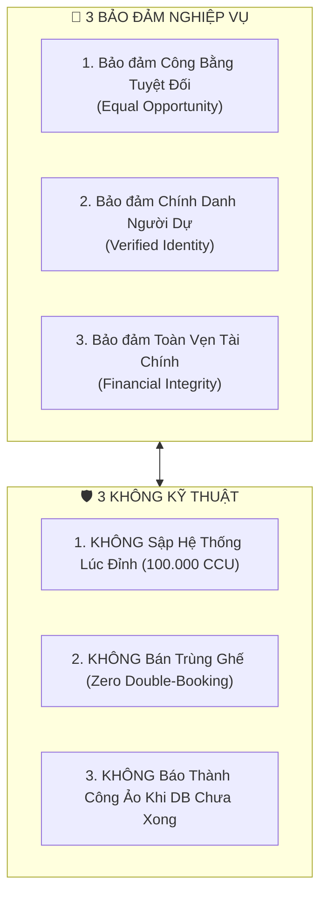
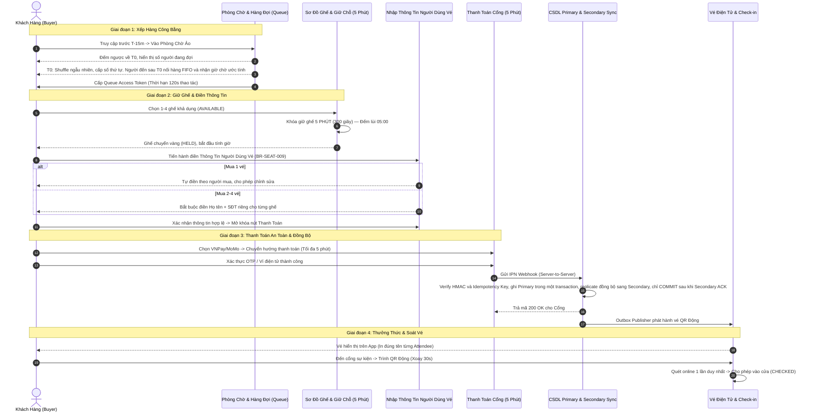
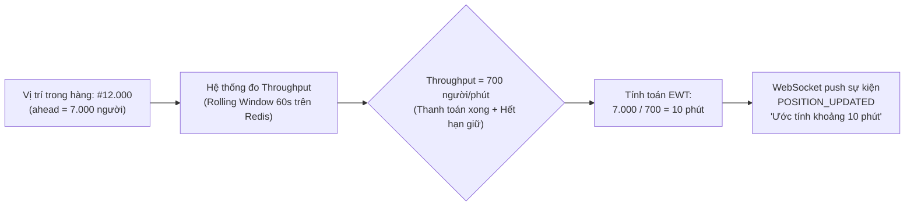
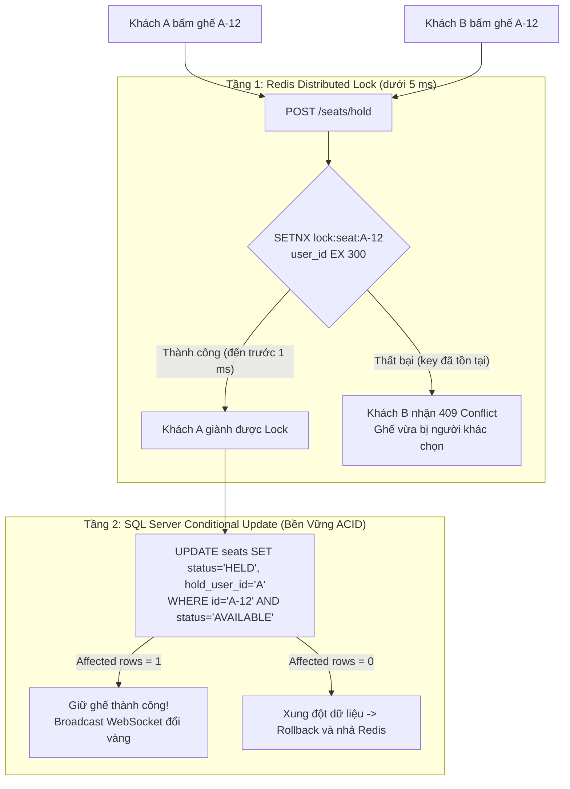
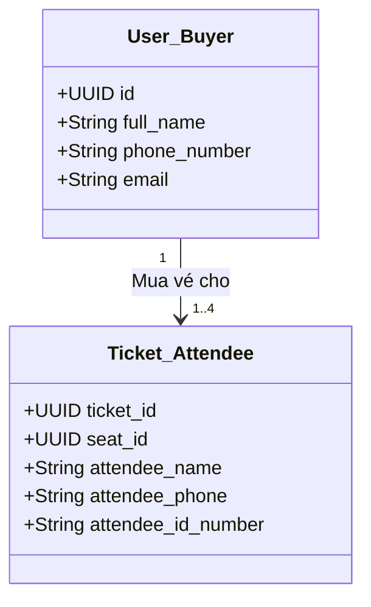
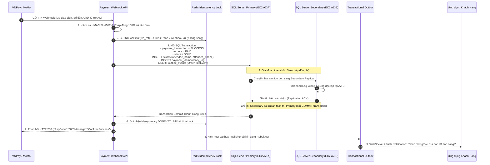
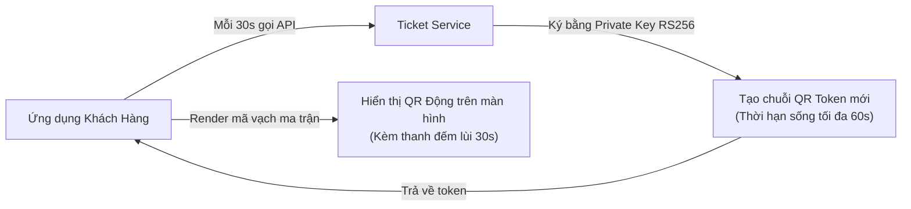
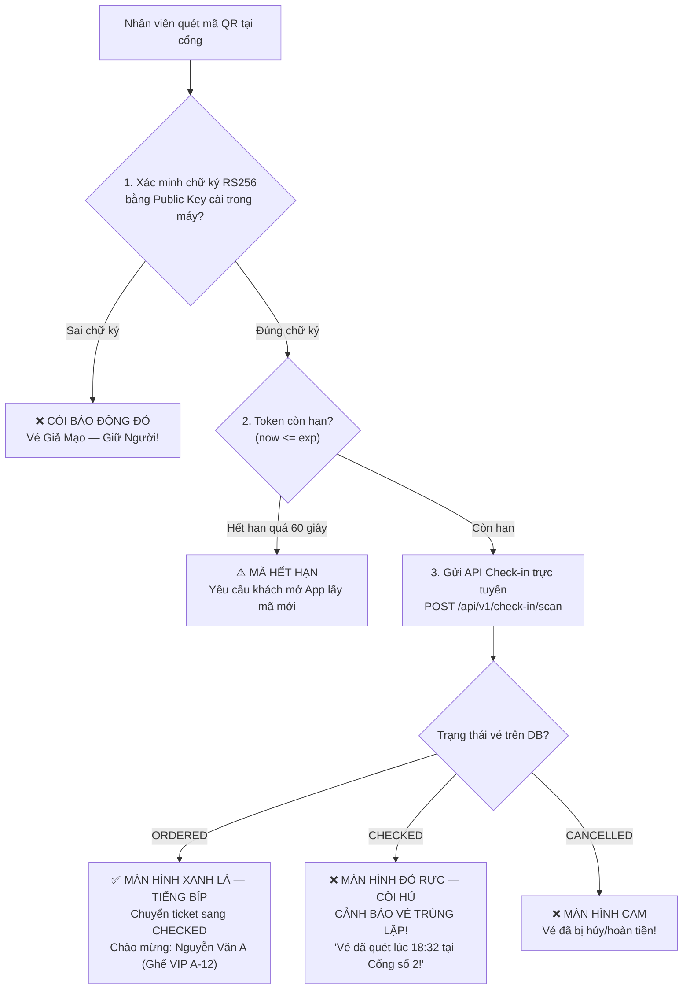
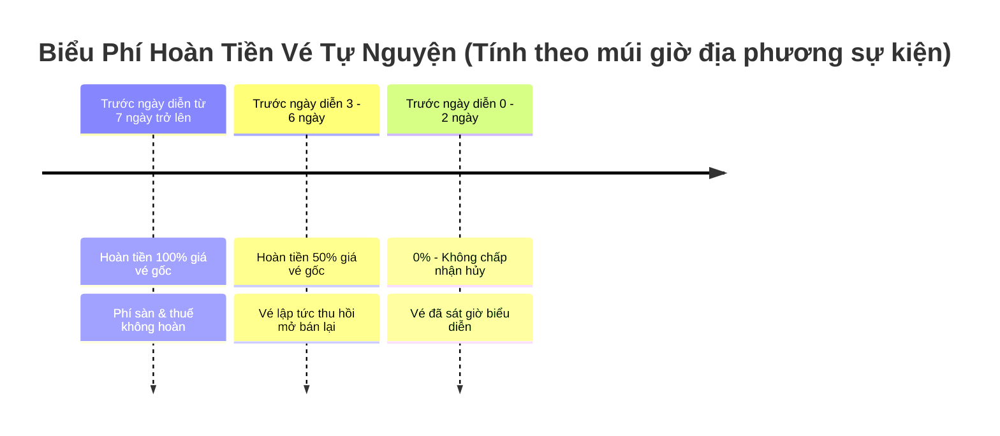
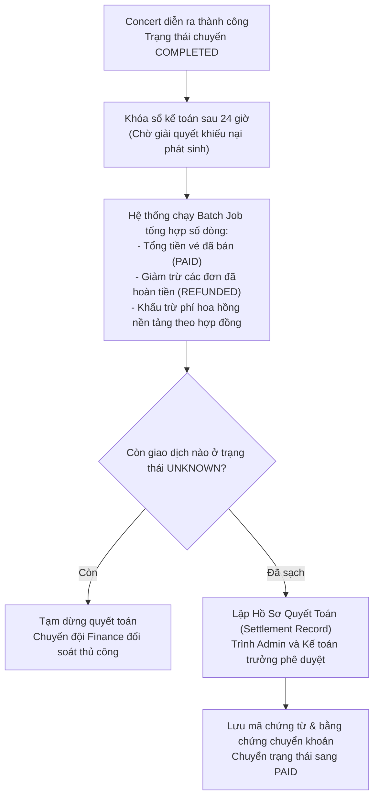

# 🎤 BÁO CÁO THUYẾT TRÌNH NGHIỆP VỤ HỆ THỐNG
## NỀN TẢNG BÁN VÉ CONCERT TRỰC TUYẾN QUY MÔ LỚN (CONCERT TICKETING SYSTEM)
> **Phiên bản tài liệu:** 2.0 — Chuyên sâu Nghiệp vụ & Kiến trúc Vận hành  
> **Ngày phát hành:** 09/11/2026  
> **Đối tượng trình bày:** Hội đồng Thẩm định Nghiệp vụ, Ban Lãnh đạo Dự án, Đội ngũ Product Owner & Solutions Architect  

---

## MỤC LỤC BÁO CÁO THUYẾT TRÌNH

1. [Phần 1: Bối Cảnh Thị Trường & Mục Tiêu Nghiệp Vụ Cốt Lõi](#phần-1-bối-cảnh-thị-trường--mục-tiêu-nghiệp-vụ-cốt-lõi)
2. [Phần 2: Chân Dung Tác Nhân & Bản Đồ Hành Trình Khách Hàng](#phần-2-chân-dung-tác-nhân--bản-đồ-hành-trình-khách-hàng)
3. [Phần 3: Đi Sâu Nghiệp Vụ 1 — Phòng Chờ Ảo & Hàng Chờ FIFO Thông Minh](#phần-3-đi-sâu-nghiệp-vụ-1--phòng-chờ-ảo--hàng-chờ-fifo-thông-minh)
4. [Phần 4: Đi Sâu Nghiệp Vụ 2 — Chọn Ghế, Giữ Chỗ 5 Phút & Phân Định Người Mua / Người Sử Dụng](#phần-4-đi-sâu-nghiệp-vụ-2--chọn-ghế-giữ-chỗ-5-phút--phân-định-người-mua--người-sử-dụng)
5. [Phần 5: Đi Sâu Nghiệp Vụ 3 — Đặt Hàng, Thanh Toán 5 Phút & Chuỗi Đồng Bộ Primary-Secondary Bền Vững](#phần-5-đi-sâu-nghiệp-vụ-3--đặt-hàng-thanh-toán-5-phút--chuỗi-đồng-bộ-primary-secondary-bền-vững)
6. [Phần 6: Đi Sâu Nghiệp Vụ 4 — Vé Điện Tử, QR Động & Soát Vé Trực Tuyến Một Lần Duy Nhất](#phần-6-đi-sâu-nghiệp-vụ-4--vé-điện-tử-qr-động--soát-vé-trực-tuyến-một-lần-duy-nhất)
7. [Phần 7: Đi Sâu Nghiệp Vụ 5 — Hủy Đơn, Hoàn Tiền Đa Tầng & Quyết Toán Ban Tổ Chức](#phần-7-đi-sâu-nghiệp-vụ-5--hủy-đơn-hoàn-tiền-đa-tầng--quyết-toán-ban-tổ-chức)
8. [Phần 8: Bảng Bất Biến Nghiệp Vụ (Business Invariants) & Ma Trận Kiểm Soát Rủi Ro](#phần-8-bảng-bất-biến-nghiệp-vụ-business-invariants--ma-trận-kiểm-soát-rủi-ro)
9. [Phần 9: Kịch Bản Q&A Bảo Vệ Trước Hội Đồng Nghiệp Vụ](#phần-9-kịch-bản-qa-bảo-vệ-trước-hội-đồng-nghiệp-vụ)

---

# PHẦN 1: BỐI CẢNH THỊ TRƯỜNG & MỤC TIÊU NGHIỆP VỤ CỐT LÕI

## 1.1. Bối cảnh thực tế & Bài toán hóc búa của ngành Vé Sự Kiện

Thị trường biểu diễn âm nhạc tại Việt Nam trong những năm gần đây bùng nổ với các concert quy mô sân vận động (từ 20.000 đến 60.000 khán giả). Tuy nhiên, các hệ thống bán vé truyền thống liên tục gặp phải các vấn nạn nghiêm trọng:
1. **Nghẽn sập hạ tầng lúc mở bán (Traffic Flash Crowd):** Hàng trăm nghìn người cùng truy cập tại một giây khiến máy chủ tê liệt, giao dịch treo lơ lửng, trừ tiền nhưng không ra vé.
2. **Nạn đầu cơ & Phe vé (Ticket Scalping):** Các đối tượng xấu sử dụng bot công nghệ cao quét tự động, gom sạch vé đẹp trong tích tắc rồi bán lại ở thị trường chợ đen với giá cắt cổ.
3. **Vé giả & Gian lận qua cổng:** Tình trạng một mã QR tĩnh được chụp màn hình và bán lại cho 5-10 người; người đến sớm vào được, người đến sau bị từ chối trong cay đắng.
4. **Tranh chấp thanh toán & Hoàn tiền nhập nhằng:** Mạng chập chờn dẫn đến trừ tiền hai lần (Double-Charge), thanh toán khi ghế đã hết hạn giữ chỗ (Late Payment), hoặc thiếu cơ chế đối soát tự động.

## 1.2. Sứ mệnh & Tuyên ngôn "3 KHÔNG — 3 BẢO ĐẢM"

Hệ thống **Concert Ticketing System** được thiết kế để giải quyết triệt để các bài toán trên bằng mô hình nghiệp vụ siết chặt và công nghệ phòng thủ đa tầng:

---

# PHẦN 2: CHÂN DUNG TÁC NHÂN & BẢN ĐỒ HÀNH TRÌNH KHÁCH HÀNG

## 2.1. Ma trận Phân quyền & Vai trò Tác nhân (Actor Matrix)

| Tác nhân (Actor) | Phạm vi & Trách nhiệm nghiệp vụ chính | Kênh tương tác | Điểm mấu chốt được bảo vệ |
|---|---|---|---|
| **Khách hàng (Customer / Buyer)** | Tìm kiếm, xếp hàng phòng chờ ảo, chọn ghế, khai báo thông tin người sử dụng vé, thanh toán, quản lý vé điện tử, yêu cầu hủy vé tự nguyện. | Web Responsive, App iOS/Android | Mỗi tài khoản tối đa 4 vé; 1 vị trí hàng chờ duy nhất; thời gian thao tác giới hạn chuẩn xác. |
| **Người sử dụng vé (Attendee)** | Người thực tế cầm vé đi vào cổng sự kiện (có thể trùng hoặc khác người mua). | Trình vé QR trên App / Email | Tên và SĐT được in trên vé; khớp thông tin CCCD ngẫu nhiên khi kiểm tra an ninh. |
| **Ban tổ chức (Organizer)** | Khởi tạo sự kiện, thiết kế sơ đồ khán phòng, cấu hình hạng vé/giá vé, theo dõi tiến độ bán vé, tiếp nhận báo cáo doanh thu và đối soát quyết toán. | Portal Quản trị Doanh nghiệp | Không được tự ý sửa giá/ghế khi sự kiện đã mở bán (`ON_SALE`); quyết toán tiền qua quy trình chặt chẽ. |
| **Nhân viên soát vé (Staff)** | Quét mã QR tại cổng kiểm soát ra vào theo phân khu được phân công (Gate/Zone). | Ứng dụng Quét Vé Chuyên Dụng (Staff App) | Quét trực tuyến 100%; từ chối vé sai cổng; cảnh báo đỏ tức thì nếu vé đã bị quét trước đó. |
| **Quản trị viên (Admin/Finance)** | Kiểm duyệt concert trước khi mở bán, kiểm soát rủi ro gian lận, phê duyệt hủy concert bất khả kháng, đối soát cổng thanh toán và duyệt lệnh giải ngân. | Dashboard Quản trị Sàn | Toàn quyền audit log; chỉ can thiệp theo quy trình đối soát kép (Dual Control). |

## 2.2. Bản đồ Hành trình Mua Vé Toàn Trình (End-to-End Buyer Journey)

---

# PHẦN 3: ĐI SÂU NGHIỆP VỤ 1 — PHÒNG CHỜ ẢO & HÀNG CHỜ FIFO THÔNG MINH

## 3.1. Nghịch lý Mở Bán & Cơ chế Xáo Trộn Ngẫu Nhiên (Fisher-Yates Shuffle)

* **Vấn đề thực tế:** Nếu mở bán trực tiếp lúc 10:00:00, hàng chục nghìn người nhấn F5 đồng loạt. Người có mạng cáp quang tốc độ cao hoặc bot tự động sẽ luôn cướp hết vé trước những người dùng phổ thông.
* **Quy tắc giải quyết (`BR-QUEUE-001`, `BR-QUEUE-002`):**
  1. **T-15 Phút:** Mở Phòng Chờ Ảo (Waiting Room). Tất cả người dùng vào phòng chờ trong 15 phút này đều được đưa vào một "Bể chờ chung" (Pre-sale Pool).
  2. **Đúng T0:** Hệ thống kích hoạt thuật toán **Fisher-Yates Shuffle** đảo ngẫu nhiên toàn bộ danh sách người trong phòng chờ. Dù bạn bấm vào phòng chờ ở phút thứ 14 hay phút thứ 1, cơ hội nhận được số thứ tự top đầu là **hoàn toàn ngang nhau (100% công bằng)**.

## 3.2. Hàng Chờ FIFO Cho Người Đến Sau & Thuật Toán Ước Tính Giờ Chờ Động (`BR-QUEUE-009`)

* **Nghiệp vụ mới:** Những người truy cập sau $T_0$ sẽ tự động xếp vào cuối hàng theo nguyên tắc **Đến trước - Phục vụ trước (First-In, First-Out — FIFO)**.
* **Bài toán tâm lý khách hàng:** Người đứng ở vị trí 15.000 nếu không biết phải đợi bao lâu sẽ liên tục F5 hoặc mở hàng chục tab, gây quá tải hệ thống.
* **Công thức toán học ước tính thời gian chờ (Estimated Wait Time - EWT):**

$$\text{Số người xếp trước (ahead)} = \text{Vị trí hiện tại} - \text{Số lượng đã được duyệt vào}$$

$$\text{Throughput thực tế } (T) = \sum \text{Số slot giải phóng trong 60 giây gần nhất}$$

$$\text{Thời gian chờ ước tính (giây)} = \left(\frac{\text{ahead}}{T}\right) \times 60$$

* **Xử lý tình huống biên (Edge Cases):**
  * Nếu $T = 0$ (chưa có ai nhả ghế): Hiển thị *"Đang tính toán — Vui lòng chờ trong giây lát..."*.
  * Khi vị trí $\le 10$: Hiển thị thông báo đỏ nhấp nháy: *"Bạn sắp đến lượt! Hãy chuẩn bị sẵn sàng thiết bị."*
  * Khi hệ thống hết vé sạch: Ngay lập tức broadcast `SALE_SOLD_OUT`, đóng hàng chờ và hiển thị thông báo cảm ơn thay vì để khách đợi vô ích.

## 3.3. Kiểm Soát Dung Lượng Khu Chọn Ghế (Admission Control — Max 5.000 CCU)

* **Nguyên tắc "Đập chắn lũ":** Khu vực chọn ghế trên sơ đồ đòi hỏi tải nặng (tải sơ đồ SVG, render trạng thái ghế, kết nối WebSocket hai chiều). Hệ thống giới hạn **tối đa đúng 5.000 người hoạt động đồng thời** (`current_active_users <= 5.000`).
* **Phiên chọn ghế có kiểm soát:**
  * Khách đến lượt nhận được `Queue Access Token` (JWT ký HMAC, có hiệu lực 120 giây).
  * Khách phải gửi **Heartbeat mỗi 30 giây**. Nếu mất kết nối quá 120 giây, hệ thống thu hồi quyền vào khu chọn ghế để nhường slot cho người tiếp theo (`BR-QUEUE-006`).

---

# PHẦN 4: ĐI SÂU NGHIỆP VỤ 2 — CHỌN GHẾ, GIỮ CHỖ 5 PHÚT & PHÂN ĐỊNH NGƯỜI MUA / NGƯỜI SỬ DỤNG

## 4.1. Tại sao rút ngắn thời gian giữ ghế từ 10 phút xuống 5 phút? (`BR-SEAT-002`)

Trong thiết kế trước đây, thời gian giữ ghế là 10 phút. Tuy nhiên, qua phân tích hành vi và áp lực mở bán concert thực tế, mốc 10 phút tạo ra các điểm nghẽn nghiệp vụ nghiêm trọng:
1. **Hiện tượng "Om vé / Treo ghế ảo":** Khách chọn 4 vé xong để đó đi làm việc khác, khiến hàng nghìn ghế bị khóa lãng phí, người thực sự cần mua ở hàng chờ phải đợi quá lâu.
2. **Kéo dài thời gian bán vé toàn diện:** Với 50.000 vé, nếu mỗi chu kỳ giữ ghế kéo dài 10 phút, sự kiện mất từ 2 đến 3 tiếng mới bán hết, làm tăng chi phí vận hành hạ tầng và tỷ lệ rớt khách (Drop-off rate).
3. **Quyết định rút ngắn còn 300 giây (5 phút):**
   * Đủ cho người dùng thao tác kiểm tra giá, nhập thông tin và xác nhận thanh toán.
   * Cảnh báo đồng hồ màu đỏ và chuông báo động ở **giây thứ 60 cuối cùng**.
   * Nếu quá 300 giây chưa thanh toán: Tự động giải phóng ghế ngay lập tức, trả về màu xanh cho cộng đồng.

## 4.2. Cơ chế Phòng Ngự Hai Tầng Chống Bán Trùng (Zero Double-Booking)

Để đảm bảo tuyệt đối không có 2 người cùng mua 1 ghế:

## 4.3. Siết Chặt Nghiệp Vụ Mới: Quản Lý Người Mua vs Người Sử Dụng Vé (`BR-SEAT-009`)

Đây là bước cải tiến đột phá nhằm **chống phe vé chợ đen** và **đảm bảo an ninh sự kiện**:

Người mua là người thanh toán; người sử dụng vé là người thực tế vào cổng.

### Bảng Quy Định Nhập Liệu Nghiệp Vụ Khi Checkout:

| Số lượng vé mua | Quy định nhập thông tin người sử dụng vé | Ràng buộc nghiệp vụ (Validation Rule) |
|---|---|---|
| **Mua 1 vé** | Mặc định tự động điền Họ tên và SĐT của tài khoản người mua. Cho phép bấm "Chỉnh sửa" nếu mua tặng người khác. | Bắt buộc có Họ tên (1-100 ký tự) và SĐT hợp lệ (10-11 chữ số). |
| **Mua từ 2 đến 4 vé (Mua nhóm)** | Hệ thống hiển thị form nhập liệu độc lập tương ứng với từng chiếc ghế đã chọn. **Bắt buộc nhập riêng biệt thông tin của từng người đi cùng.** | - `attendee_name`: Bắt buộc điền đúng tên trên giấy tờ tùy thân. - `attendee_phone`: Bắt buộc từng SĐT độc lập để nhận SMS nhắc lịch. - `attendee_id_number`: CCCD/CMND (Khuyến nghị điền để kiểm soát). |
| **Kiểm soát nút bấm** | Nút **"Tiến hành thanh toán"** bị vô hiệu hóa hoàn toàn nếu còn bất kỳ ghế nào chưa điền đủ Họ tên và SĐT. | Form validate trực tiếp realtime trên UI và kiểm tra nghiêm ngặt tại Backend API. |
| **In ấn trên vé** | Tên hiển thị trên vé điện tử và mã QR là **Tên người sử dụng vé thực tế**, không hiển thị tên người trả tiền. | Khi kiểm tra ngẫu nhiên tại cổng, nhân viên đối chiếu tên trên vé với thẻ CCCD của người đang đứng tại cổng. |

---

# PHẦN 5: ĐI SÂU NGHIỆP VỤ 3 — ĐẶT HÀNG, THANH TOÁN 5 PHÚT & CHUỖI ĐỒNG BỘ PRIMARY-SECONDARY BỀN VỮNG

## 5.1. Đồng Hồ Đếm Lược Thanh Toán 5 Phút & Tính Bất Biến Của Đơn Hàng

* Khi bấm "Thanh toán", đơn hàng được tạo ở trạng thái `PENDING` với một `Idempotency-Key` duy nhất.
* Thời gian thanh toán kế thừa chính xác số giây còn lại của phiên giữ ghế (tối đa 5 phút).
* Giá vé, phí sàn, thuế VAT được chốt cứng thành **Snapshot bất biến** (`BR-ORD-005`). Dù ban tổ chức có thay đổi chính sách sau đó, đơn hàng đã tạo tuyệt đối không bị nhảy giá.

## 5.2. Chuỗi Đồng Bộ Dữ Liệu Bắt Buộc: Primary COMMIT -> Secondary ACK -> Phản Hồi Client

Một trong những lỗi nghiêm trọng nhất của các sàn thương mại điện tử là: *Báo khách thanh toán thành công, nhưng máy chủ cơ sở dữ liệu bị sập giữa chừng khiến dữ liệu biến mất, dẫn đến tranh chấp pháp lý.*

Hệ thống thiết lập quy trình ghi dữ liệu chuẩn **Always On Availability Groups (Synchronous Commit)**:

> [!IMPORTANT]
> **Cam kết sống còn:** Tuyệt đối không gửi phản hồi thành công về cho Cổng thanh toán hoặc thông báo cho Khách hàng khi giao dịch chưa được lưu đồng thời trên cả Primary DB và Synchronous Secondary DB!

## 5.3. Xử Lý Các Trường Hợp Thanh Toán Đặc Biệt

### A. Giao dịch trễ hạn giữ ghế (Late Payment Callback — `BR-PAY-003`)
* **Tình huống:** Khách hàng A quét mã thanh toán lúc 04:59. Do mạng ngân hàng chậm, tiền bị trừ lúc 05:01 (khi ghế đã hết hạn 5 phút và đã bị Khách hàng B chọn mua).
* **Xử lý nghiêm ngặt:**
  1. Tuyệt đối **KHÔNG hồi sinh đơn hàng** và **KHÔNG cướp lại ghế** đã bán cho Khách B.
  2. Đánh dấu giao dịch là `SUCCESS_UNFULFILLED`.
  3. Hệ thống tạo lệnh **tự động hoàn tiền 100%** số tiền đã thu về tài khoản gốc của Khách A với mã Idempotency độc lập.
  4. Gửi thông báo xin lỗi chân thành qua In-App notification và Email.

### B. Mất kết nối cổng thanh toán (Gateway Timeout / Trạng thái UNKNOWN)
* Nếu gọi sang cổng không nhận được phản hồi sau 30 giây: Ghi trạng thái `UNKNOWN`.
* Tuyệt đối **cấm retry trừ tiền mù**. Hệ thống đưa vào hàng đợi đối soát tự động theo chu kỳ: **30 giây, 5 phút, 30 phút**.
* Chỉ khi cổng thanh toán xác nhận bằng văn bản số/API đối soát thì mới cập nhật trạng thái cuối cùng.

---

# PHẦN 6: ĐI SÂU NGHIỆP VỤ 4 — VÉ ĐIỆN TỬ, QR ĐỘNG & SOÁT VÉ TRỰC TUYẾN MỘT LẦN DUY NHẤT

## 6.1. Kiến Trúc Mã QR Động Chống Gian Lận (Dynamic QR Token Architecture)

* **Vấn đề vé giả:** Với vé giấy hoặc mã QR tĩnh, kẻ xấu chỉ cần chụp màn hình rồi gửi cho nhiều người hoặc in ra giấy hàng loạt.
* **Cơ chế QR Động (`BR-TCK-002`):**
  * Mã QR hiển thị trên ứng dụng là một chuỗi mã hóa **JSON Web Signature (JWS) ký bằng thuật toán mã hóa bất đối xứng RS256**.
  * Chứa các thông tin bảo mật: `ticket_id`, `concert_id`, `seat_id`, `nonce`, thời điểm tạo (`iat`), thời điểm hết hạn (`exp = iat + 60s`).
  * Ứng dụng **tự động làm mới (rotate) mã QR sau mỗi 30 giây**. Ảnh chụp màn hình gửi qua Zalo/Facebook sẽ hết hạn trong vòng chưa đầy 1 phút và trở thành vô giá trị tại cửa soát vé.

## 6.2. Quy Trình Soát Vé Trực Tuyến Một Lần Duy Nhất (Single Check-in Enforcement — `BR-TCK-003`)

Tại cổng sự kiện, máy quét chuyên dụng của nhân viên hoạt động với logic nghiêm ngặt:

* **Chính sách Mất Mạng (Fail-Closed — `BR-TCK-005`):** Nếu hệ thống mạng tại sân vận động gặp sự cố và máy quét không thể kết nối tới máy chủ trung tâm, máy quét **tuyệt đối không tự ý cho qua dựa trên cache ngoại tuyến**. Sự cố phải được báo ngay cho Trưởng cổng soát vé (Gate Supervisor) để xử lý theo luồng an ninh khẩn cấp, bảo đảm không lọt bất kỳ vé trùng nào.

---

# PHẦN 7: ĐI SÂU NGHIỆP VỤ 5 — HỦY ĐƠN, HOÀN TIỀN ĐA TẦNG & QUYẾT TOÁN BAN TỔ CHỨC

## 7.1. Chính Sách Hoàn Tiền Tự Nguyện Theo Ngày Lịch Địa Phương (`BR-RFD-001`)

Khách hàng có thể có việc đột xuất và muốn trả lại vé. Nền tảng áp dụng chính sách hoàn tiền tự nguyện theo bậc thang thời gian rõ ràng:

* **Quy tắc trọn gói (`BR-RFD-002`):** Chỉ cho phép hủy **toàn bộ đơn hàng**, không hỗ trợ hủy lẻ 1 ghế trong đơn 4 ghế để tránh xé lẻ giao dịch tài chính gốc.
* **Điều kiện tiên quyết:** Đơn hàng chưa có bất kỳ vé nào quét qua cổng (`ticket.status != CHECKED`). Đã check-in vào sân thì quyền hoàn tiền lập tức bị khóa vĩnh viễn (`BR-RFD-006`).

## 7.2. Trường Hợp Sự Kiện Bị Hủy Bất Khả Kháng (`BR-RFD-004`)

* Khi nghệ sĩ bị ốm hoặc thiên tai khiến Ban tổ chức/Admin phải công bố **HỦY CONCERT**:
  * Hệ thống tự động kích hoạt tiến trình hoàn tiền hàng loạt: **Hoàn trả 100% số tiền thực thu** (`order.final_amount`, bao gồm cả phí dịch vụ và thuế) về phương thức thanh toán ban đầu cho toàn bộ khán giả đã mua vé.
  * Toàn bộ vé bị vô hiệu hóa sang `CANCELLED`. Toàn bộ ghế chuyển về trạng thái đóng vĩnh viễn, tuyệt đối không mở bán lại.

## 7.3. Quy Trình Đối Soát & Quyết Toán Tài Chính Ban Tổ Chức (`BR-CON-005`)

Tiền bán vé không được chuyển ngay cho Ban tổ chức mà được giữ an toàn trong tài khoản trung gian của nền tảng:

---

# PHẦN 8: BẢNG BẤT BIẾN NGHIỆP VỤ (BUSINESS INVARIANTS) & MA TRẬN KIỂM SOÁT RỦI RO

Hệ thống được vận hành dựa trên các **Bất biến Nghiệp vụ (Invariants)** — những chân lý toán học và logic không bao giờ được phép vi phạm dưới bất kỳ hoàn cảnh nào:

| Mã Bất Biến | Tên Bất Biến | Định Nghĩa Nghiệp Vụ Tuyệt Đối | Cơ Chế Kiểm Soát Kỹ Thuật |
|:---:|---|---|---|
| **INV-SEAT-01** | **Bảo Toàn Số Lượng Ghế** | Tại mọi thời điểm: $\sum \text{AVAILABLE} + \sum \text{HELD} + \sum \text{SOLD} + \sum \text{BLOCKED} = \text{Sức chứa khán phòng}$. Không thể tự sinh ra hoặc biến mất bất kỳ ghế nào. | Database Check Constraint & Foreign Key ràng buộc với bảng `venues`. |
| **INV-SEAT-02** | **Loại Trừ Tương Hỗ Giữ Ghế** | Một vị trí ghế vật lý tại một thời điểm chỉ có tối đa duy nhất một người dùng được giữ (`status = HELD`). | Redis `SETNX` Lock + SQL Conditional Update `WHERE status='AVAILABLE'`. |
| **INV-ORD-01** | **Bất Biến Hạn Mức Mua** | Một tài khoản người dùng chỉ được sở hữu tối đa **4 vé hiệu lực** (bao gồm cả vé đã mua và ghế đang giữ) cho cùng 1 concert. | Kiểm tra tích lũy nguyên tử trong cùng transaction trước khi tạo đơn hàng. |
| **INV-ORD-02** | **Đóng Băng Giá Đơn Hàng** | Giá trị từng dòng trong đơn hàng là Snapshot bất biến kể từ lúc tạo; cấm mọi hành vi cập nhật lại giá theo giá thị trường sau đó. | Lưu trữ cứng các trường `unit_price`, `service_fee`, `final_amount` trong bảng `order_items`. |
| **INV-PAY-01** | **Lũy Thừa Thanh Toán (Idempotency)** | Một sự kiện thanh toán hoặc IPN Webhook chỉ được ghi nhận một lần duy nhất. Gửi lặp lại 100 lần không bao giờ tạo 2 giao dịch. | Khóa Idempotency Key duy nhất lưu bền vững trong bảng CSDL `payment_idempotency_log`. |
| **INV-TCK-01** | **Một Lần Check-in Duy Nhất** | Mỗi mã vé điện tử chỉ được chuyển từ `ORDERED` sang `CHECKED` đúng 1 lần duy nhất trong toàn bộ vòng đời. | Atomic update với điều kiện `WHERE status='ORDERED'`; lưu vết thời gian và nhân viên soát vé. |
| **INV-ATT-01** | **Định Danh Người Dùng Vé** | Mọi vé phát hành ở trạng thái `ORDERED` bắt buộc phải có đầy đủ Họ tên (`attendee_name`) và SĐT (`attendee_phone`) của người tham dự thực tế. | Ràng buộc `NOT NULL` trên bảng `tickets`; UI validate chặn submit form nếu thiếu. |

---

# PHẦN 9: KỊCH BẢN Q&A BẢO VỆ TRƯỚC HỘI ĐỒNG NGHIỆP VỤ

### ❓ Câu hỏi 1: Tại sao hệ thống lại bắt buộc nhập thông tin từng người sử dụng vé (Attendee Info) khi mua từ 2 vé trở lên? Điều này có làm tăng tỷ lệ rớt đơn (Drop-off) do khách lười điền không?
> **Trả lời:**  
> Đây là sự cân bằng có chủ đích giữa **Trải nghiệm khách hàng** và **Chống đầu cơ phe vé / An ninh quốc gia**:
> 1. **Ngăn chặn phe vé chợ đen:** Nếu chỉ lưu thông tin người mua, phe vé sẽ dùng tài khoản ảo gom vé rồi in ra bán lại trôi nổi ngoài cổng. Khi bắt buộc khai báo Họ tên và SĐT của từng người sử dụng vé, vé bị "gắn chết" danh tính với người đi cùng, triệt tiêu động cơ mua đi bán lại kiếm lời bất chính.
> 2. **Tối ưu trải nghiệm để không gây khó:** Hệ thống chỉ yêu cầu 2 trường bắt buộc tối giản: **Họ tên** và **Số điện thoại**; số CCCD là tùy chọn. Đồng thời giao diện cung cấp tính năng tiện ích *"Sử dụng lại thông tin người trước"* để khách hàng điền cực nhanh trong vòng dưới 15 giây.

---

### ❓ Câu hỏi 2: Nếu rút ngắn thời gian giữ ghế và thanh toán xuống còn 5 phút, liệu người dùng lớn tuổi hoặc người thao tác chậm có bị thiệt thòi không?
> **Trả lời:**  
> Thời gian 5 phút (300 giây) là con số chuẩn quốc tế (được áp dụng tại các nền tảng bán vé hàng đầu thế giới như Ticketmaster, AXS) dựa trên đo lường thực nghiệm:
> 1. Một khách hàng trung bình chỉ mất từ **60 đến 90 giây** để kiểm tra lại vé và quét mã QR ngân hàng.
> 2. Việc để 10 phút trước đây tạo ra "khoảng thời gian chết" quá lớn, làm tắc nghẽn hàng chờ và khiến 95.000 người đứng ngoài phải chịu cảnh chờ đợi vô ích.
> 3. Để hỗ trợ người dùng thao tác chậm, giao diện có đồng hồ đếm lùi kích thước lớn, tự động đổi sang màu đỏ kèm thông báo cảnh báo âm thanh ở **giây thứ 60**, giúp khách hàng tập trung hoàn tất giao dịch kịp thời.

---

### ❓ Câu hỏi 3: Trong trường hợp hàng chờ FIFO quá dài (ví dụ có 80.000 người đang xếp hàng), thuật toán tính giờ chờ ước tính (EWT) có bị sai lệch không nếu bỗng nhiên mọi người rời hàng loạt?
> **Trả lời:**  
> Hệ thống áp dụng cơ chế **Cửa sổ trượt (Rolling Window) 60 giây gần nhất**, được tính toán lại mỗi 10 giây một lần:
> 1. Tốc độ giải phóng slot (Throughput) không phải là con số tĩnh mà được đo đạc liên tục từ 3 nguồn thực tế: người thanh toán xong, người hết hạn 5 phút bị nhả vé, và người tắt trình duyệt bị thu hồi token.
> 2. Nếu có làn sóng rời hàng loạt, Throughput lập tức tăng vọt và thời gian chờ ước tính trên màn hình của người dùng sẽ tự động giảm xuống chỉ sau 10 giây qua kênh WebSocket `POSITION_UPDATED`.
> 3. Hệ thống luôn hiển thị dòng lưu ý minh bạch: *"Thời gian chờ là ước tính động dựa trên tốc độ giao dịch thực tế"* để quản trị kỳ vọng của khách hàng một cách chuyên nghiệp.

---

### ❓ Câu hỏi 4: Cơ chế đồng bộ Primary COMMIT -> Secondary ACK có làm chậm tốc độ phản hồi của API thanh toán không?
> **Trả lời:**  
> Đánh đổi độ trễ cực nhỏ để lấy **Sự an toàn tuyệt đối cho tiền và vé của khách hàng**:
> 1. Trong cùng một AWS Region, độ trễ mạng giữa 2 Availability Zone (AZ-A và AZ-B) qua đường truyền cáp quang chuyên dụng AWS Direct Connect chỉ dao động từ **1ms đến 2ms**.
> 2. Thời gian để Secondary DB ghi nhận hardened log chỉ mất khoảng **3ms - 5ms**. Tổng thời gian xử lý webhook vẫn duy trì ở mức xuất sắc dưới **100ms** (hoàn toàn đáp ứng chuẩn thanh toán tài chính).
> 3. Đổi lại, hệ thống loại bỏ 100% rủi ro mất mát dữ liệu tài chính (Zero Data Loss — RPO = 0), bảo đảm rằng một khi tiền đã trừ thì vé chắc chắn đã được ghi nhận vào ổ cứng an toàn.

---

# TỔNG KẾT & THÔNG ĐIỆP BẢO VỆ

Hệ thống **Concert Ticketing System** không đơn thuần là một website thương mại điện tử bán hàng, mà là một **Hệ Thống Phân Tán Xử Lý Giao Dịch Cường Độ Cao (High-Concurrency Distributed Transaction System)**.

Bằng việc siết chặt toàn diện:
* 🎯 **Chính danh người tham dự:** Phân định rõ Người mua vs Người sử dụng vé.
* ⏱️ **Tối ưu hóa vòng quay vé:** Chuẩn hóa thời gian giữ chỗ & thanh toán 5 phút.
* 📊 **Minh bạch hóa hàng đợi:** Công thức ước tính thời gian chờ động cho hàng FIFO.
* 🔒 **Bảo toàn giao dịch tuyệt đối:** Đồng bộ Primary - Secondary và kiểm soát Idempotency đa tầng.

Hệ thống tự tin mang lại một nền tảng bán vé **Hiện đại — Công bằng — Ổn định — An toàn tuyệt đối**, sẵn sàng phục vụ các siêu đại nhạc hội mang tầm vóc quốc tế!
