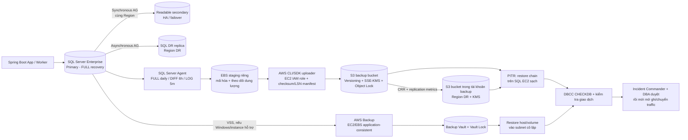
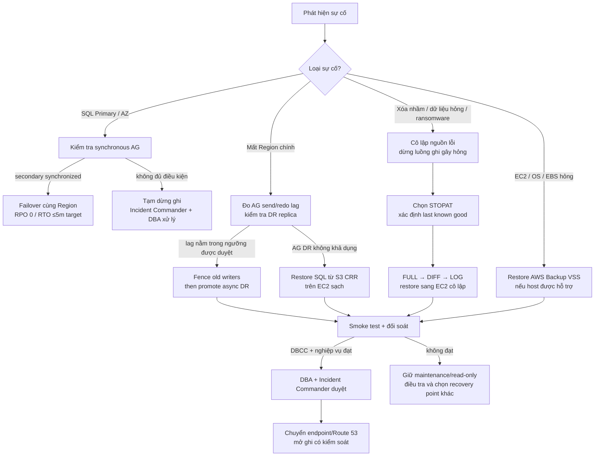

# Đề cương thuyết trình — Cloud Solutions Architect
## Concert Ticketing System

> **Mục đích:** Khung trình bày System Design theo góc nhìn Cloud Solutions Architect: bắt đầu từ bài toán kinh doanh, xác định yêu cầu và tải, chọn kiến trúc cloud phù hợp, giải thích trade-off, rồi chứng minh cách vận hành và nghiệm thu.
>
> **Đối tượng nghe:** Giảng viên chuyên sâu về Cloud; sinh viên trình bày với vai trò người thiết kế giải pháp.
>
> **Nguyên tắc đọc tài liệu:** Các quyết định ghi là **BA baseline** đã thống nhất trong tài liệu dự án. Các mục ghi **Cần chốt** là quyết định hạ tầng chưa đủ cơ sở để tuyên bố đã triển khai hoặc đã kiểm thử. Mục tiêu 100.000 CCU, SLO và RPO/RTO là mục tiêu thiết kế/nghiệm thu, không phải kết quả production đã đo được.

---

## Mạch kể chuyện của bài thuyết trình

Trình bày theo chuỗi câu hỏi mà một Solutions Architect cần trả lời:

1. Hệ thống đang giải quyết vấn đề kinh doanh nào?
2. Những yêu cầu nào buộc kiến trúc phải có các đặc điểm nhất định?
3. Tải và dữ liệu đầu vào là bao nhiêu; giả định nào cần kiểm chứng?
4. Kiến trúc cloud phân vùng và bảo vệ các luồng ra sao?
5. Làm thế nào bảo đảm không bán trùng ghế, không thu tiền trùng và không nhận vé hai lần?
6. Khi một thành phần hoặc cả vùng cloud lỗi, hệ thống xử lý thế nào?
7. Cần đo, kiểm thử, dự trù chi phí và đặt điều kiện go-live ra sao?

**Thông điệp xuyên suốt:** Hệ thống phải hấp thụ đợt truy cập lớn bằng phòng chờ và admission control, đồng thời giữ SQL Server làm nguồn dữ liệu giao dịch chuẩn để bảo vệ ghế, đơn hàng, thanh toán và vé.

---

# Phần 1 — Bối cảnh, mục tiêu và phạm vi

## 1.1. Bối cảnh nghiệp vụ
- Đợt mở bán concert tạo đỉnh truy cập ngắn và tập trung.
- Số lượng ghế hữu hạn, nhiều khách có thể tranh cùng một ghế.
- Thanh toán qua bên thứ ba có callback chậm, lặp hoặc chưa rõ kết quả.
- Ngày diễn ra sự kiện cần xác thực vé nhanh và ngăn sử dụng vé nhiều lần.

## 1.2. Mục tiêu sản phẩm
- Quản lý vòng đời concert và vé: công bố, xếp hàng, giữ ghế, thanh toán, phát hành QR và check-in.
- Phục vụ công bằng, giới hạn tải vào vùng chọn ghế.
- Bảo đảm tính đúng đắn của tồn kho, tiền và vé.
- Cung cấp vận hành, báo cáo và đối soát cho Organizer, Admin, Finance và Staff.

## 1.3. Phạm vi và tác nhân
- Customer, Guest, Organizer, Admin/Finance, Staff, Platform Ops.
- Trong baseline: Web/mobile, cổng quản trị, thanh toán VNPay/MoMo, thông báo và check-in online.
- Ngoài baseline: mua bán vé thứ cấp và check-in offline.

## 1.4. Kiến trúc thành công nghĩa là gì?
- Không bán trùng ghế trong luồng đồng thời.
- Không tạo giao dịch thu tiền hoặc phát vé trùng khi retry/callback lặp.
- Có quy tắc rõ cho người vào phòng chờ và người được vào vùng chọn ghế.
- Có phương án failover, phục hồi dữ liệu và bằng chứng kiểm thử trước go-live.

**Câu hỏi cần trả lời với giảng viên:** Bài toán quan trọng nhất là “chịu được nhiều kết nối” hay “giữ đúng trạng thái giao dịch khi tải tăng”? Giải thích vì sao cần giải quyết cả hai nhưng không dùng cùng một chiến lược cho mọi dữ liệu.

---

# Phần 2 — Yêu cầu kiến trúc và ràng buộc

## 2.1. Yêu cầu chức năng ảnh hưởng đến kiến trúc
- Đăng nhập và phân quyền theo vai trò/phạm vi sự kiện.
- Tìm kiếm concert, xem sơ đồ ghế.
- Waiting Room, cấp Queue Access Token và kiểm tra token ở API.
- Chọn tối đa 4 ghế và giữ trong 600 giây.
- Tạo đơn, thanh toán, xác minh callback, đối soát trạng thái chưa rõ.
- Phát hành QR sau khi đơn đủ điều kiện.
- Check-in trực tuyến, đơn dụng.

## 2.2. Yêu cầu phi chức năng và mục tiêu baseline
| Yêu cầu | Baseline trong BA | Ý nghĩa kiến trúc |
|---|---|---|
| Quy mô mở bán | Mục tiêu benchmark 100.000 CCU | Phải điều tiết tải; không để toàn bộ CCU chạm vào luồng giao dịch |
| Admission khu chọn ghế | Tối đa 5.000 người đồng thời | Giới hạn áp lực lên API, Redis và SQL Server |
| SLO | 99,95%/tháng cho purchase API do hệ thống trực tiếp vận hành | Đo riêng sự cố nhà cung cấp thanh toán |
| Tính toàn vẹn | Không bán trùng/thu tiền trùng/phát vé trùng | SQL transaction, ràng buộc, idempotency và đối soát |
| Giữ ghế | 600 giây, tối đa 4 ghế | TTL và quy tắc nghiệp vụ không được nhầm với timeout hàng đợi |
| Queue token | Hết sau 120 giây không có hoạt động hợp lệ | Thu hồi slot admission; không tự kết thúc một hold ghế còn hạn |
| Check-in | Online-only, fail-closed | Khi không xác minh được thì không chấp nhận vé từ cache offline |

## 2.3. Ràng buộc kỹ thuật đã thống nhất
- Backend: Spring Boot 3, kiến trúc **Modular Monolith + Worker bất đồng bộ**.
- Giao dịch: SQL Server 2025 Enterprise là nguồn sự thật; Redis không thay thế database.
- Tác vụ nền: Amazon MQ for RabbitMQ, transactional outbox, retry/DLQ và consumer idempotent.
- Không có NoSQL riêng, không Kafka, không partition SQL Server trong baseline.
- Database HA/DR và giấy phép/sizing còn cần DBA/Finance xác nhận.

## 2.4. Phân biệt yêu cầu, giả định và bằng chứng
- **Yêu cầu:** tiêu chí sản phẩm phải đạt.
- **Giả định:** số liệu dùng để thiết kế sơ bộ, ví dụ payload, tỷ lệ cache hit, polling interval.
- **Bằng chứng:** kết quả load test, benchmark, diễn tập restore/failover và xác nhận licensing.
- Không trình bày giả định như một kết quả đã đo.

---

# Phần 3 — Mô hình tải và ước lượng năng lực

## 3.1. Bộ dữ liệu đầu vào cần nói rõ bằng tiếng Việt
- Tổng số người dùng đồng thời và số người được vào chọn ghế.
- Số người đang chờ và chu kỳ hỏi trạng thái hàng chờ.
- Số ghế bán, số vé trung bình trong mỗi đơn, thời gian bán hết dự kiến.
- Tỷ lệ đọc/ghi; số lượt xem sơ đồ ghế và số lần thử giữ ghế.
- Kích thước nội dung tĩnh, dữ liệu phản hồi động và tỷ lệ cache/CDN.
- Số scan check-in, số cổng, thời gian tập trung khách vào sân.
- Tốc độ tăng dữ liệu đơn hàng, vé, audit, log; thời hạn lưu trữ.
- Đánh dấu rõ dữ liệu nào lấy từ BA, dữ liệu nào chỉ là giả định để tính.

## 3.2. Công thức cần trình bày
- **QPS đọc** = số người gọi endpoint trong một giây.
- **QPS queue polling** = số người đang chờ ÷ số giây giữa hai lần hỏi.
- **Tốc độ tạo đơn** ≈ số vé bán ÷ số vé mỗi đơn ÷ thời gian bán (giây).
- **Băng thông** = request/giây × kích thước phản hồi × 8; chia cho 1.000.000 để ra Mbps.
- **RAM cache sơ bộ** = số bản ghi cache × kích thước mỗi bản ghi × hệ số overhead/dự phòng.
- **Dung lượng DB** = số bản ghi × kích thước trung bình × thời gian lưu; cộng index, log, backup và bản sao HA.
- **Ghi SQL** phải tính số thao tác ghi thật cho mỗi nghiệp vụ, không đồng nhất số request API với số transaction hoặc row update.

## 3.3. Các con số cần đưa lên slide
- Chỉ đưa 4–6 con số chính từ file ước lượng BA: CCU, admission, queue polling, read/write, bandwidth, RAM/storage.
- Với mỗi con số, nói ba ý: **đầu vào → phép tính → quyết định được hỗ trợ**.
- Đặt giả định cạnh kết quả; không cần đọc toàn bộ bảng số liệu khi thuyết trình.
- Kết thúc bằng kế hoạch benchmark để xác nhận và điều chỉnh kích thước tài nguyên.

**Đầu ra của phần này:** Ước lượng giúp định cỡ gateway/app/Redis/SQL, quyết định cache/CDN, giới hạn connection pool, dự trù lưu trữ và đặt tiêu chí load test. Nó chưa chứng minh hệ thống thực tế đạt mức tải.

---

# Phần 4 — Kiến trúc tổng quan (High-Level Design)

## 4.1. Sơ đồ ngữ cảnh
Vẽ các nhóm người dùng, hệ thống Concert Ticketing, VNPay/MoMo, dịch vụ thông báo, CDN/WAF và các hệ thống vận hành. Nêu rõ ranh giới hệ thống và phụ thuộc bên ngoài.

## 4.2. Sơ đồ container / thành phần cấp cao
- Client Web, Mobile, Admin/Organizer Portal, Staff Scanner.
- Route 53, CloudFront/AWS WAF và ALB tới EKS.
- App Spring Boot Modular Monolith và Worker được đóng gói thành Docker image; dùng multi-stage build, image chạy non-root, không chứa secret.
- ECR lưu image theo commit SHA/digest bất biến; cùng một image đã kiểm chứng được promote từ staging lên production.
- Amazon EKS chạy các container trên node dùng containerd; Docker là công cụ build/đóng gói, không hàm ý cài Docker Engine trên node production.
- Redis cho hàng chờ, lock ghế, cache và rate limit.
- SQL Server Primary/readable secondary/DR replica.
- Amazon MQ for RabbitMQ và transactional outbox.
- Object Storage cho ảnh/media/backup theo chính sách.
- GitHub Actions thực hiện kiểm tra mã nguồn, build/scan image và triển khai theo môi trường; dùng GitHub OIDC để nhận AWS credentials tạm thời, giới hạn theo repository, branch/environment và quyền IAM.
- Nếu EKS chỉ mở private API endpoint, deploy job chạy trên self-hosted GitHub Actions runner chuyên dụng trên EC2 trong VPC; cấp quyền EKS/RBAC tối thiểu và chỉ cho runner nhận workflow tin cậy.

## 4.3. Sơ đồ triển khai AWS
Thể hiện Region, Availability Zone, VPC, public subnet, private app subnet, broker subnet, database subnet, subnet quản trị CI/CD và đường kết nối ra ngoài. AWS đã được chọn theo D-035; phân biệt kiến trúc mục tiêu với hạ tầng đã triển khai.

### Bản nháp kiến trúc logic để xem trước

~~~mermaid
flowchart LR
  client["Web / Mobile / Portal / Staff Scanner"]
  edge["Route 53 + CloudFront + AWS WAF"]
  ingress["AWS ALB → Amazon EKS"]

  subgraph github["GitHub"]
    repo["GitHub repository"]
    actions["GitHub Actions PR checks + quality/security scan"]
    hosted["GitHub-hosted runner Docker build + image scan"]
    repo --> actions --> hosted
  end

  subgraph primary["AWS Primary Region (TBD)"]
    subgraph pub["Public zone"]
      ingress
    end
    subgraph appzone["Private application zones"]
      app["Spring Boot Modular Monolith Docker image / scale ngang"]
      worker["Async Worker Docker image"]
    end
    subgraph opszone["Private CI/CD management subnet"]
      runner["Dedicated self-hosted runner on EC2 GitHub Actions deploy job"]
    end
    subgraph datazone["Private data zones"]
      redis["Amazon ElastiCache for Redis OSS queue 120s / seat lock 600s / cache"]
      mq["Amazon MQ for RabbitMQ durable queue + retry/DLQ"]
      sqlp[("SQL Server Enterprise on EC2 Primary")]
      sqls[("Readable synchronous EC2 secondary")]
    end
    ecr[("Amazon ECR immutable image digest")]
    store["Object Storage"]
    obs["Metrics / Logs / Traces / Alerts"]
  end

  subgraph dr["Approved AWS DR Region (TBD)"]
    sqldr[("SQL Server async DR replica")]
    backup["S3 + KMS backup / S3 CRR"]
  end
  payment["VNPay / MoMo"]
  notify["Email / Push providers"]

  client --> edge --> ingress --> app
  app <--> redis
  app --> sqlp
  sqlp --> sqls
  sqlp -. "async replication" .-> sqldr
  app --> mq --> worker
  worker --> sqlp
  app --> payment
  payment --> app
  worker --> notify
  client -->|"signed URL"| store
  app -. "telemetry" .-> obs
  sqlp -. "backup policy" .-> backup

  hosted -->|"GitHub OIDC / short-lived IAM role: push"| ecr
  actions -->|"protected deploy job"| runner
  runner -->|"pull exact image digest"| ecr
  runner -->|"kubectl deploy via private EKS API"| app
  runner -->|"kubectl deploy"| worker
~~~

### Ánh xạ dịch vụ AWS theo D-035

| Lớp | Dịch vụ / công cụ | Điều kiện / ghi chú |
|---|---|---|
| Edge | Route 53, CloudFront, AWS WAF, Shield Standard | Bot Control/CAPTCHA có phí; API giao dịch không cache |
| Compute | ALB, EKS, EC2 managed node groups | Multi-AZ; app/worker private; autoscaling phải benchmark |
| Đóng gói container | Docker, Amazon ECR, Amazon EKS | Multi-stage, image non-root, scan và pin phiên bản base image; triển khai theo SHA/digest; EKS node dùng containerd |
| State/async | Amazon ElastiCache for Redis OSS, Amazon MQ for RabbitMQ | Kiểm thử Lua/Sorted Set và engine version |
| DB | SQL Server Enterprise trên EC2/EBS Always On AG | EC2 giữ readable sync secondary + async DR; license/WSFC gate |
| Storage/recovery | S3, KMS, Versioning/CRR/Lifecycle, AWS Backup | SQL native full/diff/log to S3; VSS/EBS chỉ bổ sung |
| CI/CD | GitHub Actions, Amazon ECR, IAM OIDC, Amazon EKS | GitHub-hosted runner kiểm tra/build/đẩy image; EC2 self-hosted runner trong VPC triển khai vào private EKS API; không lưu AWS access key dài hạn |
| Observe/security | CloudWatch, X-Ray, CloudTrail, Config, GuardDuty, Security Hub, IAM, Secrets Manager | Retention 30 ngày; workload dùng IAM role |
| Messaging | SES, SNS Mobile Push, AWS End User Messaging SMS | Kiểm tra quota, sender registration, carrier delivery |

> GitHub Actions là control plane CI/CD; ứng dụng và tài nguyên chạy vẫn nằm trên AWS. OIDC cấp AWS credentials tạm thời theo trust policy giới hạn repository/branch/environment, không cần lưu access key dài hạn. Với EKS private-only, runner triển khai phải ở trong VPC hoặc mạng kết nối tới VPC; runner cần outbound HTTPS được kiểm soát tới GitHub, AWS STS/ECR và private EKS API, không mở inbound từ Internet. Đây là kiến trúc mục tiêu, chưa phải xác nhận hạ tầng đã triển khai.

## 4.4. Chia lớp mạng và trust boundary
- Internet/public edge chỉ mở endpoint cần thiết.
- App và Worker ở private subnet, không cấp public IP.
- Chỉ App/Worker được truy cập Redis, broker và database theo security group/network policy.
- Database không truy cập Internet trực tiếp.
- Luồng gọi payment/notification đi outbound qua egress có kiểm soát.
- Định danh rõ nơi kết thúc TLS, nơi lưu secret và nơi ghi audit.

---

# Phần 5 — Thiết kế dữ liệu và luồng giao dịch

## 5.1. Chia dữ liệu theo vai trò
- **SQL Server:** users, concert, seats, hold history, orders, payment, refunds, tickets, check-in, audit và outbox.
- **Redis:** queue state, admission token, seat lock có TTL, cache và rate limit; dữ liệu này không phải bản ghi giao dịch cuối cùng.
- **Amazon MQ for RabbitMQ:** sự kiện/job nền; không là nguồn sự thật của trạng thái order.
- **Object Storage:** nội dung/media và backup theo retention; file nhạy cảm chỉ qua quyền/URL ký.

## 5.2. Nguyên tắc nhất quán
- SQL Server là nguồn quyết định cuối cho giao dịch.
- Redis lock giúp giảm tranh chấp nhưng DB conditional update/constraint bảo vệ lớp cuối.
- Read-after-write tối đa 5 giây được route về Primary.
- Thay đổi nghiệp vụ và outbox được commit cùng transaction; Worker xử lý message idempotent.
- Idempotency key dùng cho checkout/payment/refund; callback phải xác thực chữ ký, order, amount và provider transaction.

## 5.3. Sơ đồ cần có
- ERD logic: User, Concert, Seat, SeatHold, Order, Payment, Ticket, CheckinLog, Outbox.
- State machine: Seat, Order/Payment, Ticket.
- Data flow: nơi tạo, truyền, lưu, sao lưu và xóa dữ liệu cá nhân.

---

# Phần 6 — Deep Dive: giải quyết các nút thắt

## 6.1. Phòng chờ và admission control
1. Mở Holding Room trước giờ bán 15 phút.
2. Tại T0, xáo trộn ngẫu nhiên nhóm đã có mặt; người vào sau nối FIFO.
3. Cấp quyền theo giới hạn tối đa 5.000 người ở khu chọn ghế.
4. Gateway/API xác minh Queue Access Token.
5. Heartbeat hoạt động hợp lệ; sau 120 giây không hoạt động thì thu hồi slot admission.
6. Polling có jitter/backoff để tránh thundering herd.

**Cần giải thích:** Vì sao queue được giữ trong Redis, polling không nên truy cập SQL, và admission limit bảo vệ tài nguyên downstream như thế nào.

## 6.2. Giữ ghế và chống double-booking
1. Xác thực người dùng, quyền queue và quota tối đa 4 ghế.
2. Redis lấy lock nguyên tử với owner token và TTL 600 giây.
3. SQL Server conditional update trong transaction để chốt trạng thái ghế.
4. Chỉ trả thành công sau khi DB commit.
5. Khi lỗi không rõ, fail-closed và reconcile; chỉ release lock đúng owner.

**Cần làm rõ:** Redis lock là lớp bảo vệ nhanh; SQL transaction/ràng buộc là lớp bảo đảm cuối. Queue timeout 120 giây không rút ngắn hold 600 giây.

## 6.3. Thanh toán bất đồng bộ
- Tạo order/payment attempt có idempotency.
- Chuyển người mua sang VNPay/MoMo.
- Xác minh IPN/webhook, chữ ký, amount, order và transaction ID.
- Callback lặp không tạo tác dụng lặp.
- Timeout/chưa rõ kết quả chuyển UNKNOWN; đối soát theo lịch, không retry mù.
- Nếu provider xác nhận thu tiền sau khi hold hết hạn: không hồi sinh order/ghế; xử lý hoàn tiền theo BA.

## 6.4. Phát hành QR và check-in
- Chỉ phát hành ticket sau khi trạng thái thanh toán hợp lệ.
- QR ký số/dynamic theo baseline; dữ liệu QR không tự nó thay thế kiểm tra phía server.
- Check-in chuyển trạng thái ticket nguyên tử để không nhận cùng vé ở hai cổng.
- Mất kết nối xác thực: fail-closed theo phạm vi hiện tại.

---

# Phần 7 — Bảo mật và quản trị dữ liệu

## 7.1. Defense in depth
- Edge: DDoS/WAF, rate limit, bot controls và giới hạn payload.
- Gateway: TLS, JWT, kiểm tra queue token, quota và correlation ID.
- Ứng dụng: RBAC, ownership/tenant checks, chống IDOR, validation và idempotency.
- Dữ liệu: mã hóa khi truyền/lưu, least privilege, secrets management, audit cho thao tác nhạy cảm.
- Webhook: xác minh chữ ký, chống replay và lưu provider reference.
- Client/staff: token ngắn hạn, phân quyền theo sự kiện/gate, không để secret ở client.

## 7.2. Dữ liệu cá nhân và lưu trữ
- Phân loại PII, payment reference, audit và operational logs.
- Nêu retention, masking, backup encryption và quy trình xóa/ẩn danh theo chính sách.
- Không ghi token, thông tin nhạy cảm hoặc PII không cần thiết vào log.

## 7.3. Ranh giới trách nhiệm
- Hệ thống chịu trách nhiệm luồng API, kiểm tra giao dịch, audit và quan sát.
- VNPay/MoMo/OAuth, APNs/FCM và carrier có SLA bên ngoài AWS; đo riêng các phụ thuộc này. CloudFront/WAF/notification được quản lý trong AWS target.

---

# Phần 8 — Khả dụng, backup và phục hồi khi có sự cố

> **Mục tiêu khi trình bày:** chỉ ra hệ thống vẫn hoạt động thế nào khi một máy, một AZ, một Region hoặc dữ liệu nghiệp vụ bị hỏng; chọn đúng đường phục hồi và công bố RPO/RTO đúng với bằng chứng hiện có.

## 8.1. Phân biệt HA, DR và backup

- **HA (High Availability):** xử lý hỏng máy/AZ bằng Always On Availability Group (AG) giữa Primary và synchronous secondary trong cùng Region.
- **DR (Disaster Recovery):** xử lý mất Region chính bằng asynchronous AG replica tại Region DR đã được phê duyệt.
- **Backup/PITR:** xử lý xóa nhầm, lỗi phần mềm ghi dữ liệu sai, hỏng logic hoặc ransomware bằng bản backup SQL độc lập. AG không thay backup vì thao tác xấu có thể replicate sang secondary/DR.
- **AWS Backup VSS:** phục hồi EC2/EBS/OS trong trường hợp host hoặc volume bị hỏng; đây không phải đường PITR giao dịch và chỉ dùng khi SQL Server chạy trên Windows/instance được hỗ trợ.

| Tình huống | Đường phục hồi chính | Mục tiêu trình bày |
|---|---|---|
| Primary hoặc AZ chính lỗi, synchronous secondary khỏe | Failover AG trong cùng Region | RPO 0 / RTO ≤5 phút theo D-026; mục tiêu thiết kế, cần diễn tập |
| Mất Region chính, async DR replica khỏe | Promote replica DR; fence Region cũ; chuyển traffic sau kiểm tra | RPO ≤5 phút / RTO ≤60 phút theo D-026 cho **AG failover**; phải đo lag và thời gian thật |
| Dữ liệu bị xóa/hỏng logic hoặc ransomware | Cô lập nguồn lỗi; PITR từ SQL backup chain vào EC2 sạch | Mục tiêu đề xuất RPO ≤30 phút / RTO ≤4 giờ; chưa benchmark/DBA sign-off |
| Host/volume SQL bị hỏng | AWS Backup VSS restore EC2/EBS vào subnet cô lập | RPO bằng tuổi snapshot thành công gần nhất; RTO phải đo; dùng SQL PITR riêng nếu cần phục hồi tới điểm giao dịch |
| AG DR không dùng được khi mất Region | Dựng SQL EC2 ở DR Region, lấy bản S3 đã replicate, chạy SQL PITR | Dùng mục tiêu backup fallback; không gán nhầm RPO/RTO của AG |

Các mốc RPO/RTO là mục tiêu thiết kế, không phải SLA hay kết quả đã đạt. D-026 giữ nguyên mục tiêu AG; PITR từ S3 là đường dự phòng riêng.

## 8.2. Kiến trúc backup nhiều lớp trên AWS

**Luồng dữ liệu backup:** SQL Agent tạo backup native vào EBS staging mã hóa; sau khi file hoàn tất, uploader dùng IAM instance role tải lên S3. Mỗi file có tên duy nhất và manifest ghi database, loại backup, UTC time, LSN, checksum, VersionId và trạng thái replication. Không đặt AWS access key dài hạn trên máy SQL hoặc trong script.

**Bảo vệ S3:** bật Versioning, SSE-KMS và Object Lock ở bucket nguồn/đích; CRR chuyển bản sao sang tài khoản backup riêng và Region DR. S3 Replication Time Control được khuyến nghị nếu giữ mục tiêu backup fallback RPO ≤30 phút; nếu không được duyệt ngân sách hoặc replication lag thực tế vượt ngưỡng, phải cập nhật lại target. Governance mode hiện là đề xuất; lựa chọn cuối giữa Governance/Compliance và chi phí retention chờ xác nhận tại Q-023/D-036.

**Retention:** PITR cần cửa sổ 35 ngày; giữ chuỗi/object tối thiểu 37 ngày để còn full backup nền trước điểm khôi phục cũ nhất. Lifecycle không được xóa object còn retention lock hoặc còn phụ thuộc trong backup chain.

## 8.3. Chính sách backup và vai trò từng bản sao

| Dữ liệu/lớp | Cách làm | Tần suất / thời gian giữ | Dùng khi nào |
|---|---|---|---|
| SQL Server native backup | FULL + `CHECKSUM`/compression, DIFF và transaction LOG; ghi EBS staging rồi chuyển S3 | FULL mỗi ngày; DIFF mỗi 6 giờ; LOG mỗi 5 phút; PITR 35 ngày, chain tối thiểu 37 ngày | Phục hồi database theo thời điểm; là đường chính cho logical corruption |
| Bản sao S3 ở Region khác | S3 CRR sang tài khoản backup; KMS key riêng tại Region đích; theo dõi replication metrics/events | Theo từng object; replication lag được giám sát | Phục hồi khi Region/tài khoản nguồn không còn truy cập được |
| Snapshot máy chủ | AWS Backup Windows VSS cho EC2/EBS được hỗ trợ; Backup Vault Lock và Restore Testing | Hằng ngày; retention snapshot 14 ngày theo đề xuất | Dựng lại host/volume sau lỗi OS, EC2 hoặc EBS; không thay native SQL PITR |
| Redis | Không coi RDB/AOF là nguồn phục hồi order/payment/ticket; dựng lại state tạm từ SQL/outbox hoặc thu hồi token | Không giữ làm backup giao dịch | Cache/queue/lock lỗi; ứng dụng phải xử lý an toàn khi trạng thái chưa xác minh |
| Mã nguồn/IaC và release | GitHub protected branch/tag; artifacts và bản export cấu hình vận hành được lưu có kiểm soát trong S3 | Theo release/retention đã duyệt | Dựng lại ứng dụng và hạ tầng; secrets phải lấy từ Secrets Manager/KMS |

**Lưu ý chain:** trước khi dựa vào log backup phải đặt database ở FULL recovery model và có FULL backup nền thành công. Khi restore PITR, phải khôi phục FULL → DIFF gần nhất (nếu có) → toàn bộ LOG backup liên tục theo LSN. Thiếu một log thì chỉ được phục hồi tới thời điểm sớm hơn còn đủ chain, không được bỏ qua khoảng trống.

## 8.4. Cây quyết định khi dữ liệu hoặc hạ tầng gặp sự cố

## 8.5. Runbook phục hồi dữ liệu

### A. PITR khi dữ liệu bị xóa/hỏng logic

1. **Khai báo và khoanh vùng:** Incident Commander dừng/giới hạn luồng ghi gây lỗi. Giữ nguyên database/volume bị ảnh hưởng làm evidence; không restore đè lên nguồn duy nhất.
2. **Chọn điểm phục hồi:** xác định `STOPAT` trước thời điểm lỗi bằng audit, order/payment, callback và outbox logs. Nếu dùng DR copy, chỉ chọn object có checksum hợp lệ và replication `COMPLETED`.
3. **Dựng môi trường sạch:** khởi tạo SQL Server 2025 Enterprise EC2 trong subnet cô lập; kiểm tra EBS layout, quyền giải mã KMS, TDE certificate/key nếu áp dụng.
4. **Khôi phục chain:** tải FULL gần nhất trước `STOPAT`, DIFF gần nhất sau FULL và trước `STOPAT` (nếu có), rồi tất cả LOG backup theo LSN. Restore các phần trước bằng `NORECOVERY`; log cuối dùng `STOPAT` rồi `RECOVERY`.
5. **Xác minh:** chạy `RESTORE VERIFYONLY` như bước sơ bộ, sau restore chạy `DBCC CHECKDB`, kiểm tra FK/constraint và business invariants: ghế, order, ticket, payment, refund, tổng tiền và idempotency.
6. **Đối soát hệ thống ngoài:** đối chiếu trạng thái thu/hoàn tiền với VNPay/MoMo quanh khoảng thời gian khôi phục; xử lý paid-but-unfulfilled theo business rule, không tạo charge/refund mới khi kết quả còn UNKNOWN. Reconcile outbox theo idempotency key, không phát lại mù notification/event.
7. **Duyệt và cutover:** giữ maintenance/read-only tới khi DBA và Incident Commander ký duyệt; sau đó chuyển endpoint/traffic, mở ghi có kiểm soát và theo dõi lỗi.
8. **Ghi bằng chứng:** lưu recovery point/VersionId, LSN cuối, thời gian phục hồi, RPO/RTO đo được, phần mất dữ liệu, đối soát và hành động khắc phục.

### B. Mất Region chính

1. Xác nhận outage qua AWS Health/CloudWatch; kiểm tra sức khỏe async AG replica, log send/redo queue và commit cuối.
2. **Fence trước khi promote:** nếu Region cũ còn truy cập được, chặn writer/endpoint cũ; nếu không truy cập được, áp dụng cơ chế fail-closed để ứng dụng không thể ghi đồng thời vào hai Primary.
3. Nếu async replica DR khỏe và lag trong ngưỡng đã duyệt, DBA/Incident Commander promote theo runbook. Nếu cần forced failover có nguy cơ mất dữ liệu, Incident Commander phải chấp thuận mức mất dữ liệu trước khi thực hiện.
4. Nếu AG DR không dùng được hoặc đã replicate dữ liệu lỗi logic, dùng S3 CRR và PITR lên SQL EC2 sạch; không failover sang bản sao đang chứa dữ liệu hỏng.
5. Xác nhận một Primary duy nhất; kiểm tra listener/endpoint, security group, secrets và KMS. Chạy DBCC CHECKDB, smoke test và đối soát payment/outbox.
6. Chuyển traffic bằng Route 53 sau khi phê duyệt; đo RPO/RTO thực tế. Không tự động failback khi Region cũ phục hồi; đồng bộ, kiểm tra drift rồi lập cửa sổ failback có phê duyệt.

### C. Hỏng EC2/OS/EBS

1. Chọn AWS Backup VSS recovery point thành công gần nhất; restore sang subnet cô lập, không thay thế host/evidence đang điều tra.
2. Kiểm tra Windows/SQL VSS Writer, volume mapping, SQL Server service và trạng thái database.
3. VSS snapshot chỉ phục hồi host/volume tại thời điểm snapshot. **Không giả định có thể nối native SQL log chain lên VSS snapshot**; nếu cần PITR chính xác hơn, chạy luồng native SQL restore riêng tại mục A.
4. Chạy DBCC CHECKDB và kiểm tra nghiệp vụ trước khi cutover.

## 8.6. Giám sát, kiểm thử và điều kiện go-live cho backup

- **CloudWatch dashboard:** thời điểm full/diff/log thành công gần nhất; backup job failure; last completed LSN; dung lượng staging EBS; checksum/upload failures; S3 objects pending/failed replication; AWS Backup job và KMS access errors.
- **CloudWatch/SNS alarms:** không có transaction-log backup >10 phút (cảnh báo), >15 phút (critical); S3 replication pending >15 phút hoặc failed; staging free <30% (high), <20% (critical); VSS job/restore test thất bại.
- **Hằng tháng:** restore thật một SQL backup chain vào EC2 cô lập; DBCC CHECKDB và business reconciliation. AWS Backup Restore Testing kiểm tra riêng EC2/EBS.
- **Hằng quý:** diễn tập Region, đo thời gian phát hiện, promote/restore, kiểm tra DNS, KMS, secrets và traffic cutover.
- **Go-live gate:** DBA/SRE/Finance xác nhận edition/license, Windows/VSS support, quota/Region, KMS keys, Object Lock mode, backup storage/CRR cost, actual restore duration và RPO/RTO bằng bằng chứng. S3 PITR target không được tuyên bố là đạt nếu chưa có restore test.

**Cách nói ngắn khi thuyết trình:** “Nếu máy hoặc AZ lỗi, hệ thống ưu tiên failover synchronous AG. Nếu mất Region, promote async AG khi lag chấp nhận được. Nếu dữ liệu bị xóa hoặc hỏng logic, không failover sang bản sao đã replicate lỗi đó; chúng tôi cô lập hệ thống và PITR từ chuỗi backup SQL trên EC2 sạch. Snapshot VSS chỉ giúp dựng lại máy chủ. Mọi đường phục hồi phải qua kiểm tra toàn vẹn và đối soát thanh toán trước khi mở ghi.”

### Tài liệu kỹ thuật tham chiếu

- [AWS Prescriptive Guidance — SQL Server on EC2 HA/DR and native backup to S3](https://docs.aws.amazon.com/prescriptive-guidance/latest/sql-server-ec2-ha-dr/options-considerations.html)
- [AWS Backup — Windows VSS backups](https://docs.aws.amazon.com/aws-backup/latest/devguide/windows-backups.html)
- [AWS Backup — restore testing](https://docs.aws.amazon.com/aws-backup/latest/devguide/restore-testing.html)
- [Amazon S3 — Object Lock](https://docs.aws.amazon.com/AmazonS3/latest/userguide/object-lock.html)
- [Amazon S3 — replication requirements](https://docs.aws.amazon.com/AmazonS3/latest/userguide/replication-requirements.html)

# Phần 9 — Vận hành cloud, quan sát và CI/CD

## 9.1. Chỉ số cần theo dõi
- **Người dùng:** thời gian phản hồi P50/P95/P99, lỗi 4xx/5xx, tỷ lệ từ chối/rate limit.
- **Queue:** số người chờ, độ trễ admission, số slot hoạt động, polling QPS.
- **Giao dịch:** hold conflict/expiry, checkout TPS, payment UNKNOWN, callback lag, double-booking/duplicate-charge count.
- **Tài nguyên:** CPU/memory/JVM, DB connections/locks/log growth, ElastiCache memory/latency, Amazon MQ depth/DLQ.
- **Cloud:** network ingress/egress, CDN cache hit, storage growth, backup age, AZ/region health.

## 9.2. Cảnh báo và runbook
- Cảnh báo theo SLO/error budget và dấu hiệu sắp cạn connection pool/DB log.
- Runbook cho mở bán, tăng tải trước T−60 phút, bật queue tại T−15, mở van tại T0, đóng queue và đối soát sau bán.
- Chỉ rõ người trực, người có quyền failover, tiêu chí dừng mở bán và cách thông báo.

## 9.3. CI/CD và an toàn thay đổi
- Pull request: chạy format/lint, kiểm tra chất lượng, unit/integration checks và quét dependency/image; workflow từ fork không được nhận quyền AWS hoặc deploy.
- Merge vào main: GitHub Actions build một Docker image, gắn commit SHA và ghi nhận digest; quét image rồi push lên Amazon ECR bằng GitHub OIDC và IAM role quyền tối thiểu. Không lưu AWS access key dài hạn trong GitHub Secrets.
- Staging: triển khai đúng image digest vừa tạo, chạy smoke/health checks và giữ lại kết quả release.
- Production: dùng GitHub Environment có branch protection và phê duyệt; job chạy trên self-hosted runner chuyên dụng trong VPC để truy cập private EKS API. IAM role và EKS access/RBAC chỉ cho phép triển khai workload cần thiết.
- Promote cùng image digest đã kiểm chứng; rolling/canary có health check, theo dõi lỗi và rollback về phiên bản trước nếu không đạt ngưỡng.
- Pin phiên bản GitHub Actions theo commit SHA; giới hạn quyền token/job, cô lập và cập nhật runner, không chạy pull request không tin cậy trên runner production.
- Secrets/cấu hình runtime lấy từ AWS Secrets Manager hoặc cơ chế quản lý cấu hình phù hợp; không đưa secret vào Docker image, layer, log hay repository.
- Migration theo hướng tương thích mở rộng/thu hẹp; tránh thay đổi phá tương thích trong thời gian mở bán và đặt freeze trước sự kiện.

---

# Phần 10 — Chi phí cloud và tối ưu tài nguyên

## 10.1. Các nhóm chi phí cần lập bảng
- App/gateway/worker compute và autoscaling.
- SQL Server Enterprise: license, CPU/RAM/storage, replica HA/DR và backup.
- ElastiCache, Amazon MQ, ALB, NAT/egress.
- CDN/WAF theo request và dữ liệu truyền; GitHub Actions minutes/cache hoặc EC2 self-hosted runner, ECR image storage/scanning và chi phí truyền image.
- Object Storage, logs/metrics/traces, retention và data transfer liên vùng.
- Chi phí benchmark, staging, DR và thời gian giữ tài nguyên ngoài giờ cao điểm.

## 10.2. Cách tính và phương án tối ưu
- Tính theo giờ/tháng, dung lượng, request, egress và số bản sao.
- Lập ít nhất 3 kịch bản: ngày thường, mở bán cao điểm, DR/diễn tập.
- So sánh managed service với tự vận hành theo tổng chi phí, SLA, giới hạn tính năng và năng lực đội ngũ.
- Scale App/Worker theo tải; đặt min/max và lịch scale cho sự kiện.
- Cache/CDN cho dữ liệu phù hợp; không cache trạng thái giao dịch cần nhất quán.
- Ghi rõ bảng giá, region, cấu hình và ngày lấy giá trước khi trình bày con số.

> **Cần chốt:** AWS đã được chọn; Region, SKU, quota và giá chưa xác nhận. Dùng AWS Pricing Calculator theo Region/lưu lượng/egress, ghi ngày định giá; không xem số sơ bộ là báo giá.

---

# Phần 11 — Quyết định kiến trúc và trade-off

| Lựa chọn | Lý do | Đánh đổi / điều kiện đánh giá lại |
|---|---|---|
| Modular Monolith + Worker | Ít phân tán hơn microservices; giữ ranh giới domain; scale Worker riêng | App đồng bộ vẫn là một deployment unit; tách service chỉ khi benchmark/ownership chứng minh cần |
| SQL Server làm nguồn sự thật | ACID và ràng buộc bảo vệ tồn kho/giao dịch | Chi phí license/HA đáng kể; cần DBA sizing, benchmark, sign-off |
| Redis cho queue/lock/cache | Tốc độ cao, hỗ trợ TTL và atomic operation | Có thể mất state; không được xem là nguồn quyết định transaction |
| Amazon MQ + outbox | Tác vụ nền bền, retry/DLQ, không chặn giao dịch chính | Cần giám sát lag, DLQ và xử lý idempotent |
| Admission 5.000 selector | Giới hạn áp lực vào vùng khan hiếm tài nguyên | Tốc độ xả hàng chờ phụ thuộc thời gian mua/checkout thực tế |
| Check-in online-only | Bảo vệ trạng thái single-use nhất quán | Mất kết nối sẽ dừng xác nhận tự động tại cổng |

## 11.1. Các lựa chọn cloud còn mở
- AWS primary/DR Region, AZ layout, quotas and data-residency review.
- Managed SQL tương thích đầy đủ với SQL Server Enterprise AG hay SQL Server trên VM; cần kiểm tra kỹ năng, licensing, network, SLA, failover và chi phí.
- Amazon ElastiCache for Redis OSS version compatibility; Amazon MQ RabbitMQ version, quorum queues, multi-AZ and recovery.
- CloudFront/WAF/ALB quotas; IAM/KMS/Secrets Manager; CloudWatch/X-Ray retention and ingestion cost.
- Định mức compute/storage/egress dựa trên benchmark, không dựa riêng vào số CCU.

## 11.2. Mẫu lập luận cho mỗi quyết định
1. Bài toán/constraint cần xử lý.
2. Các lựa chọn khả thi.
3. Lựa chọn baseline.
4. Trade-off và rủi ro.
5. Bằng chứng cần có để giữ hoặc đổi lựa chọn.

---

# Phần 12 — Kế hoạch kiểm chứng trước go-live

## 12.1. Release gates theo BA
- Load/resilience test 100.000 CCU trên topology production-like.
- Đạt latency/error/availability criteria trong test plan.
- Không double-booking, không duplicate charge và không phát hành vé sai điều kiện.
- Kiểm thử saturation, rate limit, graceful degradation và hồi phục broker/cache/database.
- Diễn tập backup restore, local failover và DR failover; ghi lại RPO/RTO đo được.
- DBA/Finance sign-off database sizing và licensing; Security sign-off secrets, access, logging, OIDC trust conditions, IAM/EKS RBAC, protected environment và network của private deploy runner.
- Chuẩn bị dashboard, on-call, runbook, rollback và truyền thông vận hành.

## 12.2. Ma trận bằng chứng
| Tuyên bố trên slide | Bằng chứng cần dẫn |
|---|---|
| “Hỗ trợ mục tiêu 100K CCU” | Kết quả load test, topology, workload mix, latency/error, thời gian chạy |
| “Không bán trùng ghế” | Kết quả test đồng thời và kiểm tra dữ liệu sau test |
| “Không thu tiền trùng” | Callback lặp/retry/timeout test và đối soát provider |
| “Có HA/DR” | Biên bản failover/restore, RPO/RTO đo được, runbook |
| “Đủ ngân sách cloud” | Cloud estimate theo region, service, license, egress và kịch bản |

---

# Phần 13 — Kết luận và phần hỏi đáp

## 13.1. Kết luận kiến trúc
- Phòng chờ hấp thụ surge; admission control bảo vệ critical path.
- Redis tăng tốc nhưng SQL Server giữ thẩm quyền cuối cho dữ liệu giao dịch.
- Outbox + Amazon MQ + Worker giúp tách tác vụ nền và phục hồi an toàn.
- Multi-AZ/replication/backup tạo phương án HA/DR, phải được kiểm thử và cấp kinh phí.
- Go-live chỉ sau benchmark, diễn tập và phê duyệt sizing/licensing.

## 13.2. Câu hỏi dự kiến từ giảng viên
- Vì sao không dùng microservices cho toàn hệ thống ngay từ đầu?
- Nếu Redis mất lock nhưng SQL vẫn ghi, cơ chế nào ngăn bán trùng?
- Vì sao giới hạn 5.000 người chọn ghế; số này dựa trên phép đo nào?
- Queue token 120 giây khác hold ghế 600 giây thế nào?
- Nếu callback thanh toán về sau khi ghế hết hạn thì xử lý ra sao?
- SQL Server HA/DR này chạy trên cloud nào, giá bao nhiêu, có vướng license gì?
- RPO/RTO là mục tiêu hay kết quả diễn tập?
- Làm sao chứng minh hệ thống chịu 100.000 CCU thay vì chỉ vẽ được sơ đồ?
- Khi nào kiến trúc cần tách thành microservices hoặc tăng số admission slot?

---

## Gợi ý bố cục slide

1. Tên đề tài và vai trò Cloud Solutions Architect.
2. Bối cảnh và vấn đề kinh doanh.
3. Actors, scope và critical journeys.
4. Architecture drivers và success criteria.
5. Workload inputs và phép tính capacity tiêu biểu.
6. System context diagram.
7. High-level component/container diagram.
8. Cloud deployment/network topology theo region/AZ/subnet.
9. Data architecture và nguồn sự thật.
10. Waiting room/admission control deep dive.
11. Seat hold, payment và chống lỗi giao dịch.
12. Ticket/QR/check-in.
13. Security và trust boundaries.
14. HA/DR và failure scenarios.
15. Observability, CI/CD và runbook.
16. Cost model, quyết định còn mở và trade-offs.
17. Validation gates, kết luận và Q&A.

> **Cách thuyết trình:** Mỗi sơ đồ chỉ ra vấn đề mà thành phần đó giải quyết, đường đi của một request, lỗi có thể xảy ra và chỉ số dùng để xác minh. Tránh đọc tên dịch vụ cloud theo danh sách nếu chưa giải thích lý do chọn.

---

## Nguồn BA dùng để hoàn thiện bản trình bày

- `System_Design_Presentation.md`
- `06_System_Design_And_Tools_(Architecture_And_Tools)/01_High_Level_Client_Server_And_API_Gateway_Architecture.md`
- `06_System_Design_And_Tools_(Architecture_And_Tools)/02_Modular_Monolith_Architecture_And_Design.md`
- `06_System_Design_And_Tools_(Architecture_And_Tools)/07_Deployment_And_Operations_Architecture.md`
- `04_Capacity_Planning_And_Resource_Estimation/`
- `05_Non_Functional_Requirements_(NFR)/`
- `00_Project_Governance/03_Risks_Open_Questions_And_Decision_Log.md`

**Lưu ý trước khi làm slide cuối:** Chốt AWS Region/AZ, quotas, estimate, SQL Server EC2 topology/license và lấy bằng chứng test. Không trình bày các mục này như đã triển khai nếu mới là kiến trúc mục tiêu.
